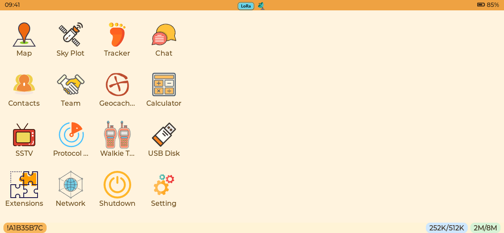
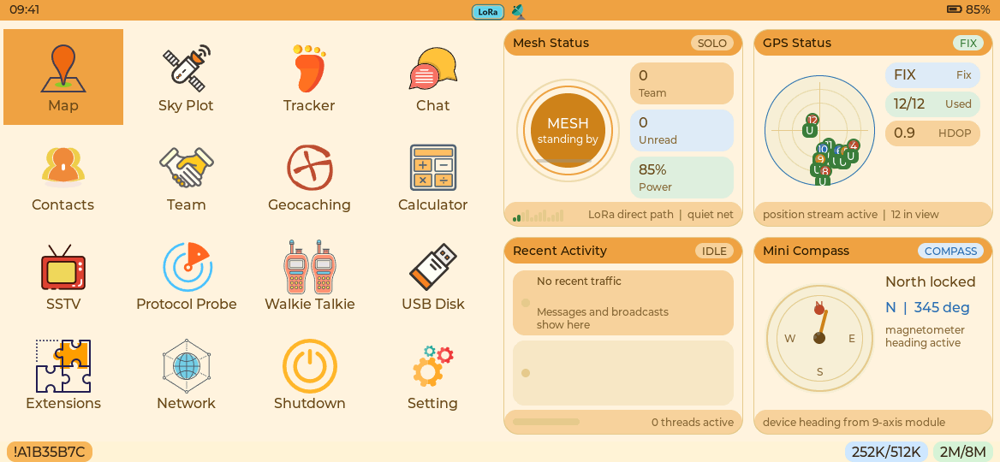
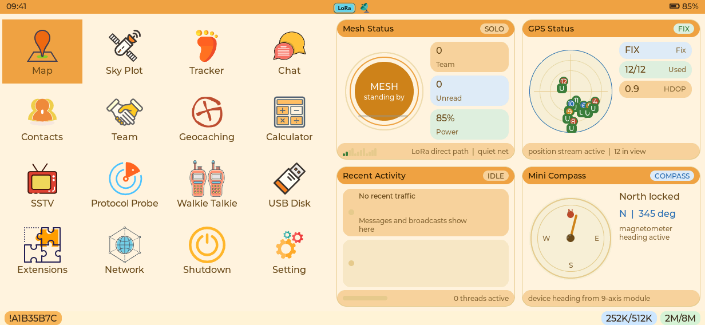

# T-Display-P4 layout and dashboard regression report

The P4 preview compiles the production LVGL pages and menu/dashboard widgets at
TFT 1168×540 and AMOLED 1232×568. Frames below come directly from RGB565 LVGL
output. Hardware/service values are supplied by the existing preview adapters;
the preview does not emulate ESP32-P4 PPA, DSI timing, SD latency or task scheduling.

## Dashboard restoration

The former dashboard did not connect panel deletion to timer destruction.
Deleting the panel left a live refresh timer holding the old widget addresses.
The regression test reproduced that ownership failure before the fix: its
deletion/rebuild check returned error 4. This establishes a use-after-delete
path, but does not identify the historical device coredump without its backtrace.

The panel now owns its DELETE cleanup, which cancels the timer and clears all
widget references. Reinitialization replaces the previous panel rather than
retaining an extra tree. Hidden dashboards do not refresh. P4 is enabled with a
one-second cadence; Tab5 retains its previous disabled setting.

Other changes:

- Resolve parent/card layout before deriving widget dimensions, and measure
  content dimensions rather than including padding in available space.
- Keep both rows of dashboard cards above the bottom status bar.
- Render the compass needle as an LVGL line with widget-owned points, avoiding
  rotation layers and their temporary render-buffer allocations.
- Widen the four launcher columns from 104 to 140 pixels so app names fit,
  while retaining the right-side dashboard area on both panels.
- Restore opaque keyboard focus styling on transparent launcher cards, so
  selecting an app has visible feedback.
- Let LVGL fit recent-activity names/previews using their pixel width and UTF-8
  character boundaries. Remove byte-count truncation that could split Chinese
  characters, and replace abrupt clipping with the label's ellipsis mode.

Before, with the dashboard disabled:



TFT, with the restored dashboard:



AMOLED uses its own panel geometry:



## Pager and Deck navigation alignment

The existing shared bottom-menu components already give P4 the later Pager/Deck
full-width content arrangement. The rendered checks exercise Chat, Settings,
Contacts, Tracker, Extensions and Network: content has no permanent filter
column, Menu remains in the bottom-right corner, its popup fits the viewport,
and ESC closes the popup before leaving the page.

The P4 keyboard adapter previously bypassed modal focus groups and sent ESC
directly to app exit. It now respects the active modal group, including the
top layer, and sends ESC to focused/page KEY handlers first. This preserves
compose → conversation → chat-list → launcher navigation. Shift+Tab traverses
backward and F1 maps to the function-key namespace used by Map Help.

## Display synchronization

Display registration and initial rotation now execute under one recursive LVGL
lock. Touch input registration also holds that lock. Display readiness is
published atomically, and brightness changes are serialized and update their
cached value only after the hardware write succeeds. The initial boot scene is
submitted before raising brightness.

The P4 display still uses independent LVGL/PPA buffers with dirty-area transfers.
Changing that ownership model or proving the absence of physical tearing needs
device measurements. The host renderer validates the UI object tree and pixels,
not the panel scan-out pipeline.

## Automated verification

`tests/site/p4-native-ui.test.mjs` exercises both panels, captures 18 page states
plus the six bottom-menu popups, verifies nested touch back navigation, and
performs 250 dashboard delete/rebuild cycles per panel. Each cycle initializes
the dashboard twice to catch duplicate trees. It also sweeps 24 compass angles,
changes GPS availability, checks drawable geometry/bottom-bar bounds, and verifies
that a hidden dashboard stops advancing its refresh state.

`tests/p4_keyboard` separately tests the production physical-key adapter against
real LVGL, including modal groups, page ESC, F1, Shift+Tab and recovery. Hardware
fault/locking tests are described in [the hardware audit](t-display-p4-hardware-audit.md).

The CI check **T-Display P4 Rendered UI** builds these previews with firmware
LVGL 9.5.0 and retains PNG frames plus JSON object coordinates for seven days.

## Reproduce

In an Emscripten 4.0.10 shell, point `LVGL_SOURCE_DIR` at LVGL 9.5.0 (commit
`85aa60d18b3d5e5588d7b247abf90198f07c8a63`):

```sh
emcmake cmake -S tools/web_simulator -B .codex-build/p4-preview/build -G Ninja \
  -DCMAKE_BUILD_TYPE=Release -DTRAIL_MATE_PREVIEW_P4=ON \
  -DLVGL_SOURCE_DIR=/path/to/lvgl-9.5.0
cmake --build .codex-build/p4-preview/build \
  --target trailmate_p4_tft trailmate_p4_amoled --parallel 2
P4_UI_ARTIFACT_DIR=.codex-build/p4-preview/artifacts \
  node tests/site/p4-native-ui.test.mjs
```

The preview's bundled map tiles cover a small sample area. Missing tiles on a
wider viewport are fixture coverage, rather than an alternative map layout.
Real map streaming, concurrent C6 traffic, sleep/wake and long-running panel
stability remain part of physical acceptance.
