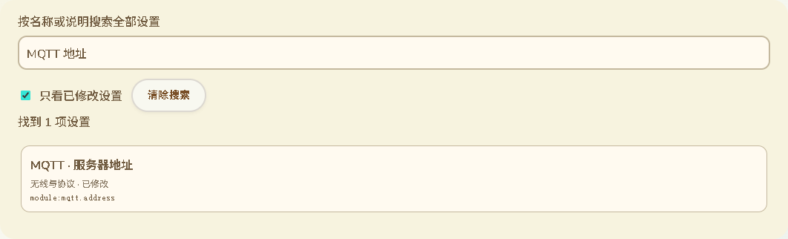
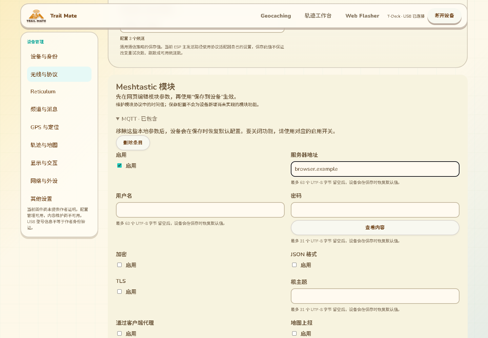

# 浏览器全部配置管理：规划草案

2026-10-13 用户范围修正：网页不展示蓝牙配置，不以 Meshtastic／MeshCore App 连接作为设备管理方式。蓝牙字段退出当前网页管理范围，录入／搜索／预览排除，备份导入保留当前设备兼容值，不开启相关功能。其他配置与 USB 身份管理继续保留，详见 [70](70-时间单位录入与网页配置范围修正.md)。以下旧版蓝牙录入记录不再表示当前产品要求。

2026-10-12 全局模块搜索补齐：原全局搜索只索引 TMS 字段，模块表单参数无法直接查找。现将结构化 Meshtastic 模块接入原配置搜索，按当前语言的模块/字段名称及稳定字段键搜索；点击结果后切换到既有“无线与协议”分类，展开折叠区并聚焦控件。未包含模块的参数定位到添加入口，搜索不自动添加或改写配置。GPIO 行保留索引定位，增删行及具体字段编辑支持“只看已修改”；尚未通过校验的输入也能被该筛选找到。定位完成即清除跳转请求，避免手动切换分类后重复展开。

搜索数据仅包含名称、说明、位置及修改标记，不索引密码、密钥、地址等配置值。未知格式或损坏模块保持原文，不尝试结构化定位。13 项搜索及模块模型/存在性测试通过；完整 Edge 设备页面测试包含未包含模块定位、已编辑 MQTT 地址定位、11 语言切换、修改筛选、密码值不匹配搜索、零新增串口命令及既有输入/备份/保存/窄屏回归。仅网页改动，不重编译固件或增加设备 RAM。

下图为实际页面渲染，使用模拟串口与合成配置，沿用现有 Pages 风格；不代表 Wio 实机界面或真实用户配置：

2026-10-12 模块导入与保存边界补充：已知 pb-v1 模块在备份导入完成前和配置上传前统一校验 TMS 分块、protobuf 字段类型及真实存储容量。错误模块不发送任何串口请求；包含模块错误的备份整体回滚候选编辑，保留当前配置。无模块能力及未来格式保持不透明，不误用当前 protobuf 解码。新增 3 项边界测试与既有保存测试共 6 项通过，网页构建通过；没有固件编译或 RAM 改动。此校验不替代设备端校验，也不证明未知格式可在当前固件应用。

2026-10-12 外部通知联动补充：依据 module_config.pb.h 的 use_pwm 注释，PWM=true 时禁用普通 output/output_ms/active 控件并显示 11 语言保留说明；关闭 PWM 后重新启用控件，不清空或改写任何保留值。模块 enabled=false 不禁止提前编辑参数。依赖与文案针对性测试共 4 项通过；实际 Edge 页面设置 output=13/output_ms=1234/active=true，切换 PWM 验证三控件禁用与恢复，原值保留，撤销模块后恢复零修改，无串口命令。网页构建及相关配置/备份/语言/上传浏览器回归通过，无固件编译或设备 RAM 改动。这仅落实协议明确规定的一项依赖，其他模块依赖与板型能力仍需核对。

2026-10-12 模块多语言补齐：其余 9 种语言的模块字段与枚举专用名称已补齐，读取语言表不再退回英文专用术语；MQTT、GPIO、I²S、NMEA 等标准缩写保留原名。文案覆盖测试按当前固件生成的 119 个字段及每个枚举选项核对 11 种语言，测试通过。实际 Edge 测试核对 11 语言下 MQTT 地址标签、串口模式标签与文本消息枚举选项，保留既有输入和 mode=3；每种语言的 390 像素窄屏均无横向溢出，语言切换无串口命令。模拟串口上传后的配置解码确认 MQTT 参数与串口 mode=3，内部版本保持 1。网页构建通过，无固件编译或 RAM 改动。此结果仅补齐模块文案与相关浏览器验证，不证明所有网页文案、模块业务联动、硬件能力或实机配置持久化完成。

2026-10-12 模块表单页面接入补充：MeshtasticModuleEditor 已接入既有“无线与协议”分类，模块原始 TMS 数据移至独立折叠区，沿用原页面主题与配置上传流程。模块动作及说明文案覆盖 11 种语言；119 个字段及所有枚举选项的专用名称目前覆盖英文和简体中文，其他 9 种语言仍暂用英文专用术语，不能认定完整多语言交付。实际 Edge 测试通过模块存在性增删、MQTT 密码 UTF-8 容量、错误输入阻止导出、切换分类后错误输入与提示保留、GPIO 四行容量及编辑、撤销全部模块变更后恢复零修改计数。11 语言切换保留模块输入，编辑和语言切换不产生串口请求。经现有上传/提交协议发送的配置包含预期 MQTT 开关、地址、合成测试密码，内部版本仍为 1；此为模拟串口端测试，不代替实机持久化。已检查实际页面截图 assets/implemented-device-modules.png。网页构建与 2 项文案覆盖测试通过，本轮没有固件编译。仍需补齐 9 种语言专用术语、模块业务联动及实机验证。

2026-10-12 可选模块与表单实现补充：新增可选模块存在性编辑，区分模块未包含与模块包含但 enabled=false；重复添加不重置原数据，移除不存在的嵌套模块不生成空父模块，定向移除保留其他模块、内部版本与根未知字段。存在性与 GPIO 行编辑共 6 项针对性测试通过。新增 MeshtasticModuleEditor 组件，复用现有 Card/Button 与配置表单样式，支持递归折叠模块、标量控件、未知枚举保留、密码隐藏、字节容量提示、错误输入保留并阻止保存、GPIO 行增删。组件及数据依赖通过独立打包检查；当前尚未接入主配置页，也尚未完成其多语言字段文案或实际浏览器交互测试，不作为已交付功能计数。本轮未编译固件。

2026-10-12 模块互操作验证补充：浏览器模块模型已支持 remote_hardware.available_pins 的增改删，最多 4 行，保留未编辑行及未知字段字节；3 项针对性测试通过。新增小型原生工具直接使用 Wio 当前依赖中的 nanopb 与固件生成描述符解码浏览器输出，MQTT、嵌套地图参数、负数阈值及重复 GPIO 行读取正确；字符串容量、uint8 溢出与第 5 行均被实际解码器拒绝。Windows 标准输入使用二进制模式，测试通过。此轮只增量编译该原生工具，没有编译设备固件，没有设备 RAM 改动。模块表单交互及多语言文案仍待接入，不能据此认定全部配置管理已完成。

2026-10-12 录入实现补充：定位模式、定位坐标格式、地图坐标系、地图来源、记录间隔、记录格式使用设备设置代码中的固定枚举，分别为 0/1/2、0/1/2、0/1/2、0/1/2、1/5/10/99、0/1/2。记录间隔 99 为按距离，不是 99 秒；记录格式为 GPX/CSV/Binary。选项文案覆盖现有 11 种语言，秒数用当前语言单位格式化。未知旧值保留为不可选的当前项，不静默改写；用户修改时拒绝不支持值。事实来源：`settings_page_components.cpp` 的 kGpsModeOptions/kGpsCoordOptions/kMapCoordOptions/kMapSourceOptions/kMapTrackIntervalOptions/kMapTrackFormatOptions 与 `gps/track_runtime.h`。

2026-10-12 文本容量补充：按 AppConfig 真实字符数组及 TMS 键映射，设备名称限 31 UTF-8 字节、短名称 15，Meshtastic MQTT host/root/username/password 63，APRS 呼号/tocall 15、path 63，route.path 95。字符数组保留终止符空间；网页按 UTF-8 字节而不是 JavaScript 字符数校验，不用 HTML maxLength 冒充字节预算。与固定选项合计 4 项针对性测试通过，覆盖中文恰好满容量及超限拒绝，设备网页构建成功。该限额不是完整字段覆盖矩阵，板型能力、独立存储与身份恢复仍待完成。

2026-10-12 无线联动补充：`mt.use_preset=true` 时禁止编辑保留的 bandwidth_khz/spread_factor/coding_rate，允许 modem_preset；切换自定义时反转这些控件可用状态，不删除或改写保留值。来源为 TMS writeMeshBase 的 `mt.` 键及 Meshtastic resolveRadioConfig 的 using_preset 分支。没有依赖字段或旧未知类型时保持原配置可读写，不猜测平台状态；设备端仍负责最终实际调制参数和平台强制预设。2 项依赖测试与实际 Edge 页面预设→自定义→预设切换回归通过，带宽保留 125，其他配置/备份/身份回归继续通过。网页构建成功，GitNexus 新模块 UNKNOWN，没有固件编译或设备 RAM 改动。

2026-10-12 Meshtastic modem_preset 改为具名下拉，按生成枚举的真实值支持 LongFast=0、LongSlow=1、MediumSlow=3、MediumFast=4、ShortSlow=5、ShortFast=6、LongModerate=7、ShortTurbo=8、LongTurbo=9；排序不改变保存值。弃用的 VeryLongSlow=2 在参数换算中落入默认分支，旧配置原值保留显示而不作为新选项。事实来源为 config.pb.h 与 mt_region.cpp。3 项预设/依赖测试及 Edge 配置页面回归通过，网页构建成功，未编译固件。

2026-10-12 群组身份引用校验：`rt.group.<slot>.destination_hash/identity_hash` 是可配置的群组引用，不是本机私钥身份，不标为只读。按 TMS assignBlob 的确切要求限制为 16 字节解码值，拒绝空值、短值及 32 字节误填；错误文案覆盖 11 种语言。2 项字段/文案测试通过，Edge 原设备页面回归通过，网页构建成功。没有增加本机身份导出/恢复能力，没有固件编译；GitNexus 影响分析 UNKNOWN。

2026-10-12 群组哈希录入支持 32 位十六进制（含可选 0x 前缀）和 Base64，按字段区分，不把其他二进制密钥的 Base64 误当十六进制。实际保存仍为同一 16 字节值及既有 TMS Base64 表示，字段长度校验继续生效。录入说明覆盖 11 种语言；4 项解析/持久字节/长度测试及 Edge 原设备页面回归通过，网页构建成功，无固件编译。

## 1. “全部配置”的完成定义

覆盖设备所有受支持的持久化用户配置，不仅 AppConfig，也包括 TMS 扩展、协议配置、板型设置及独立配置存储。派生值和状态标为只读；秘密配置可修改和经授权备份；不存在硬件能力的字段明确说明不支持。

实施首先生成配置覆盖矩阵：存储键/模型字段、默认值、读写接口、范围、设备设置入口、平台能力、秘密级别、生效方式、迁移版本、网页控件及验收用例。每个持久化设置必须有矩阵行。不能把现有 HostLink 能读到的字段当成全集。

代码起点：`modules/core_sys/include/app/app_config.h`、`platform/esp/arduino_common/src/app_config_store.cpp`、TMS 配置扩展、`docs/config_persistence_architecture.md`、`docs/reticulum_network_config.md`。当前 Reticulum 网络配置事实来源为 `/trailmate/config.tms`。

## 2. 配置 schema

每个字段声明稳定 field_id、类型、单位、枚举、范围、UTF-8 字节长度、默认值、可读/可写、秘密级别、依赖条件、所属事务组和生效策略。列表声明最大项数、稳定项 ID 和允许操作；schema 是数据，不携带可执行 JavaScript。

顶层返回 schema_version、schema_hash、config_generation、板型 capability。Reticulum 接口使用稳定 ID 编辑，不依赖会移动的数组下标。密码快照返回 has_value/changed 状态，明确区分保留、替换、清空。

## 3. 串口事务

1. 获取 schema 和带 generation 的一致快照。
2. CONFIG_BEGIN(expected_generation) 创建有界候选事务。
3. CONFIG_PATCH 上传类型化 patch；未出现字段保留原值，null 不隐式表示清空。
4. CONFIG_VALIDATE 返回字段错误、依赖错误和生效计划。
5. CONFIG_COMMIT(operation_id, expected_generation, patch_hash) 再次校验并持久化。
6. 查询提交状态，并重新读回 generation 与有效配置。

持久化失败不能报告保存成功。保存成功但运行时应用失败，返回 SavedApplyFailed，并展示存储值/有效值差异及恢复操作。协议切换不得造成一半字段写入。跨存储配置先建立协调日志和恢复机制；无法保证整组原子提交时，必须由 schema 显示事务边界，网页不得声称“全部原子保存”。

设备端设置并发修改导致 generation 冲突，返回字段差异，用户重新合并；禁止静默覆盖。恢复默认与备份导入也走同一验证和提交路径。

## 4. 输入与交互

| 分组 | 录入要求 |
|---|---|
| 协议与无线 | 协议选择、预设/自定义参数联动，板型功率范围、频率与单位明确 |
| Reticulum | 接口卡片、添加/删除/启停、host/port 校验、IFAC 名称/口令、传播节点与同步策略 |
| MQTT/APRS/频道 | 地址与端口分开输入，密钥格式说明，呼号和频道依赖校验 |
| GPS/Tracker/Route | 时间单位、录制策略、格式、路线对象选择；不手填未经验证的设备文件路径 |
| 地图/显示/电源等 | 能力驱动控件，缺少硬件时说明原因 |
| 身份与秘密 | 指纹核对、显式替换/清空、单独的备份恢复入口 |

前端即时校验提高录入效率，设备校验具有最终权威。保留未保存草稿；切换页面、断线及刷新前展示修改状态。恢复连接先确认同一设备，再检查 generation，不自动提交旧草稿。

## 5. 备份与覆盖验收

备份含格式版本、来源板型、schema_hash、时间、类型化配置和秘密包含标志。敏感完整备份加密并由用户下载；恢复展示兼容字段、忽略项、秘密变化及生效计划，不执行备份中的代码或任意路径。

验收要求：覆盖矩阵无遗漏；所有写项完成写入/读回/重启恢复；秘密的保留与清空无歧义；跨板型导入可解释；设备端同时修改可检测；掉电提交可恢复；新固件未知字段不会被旧网页删除。

## 6. 当前集合编辑实现与边界

设备管理页面已加入 Reticulum 接口和已保存 Wi-Fi 卡片。接口增删、启停、排序、TCP 地址、AutoInterface 参数以及可选 IFAC 名称/口令/位数可维护；Wi-Fi 条目可增删、排序和修改 SSID/密码。计数由集合操作维护，不再作为独立数字输入。按接口类型展示主要字段，暂未使用的参数可展开维护，并保留原值。

当前 TMSET7 固件要求保留全部 6 个接口槽的 8 项基本字段，interface_count 指定有效前缀；LoRa/Auto 各最多一个，TCP 最多三个。Wi-Fi 最多 10 条，只保留实际数量对应的连续记录。增删及重排在浏览器候选文档完成，不增加固件 RAM。剩余条目的扩展字段跟随条目移动；未改动设置及未启用接口槽保留。删除条目会移除该条目的口令和可选字段；新增 TCP 初始禁用，必须填写地址后才可提交，新增空 Wi-Fi 必须填写 SSID。

检查覆盖数量/类型、重复 ID/SSID、主机与端口、UTF-8 字节预算及 IFAC 组合，错误阻止上传。删除字段也计入修改比较。提交仍复用现有完整 TMS 上传和基哈希冲突检查，由设备最终验证；不宣称所有规划中的 patch/事务接口已经实现。

集合备份已支持数量变化的恢复：完整集合连同计数、行顺序及已支持字段一起恢复；剩余设备扩展按接口稳定 ID 或 SSID 关联保留，兼容且可编辑的扩展可以恢复，未知或只读扩展列为跳过项。删除行不把旧口令/IFAC 留在重新空出的接口槽。备份未包含集合则保留设备集合；设备未提供该集合则跳过。包含行却缺少数量、不完整三项 IFAC、类型不兼容、重复项、未启用槽存在 IFAC 等错误使整个导入退回原候选文档，不应用其他标量修改。导入确认显示新增、删除、口令/密钥变化和跳过项数量；导入本身不写入设备。

配置相关 28 项 Node 测试、页面构建及 Edge 模拟 USB 流程通过，覆盖增删/排序/IFAC、空值和重复阻止、字段保留、数量变化恢复、导入失败不改编辑区、导入后的实际上传文档和基哈希、原断线传输恢复及 390px 溢出检查。所有配置依赖录入、身份备份轮换以及真实设备写入/重启/掉电验收仍未完成；当前不能判定“全部配置维护”已经交付。

## 7. 加密配置备份实施

默认导出入口为加密配置备份 `.tmbak`，在现有保存栏打开原生对话框，输入至少 12 个字符的口令并再次确认。导入按文件内容识别加密备份，解密成功后仍走完整兼容检查及新增/删除/秘密变更确认；没有自动设备提交。错误口令、篡改或不完整内容不改变编辑区。旧 `.tms` 可继续导入；明文导出放在明确标注的兼容入口，另有确认。备份口令只用于文件，不增加网站账号登录。

版本 1：40 字节认证头由 `TMBKENC1`（8 字节）、PBKDF2 次数（u32 大端，固定 600000）、16 字节随机盐、12 字节随机 nonce 组成；后接 AES-256-GCM 密文及 128 位标签。认证附加数据为完整头，明文仅为 kind=backup 的 TMSET7 文档。PBKDF2 使用 SHA-256，密钥不可提取；由浏览器 Web Crypto 计算。次数参考 [OWASP PBKDF2 工作量建议](https://cheatsheetseries.owasp.org/cheatsheets/Password_Storage_Cheat_Sheet.html#pbkdf2)，算法 API 与认证参数遵循 [W3C Web Cryptography](https://www.w3.org/TR/webcrypto/)。

加密明文可包含来源记录：`TMBKMETA1`（9 字节）+ JSON 长度（u16 大端）+ 至多 1024 字节白名单 JSON + 原 TMSET7 备份。来源包含版本 1、规范 ISO 导出时间、至多 64 UTF-8 字节的型号/固件，以及可选作者指纹/身份代次成对记录。网页只在设备连接且作者证明有效时记录作者；来源数据由网页记录，不是设备对备份内容的签名证明。整个来源与配置都受 AES-GCM 认证保护。旧的仅含 TMS 的加密文件继续可读。

解密在派生密钥前拒绝未知版本/次数与超过 33859 字节的文件，来源上限 1024 字节，TMS 上限仍为 32768 字节。每次导出独立盐/nonce；输入在异步操作前冻结。应用不把口令、派生密钥或解密内容写入 localStorage；关闭对话框清除输入状态，恢复触发按钮焦点。临时字节缓冲会清零，但不宣称 JavaScript 字符串能够保证从内存擦除。

正确解密后先显示来源，未点击“继续检查导入”时不改变编辑区；备份记录作者/代次与当前已验证作者不同会提示，当前未验证则说明不能核对。旧文件没有来源记录时明确显示。继续后仍有字段/集合兼容检查与新增/删除/秘密变化确认，不自动写设备。

配置加密备份不包含设备身份私钥，身份备份/恢复/轮换需要单独设备接口，仍未完成；来源签名和 schema_hash 等元数据也仍待完善。所有加解密在浏览器，本轮无固件 RAM 增量。

34 项配置/备份/文档 Node、页面构建及 Edge 实际加密下载/解密导入通过。测试覆盖错误口令、盐/nonce/密文/标签篡改、固定 KDF 成本拒绝、每次随机值不同、异步输入冻结、来源白名单/容量/配对验证、旧文件兼容、Node 与 Edge 密文互通、解密后先检查来源、代次不同提示及取消保留编辑、Esc 清空、Enter 提交、错误导入保留编辑、无新增串口命令/设备提交、口令不进 localStorage 与 390px 对话框溢出。
# Meshtastic 模块结构化维护实施补充（2026-10-12）

当前生成描述模型已建立：脚本从仓库 localonly.pb.h 和 module_config.pb.h 提取 LocalModuleConfig 可达的 16 个消息、119 个字段，保留编号、类型、枚举、字符串字节容量、重复消息数量和窄整数存储范围。--check 校验生成模型与当前头文件一致，缺少/不支持描述时失败，不静默丢字段。模块 MQTT 地址/用户名容量为 63 字节，密码/主题根为 31 字节；部分音频引脚限 255，内部 version 字段保持只读。

浏览器结构化读取与单值字段更新已接入此模型，覆盖布尔、UTF-8 字符串、无符号/有符号整数、枚举、可选消息和重复消息读取。字段更新同步回 TMS 三段容器，保留其他数据与未知字节；读取检查每个重复单值的 wire/value，不以最后正确值掩盖较早坏值。十三项模型/wire/容器测试通过，含负数 INT32、未知字段、枚举拒绝、容量及源文档保持。本轮没有固件编译或设备 RAM 改动。模型尚未接入网页表单；重复字段写入、业务语义约束、多语言控件及真实 nanopb 互操作仍需完成。

protobuf 字段保留基础已新增 module-protobuf-wire.js：限制当前 673 字节容器，解析 varint/fixed64/bytes/fixed32 和匹配的未知 group（深度不超过 16），未修改字段保留原始字节，包括非最短 varint。按已知单值路径修改时只替换目标字段与父消息长度；同一单值嵌套消息的多个出现按 wire 顺序合并后修改，避免丢掉较早消息中的其他字段。重复单值叶子一起替换，删除叶子保留显式父消息存在性。重复字段/数组必须由后续 schema-aware 控件处理，不能误用单值接口。

五项 wire 测试和三项容器测试通过：覆盖未知字段/版本字节保留、嵌套修改、重复消息合并、单值重复、缺失路径创建、删除、固定字段/group、截断/溢出/错误 wire 与容量拒绝。没有固件编译或设备 RAM 改动。当前仅完成底层字节编辑，并未接入网页控件；字段类型、合法值和真实 nanopb 互操作仍待依据当前生成描述继续实现和验证。

已新增浏览器 `meshtastic-module-document.js`，按仓库当前 LocalModuleConfig 最大 673 字节、固定三段、每段 240 字节校验 TMS 容器。模块替换返回新的配置文档，同时更新总长度及三段内容；缩短时清空后续段，失败不修改源文档，其他已编辑字段和未知扩展原文保持。测试直接核对当前生成头文件常量，覆盖 240/480 字节边界、最大长度、缩短、错误容器和文档往返，共三项通过，没有固件编译或设备 RAM 改动。

此模块只完成容器拼接和原子替换，不验证 protobuf 内部语义，不代表模块维护界面已完成。下一步需要依据当前 nanopb 字段描述建立结构化字段模型、保留未知字段，并接入有名称和约束的模块控件；最终仍由设备 protobuf 解码/校验器验收。
