# 网页 UI/UX 与渲染设计

## 实际设备记录导入补充

现有轨迹工作台左侧设备记录卡片已接通快照构建、进度、取消、完整文件校验及浏览器草稿导入。录制中的文件禁用导入；旧固件只显示已支持的列表功能。右侧沿用现有地图、统计和 KML 编辑界面，导入不会自动发布网络。下图来自实际 Edge 页面及模拟串口回归，展示 GPX 快照转换后的可编辑 KML。

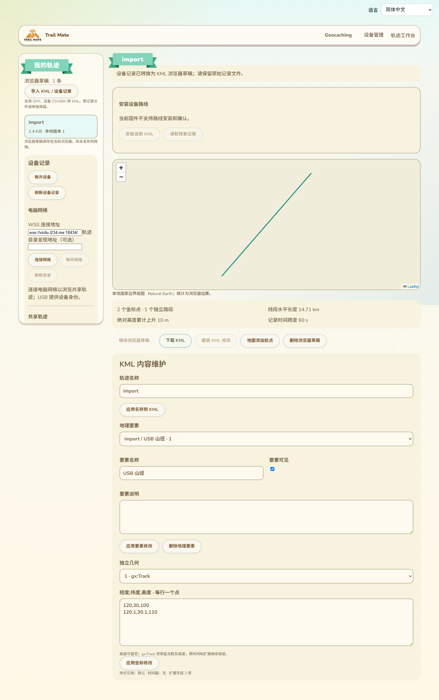

修订说明：本文件旧图未充分体现现有 Pages 的结构和组件。站点风格、导航和功能位置以 [07-现有Pages集成与修订渲染](07-现有Pages集成与修订渲染.md) 为准；本文件保留录入、确认、任务及异常状态的交互规则。

状态：可审阅的交互原型，示例数据；不连接真实串口、不执行网络发布。打开同目录 `ui-preview.html` 可切换七种状态、编辑输入、查看变更、提交发布及模拟目录确认。

## 1. 产品入口与身份

沿用现有网页的自然绿色、暖色纸面与圆角视觉语言，正式实现继续复用当前 Animal Island UI 组件。本原型以可检查的 HTML/CSS 渲染，不引入新生产依赖。

全局导航为设备配置、Geocaching、轨迹与路线。右上角始终呈现连接状态、设备昵称/型号和作者指纹。没有注册、登录、退出账号菜单；“连接设备”“断开”即身份会话入口。浏览者无需设备；维护动作需要设备身份。

首次连接：用户插线 → 点击连接 → 浏览器原生串口选择器 → 协议握手 → 识别设备 → 展示昵称和指纹 → 进入维护。原型中的“演示选择设备并连接”只是模拟，正式页面不得仿造浏览器权限窗口。权限拒绝、端口占用、设备不支持管理协议、不支持 Web Serial 分别显示原因与下一步。

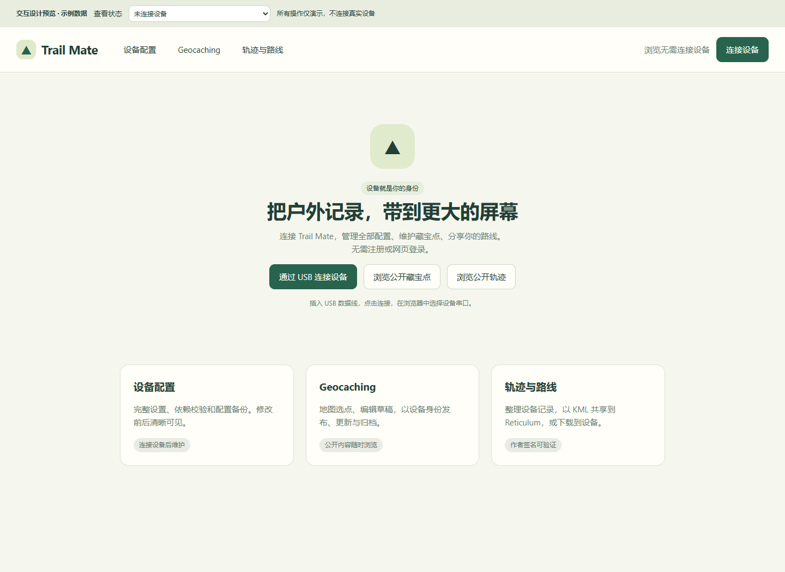

## 2. 设备全部配置

左侧按任务分组，右侧显示当前分组表单。正式实现分组从全配置覆盖矩阵确定；原型展示 Reticulum 复杂录入，不代表其他配置可以遗漏。

接口以稳定 ID 编辑，地址/端口分别输入，启用与移除是不同操作。枚举用选择器；数值显示单位与板型范围；依赖字段在条件满足时展示；隐藏字段保留原值。添加按钮达到能力上限后禁用并说明上限。

口令输入不展示旧值，留空保持；替换和清空使用明确动作。校验错误显示在字段旁，错误摘要可跳转定位。错误未解决时不能提交，设备校验返回相同字段 ID 以定位。

底部变更条常驻：显示未保存数量、保存后的影响、放弃及“查看变更并保存”。确认面板逐项显示旧/新值，秘密显示“已替换”，不显示明文。提交中防重复；成功后读回配置，并区分已保存且生效、已保存待重启、已保存但应用失败。

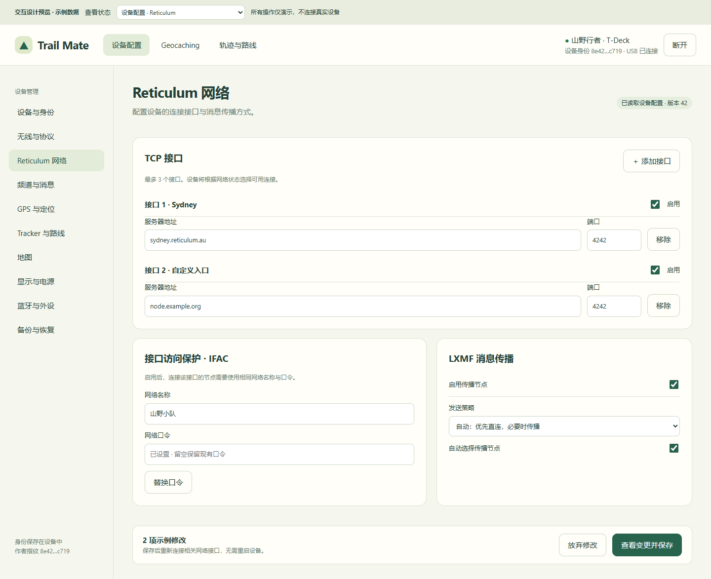

设备端并发修改触发差异合并：每个冲突字段选择设备值或网页值，不用一个“强制覆盖全部”按钮解决。合并后重新校验和生成提交摘要。

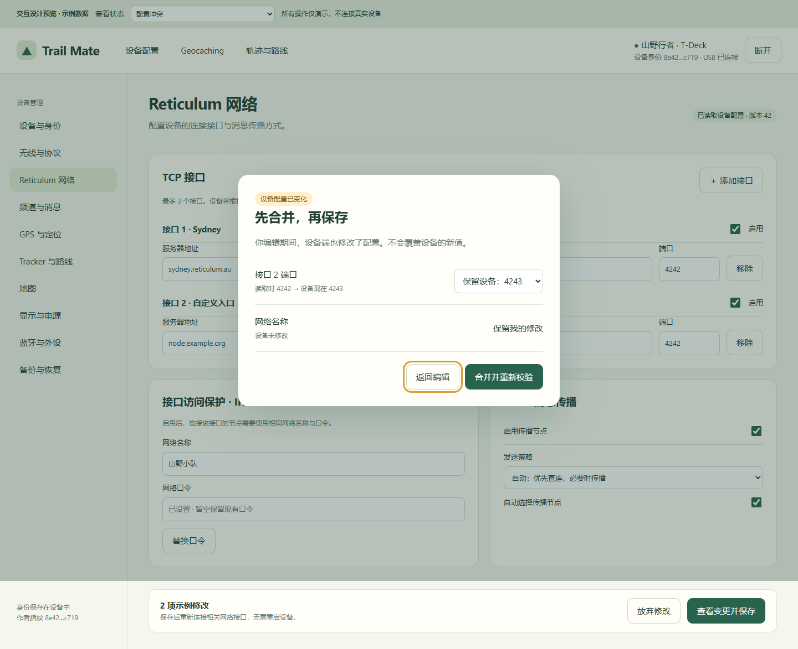

配置备份/恢复单独入口：选择文件 → 展示来源/schema/秘密包含情况 → 兼容性检查 → 逐组预览 → 同一配置提交流程。身份备份/恢复进一步单列，并有设备确认。设备概览可以显示只读状态，但不使用装饰性指标替代完整设置。

## 3. Geocaching 作者工具

二级导航：浏览、我的藏宝点、草稿、发布任务、归档记录。“我的”始终指当前设备作者公钥。未连接可以浏览；点击维护入口时引导连接，保留用户浏览位置。

桌面采用编辑表单与地图双栏：名称、坐标、正文、提示、难度、地形和容器大小等完整字段按当前协议提供。原型只画代表性字段，正式实现以记录模型为全集。正文显示 UTF-8 字节预算；坐标支持地图选点和精确输入，统一 WGS84。

草稿保存与公开发布分开。发布预览显示作者、缓存 ID、新旧版本、公开坐标、目标目录和字段校验结果。更新必须绑定上一版哈希；归档详情先显示后果，再生成新版本提交。归档不是本地删除。

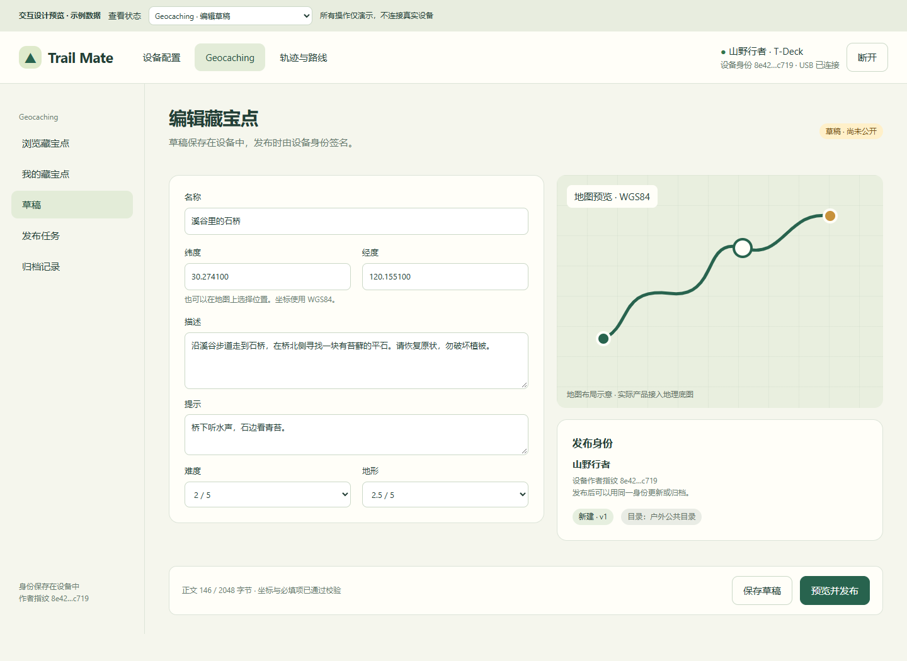

“我的藏宝点”使用列表/地图联动，状态显示草稿、已公开、待确认、已归档及冲突。详情提供编辑、历史、归档；非当前作者条目仅提供浏览/下载。“我的”列表区分设备已知记录与目录查询结果，不声称本地数据是全网全集。

## 4. 轨迹与路线

二级导航：浏览公开路线、设备记录、我的共享、发布任务、归档记录。设备记录列表显示名称、录制时间、格式、大小和是否仍在录制。活动录制条目只能预览/生成封闭快照，不直接发布可变文件。

共享向导：选择设备记录 → 生成 KML 副本 → 地图/分段/文件预览 → 编辑名称描述 → 可选隐藏起终点 → 选择目录 → 核对设备作者 → 提交。裁剪改变共享文件 hash，原始记录保持。未经验证的几何统计不能标成设备核验。

桌面地图与内容表单双栏，窄屏先地图再表单。下载 KML、保存草稿、共享是不同动作。原型地图是明确标注的布局示意，正式地图接入真实底图、轨迹和坐标；截图中的距离、点数及文件大小均为示例。

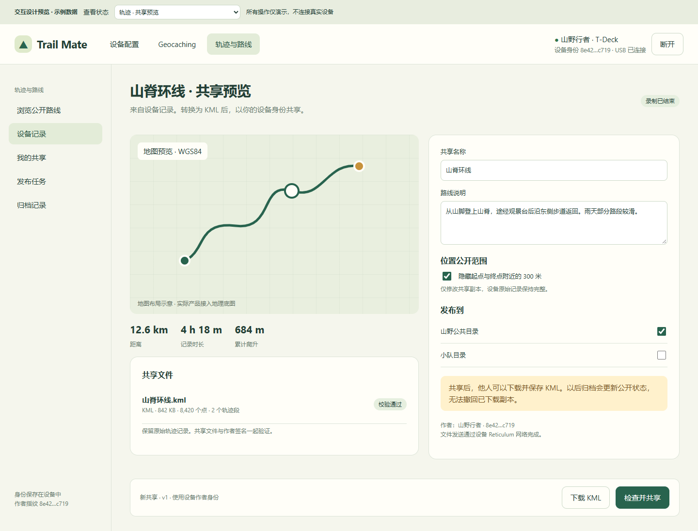

公开条目详情展示作者验证、版本、KML 下载、保存来源及归档状态。连接设备后提供安装为路线；安装前检查目标能力和空间。作者自己的条目可更新和归档。分叉条目显示冲突及来源，不自动选择“最新收到”的版本。

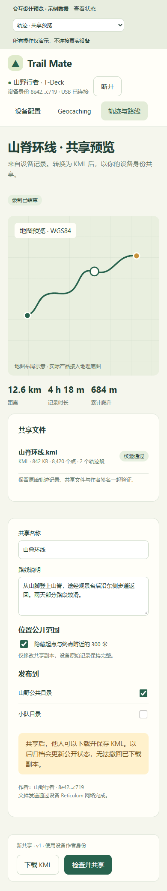

## 5. 任务、断线与恢复

统一任务页用于配置长操作、Geocaching 和轨迹发布。轨迹发布四步：设备签名、文件保存、条目提交、目录确认。每步采用真实协议事实，文件发送完成不等于发布成功。多目录分别显示结果，部分成功允许补发失败来源。

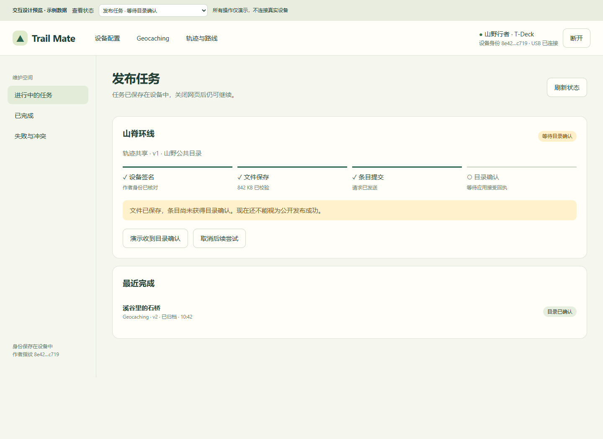

断线显示全局提示：未保存草稿保留；设备已受理任务可能继续。维护按钮禁用，浏览功能保持可用。重连后先核对设备及作者，再读取配置 generation 和任务状态。另一设备身份连接时不自动恢复原身份任务；显式允许切换并保留旧草稿。

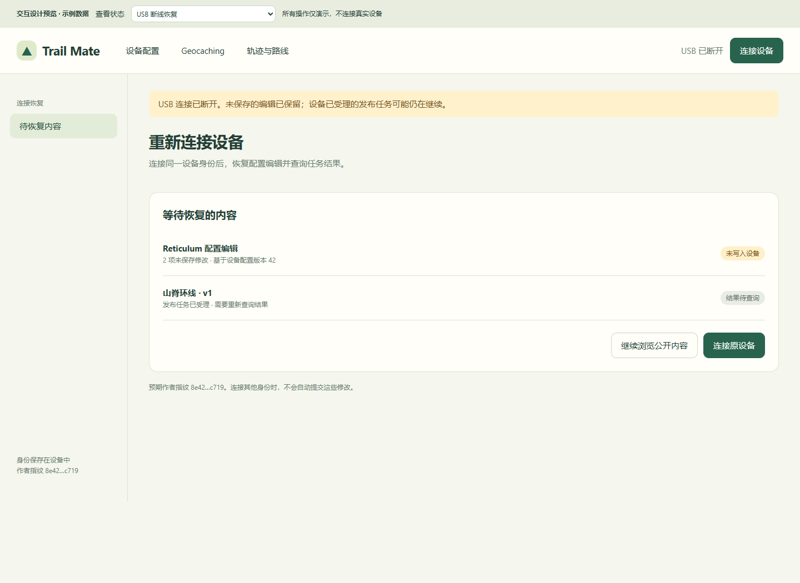

取消按钮说明仅停止后续尝试，不能撤回已发送请求。超时使用“结果未知/待查询”，不直接表示“目录未收到”。晚到回执恢复实际状态。发布确认已显示一次的操作，重复点击或重连不会生成新版本。

## 6. 状态与协议映射

| UI 动作/状态 | 协议依据 |
|---|---|
| 已连接设备、身份指纹 | HELLO、GET_CAPABILITIES、AUTHOR_INFO/PROVE |
| 表单及范围/依赖 | CONFIG_SCHEMA + CONFIG_SNAPSHOT |
| 未保存修改 | 浏览器本地 patch；尚未调用 COMMIT |
| 保存确认 | CONFIG_VALIDATE 的差异与生效计划 |
| 配置冲突 | expected_generation 校验失败 |
| 草稿保存 | DRAFT_PUT 返回持久化结果 |
| 发布预览 | CACHE/TRACK_PREPARE 返回内容摘要和版本 |
| 已受理任务 | COMMIT 返回持久化 operation_id |
| 文件保存成功 | 完整文件哈希校验和保存回执 |
| 已公开/已归档 | 对应版本的目录应用接受回执 |
| 断线恢复 | 核对身份、CONFIG_COMMIT_STATUS、JOB_GET |

## 7. 可用性与后续验收

键盘可完成连接入口、导航、输入、校验和确认；原生 focus 保留。状态不能只依赖颜色。正式对话框补齐焦点锁定、Esc 关闭和关闭后焦点恢复；原型用于设计审阅，不宣称已实现完整无障碍。

主要维护目标是桌面浏览器；窄屏支持布局重排，不据此承诺手机 Web Serial 支持。输入和按钮不溢出 390px 宽度。页面正文不出现 request_id、二进制帧和协议栈等实现细节；排障入口可下载脱敏诊断。

验收除了截图还要覆盖完整流程：连接 → 编辑 → 字段错误 → 修正 → 变更确认 → 保存读回；草稿 → 发布 → 回执；设备轨迹 → KML → 共享 → 下载安装；断线/错身份/配置冲突/多目录部分失败。复杂地图编辑与批量操作需后续补细节页，并复用这里的身份、事务和任务状态。

当前已渲染七个桌面状态与一个窄屏状态；渲染脚本检查浏览器脚本错误、配置保存交互和窄屏水平溢出。规划原型截图可由 `render-ui.mjs` 重新生成。

### 已实现页面的发布确认与恢复截图

以下为 `tests/site/geocaching-maintenance.browser.mjs` 运行实际页面所得，保留原 GitHub Pages 的地图、导航、颜色及卡片样式。设备/目录回复使用模拟 USB，不能作为真实 RNS 发布验收。

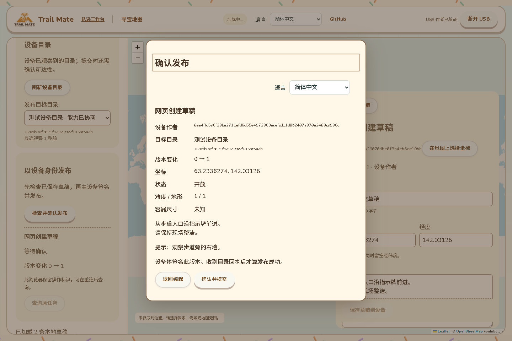

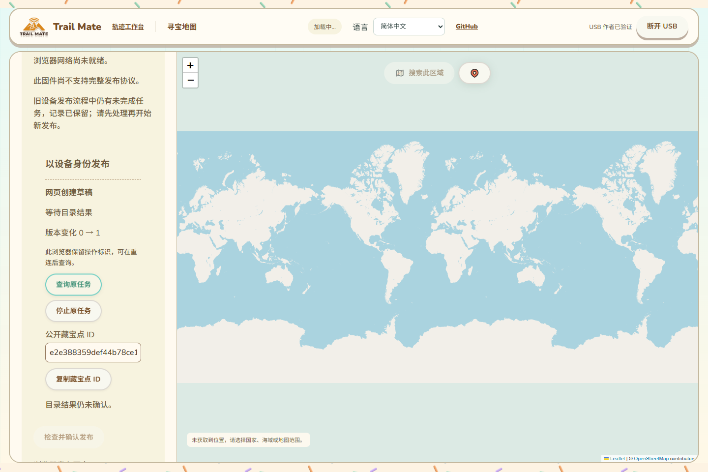

原任务卡新增“停止原任务”，先展示本地停止确认和目录可能已收到的说明；选择“保留任务”不发送命令，确认才发送原操作 ID。Busy 重试完成后显示本地已停止，仍可查询或复制公开 ID；后续目录确认会更新为确认状态。浏览器“暂停等待”只停止本地查询/等待。

停止请求发送前，浏览器保存“停止待确认”。停止结果不明确或刷新网页时保留原操作及该状态，不显示“恢复原提交”；重连后可查询或再次停止。只有设备回执证明本地持久停止或目录确认，才更新为对应完成状态。

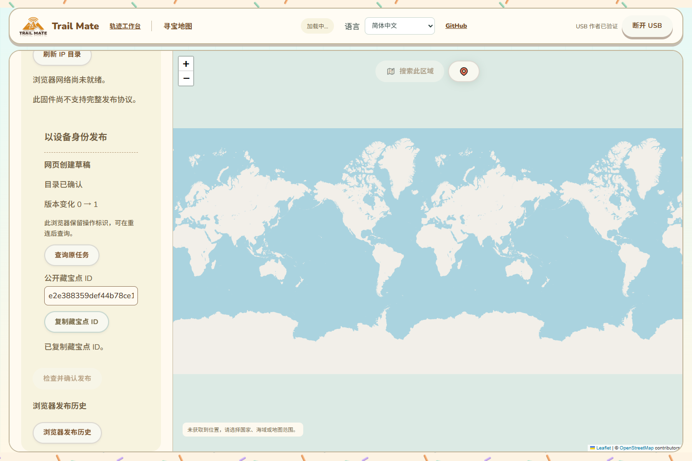

### 已实现设备配置集合截图

以下为实际设备管理页面在 Edge 模拟 USB 下运行所得。Reticulum 分组提供接口卡片、类型相关字段、可展开保留参数及 IFAC；网络与外设分组提供 Wi-Fi 条目。增删/排序只修改编辑区，经过校验及保存确认后才上传。截图不作为真实硬件配置生效验收。

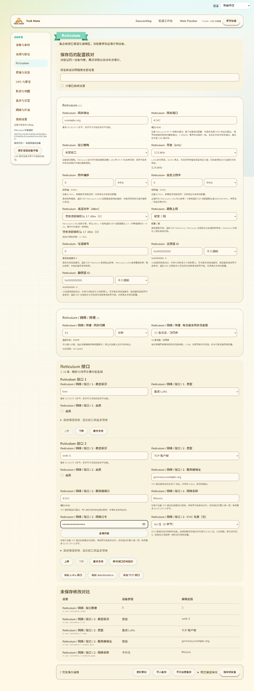

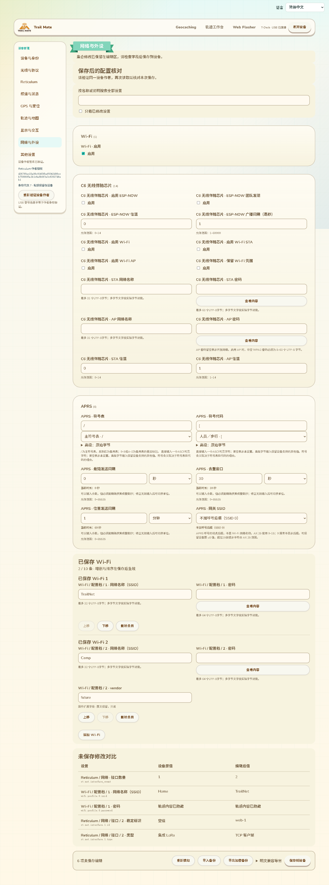

### 已实现加密配置备份

保存栏默认导出加密备份，口令双次输入、取消/键盘提交及焦点恢复使用原生对话框。导入识别加密文件后输入备份口令，正确解密仍需确认导入和显式保存；明文导出在兼容入口。本口令只用于文件，USB 设备连接无需网站账号；当前配置备份不包含设备身份私钥。

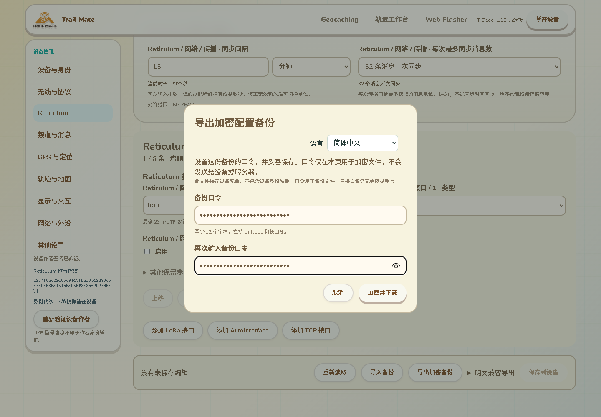

解密成功后先检查型号、固件、时间及备份记录作者，作者/代次不同会提示。来源信息由导出网页记录，并不构成设备备份签名；点击继续后才进入字段/集合导入确认，取消不会覆盖编辑区。

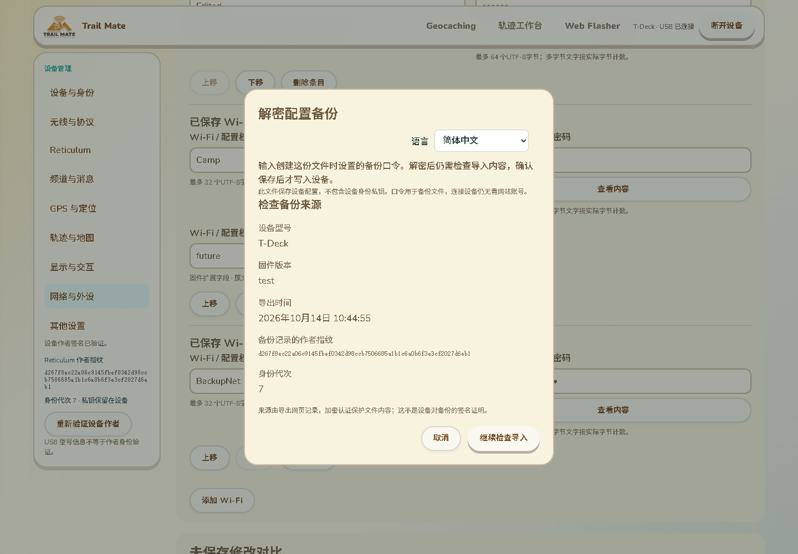

### 已实现浏览器轨迹工作台

现有 Geocaching 及设备管理页顶栏加入“轨迹”，进入复用同一风格的轨迹工作台。左侧为当前浏览器的未发布草稿，右侧为地图、统计、文件及要素/独立路段编辑。KML 原文与未编辑内容保留；设备和网络能力未接入时明确说明，不能把本地保存显示成公开发布。

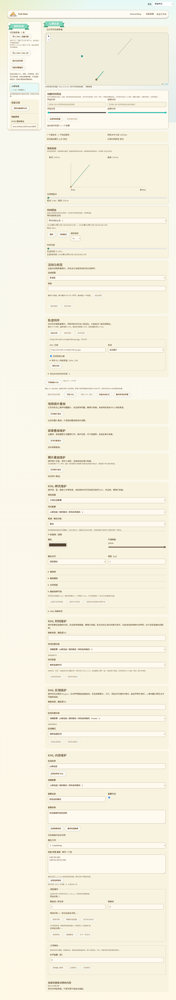
# 实际设备记录列表补充

轨迹工作台左侧“我的轨迹”保留本浏览器草稿列表，下方“设备记录”卡片使用实际 Web Serial 连接。卡片提供连接/断开、刷新、继续分页，记录显示原始格式、字节大小及正在录制状态。设备列表独立滚动，不把记录当作已经导入或发布。当前固件操作 80 可读取目录，81 文件导入继续待接入。

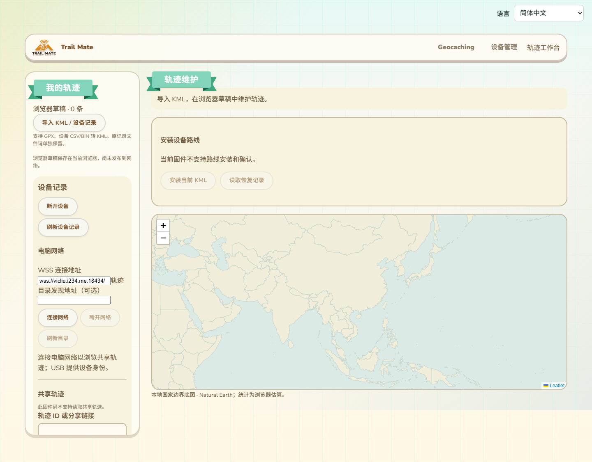
