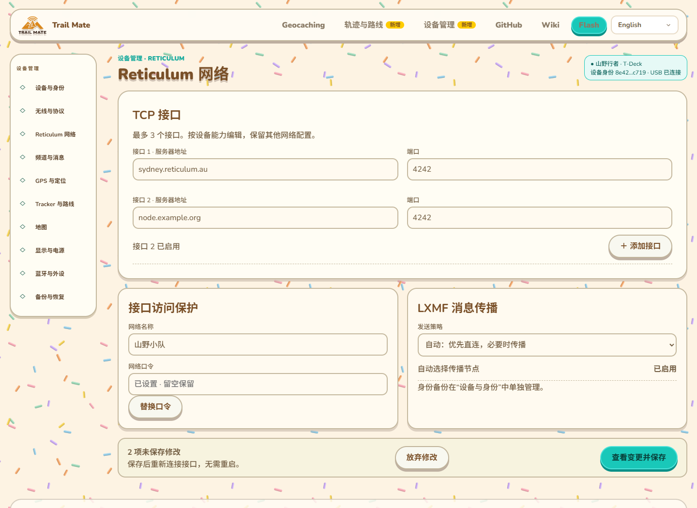
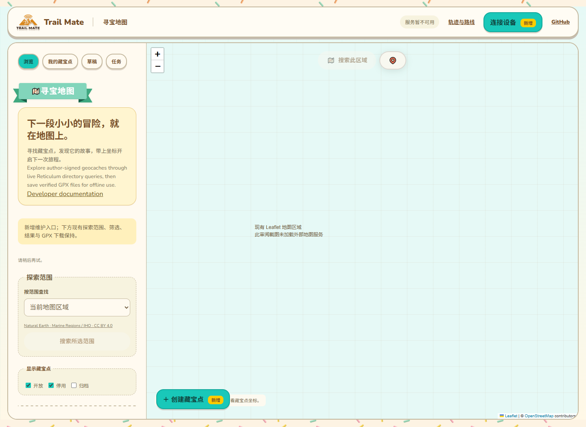
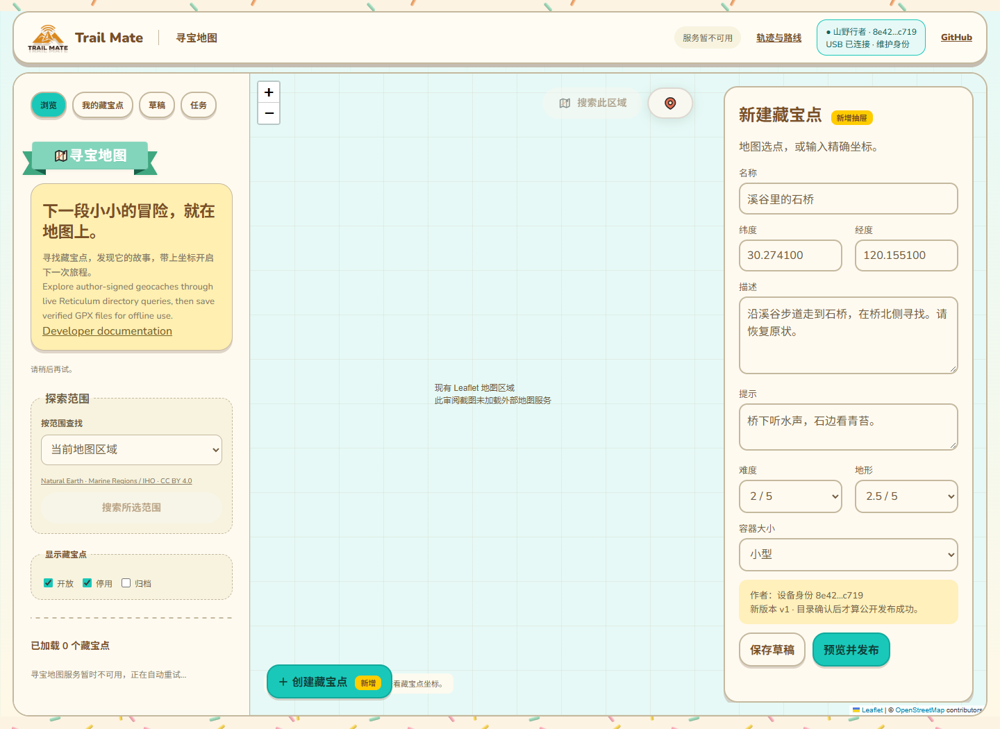
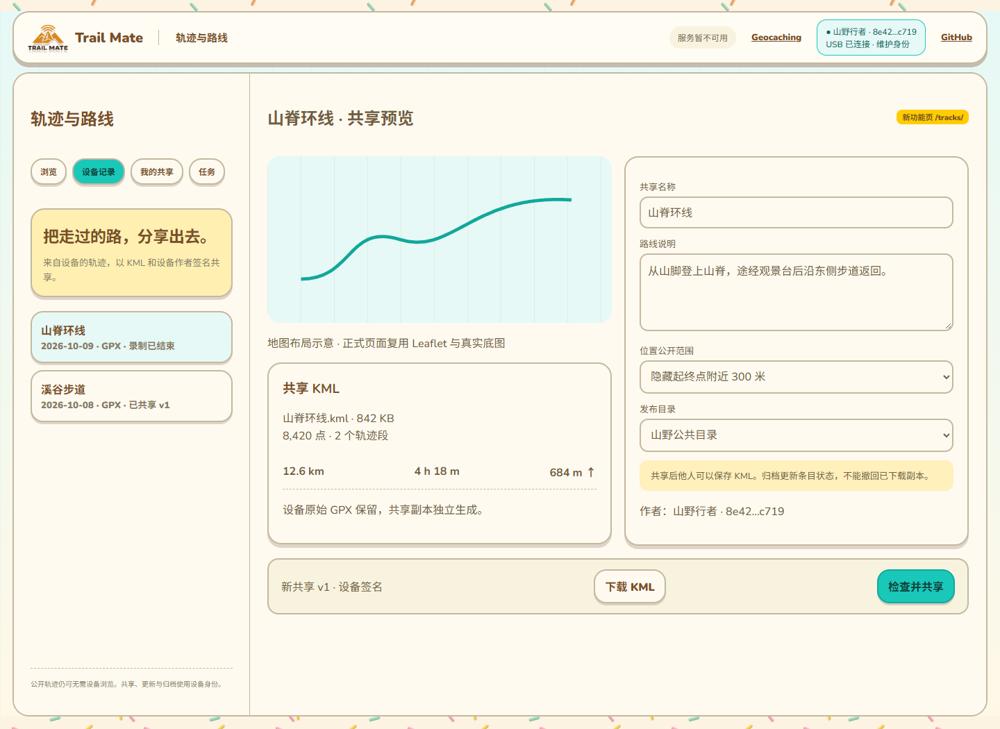

# 现有 GitHub Pages 集成方案与修订渲染

本文件替代 06 中独立工作台的站点布局方案。06 的字段录入、任务和断线规则仍可复用；其旧渲染图不再作为风格和导航实施依据。

## 1. 本次核对的真实站点

- `site/index.html`：产品首页，顶栏已有 Geocaching/GitHub/Wiki/Flash/语言选择；侧栏包含概览、交互指南、能力、功能、Geocaching、语言包、Web Flasher、文档。
- `site/components.jsx`、`site/styles.css`：Animal Island UI、真实品牌图片、彩色纸屑背景、暖棕文字、青绿色按钮、米色卡片、描边和抬高阴影。
- `site/geocaching/src/island-shell.jsx`、`page.js`、`page.css`、`theme.css`：独立地图应用；范围包含地图/国家地区/海域，状态筛选包含开放/停用/归档；保留结果分页、选择、详情和 GPX 下载、定位和地图搜索、服务重连与刷新逻辑。

新图由上述真实页面运行后的 DOM 加入设计提案生成，引用现有 CSS 和组件资源，不用另造站点外壳替代现有页面。没有修改生产站点文件。黄色“新增”标签仅是审阅标注，正式页面不保留。

## 2. 页面位置

| 入口/功能 | 位置与路径提案 | 对现有功能的影响 |
|---|---|---|
| 设备管理 | 首页顶栏、侧栏新增入口；新 `/device/` 页面 | 保留首页所有产品内容及模拟器/刷机/语言包入口 |
| 轨迹与路线 | 首页 Geocaching 旁新增入口；新 `/tracks/` 页面 | 新增同级户外内容页面，不取代设备 Route/Tracker |
| Geocaching 作者维护 | 现有 `/geocaching/` 内新增模式与编辑抽屉 | 复用原页面与 worker，不另建重复的藏宝点浏览器 |
| 连接设备 | 功能页顶栏右侧；首页设备管理入口 | 替代账号登录，目录连接与 USB 状态分别显示 |
| 刷机 | 仍在原 Web Flasher | 与管理串口互斥；进入刷机前关闭维护会话 |

路径都相对于 GitHub Pages 项目前缀解析，例如 `/trail-mate/device/`，不能硬编码网站根路径。多个页面之间导航会重新建立串口会话，不能声称连接跨页面自动保持；维护时在当前页内切换子模式。重新进入功能页时利用已授权端口恢复，并核对身份和任务。

## 3. 首页：加入口，保留产品介绍

顶栏在 Geocaching 后增加轨迹与路线、设备管理，保留 GitHub、Wiki、Flash 和语言选择。侧栏同样新增两项。Hero 原“试用设备”“获取固件”保留，增加设备管理入口；Hero 下增加工具入口卡片，原交互指南及后续内容仍在下方。

本图沿用当前首页英文内容，新增入口示例为中文，正式实现需要给新字符串补齐现有 i18n，避免语言混排。原模拟器区域在审阅图标明未启动，不能解释成计划移除模拟器。

## 4. 设备管理：沿用首页导航与视觉外壳

新功能页面保留站点顶栏、品牌、外部链接与语言选择；左侧从产品目录切换为配置分组，主要区域是有界表单。新增表单控件正式使用现有 Animal Island 组件。完整字段覆盖与事务仍遵循 02。

## 5. Geocaching：原地图页面就地扩展

侧栏顶部新增“浏览 / 我的藏宝点 / 草稿 / 任务”。默认浏览状态继续使用原探索范围、国家/海域选择、状态过滤、结果、分页和 GPX 下载。滚动侧栏保留所有原控件，不因新增按钮删除功能。

右侧地图新增“创建藏宝点”入口，未连接时点击引导连接。原顶部搜索和定位保留，右下详情卡片保留；创建/编辑时使用同一区域的编辑抽屉，详情与编辑互斥，防止面板堆叠。

“我的藏宝点”把左侧内容切换为作者记录列表，地图继续存在；“草稿”显示设备草稿列表，选中进入编辑抽屉；“任务”显示发布结果，保留返回地图方式。原浏览查询状态与选中项在模式切换时保留。批量 GPX 下载在浏览模式继续按现有逻辑执行。

USB 作者身份状态与 Reticulum 目录连接状态是两个独立状态，图中“服务暂不可用”和“USB 已连接”可同时出现；不能把连接设备当作目录已可用。

## 6. 轨迹：新增同级页面，复用地图应用结构

新 `/tracks/` 复用 Geocaching 的品牌顶栏、视觉组件、地图/列表布局及网络状态模式。二级模式为浏览、设备记录、我的共享、任务。公开浏览默认地图+筛选+结果；选择设备记录进入共享预览，显示 KML 和设备作者。

轨迹与 Geocaching 是不同业务，不共用结果集合或 wire 操作编号。可以共用视觉、串口会话抽象、身份识别、地图底图及任务组件。

## 7. 预览限制与验收

本次截图禁用外部网络：真实 Geocaching 地图区域仍在，但底图与目录未加载，画面明确说明该情况。轨迹几何是布局示意，不是地理数据。新表单数据均为示例。

同目录 `integrated-*.html` 是从页面保存的静态审阅快照，移除脚本后不执行设备或网络操作；不是可用的新功能网站。`render-integrated-ui.mjs` 可重新生成五张图。

正式集成必须验收：原主页模拟器、语言选择、Web Flasher 和语言包无回归；Geocaching 国家/海域查询、状态筛选、分页、详情验签、单项/批量 GPX 下载、自动刷新和重连无回归；所有新页面处理 Pages 子路径与 i18n；维护子模式的未保存草稿、浏览选择和任务状态可恢复。
