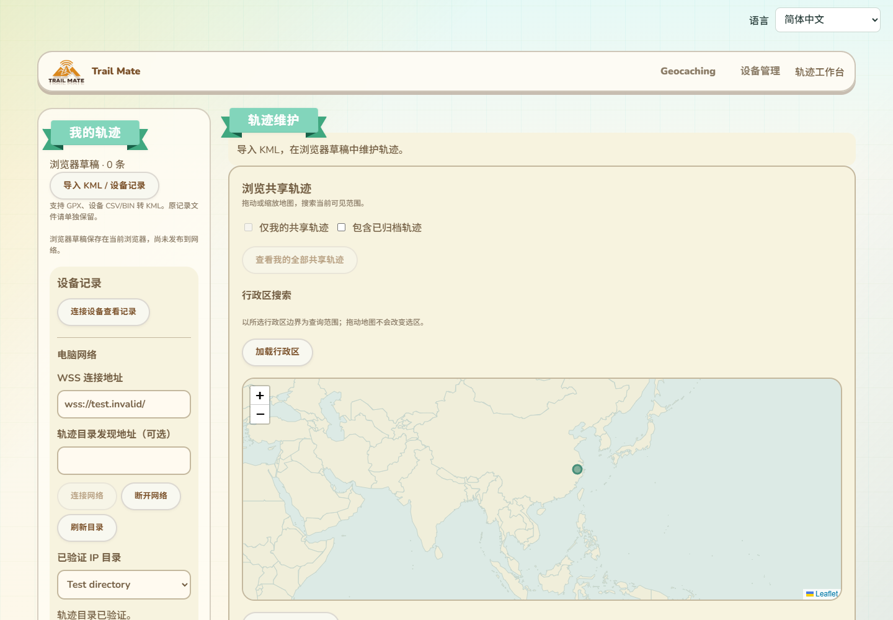
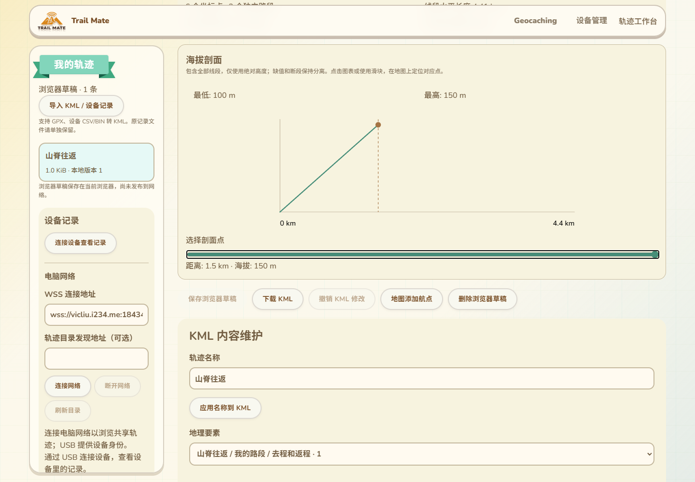
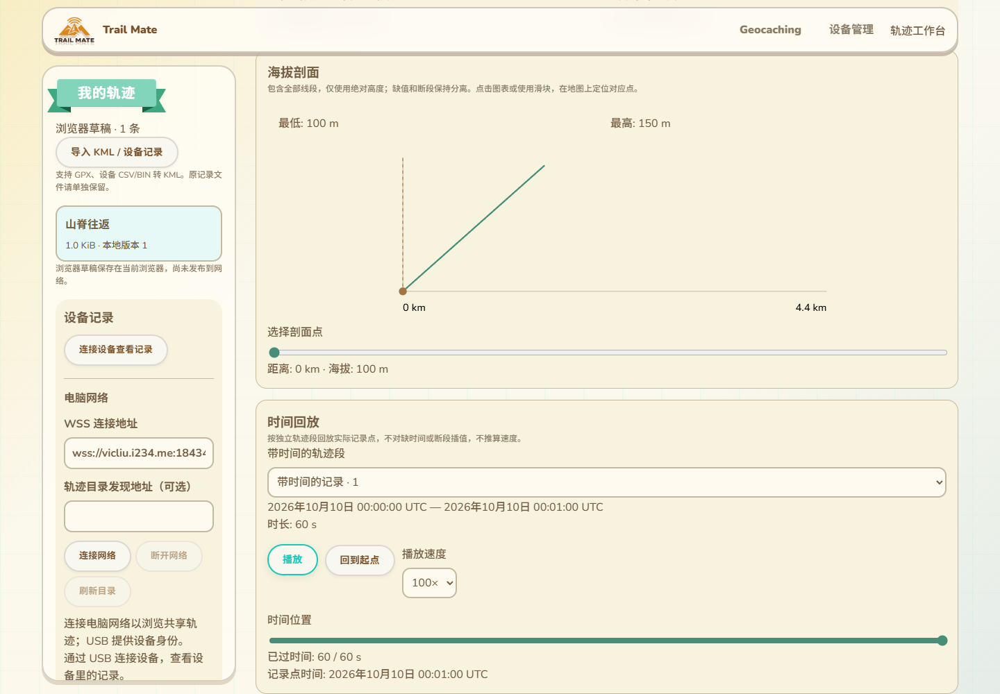
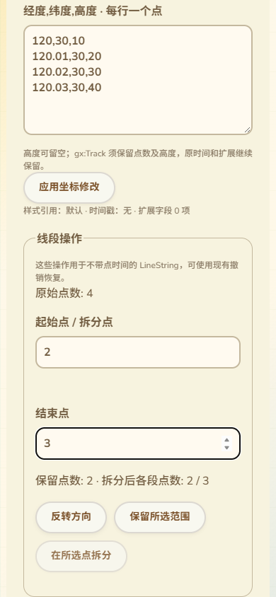
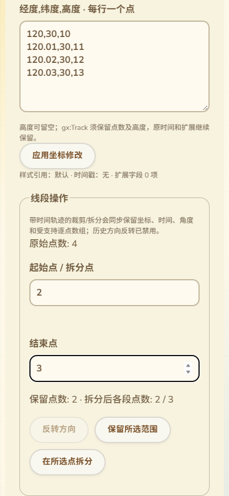
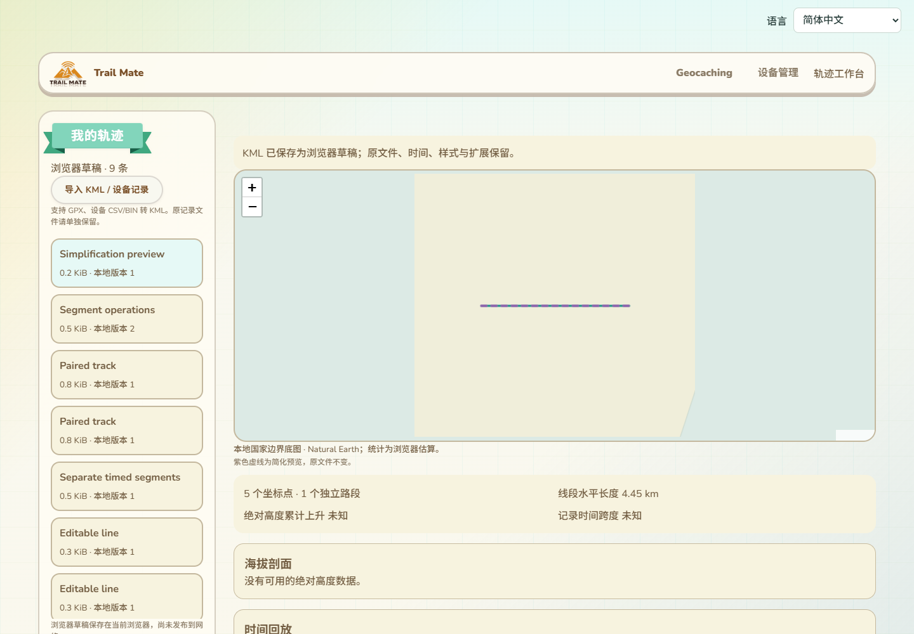
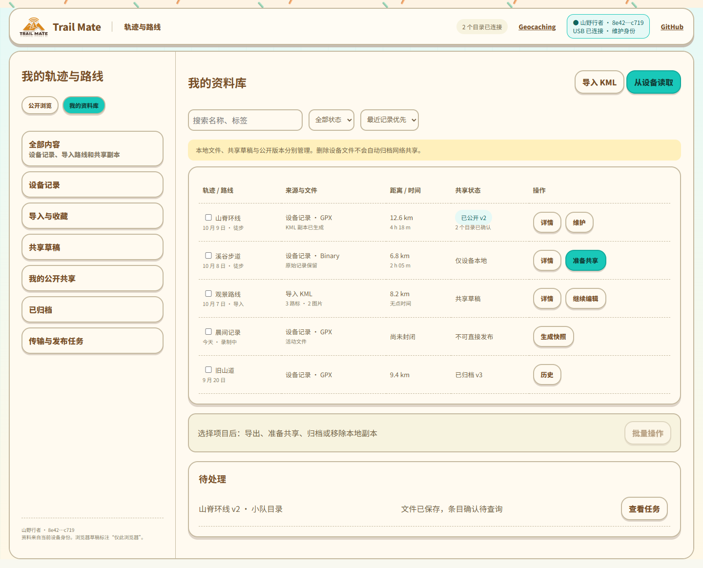
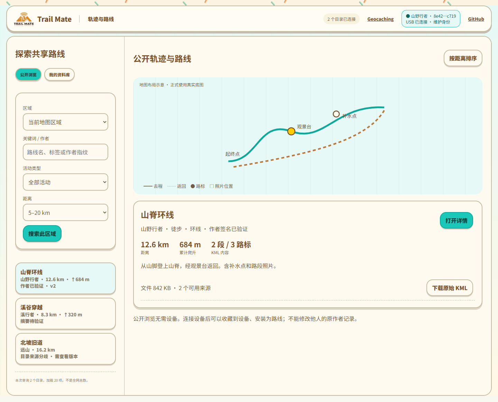
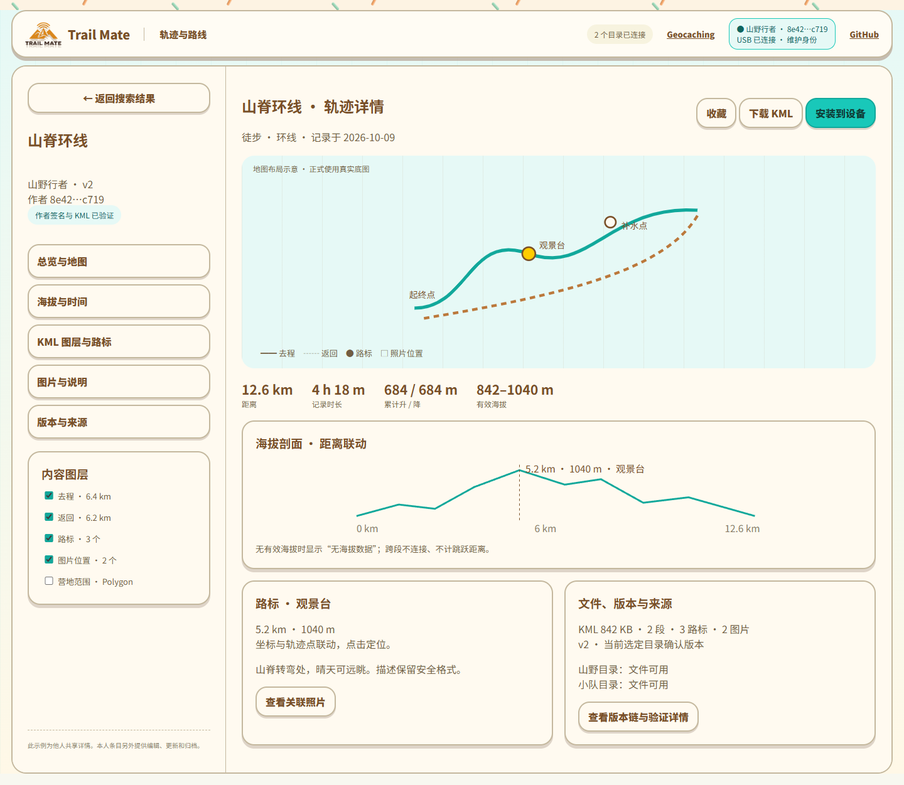
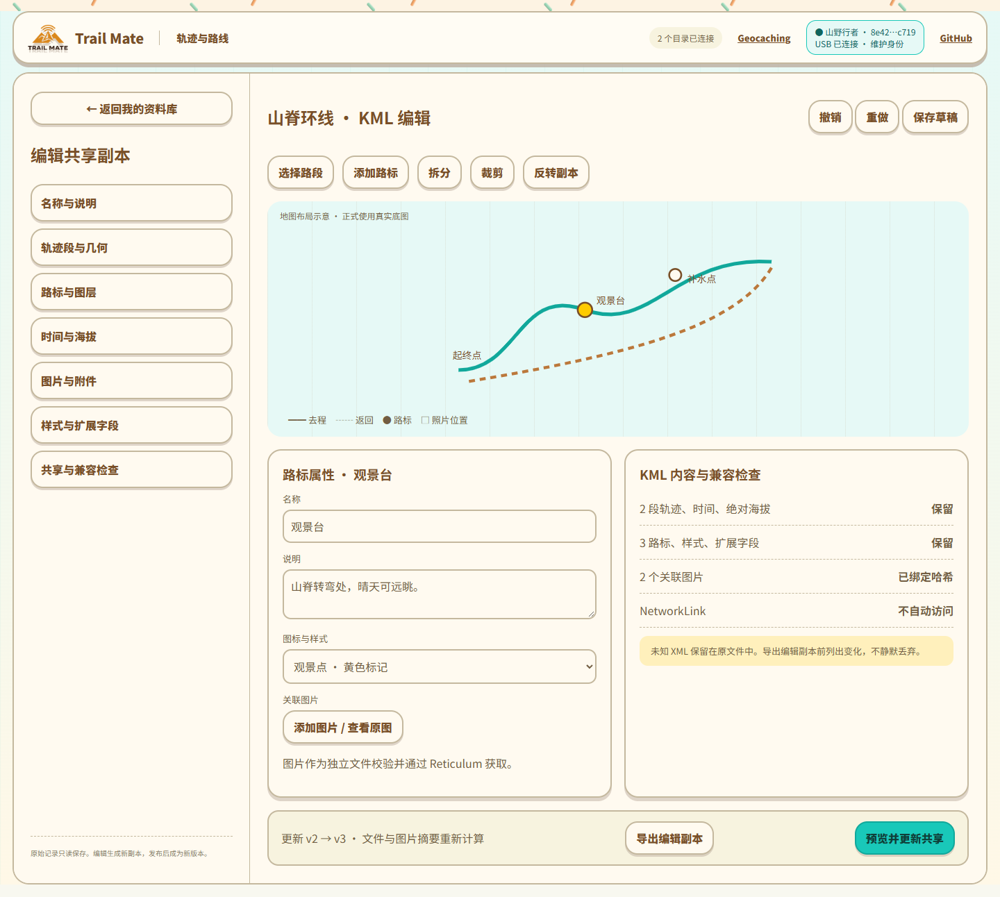

# 轨迹完整页面、KML 能力与附件协议

本文件补全 04、07 的轨迹规划。轨迹不是一个上传 KML 的表单，而是独立的资料管理、发现、详情、编辑与共享生命周期。截图沿用当前 Geocaching 页面资源和组件风格，数据、几何和统计均为审阅示例。

## 当前实现补充：公开浏览与设备作者身份（2026-10-13）

网络只读浏览现已独立于 USB：未插设备、浏览器没有 navigator.serial 时，可以通过 IP 目录拖动地图搜索、选择行政区层级/边界搜索、按轨迹 ID/分享链接查询、核验作者签名、下载精确 KML、复制 ID/链接，并保存本地编辑副本。此时“仅我的共享轨迹”和本人全部轨迹分页不可用，设备安装入口不显示；11 语言说明插入设备后才能维护本人轨迹。

设备连接后自动进行现有 USB 作者身份挑战，成功才开放本人筛选/分页并显示属于该作者的维护操作；更新/归档仍在执行前重新验证作者与原对象，公开查询不需要每次发送 USB 证明，网络查询不使用 RF 目录命令。身份未验证时仍可进行公开浏览。断开或更换设备保留公开地图位置、行政区路径、ID、已验证详情与文件下载；本人筛选/分页清除，待签维护草稿失效，设备安装组件卸载。进行中的公开 IP 读取不会被 USB 断开取消。

当前实际 page.jsx 的 Edge 回归验证了没有 Web Serial 的公开地图拖动、行政区、ID、详情、原字节下载及复制，全过程零 USB；连接/断开保持同一个浏览组件、行政区路径与文件 URL，延迟网络读取中断开仍完成验签；另一设备身份不能维护原作者轨迹。原有本人分页、更新/归档草稿、USB 安装/查询/刷新恢复、11 语言及 390px 布局回归通过。本人工作台与 IP 共享专项回归、网页构建和差异检查通过。目录传输和 USB 使用测试模拟，不能当作真实公网部署或实机 Web Serial 验收。本批只改网页与测试，不编译/上传固件或增加设备 RAM。

## 当前实现补充：海拔剖面（2026-10-12）

实际本人工作台和共享详情已提供海拔剖面、最低/最高值、距离/高度读数与地图选点。只将 absolute 高度作为可用海拔，缺值和线段边界分离；相对地面/海底、贴地高度不冒充海拔，距离累计不跨越断段。显示全部线段的剖面，图表点击或键盘滑块选择对应位置；模型变化重置选择，语言切换保留它。

绘图最多 2048 个采样点，按桶保留首末点与局部极值，全量有效点参与最低/最高值计算；超过绘图预算显示简化说明，不改原始 KML。20 万点纯计算压力测试通过，实际 KML 解析上限仍为 10 万点。断段/缺高度、跨日期线、零/负海拔、原对象不变及预算测试通过；本人页面与实际共享组件 Edge 验证键盘→地图标记、鼠标选择、11 语言、390px 无横向溢出及原文件字节保留。IP/USB 为测试模拟，不当作实机或公网证明。

本批仅网页与测试，没有固件编译/上传或设备 RAM 变化。时间回放、完整附件管理及其它未验收项目仍按下面的原规划保留；动态/3D 能力的首期边界不扩张为完整 Google Earth 渲染。

### 当前实现补充：时间回放

本人工作台与共享详情现已共用 gx:Track / gx:MultiTrack 时间控件：选择独立带时间轨迹段、播放/暂停、回到起点、1/5/20/100 倍速、键盘时间滑块与地图选点。显示该段起止、时长、已过时间和当前实际记录点的 UTC 时间；选择时间时定位到该时刻之前的实际记录点，不推造中间坐标、速度或移动时间。切段停止播放，浏览器隐藏暂停，卸载时清理定时器。

缺少 when 的轨迹不假造时长；缺时间点保留缺失，倒序/非有限时间或时间与坐标数量不符的段排除并提示。不同段可在时间上重叠或排列不同，不自动跨段回放；重复时间保留，只有一个有效时间点时不推算动画时长。原 KML 不变。地图下方说明当前标记来自海拔剖面还是时间回放，语言切换保留时间选择。

5 项时间计算/多语言检查通过（与海拔共 9 项）；Edge 本人页面验证 UTC 时间定位、100 倍速播放终态、两段切换停止与跨日期线定位；共享实际组件验证键盘时间定位、11 语言、390px 无横向溢出、原 KML 字节下载/复制与原 IP 签名流程。图片/附件、复杂编辑和实机/公网验收仍保留。本批只改网页与测试，不编译/上传固件或改变设备 RAM；覆盖上一段时间回放尚待实现的中间状态。

### 当前实现补充：普通线段裁剪、拆分与反转

本人工作台的 LineString 编辑增加起始/结束点录入、保留范围、在所选点拆分和反转方向；执行前显示原点数、保留点数与拆分后各段点数。结果使用既有撤销历史，未保存修改继续阻止公开准备。范围至少保留两点，拆分点必须位于内部，每个结果段至少两点；拆分两段共享边界点，不增加跨断段连接。

裁剪与反转只改变所选 coordinates，保留其它属性。拆分将所选 LineString 转为 MultiGeometry，原几何 ID 留在整体分组，两个结果段复制静态线段属性；子元素带 ID 时明确禁用拆分并显示 11 语言原因，底层也拒绝，避免复制导致重复 ID 或任意删掉未知标识。样式引用、绝对高度模式、extrude 与未知子扩展保留，原导入字节不变，加工副本重新序列化并校验。

实际 DOM 编辑测试通过：反转/裁剪/拆分的坐标及点数、整体 ID、样式/扩展保留、拆分距离不增连线、非法范围与带 ID 子元素拒绝。本人整页 Edge 回归验证三项操作与撤销、输入在 11 语言切换时保持、390px 布局、受保护拆分说明/禁用及未加工下载字节精确一致；既有时间/海拔、IndexedDB、签名准备约束继续运行。截图已检查。

这批操作尚不用于 gx:Track、Point、LinearRing 或 Polygon；带时间轨迹的坐标、when、angles 和逐点扩展需专门配对处理，不能用普通线段反转伪造历史时间。轨迹段排序、合并、简化、图片/附件以及这些几何类型的完整维护继续保留在原规划内。本批只改网页与测试，无固件编译/上传或设备 RAM 变化。

### 当前实现补充：带时间轨迹的配对裁剪与拆分

gx:Track 的裁剪/拆分已接入，同步处理 when、gx:coord、可选 gx:angles，以及 ExtendedData/SchemaData 中的 gx:SimpleArrayData/gx:value；保留原始字符串、缺值槽位和标量属性，不生成新时间。依据 [Google KML Track 参考](https://developers.google.com/kml/documentation/kmlreference#gxtrack) 的并行时间/坐标/角度与逐点数组结构进行实现，不能只裁剪坐标。

操作前必须确认时间与坐标等长、角度缺省或等长、逐点数组等长，以及已识别的子结构。无法确认的扩展或数量不匹配时，网页提供 11 语言说明并禁用裁剪/拆分，底层也拒绝；原文仍可下载。拆分为 gx:MultiTrack，两段共享原边界点及相应时间/角度/数组值，显式 interpolate=0，原几何 ID 留在分组，继承原高度模式。子元素 ID 继续按重复引用保护禁用拆分，裁剪不会复制 ID。

实际 DOM 测试验证不同 namespace 前缀、四组时间/坐标/角度/传感器值的裁剪和拆分、标量保留、数组及角度数量不匹配拒绝、未知扩展拒绝和历史反转拒绝。整页 Edge 验证裁剪/拆分及撤销、11 语言提示、手机布局、历史反转禁用、未知扩展保护与原文件精确下载。截图已检查。

覆盖上一段 gx:Track 尚未支持裁剪/拆分的中间记录。历史方向反转需独立的派生导航路线流程，仍未完成；排序/合并/简化与附件等其余规划保持。本批没有固件编译/上传、USB 或网络协议改变，也不增加设备 RAM。

### 当前实现补充：普通轨迹段排序与合并

同一 MultiGeometry 内的 LineString 可以向前/向后移动，原节点整体移动，不改坐标、ID、属性或未知内容；其它几何仍保留。移动返回新的几何路径，编辑器继续选中移动的段，普通修改与保存也保持当前几何选择；保存忙碌期间禁止从下拉框或地图切换要素。父组信息在同一次编辑器解析中复用 WeakMap 缓存，不为每段重复扫描整组。

合并选中段与下一普通线段，提前显示结果点数：静态属性必须匹配，端点坐标（含高度有无）必须重合，支持 +180/-180 的同一经线端点；移除重复边界点，不补造连接线。保留第一段 ID，后一段或其子元素带 ID 时拒绝，未知属性/扩展或属性不匹配也拒绝，不能为合并静默删除它们。尚不提供跨组、跨要素、带时间轨迹或不相接段的合并。

实际 DOM 测试验证移动路径与原 ID、夹有 Point 时其它几何保留、合并点数及距离不变、日期线等价端点，以及 ID/端点间隙/未知扩展/错误类型拒绝。整页 Edge 验证两个方向移动并保持原段选择、合并与撤销、11 语言、390px、受保护下一段禁用及保存后几何选择保持；网页构建和差异检查通过。截图已检查。

覆盖前文普通同组段排序/合并待实现的中间状态；历史轨迹派生、其它类型与跨组维护、简化和完整附件管理继续保留。本批只有浏览器代码与测试，没有固件编译/上传或设备 RAM 变化。

### 当前实现补充：几何简化预览（2026-10-13）

LineString 与已确认配对的 gx:Track 现在支持先预览、再应用的简化。输入球面水平容差（0.1–10000 米），地图以紫色虚线叠加候选结果，原线与原文件保持不变；显示所选段点数与整个文件距离/爬升/时长的前后对照。未应用预览使草稿发布/安装入口不可用，取消后恢复，应用后成为未保存修改并可撤销。

迭代计算限制 10 万点与 200 万次距离检查，预算不足拒绝，不返回未经验证的简化结果。保留实际首末点、高度最低/最高点、缺高度/缺时间的边界及逐点 ID 对应的位置；接近对跖端点先保留中间点，不假定唯一短弧。容差针对水平球面距离，不是垂直误差保证，累计爬升可能改变并在对照中显示。保留点的坐标和高度来自原记录，不生成点时间。

gx:Track 同步筛选 when、coord、angles 和已识别 SimpleArrayData，未知配对结构拒绝。普通线段不调整未知结构，仍可下载原文；其它 KML 内容和静态属性不因简化静默删除。只有应用并保存后才重新准备相应文件签名。

5 项纯计算/多语言测试通过：10 万点直线、转角、缺值、极值、点 ID 保护、日期线、极区/退化边与计算预算失败。实际 DOM 编辑回归验证时间/角度/逐点数组配对、引用点保留及未知结构拒绝；工作台 Edge 验证预览不改编辑内容或下载字节、11 语言选择保持、手机布局、应用/撤销和非法容差。当前 IP 整页模拟设备验证安装原先可用→预览期间禁用→取消恢复，全程不新增 USB 请求，并继续完成既有安装/恢复与目录查询流程。网页构建与差异检查通过。

本批无固件编译/上传或设备 RAM 改动。历史轨迹派生反转、跨组维护、附件和实机/公网验收仍保持原范围；原规划的简化待实现记录由本段覆盖。

## 1. 我的资料库

连接设备后进入当前作者的资料库，明确区分设备原始记录、导入/收藏路线、编辑副本、共享草稿、公开版本、归档版本和进行中的任务。浏览器未同步草稿标记“仅此浏览器”，不能假装已经存入设备。

列表提供名称/标签搜索、来源、时间、距离、活动类型、文件大小、状态筛选和排序，支持列表/地图联动。轨迹标识与文件路径分开；一个原始记录可以有多个编辑副本和公开版本。

操作按状态呈现：原始记录查看/导出/生成共享副本；草稿编辑/保存/发布；已共享条目更新/归档/历史；导入或他人收藏查看/安装/生成自己的派生副本。删除本地文件、取消收藏、归档公开条目分别确认，不能连带隐式执行。

录制中条目先创建封闭快照；批量操作显示符合条件和跳过的项目，逐项反馈。已被任务/路线使用的对象移除时执行引用检查。

## 2. 浏览他人共享轨迹

默认公开浏览不要求连接设备。地图与结果列表联动；筛选区域、关键词、作者、活动类型、距离、累计爬升、公开状态，排序按相关性、距离、发布时间。活动类型等检索元数据需进入协议字段；不设计无法由协议支持的筛选。

区域查询分页绑定目录 snapshot/cursor；地图移动后显式搜索，不每次拖动触发网络任务。合并多目录以对象和版本去重，标注已加载范围。摘要先显示“目录声明/待验证”，取回作者签名清单后才显示作者已验证；文件下载后才显示完整文件已验证。

结果展示名称、作者、距离、爬升、类型、时间、轨迹段/路标数量、KML 大小和可用来源。点时间缺失不展示虚构时长。发生分叉时显示来源分歧，不能用热度或更新时间自动掩盖冲突。点赞、评论、全网收藏人数未获得需求，不作为首期接口。

## 3. 轨迹详情

详情从公开浏览、本人列表和设备记录共用进入，但根据作者与来源提供不同操作。返回时保留查询、分页、地图视角和选中项。

详情包含：

- 总览：名称、作者、公开状态、版本、说明、活动类型、文件信息。
- 地图：完整几何、各段开关、路标、图片位置、方向和起终点，选择元素定位到对应属性。
- 海拔：距离剖面与地图点联动，最低/最高海拔、升降；无数据或高度模式不允许计算时明确说明。
- 时间：存在点时间时回放、时间范围、总时长；移动时间/速度需标明计算规则，断段不跨越插值。
- 内容树：Document/Folder/Placemark 的层级、几何和可见性，不能把多段压成唯一折线。
- 路标与说明：坐标、名称、安全描述、图标、扩展属性、关联图片。
- 图片：缩略图/原图、地图位置、文件大小、下载进度和来源，缺图占位不影响路线几何查看。
- 版本与来源：父版本、签名/哈希验证、各目录当前性、文件/附件可用性、冲突和归档记录。

他人内容提供收藏、下载原始 KML、安装到设备、下载附件包；自己的公开内容另有更新和归档。复制为自己的路线须保留派生来源说明，不伪造原作者签名。原始 KML 与加工后的兼容导出分别标识。

## 4. KML 编辑与发布

编辑生成独立副本，原始文件不可变。提供命名/说明、轨迹段选择与排序、拆分、裁剪、添加/修改路标、样式、图片关联和扩展字段。几何简化、反转、合并属于明确操作，预览变化、支持撤销；反转轨迹不得反转后虚构记录时间。

编辑前建立内容树和兼容报告；编辑后显示新增/删除几何、点数、时间、海拔、附件和未知扩展的差异。未修改的原始 KML 下载保持精确字节。加工副本重新序列化、计算摘要和签名，不能沿用原文件 hash。

## 5. KML 能力矩阵

KML 包含结构、样式、扩展属性、时间及多种地理对象，不能只处理 LineString。依据：[Google KML 官方参考](https://developers.google.com/kml/documentation/kmlreference)、[OGC KML 标准入口](https://www.ogc.org/standards/kml/)。下表是拟实现能力，不是现有固件支持声明。

| 内容 | 浏览器维护目标 | 文件保存/共享 | 设备安装 |
|---|---|---|---|
| Document、Folder、Placemark、id、name、visibility | 内容树、重命名、开关、定位 | 保留层级和引用 | 按设备能力生成视图索引 |
| Point、LineString、MultiGeometry | 路标、多段轨迹、分组与编辑 | 不合并断段、不凭空连线 | 路线/路标能力需逐项协商 |
| Polygon、LinearRing、内外环 | 区域图层、属性与边界预览 | 原始几何完整保留 | 不支持时提示，仅装入受支持导航内容 |
| gx:Track、gx:MultiTrack、when、gx:coord | 时间联动与回放、段边界 | 点时间和坐标对应保留 | 记录时间能力单列 |
| altitudeMode、extrude、tessellate | 保留语义；2D 预览与可计算高度明确区分 | 不把相对高度当海拔 | 设备不支持时不伪装等价 |
| Style、StyleMap、styleUrl、Line/Icon/Label/PolyStyle | 线色/宽、图标、标签、区域样式 | 引用解析，保留 highlight 样式 | 能力允许时投影到设备样式 |
| description/CDATA、Snippet | 安全文本/受限富文本、图片与链接 | 原文件保留，编辑输出清洗后的内容 | 现有说明/图片能力延续 |
| ExtendedData、Data、SchemaData | 属性查看；已知字段可编辑 | 未知字段无损保留 | 仅识别支持字段 |
| TimeStamp、TimeSpan、LookAt、Camera | 时间范围和初始视图；3D 参数展示 | 原始内容保留 | 非导航核心，报告支持情况 |
| GroundOverlay、ScreenOverlay、PhotoOverlay | 兼容报告；地理叠加可按实现能力预览 | 原文件与资源保存，不静默丢弃 | 明确不支持项 |
| Model、Region/LOD、gx:Tour、Update、NetworkLink | 标明动态/3D 能力，暂不承诺完整渲染或编辑 | 静态原文保留，不自动执行/访问 | 不当作有效导航几何 |

“KML 功能不能少”落实为完整内容清单、可用能力和原文保存，不用“支持 KML”暗示等同 Google Earth 全部 3D/动态能力。第一期必须完整覆盖户外轨迹核心（分段、路标、时间、海拔、说明、图片、样式、扩展数据）；其余元素明确兼容状态和后续实现，不在导入时删除。

XML namespace 和元素大小写必须正确处理；支持单行/跨行 KML，不沿用按行查字符串作为通用解析器。缺失高度/时间保留缺失语义，gx 时间和坐标数量不匹配报告错误。多段统计忽略断点间直线，KML 高度模式和垂直基准影响海拔统计。不能仅凭 clampToGround 的第三坐标计算真实爬升。

## 6. 现有设备能力必须继承

2026-10-13 分段预览补充（源码/原生验证）：普通线/gx:Track 边界与 gx 缺测点传递断段标记；预览距离、升降和海拔样本不跨段，缺海拔不补造爬升。地图和共享海拔图的线性抽样保留被跳过的边界，投影失败也断开。每图仍一个 LVGL line 对象；最多 96 个实际点/95 个断段标记，用 192 项上限的 PSRAM backing，无 PSRAM 回退。标记不交给原生 lv_line_set_points，点/样本的 break_before 使用原填充空间（<=32/<=24 字节断言），没有段索引数组。

实际组件/预览加载及统计/抽样回归与 8 项 CTest、栈/流式/差异检查通过，含 10 万点、抽样越过断段、缺测、投影失败、PSRAM 不足/释放；真实 LVGL 头文件的整数和浮点语法检查通过。绘图调用为模拟，像素/裁剪/触摸待实机；未 SDK 构建/上传/测运行堆。GPS 导航旧几何模型、高度模式和签名准入缺测/时间配对仍待完善。现有 Manifest v1 14 字段/单 KML/4096B 不能直接容纳设计附件扩展，需明确协议版本与旧签名兼容；附件共享仍为完整待交付项。

2026-10-13 后续流式读取补齐（源码/原生验证，未进入下述 SDK 镜像）：导航图片和轨迹预览共享有界 namespace XML + description HTML 流；跨块/跨行图片、多个 Placemark、说明与几何顺序、CDATA/转义文本及精确图片属性已接入。图片顺序保持，feature 结束时关联首个有效几何位置；未知/空 namespace 不冒充标准 KML，本地旧无 namespace 根兼容。预览坐标也按流读取，保留 gx 优先、普通线回退，不再用 8KB 行上限。

工作区上限 12,544 字节，短期 PSRAM、有 PSRAM 时无内部回退，释放后不常驻；单张图片录入移除临时 URL 列表，预览 move 字符串，原图片字符串/轨迹点 vector 的内部堆所有权仍保留。图片 64 项、source 4096 字节、文件 8MiB/64 层/20 万元素/10 万点预算；超长 source 不收录。真正两页加载函数提取回归与 XML/HTML/SHA 测试、7 项 CTest、栈/流式读取/差异检查通过，FS/硬件为模拟，Linux 仅补源列表而未构建整个应用。

此 UI 读取器接受空 gx:coord 为缺测，不生成位置；签名准入解析器未修改，完整缺测/时间配对/分段地图与统计仍须完善。未 SDK 构建/刷写/运行 RAM 或实际显示验收；网络签名附件、传输与原子安装仍必须完成，不能以流式读取替代附件协议。下方“尚为按行读取”的历史状态由本段覆盖，签名/附件和实机边界保持。

2026-10-13 合批构建完成：Wio L2 候选已 SDK SUCCESS、退出 0，静态 RAM 95,580 B（较前候选减 16 B），Flash 4,729,433 B，bin 4,729,856 B，SHA256 `83b57b29969b1ef4dabd08fdba8590ea7507876777183dbface78df7e81316ec`，能力/分区校验通过；未上传或运行内存/真实 UI 验收。覆盖下面 SDK 未完成的中间记录，不覆盖附件和流式读取等剩余要求。

2026-10-13 页面接入补充：导航和预览均在录入时记录当前精确引用的 SHA256，再按来源记录判断已保存/派生图就绪；导航不保存 URL，只新增固定摘要。预览原 URL 用于下载，其所有权保留。两页对象 backing 使用最多 64 项的动态 PSRAM 存储，有 PSRAM 时无内部回退，不足返回失败/提示；clear 释放，容器自身不抛异常或 abort。原字符串仍维持原分配，不能把整个 UI 内存归为 PSRAM。旧文件保留，但不能因 exists 或目录图片数就显示当前引用已保存；界面提示核对/重新下载。批次计数仅用于进度，不能把 subset 的前 N 个成功推广成全局槽就绪，完成后重新检查记录。

实际模型和生产控制函数的 -fno-exceptions 原生回归通过，包括两页来源一致、旧/错来源不就绪、计数与派生图、部分任务不冒用就绪、哈希/对象 PSRAM 不足、64 项预算/释放。13 个 locale 的缓存/内存提示检查通过，7 个语言包版本已递增，需部署新语言包；ESP 小型哈希 owner 不创建 SD backing，Linux 复用可选 OpenSSL，没有时标记无法验证。相关 6 项 CTest 和栈/差异检查通过。SDK 合批编译进行中，无刷写/运行内存或完整设备渲染验收。下面页面未接入的早期状态由本段覆盖；签名附件、跨行/namespace KML、缓存失效细节与实机等完整要求仍须完成。

2026-10-13 平台接入补充（覆盖下一段平台未接入状态）：ESP HTTP 图片下载已调用短期 RouteImageSourceWork，边写边计算源引用及文件摘要，完成写入/flush 后再读临时文件核验并提交来源记录；失败不发布成功，旧来源失效后替换图片/清理派生位图。后台跳过下载前改为来源匹配，公开 ESP/Linux 查询只做记录/来源/长度检查，不是独立内容摘要或作者签名证明。工作区/SHA/路径/借用 scratch 及 SD 句柄 backing 放在短期 PSRAM，有 PSRAM 时申请失败不回退内部堆；无 PSRAM 板保留原硬件条件下的工作区支持。下载、缓存生成、查询复用存储 lease，I/O 检查 SD 代次。

实际下载/ESP 查询函数提取的原生验证通过，HTTP/SD/heap 模拟，SHA 使用真实库；Linux 使用真实文件及路径解析函数验证查询。连同来源提交、文件完整性和图片属性共 5 项 CTest 通过，栈检查/差异检查通过。没有 SDK 编译/上传、运行内存或真实掉电验收。导航/预览的已保存数量与显示仍未使用来源查询，旧缓存重建及 RAM 克制的 UI 摘要存储仍待接入，不能宣布整个来源绑定交付。网络签名附件清单/传输/安装和跨行/namespace KML 读取继续保留。

2026-10-13 来源记录底层补充（尚未接入平台/UI）：新增 ImageSourceBindingView 与 ImageSourceBindingStore，固定格式为 `TMSI(4) | version=1(1) | file_bytes_LE32(4) | SHA256(decoded_reference_UTF8)(32) | SHA256(image_bytes)(32) | CRC16_CCITT_LE(2)`，总 75 字节。引用保持精确文本，不偷偷做 URL 规范化；本地记录不等于网络作者签名，也不能仅凭 CRC 或元数据宣称图片文件已经验证。字段使用借用视图，提交器不分配或保留整图/URL，复用调用方小块 scratch。

提交必须有同路径、同长度、同摘要的 Ready 文件校验结果及不可变存储租约。写临时记录并同步/读回后，先使旧来源记录失效、清理派生位图，再替换图片，最后发布新来源；失败允许保留未绑定的文件，但不能把新文件与旧来源作为有效组合。候选被重命名后不能复用旧证明再次删除已发布文件。路径由设备确定，须互异、符合 FAT 大小写规则且受 SD 代次保护；真实平台重命名和掉电尚待验收。

真实 SHA256、独立 Python fixture、逐 I/O 失败、逐字节损坏、短写、证明错绑定/重用、缺记录、路径冲突和超大文件长度原生验证通过。尚无 HTTP/USB 下载器、导航页或预览页调用此 store，也未 SDK 编译/上传；现有缓存展示尚不因此获得来源检查。网络签名附件描述、资源管理、迁移提示及 KML+附件原子安装仍必须继续实现。

2026-10-13 源码补充：导航页与轨迹预览的重复 img/src 解析已统一为 core_gps/kml/image_sources.h，修复 data-src/srcset 子串误选、引号内 > 截断、首个空/重复属性和重复实体解码。借用输入 string_view，不复制整个标签，不新增可变全局缓存；保留两页原 64 张上限与输出列表，已通过从实际生产函数及上限提取的原生回归、压力输入和 ESP 栈检查。本批未 SDK 编译或上传，不能据此宣称设备行为/堆峰值验收。

仍是已有按行读取的属性层修正，不是完整流式 KML/HTML DOM 支持：跨行图片标签、单行多个 Placemark、命名空间以及说明/几何的任意顺序仍须补；有限命名实体以外保持原字符串。缓存目前使用路线名 hash 与图片序号，尚无来源摘要绑定，旧缓存与修正后图片列表可能不对应。去中心化附件协议须绑定 KML 原始引用和文件 hash，安装时验证映射并重建对应缓存，不能直接把网络附件放到未经核对的旧序号路径。

当前 `gps_page_runtime.cpp` 已有 `load_kml_route_images`：从 Placemark 描述提取 img src，并用 coordinates/gx:coord 关联位置；已有路线图片保存和缓存操作。`route_elevation_profile` 已有海拔剖面。网页共享协议必须覆盖这些数据，不能只分享几何导致现有设备功能退化。

这些实现并不能证明设备完整支持所有 KML 元素；P0 增加 Route 实际能力清单和对照样例，逐项验证解析、存储、图片离线加载和导航。

## 7. 附件与协议补充

修订 04 的 manifest 草案，在末尾增加明确版本内固定位置的 `metadata` 和 `assets`；尚未有实现，可在冻结 v1 前修订，不在已部署协议上偷偷追加字段。

`metadata=[activity:u8,tags:[str],geometry_capabilities:u32,segment_count:u32,waypoint_count:u32,time_coverage:u8,altitude_semantics:u8,derived_from:[object_id,manifest_hash]|null]`。

2026-10-13 实施修订：已部署 v1 保留 14 字段，新清单采用显式 v2 的 16 字段。`assets` 改为 `nil | [index_sha256:bin32,index_bytes:u32,entry_count:u8,index_format=1]`；附件索引文件保存 `[1,kml_sha256:bin32,kml_bytes:u32,[[asset_id:str,sha256:bin32,size:u32,mime:str,kml_reference:str,role:u8,required:u8],...]]`。required 在 CMP1 线上为 0/1。主清单仍 4KB，完整引用放在摘要绑定的索引中，不删减附件要求。字段、预算、三端验证和尚未贯通的发布/安装边界见 [27-签名附件索引与版本演进](27-签名附件索引与版本演进.md)。

作者签名绑定 KML 和全部附件的精确摘要。附件角色包括描述图片、路标图标、叠加图和其他受支持文件。复用 FILE_* 按 hash 传输，声明文件类型及预算；PUBLISH 对 required 资源要求保存回执，optional 缺失需返回部分可用状态。目录 QUERY 增加活动/标签、距离/爬升范围等筛选与能力公告，不支持过滤返回明确错误。

完整 KML 采用相对资源引用时，导出 KML 与资源目录结构；原始文件已有 HTTP URL 时，通过签名资源映射解析，原文件不为下载偷偷改写。单文件 KML 下载说明附件可用性；完整下载可使用普通 ZIP（不是把共享格式改成 KMZ），包含 KML、相对资源、manifest 和回执。不同文件字节版本的导出副本必须标明原作者签名验证范围。

浏览器资源路径解析拒绝目录穿越；HTML/远程 URL 不自动执行或下载。用户主动加载外部图片需提示来源；纳入去中心化共享的图片应成为 hash 寻址附件，避免依赖作者个人网站永久在线。设备安装传输 KML + 必需附件集合，临时目录校验后原子安装，提供索引给现有图片缓存流程。

拟定附件预算与总包预算分别协商：单图、总大小、数量、XML 深度、要素和扩展字段数量均有硬上限；04 的 8 MiB KML 限额不等于包含无限附件。限额以真机压测后冻结。

## 8. 新增串口能力

增加 TRACK_LIBRARY_QUERY、TRACK_OBJECT_GET、TRACK_DRAFT_PATCH、TRACK_COMPATIBILITY_REPORT、TRACK_ASSET_LIST、TRACK_DERIVE、TRACK_LOCAL_REMOVE、TRACK_ARCHIVE_PREPARE、ROUTE_INSTALL_PREPARE 等明确命令，最终编号进入公共注册表。

删除与安装有引用和空间检查，安装回执区分原文件已保存、导航内容可用、图片缓存完成；不能统一返回一个成功。收藏与最近浏览可保存在浏览器或设备，必须标明存储位置，未连接时可浏览器收藏但不声称同步。

## 9. 验收扩展

新增混合 KML corpus：Folder、点线面、多段、时间、缺值、高度模式、StyleMap、ExtendedData、CDATA 图片、相对附件、单行 XML、未知扩展、动态元素和错误引用。验证原始导入/导出 byte hash 不变；编辑差异可解释；KML 与所有资源 hash 一致；附件缺失/断线/磁盘满可恢复；安装后现有路标、图片和海拔功能无回归。

页面验收包括我的资料库到详情/编辑/历史，公开搜索到详情/收藏/下载安装，KML 图层到路标图片/海拔联动，归档到公开状态同步。截图只是页面结构审阅，不替代这些真实交互验收。
