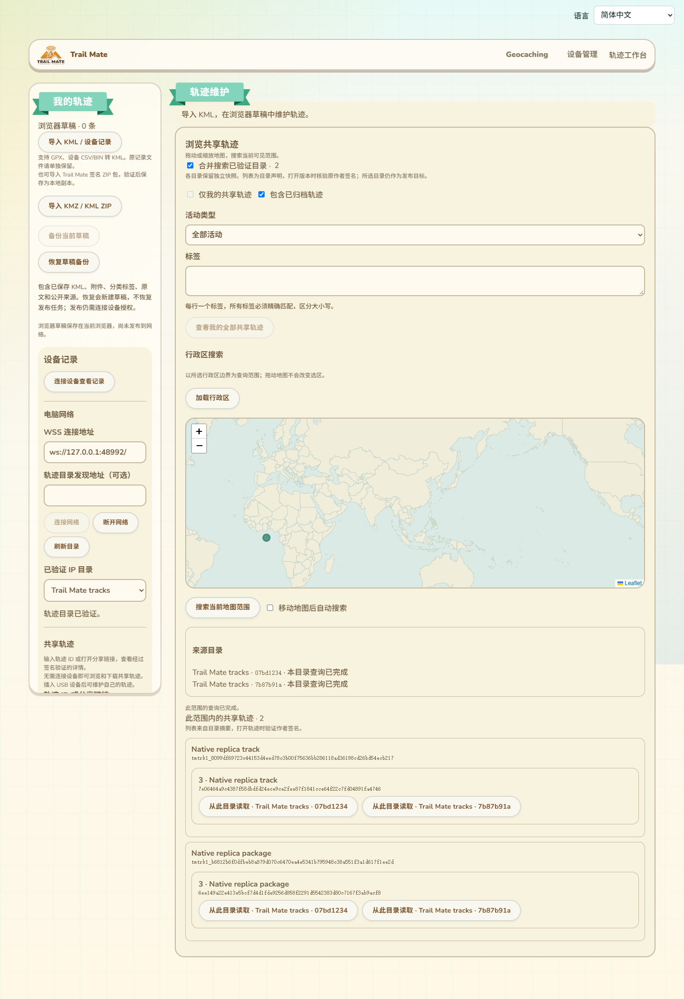

# 多目录轨迹检索与来源绑定

2026-10-14，接99。现有轨迹工作台增加多个已验证目录的合并检索，覆盖地图范围、本人范围、全部本人轨迹和行政区查询。仅修改网页、文案及验收脚本；没有固件源码、SDK构建、刷入或设备RAM变化。

## 现有页面中的位置

功能位于原“浏览共享轨迹”区域，地图与筛选条件上方增加“合并搜索已验证目录”。左侧“已验证IP目录”仍用于选择默认直达查询和发布目标，合并搜索不会自动改变发布目标。

- 来源状态区分别展示目录名、地址和查询进度，支持继续查询及只重试失败来源。部分失败保留其他目录的结果，但明确提示结果不完整。
- 同一对象、版本hash及相同摘要合并来源按钮；不同版本分别展示。相同版本hash而摘要不同也保留差异，不自动选择全网当前版本。
- 地图绘制每份不同摘要自己的范围；存在版本差异的对象用不同颜色提示，点击后引导选择版本和来源。
- 来源按钮打开对应目录的签名详情，历史、下载、完整包和作者维护继续绑定该来源。归档草稿的发布审阅也使用该来源，不混用左侧默认目录。
- 设备作者证明用于“仅我的共享轨迹”和“查看我的全部共享轨迹”。后者跨当前参与目录查询并保留各自分页，不受随后移动地图影响。
- 行政区层级从所选目录读取，逐级选区与边界核验复用原实现。合并查询要求各来源声明相同命名空间和行政区版本；不匹配的来源明确退出本次选区查询，不静默退回矩形地图搜索。
- 地图范围改变、筛选改变、目录身份／epoch集合改变或作者切换后，取消旧查询并清除旧结果和来源状态，迟到响应不能回填新范围。新增19条文案覆盖现有11语言，包含跨目录本人结果说明。

实际构建页面与两个真实本机Reticulum目录的截图如下。使用现有导航、主题和设备／网络侧栏；英文标题和测试坐标属于隔离验收数据。

[中文样例结果截图](images/track-multidirectory-results-zh-Hans.png)展示两目录报告不同版本及同版多来源。该补充截图来自生产组件，网络边界与USB由测试控制，不作为真实设备证据。

截图检查发现原单目录结果的两列布局把多来源长标题挤成竖排，已为合并结果改成完整宽度的卡片：标题、ID、版本和来源按钮顺序排列，长hash换行。390px／RTL复核页面及列表没有横向溢出，标题仍占卡片主要宽度；原单目录布局保持。

## 协议和预算

不增加网络操作或USB命令。每个来源使用原IP读取适配器绑定目录公钥、delivery、epoch与网络generation，并独立保留原查询snapshot／cursor。

`queryTrackDirectories`接受1—32个已验证来源，每轮至多读取8个来源批次，每个来源批次至多16条。此预算是来源读取次数，行政区能力查询或日期线分段仍可能产生多个网络请求，不能称为8个网络包。列表显示窗口最多256份不同摘要，跨窗口去重预算最多8192份；窗口未展示条目保留在来源待处理队列，继续时不会跳过。达到去重上限明确提示未完成。

继续令牌为进程内不透明对象，绑定全部来源身份／epoch、范围／行政区、作者、活动／标签／归档条件及预算；不能复用于另一查询或伪造为普通对象。每次进度与继续状态独立复制，取消或界面修改进度数据不能改写旧令牌。

合并对象不带作者已验签声明。列表是认证目录的摘要声明，只有打开精确对象／版本后才核验原作者manifest签名；合并不证明全网已发现所有目录、不证明全网当前头，也不证明所有来源持有完整附件。不同分支仍按原冲突证据流程处理。

## 验证结果

- 新增9项Node测试通过：11语言；同版多来源／版本和摘要差异；8来源预算与公平继续；独立游标和失败重试；显示窗口与去重；快照变化；查询／身份／预算绑定与伪造拒绝；取消／进度隔离；非法摘要及容量。与查询继续、摘要、行政区、历史组合共31项通过。
- 实际生产组件Edge测试通过：部分目录存储失败保留结果，仅重试失败来源；不同版本／同版来源；来源绑定的详情、下载、历史及归档草稿审阅；设备作者限定的地图与全部本人分页；两级行政区查询；行政区版本不同的来源未发操作13，且没有操作1矩形回退；移动地图、目录epoch变化与迟到结果清理；11语言／RTL／390px。USB只调用身份信息／证明，未写设备。测试网络边界受控，实际加密与生产组件未替换。
- 原共享IP模式和版本历史浏览器回归通过，网页构建与差异检查通过。新增Node与浏览器专项加入CI；真实多目录浏览器步骤接入已有原生复制网络验收，尚未远端运行CI。
- 两个真实本机RNS目录复制9版本并中断重启后，浏览器独立读取两目录快照、合并2对象各2来源；实际`site/tracks/dist`页面完成地图／含归档查询，从另一来源打开详情，同时左侧发布目录不变。
- 随后关闭源目录TCP，新浏览器从副本读取必需KML／索引／PNG、3→2→1历史到根、精确历史版本、分叉所选2→1路径，并保存和刷新验证IndexedDB副本。本轮完整流程39.416秒退出0；排版修正后再次39.261秒退出0，所有子进程终止。证据位于`.codex-build/hostlink-codec/track-replication-network/result.json`、`multidirectory/result.json`和`browser/result.json`，均标记`physicalUsb=false`、`publicNetwork=false`。

此前组合回归曾在历史版本打开后等待详情hash时超时。本轮增加失败时的页面状态／截图诊断，并连续两次通过；尚未捕获该超时根因，不能声称已证明其根因修复。没有放宽签名、hash或历史版本断言。地图旧来源状态清理是独立确认的界面修正。

## 继续保留的交付范围

候选Wio固件刷入与真实设备作者发布／确认／恢复、公网NAS／Linux容器和生产行政区数据、最大文件／包吞吐、长期多peer及物理掉电、全部配置实际生效及其他高级KML能力继续按16推进。真实网络本轮证明地图／离线历史及包流程；多目录行政区／本人分页由生产组件受控边界验证，不扩大为生产行政区或真实USB验收。

设备运行RAM仍以用户验收的约87K／297K为基准，本轮没有新测量。GitNexus修改前查询相关网页符号和验收入口，未收录结果UNKNOWN；人工核对调用范围为目录发现→共享检索→来源绑定详情／维护，未涉及ESP路径。
