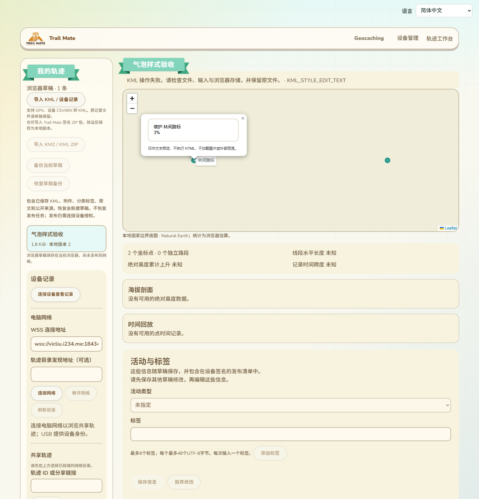
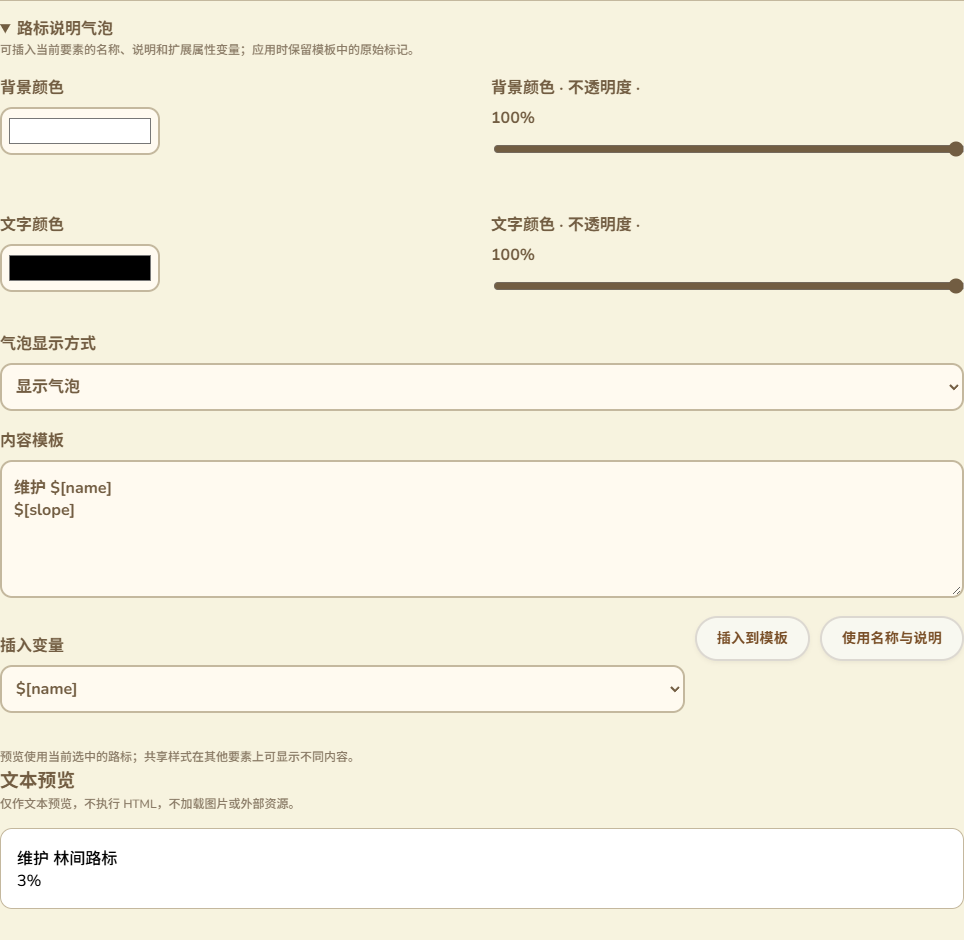

# KML气泡样式维护与安全预览

2026-10-14，接100。现有KML样式编辑器新增`BalloonStyle`维护，编辑地图和共享详情地图可点击打开对应气泡。没有固件、USB命令、网络操作或设备RAM改动。

## 入口与交互

入口在原“KML样式编辑器”中，线、区域、图标及标签之后增加“路标说明气泡”折叠区，沿用现有主题与局部／共享／StyleMap内联范围和普通／高亮／两种状态选择。

- 背景与文字颜色使用颜色选择器和带百分比的不透明度滑块，保存为原KML颜色编码，不要求用户填写十六进制数。
- 显示方式使用“显示气泡／隐藏气泡”选项；原文未知值保留为禁用选项，未修改时不会被默认值覆盖。
- 内容模板保留原有空白和标记。变量下拉列出当前路标名称、说明、ID、地址、Snippet及可解析的扩展数据；按钮在光标／选择范围处插入。另有“使用名称与说明”按钮供简单录入。
- 文本预览使用当前选中的路标，明确说明共享样式在其他要素上的内容可能不同。未解析变量逐项列出并保留，不能当作已经成功填充。
- 尚未应用的输入进入原工作台互锁，阻止保存或其他编辑覆盖；应用后可保存、重开和撤销。切换语言不重建输入或提交内容。

实际工作台位置与地图气泡：

实际表单：

截图来自真实构建页面和隔离浏览器草稿，包含原导航／设备与网络侧栏；没有连接真实USB或网络目录。表单与模板错误文案19条覆盖现有11语言，390px与阿拉伯语RTL检查通过。超过64KiB的模板在应用时明确说明容量／XML字符限制，保留原草稿和待修改输入，可放弃恢复，不误报为数字或图标裁剪错误。

## 样式与保存语义

维护`bgColor`、`textColor`、`text`和`displayMode`，依据[官方KML BalloonStyle参考](https://developers.google.com/kml/documentation/kmlreference#balloonstyle)。颜色保留透明度，默认背景白色、文字黑色；旧`color`作为背景兼容读取，新的颜色修改写入`bgColor`。

样式解析器沿原共享引用和StyleMap合并气泡字段。局部修改只影响所选要素／状态；选择两种状态时只应用改变的字段，其他状态差异继续保留。共享Style与StyleMap内联编辑复用原身份、引用和分支保护。新增气泡覆盖不顺带创建LabelStyle或改线色。未编辑的ListStyle、未知namespace、原样式ID及扩展字段保留；原归档KML字节继续独立保存。

模板新输入最多64KiB，拒绝非法XML控制字符、无效代理字符和未知字段；不把显示模式的数字或随机颜色模式当合法气泡字段。修改`text`仅改该元素内容，其他原文结构保留，不执行模板。

## 预览范围与安全边界

预览为文本，不承诺Google Earth完整富文本、图片、路线指引或3D气泡效果。原HTML仍保存到KML；浏览器使用不挂载的template解析文本，跳过脚本／样式／嵌入内容，图片最多显示alt文字，不加载其URL。普通名称和数据变量先转义，再解析；说明及displayName允许提取原标记中的文本。变量替换单次进行，不递归展开数据中的另一模板。

支持`$[name]`、`$[description]`、`$[id]`、`$[address]`、`$[Snippet]`、Data值／displayName，以及本文件内唯一Schema的`SchemaName/FieldName`与displayName。重复、外部schema、未知变量或`geDirections`保留为未解析，不访问外部服务。

预览预算与文件保存分开：模板／展开输入最多64KiB，显示文本最多32768字符，最多256次变量替换、4096个解析节点、32层深度。超预算显示提示，不把不完整结果当完整预览。符合KML写入预算但超过预览预算的原文仍可保存；地图气泡显示限额说明。

编辑地图点击按当前普通／高亮选择解析；共享详情按普通样式解析。显示模式hide不打开气泡，原要素仍可选择；模型、语言或样式状态变更时关闭旧气泡，避免保留过时内容。气泡使用DOM文本节点，不以模板作为页面HTML。

## 验证证据

- 新Node文案检查与原样式／内联文案组合3项通过。
- 新Edge浏览器验收使用真实DOM解析、生产样式编辑／解析器和实际`site/tracks/dist`页面：普通／高亮／两种状态与要素范围隔离、共享Style和StyleMap内联、旧颜色、新样式不污染标签、未知XML和ListStyle保留、名称／说明／Data／Schema变量、未解析及转义变量、7类非法修改、4类预览预算。
- 实际表单插入位置、未应用互锁、应用／保存／重开／隐藏／撤销、原归档KML精确字节、11语言390px／RTL，以及编辑地图和共享预览组件的真实鼠标点击气泡通过。模板中的图片／脚本没有触发外部请求。共享预览输入由测试构造，不当作目录签名或USB验收。
- 原完整样式编辑器及StyleMap内联浏览器回归通过，包含图标裁剪、线色Canvas像素、引用／分支／ID、共享修改、保存重开、撤销和原附件字节。构建及差异检查通过。
- 证据在`.codex-build/hostlink-codec/kml-balloon-browser/result.json`，包括`productionPage=true`、`sharedMapPopup=true`、`physicalUsb=false`、`publicNetwork=false`。新增文案及浏览器专项接入CI，尚未远端运行。

验收初次鼠标点击未打开气泡而超时，未捕获该次状态。针对测试中的多次视口变化，补充记录绘制时尺寸并筛掉旧尺寸坐标，最终编辑／共享地图点击通过；不能把这项防护当作已捕获的根因证据。另修正变量插入直接读取textarea当前选区，避免依赖选择事件是否到达；截图等待气泡淡入结束，最终颜色／布局已核对。这些没有放宽保存、签名或范围断言。

GitNexus在修改样式字段、合并、编辑器、patch／默认值、地图预览与相关入口前执行影响查询，未收录结果UNKNOWN；人工核对范围为样式解析→编辑提交→本地及共享地图，不涉及ESP路径。

## 保留的交付缺口

本项不等于完整KML高级能力交付。ListStyle专用维护、ScreenOverlay／PhotoOverlay完整预览或编辑、完整受限富文本气泡仍待后续；动态／3D元素继续按08的兼容状态和原文保留处理。候选Wio实机闭环、公网部署／生产行政区、全部配置实际生效、大包／长期多peer／掉电验证按16继续，不用浏览器样式验收替代。设备运行内存基准仍是用户确认的约87K／297K，本轮没有重新测量。
