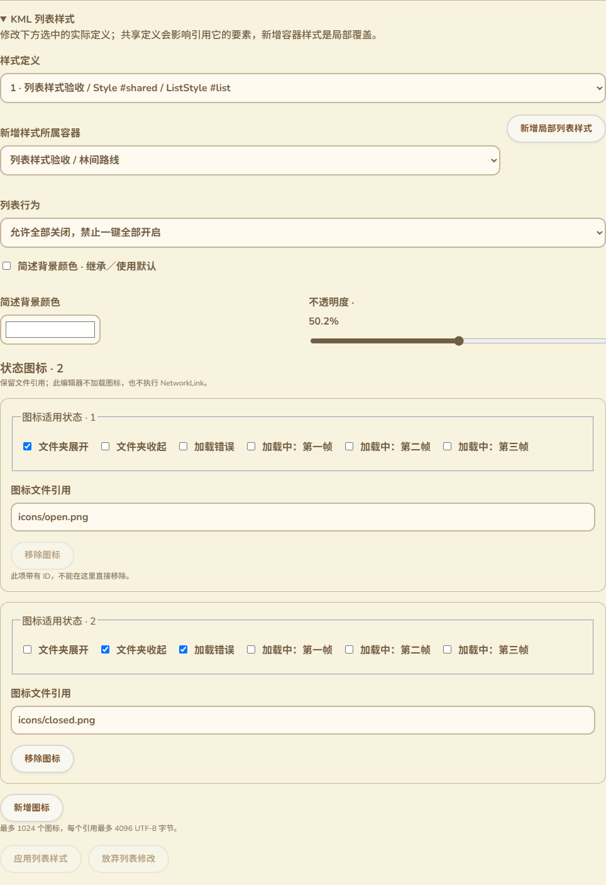

# KML列表样式与容器覆盖维护

2026-10-14，接101。在原KML样式编辑器底部增加列表样式区，覆盖实际ListStyle定义、Document／Folder局部覆盖及状态图标维护。本批没有固件、USB命令、网络协议或设备RAM变化。

## 页面位置与交互

[实际样式编辑器截图](images/kml-list-style-workspace-zh-Hans.png)包含原范围／普通高亮选择、线与图标等折叠区，以及新增列表样式区；新增区不受路标选择限制，因为ListStyle也用于文件夹与Document。

- 按完整所属路径、Style／ListStyle ID和分支选择实际定义，而不是按显示名称猜测修改目标。共享定义仍影响其引用，编辑内联分支不会自动改另一分支。
- 行为下拉展示普通勾选、子项互斥、只允许全部关闭和隐藏列表子项的含义；未设置与未知原值保留，只有显式改变时写入。
- 简述背景色采用颜色选择器和带百分比的透明度滑块；可移除本地颜色字段以恢复继承／默认。非法原文颜色显示原值与提示，未修改时保留。
- 状态图标使用六个可读的状态勾选，支持组合；引用可修改，图标可新增／移除，每页20项。带ID的项提示并禁直接删除，避免破坏外部引用；修改其字段仍保留身份。
- 新增局部样式可选择Document或Folder，插入空ListStyle覆盖，不复制共享定义、不改变styleUrl。随后可编辑该覆盖。
- 未应用输入接入原工作台互锁，阻止保存、其他样式字段、共享定义身份或其他编辑覆盖；应用、放弃、撤销、保存重开均复用原流程。

35条文案覆盖现有11语言；语言切换保留输入，390px与阿拉伯语RTL无页面横向溢出。图标引用和状态文本由用户维护，不隐式加载图片或执行NetworkLink。

## KML与保存范围

四种行为及ItemIcon状态组合依据[官方ListStyle参考](https://developers.google.com/kml/documentation/kmlreference#liststyle)。图标状态包括文件夹展开／收起、加载错误和三帧加载状态，文件引用为原URI。这里维护声明；网页内容列表目前没有完整模拟Google Earth Places面板的互斥／隐藏子项行为，也没有把状态图标渲染为已验证资源。保存到KML后供支持这些语义的读取器使用，不把维护控件当作完整列表渲染已经交付。

维护器选择实际Style下的ListStyle，排除Update、ExtendedData、Metadata和外部namespace中的声明，防止改动动态指令或扩展载荷。新增覆盖按Feature顺序放在Region／扩展数据和容器子项之前，不把Style附在Placemark之后。

修改以字段／原图标索引为单位；改变href不重建ItemIcon，未知子元素、注释、属性及ID保留，未改变图标不重写状态。删除ID所属子树拒绝；重复标量字段、重复操作索引、无效索引、非法状态和颜色拒绝。实际输入和XML变更在独立DOM执行，失败不替换工作台模型。

语义无变化返回原始source字节。修改模板之外的列表样式不改变BalloonStyle、LineStyle或StyleMap；原归档KML字节独立保留。

图标操作后最多1024项；每个新增／修改引用最多4096 UTF-8字节，拒绝非法XML字符和无效代理字符。原文件仍受既有8MiB／DOM等预算约束。状态组合不得含未知或重复词；原未知状态只在用户改该字段时要求修复，其他字段修改仍保留未改原值。

## 验证证据

- 新Node文案检查与气泡文案组合2项通过，全部语言具有行为／状态／保存保护说明。
- 新Edge验收使用真实DOM与生产维护器，覆盖2个实际定义和2个容器的选择、排除foreign／Update、精确无操作字节、10类非法修改、图标ID／未知扩展／注释保留、共享分支及其他样式不变、容器插入顺序、新增／删除图标。
- 实际构建页面覆盖编辑／互锁、保存重开、Folder新增覆盖、应用／撤销／放弃、原归档精确字节及11语言／390px／RTL。另以45图标实际浏览20／20／5三页，修改第三页后应用保存通过。
- 原完整样式编辑器、StyleMap与气泡浏览器回归通过，包含原图标裁剪／Canvas线色、普通高亮／共享引用、保存重开／原附件、两个地图气泡与安全预览。构建和差异检查通过；新增Node与浏览器专项接入CI，尚未远端运行。
- `.codex-build/hostlink-codec/kml-list-style-browser/result.json`记录`productionPage`、`originalPreserved`、`containerInsertion`、`stateIconPreservation`、`iconPagination`均true；`physicalUsb=false`、`publicNetwork=false`。截图为隔离草稿的实际表单，不能作为真实USB或目录发布证据。

GitNexus修改前执行样式编辑器及新维护入口的影响查询，新符号未收录、结果UNKNOWN。人工核对范围是原样式区的未应用互锁与独立XML提交，不涉及ESP执行路径。

## 仍保留的完整交付范围

本项完成ListStyle定义维护，不证明浏览器完整列表行为或图标显示。屏幕／照片叠加、完整受限富文本及08的其他兼容能力继续按原范围；候选Wio作者发布／确认／恢复、公网NAS／Linux容器和行政区、全部配置实际生效、大包／长期多peer／物理掉电等按16继续。没有新SDK编译／刷入／设备运行内存测量，基准仍为用户验收的约87K／297K。
