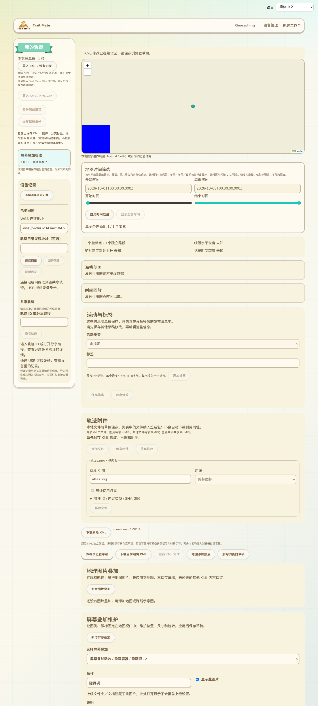

# KML屏幕叠加维护与固定视口预览

2026-10-14，接102。现有轨迹工作台增加ScreenOverlay维护，编辑地图与共享详情可以显示固定于视口的图例、徽标和其他屏幕图片。本批仅修改网页与测试，没有固件、USB命令、网络协议、SDK构建或设备RAM改动。

## 页面位置与输入

入口位于原地理图片叠加之后、样式编辑器之前，沿用已有附件与地图。未应用输入加入工作台互锁，防止保存、其他编辑或附件操作覆盖。

图中蓝色方块是隔离验收PNG图集的右半部分，原名称“右上角图例”保留，测试已通过预设改到左下角。截图使用实际构建页面和现有导航、侧栏；未连接USB或网络目录。

[实际屏幕叠加表单](images/kml-screen-editor-zh-Hans.png)支持：

- 名称、说明、显示开关及精确图片附件引用；引用选择复用本地PNG／JPEG附件。
- 左上／右上／左下／右下／居中预设，修改图片和视口锚点；高级折叠区可分别设置图片锚点、视口锚点及视口旋转中心。
- 比例、像素、距右／上边缘像素三种单位。尺寸使用“原始尺寸／保持宽高比／自定义尺寸”选项，不要求用户解释-1和0。
- 逆时针旋转、图层顺序、图片乘色和百分比透明度；图集裁剪的宽高同样用源图尺寸／指定像素选项。
- 新增、删除、放弃、应用、撤销、保存和重开。父容器隐藏、无效原颜色及缺少声明均有提示。

专用文案覆盖现有11语言并复用原叠加共用文案；实际390px和阿拉伯语RTL检查通过。数字使用原有按录入语言绑定的解析器，原文和未改字段不因语言切换改写。

## 位置与资源语义

参考[官方ScreenOverlay说明](https://developers.google.com/kml/documentation/kmlreference#screenoverlay)和[OGC KML 2.2 schema](https://schemas.opengis.net/kml/2.2.0/ogckml22.xsd)。坐标以左下角为原点，内部转换到CSS屏幕坐标；显示尺寸分别解析原始尺寸、宽高比及指定单位，原始尺寸基于实际裁剪区域。声明的rotationXY按视口解释；未声明时预览围绕叠加图像中心旋转。

对未声明overlayXY／screenXY／size的文件，预览分别使用居中锚点／原始尺寸，并明确提示此预览策略；已经声明的参数继续生效，不冒充所有读取器的默认行为。已经存在但缺属性的vec2按schema的1.0／fraction读取；未修改时不补写默认参数。

屏幕图层直接附着地图容器，独立于随地图平移的地理pane。它不返回地理边界，因此不会改变fitBounds、路线统计或制造经纬度；鼠标事件透过叠加，仍能拖动地图。尺寸变化时重算布局。显示尺寸最多16384px、位置绝对值最多100000px，超预览预算隐藏；有效原参数仍保存。

图片来源继续由原附件读取器校验实际SHA-256、类型、尺寸和解码像素预算，使用精确本地引用。共享输入须由上游签名索引验证，再校验实际字节；没有自动访问KML中的外部地址。缺图、坏摘要、裁剪错误或超布局预算均提供本地化说明。没有href时使用颜色矩形，不伪造图片已下载。

ScreenOverlay有独立标识，时间／Region投影与GroundOverlay分开，避免两类都从索引0开始而混用范围。复用既有最近祖先时间、Region／LOD／淡出与显式绕过策略，地图时间筛选的范围也包含屏幕叠加声明。

## 编辑与保留

编辑只选取有效KML根容器中的ScreenOverlay，外部namespace和动态Update内容不进入编辑目标。字段修改保留ID、未知子树、Icon的其他字段、时间／Region与其他要素。重复字段拒绝不明确修改，删除时检查外部targetId；无操作保持原source字节。新增生成独立ID，必要时保留原根内容并建立Document。

本次原归档KML及附件字节独立保留，修改后沿现有草稿版本／摘要和发布流程处理，不沿用原文件hash。兼容报告不再把ScreenOverlay一律标为“未渲染”；具体资源或布局限制由实际预览提示。设备仍没有屏幕叠加显示能力，本批不扩大设备安装能力声明。

## 验证证据

- 新增6项Node检查：三种锚点／左下原点、裁剪后原始尺寸／宽高比、显式旋转中心、尺寸变化／源参数不变、有限预算、11语言。与原时间／Region组合14项退出0。
- 新Edge检查真实DOM及实际页面：8类非法输入、namespace／隐藏父容器／ID／原文保留，实际通过校验PNG图集裁剪、视口固定与拖动／缩放、时间筛选、新增纯色矩形／删除／撤销、应用保存重开／放弃／互锁、11语言／390px／RTL。
- 生产共享预览组件使用同一附件字节，实际Region／LOD隐藏与显式绕过通过；修改附件字节后即使上游测试声明verified也被实际摘要检查拒绝。共享元数据与签名索引边界由测试构造，不作为作者签名、真实目录或USB证据。
- 原地理叠加像素／投影、叠加维护、时间筛选、Region、列表样式及完整包浏览器回归通过，构建及差异检查通过；新增Node／浏览器专项加入CI，尚未远端运行。
- 结果在`.codex-build/hostlink-codec/kml-screen-browser/result.json`：`productionPage`、`verifiedLocalRaster`、`crop`、`screenFixed`、`timeFilter`、`regionScope`、`sharedPreview`、`corruptAssetRejected`、`originalPreserved`为true，`physicalUsb=false`、`publicNetwork=false`。最终截图已检查。

首次实际页面暴露FeatureGroup向屏幕图层索取getLatLng的异常；新增空地理边界后实际渲染通过，而不是给屏幕位置补假经纬度。鼠标位置断言按地图内部内容区扣除边框；未应用互锁等待实际禁用状态后核对，没有放宽原保存、字节或签名断言。

GitNexus修改前查询预览、资源读取、时间／Region投影、工作台及解析器入口，返回UNKNOWN（新符号未收录）；人工核对范围包括本地与共享地图、共用图片读取及兼容清单。原相关浏览器回归覆盖这些路径，未修改ESP。

## 保留的完整交付范围

核对原文保存时发现：普通KML的`App.importFile`仅传当前source到`saveTrackDraft`，后者只有归档导入／特定备份恢复路径登记originalBytes及独立original。因此本轮原归档字节验收不能推广为普通导入修改后仍保留初始原文；普通导入的不可变原文保存需要补齐，不以撤销历史替代。

PhotoOverlay及08的其他高级内容、完整受限富文本、完整列表行为仍继续推进。候选Wio作者发布／确认／恢复、公网NAS／Linux容器和生产行政区、全部配置实际生效、最大包吞吐、长期多peer与物理掉电等仍按16验收。当前测试没有设备运行内存测量，基准保持用户确认的约87K／297K。
