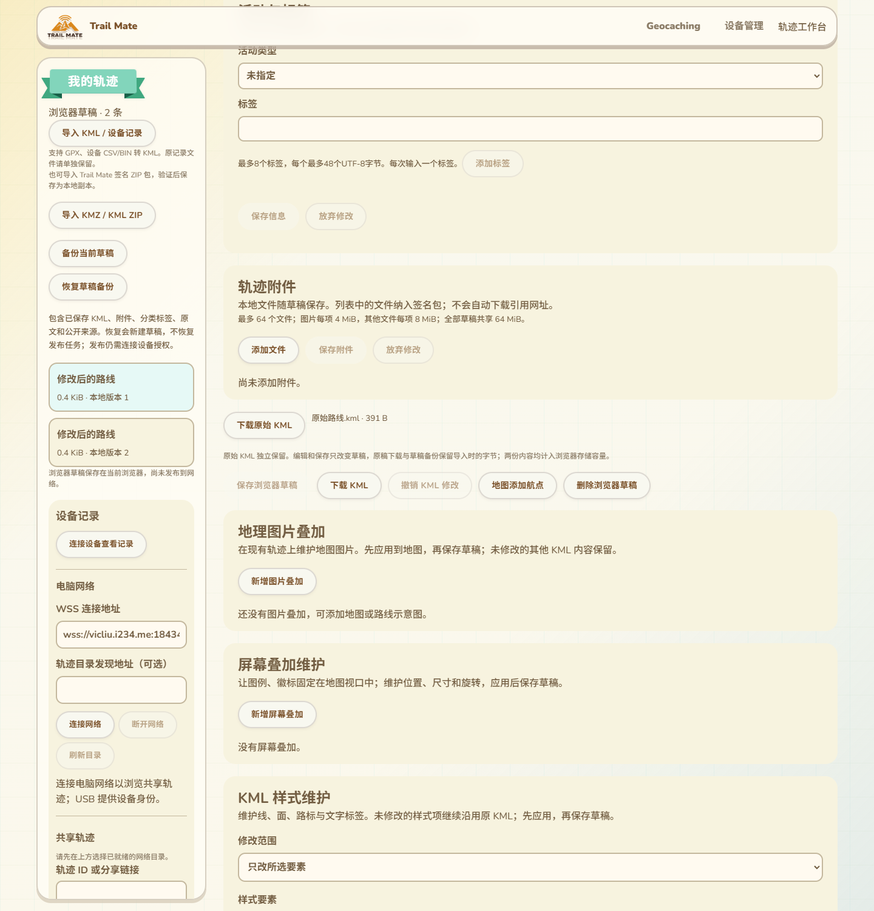

# 普通KML原文保留与备份恢复

2026-10-14，接103的原文范围复核。普通KML导入及签名ZIP导入现在独立保存导入时的KML原始字节；编辑、保存和重开继续使用当前草稿，下载原始KML及草稿备份保留初始原文。本批不修改固件、USB协议、Reticulum协议或设备RAM，没有SDK构建或刷入。

## 页面交互

入口仍在原轨迹工作台的附件区之后。独立的“下载原始KML”显示原文件名、原字节大小，并说明编辑只改变当前草稿。原文和当前内容同时计入浏览器存储容量；用户无需自行判断哪个下载按钮能取回原稿。

新普通导入使用实际原文件名，签名ZIP内的KML使用track.kml；下载前缀original-，不再根据可能已经改名的草稿猜测原名。未保存修改时也能下载原稿。历史草稿若没有独立原文，显示明确提示，不把已编辑文件冒充初次导入文件，也不会自动制造原文。

专用两条说明覆盖现有11语言，复用原下载按钮文案；实际390px和阿拉伯语RTL检查通过。

## 保存与验证

`saveTrackDraft`新增显式originalImport，仅允许新草稿第一次导入，内容必须与初始KML逐字节相同；不得用于替换旧原文或与归档导入、备份恢复、前版维护混用。允许与经过校验的packageSource共存，因此共享来源和签名ZIP的原作者证明、附件索引及资源不会被独立原稿覆盖。

输入原字节、当前字节和原文件名在等待草稿锁或摘要前捕获，调用者后续修改输入不改变被保存的内容。继续复用已有originalBytes／originalHash／archiveMember与文件original存储，无数据库版本或备份格式升级。

读原文检查长度、原名和SHA-256。后续编辑保存先在同一草稿锁中读取并验证原文，再由写事务核对版本和原文元数据绑定，写入经过验证的独立原字节。原文损坏时读和保存都拒绝，不通过覆盖当前草稿悄悄消除损坏证据。当前KML继续有独立摘要与版本，原资源与公开来源证明沿原路径保留。

## 验收证据

- 新实际构建页面／Edge／IndexedDB专项：带BOM、CRLF、CDATA、注释、未知namespace和中文文件名的普通KML导入，原稿下载、未保存下载、修改保存、当前文件区别、刷新重开全部逐字节核对。
- 真实草稿ZIP导出、解析和恢复为新草稿后，编辑稿和原稿均与各自输入精确相同。
- 输入立即变更隔离、五类非法originalImport、真实Ed25519签名来源与原稿共存、实际页面签名ZIP导入和独立原稿下载通过。
- 原稿字节被篡改后读取和编辑保存均拒绝，元数据版本／名称保持；历史草稿没有原文时不伪造。
- 独立实际IndexedDB上下文写入四个8MiB当前文件及四个8MiB原文，达到64MiB逻辑预算后下一次保存失败且无部分新草稿；删除一条后可保存。此处是逻辑容量验证，不是物理磁盘满测试。
- 11语言、390px／RTL、无外部请求检查通过。结果见`.codex-build/hostlink-codec/kml-original-browser/result.json`，physicalUsb和publicNetwork均为false；最终实际截图已核对。
- 24项原文文案／备份／签名ZIP／KMZ Node组合退出0；原草稿备份、共享完整包、签名ZIP实际页面、屏幕叠加与工作台浏览器回归退出0。工作台回归包含保存、编辑、冲突和窄屏。专项加入CI，尚未远端运行。

GitNexus修改前对saveTrackDraft、readTrackDraft、importFile及downloadArchiveOriginal分析返回UNKNOWN，新符号尚未收录，不能解释为零调用风险。人工范围为普通导入、签名ZIP／共享副本、备份恢复及编辑保存；本批回归覆盖这些浏览器路径，不涉及ESP。

## 仍保留的范围

GPX／CSV／BIN记录转换没有在本批作为原始KML登记；不能以本次普通KML验收宣称这些原记录已经在浏览器中独立备份。PhotoOverlay、完整受限富文本与列表显示，以及候选Wio作者完整维护、公网NAS／生产行政区、配置实际生效、大包长期故障和物理掉电仍按16继续。本批没有新的运行RAM测量，设备基准仍是用户确认的约87K／297K。
