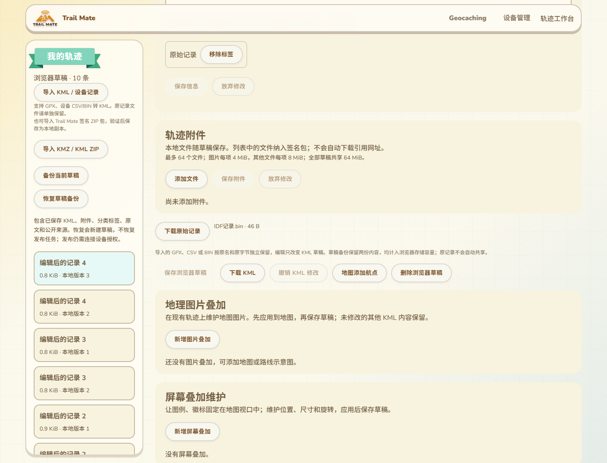

# 原始记录保留与旧草稿库升级

2026-10-14，接104的GPX／CSV／BIN原记录缺口。普通文件导入与设备快照导入共用的工作台入口，现在将原记录按原名、原格式和原字节独立保存。转换后仍使用KML作为编辑及发布内容；本批不修改固件、USB协议、Reticulum协议或设备RAM，没有SDK构建或刷入。

## 工作台中的两份文件

原稿下载沿用104所在的位置，原记录显示“下载原始记录”，保留GPX／CSV／BIN原文件名及实际大小；小于1KiB的文件直接显示字节，避免46字节的记录被显示成0.0KiB。当前KML仍由原下载按钮取得，编辑只改变这份草稿。

原记录和KML一起进入草稿备份，计入已有64MiB浏览器容量。原记录没有自动添加到附件列表，也没有自动共享。专用按钮及说明覆盖11语言，实际390px和阿拉伯语RTL核对通过。

设备读取组件原本已经将快照原字节作为File传给同一importFile入口，当前原记录保存路径因此接通；此次实际页面验收使用本地文件输入，不宣称Wio USB快照导入已重新实测。旧草稿如果已经丢失原记录，仍不能从转换后的KML恢复原文件，不会自动伪造。

## 存储、备份与兼容

新增originalFormat只用于GPX／CSV／BIN。普通KML及原KMZ继续以未声明格式作为KML兼容默认值。原名的后缀与记录格式相符，格式为显式有限集合；未知类型、对象、null、错误后缀及后续替换原稿均拒绝。初次调用在等待锁或摘要前捕获当前KML、原记录与原名／格式。

原字节继续位于已有文件original字段，原名／摘要／大小沿用已有元数据。读取和后续编辑保存校验原字节SHA-256及格式绑定，损坏读写拒绝，当前版本不变。附件保存和活动／标签保存也保留原格式，避免编辑别的内容后错标成KML。

草稿库版本升至4，升级不重写已有字节或清除旧草稿，仍保留已有附件和任务迁移。旧网页不认识格式字段，手工构造元数据的旧保存路径可能丢失它，因此必须禁止旧版本继续写入；版本变更关闭旧连接，旧版open请求产生VersionError。不能只新增字段而放任旧页面覆盖。此次范围包含旧库升级和并存旧连接检查。

原记录备份使用trailmate.track.draft版本2，明确originalFormat，ZIP成员为original.gpx／original.csv／original.bin。当前内容仍是draft.kml。普通KML及没有独立原文的备份仍输出版本1；新读取器继续接受版本1，严格拒绝混淆版本、格式、后缀、成员、摘要或缺失原文的包。旧版读取器会拒绝版本2，避免误认。备份校验是内容完整性检查，不是原记录作者认证；公开作者仍由现有设备签名流程证明。

## 验收证据

- 新5项Node专项及原5项备份组合退出0：三格式原字节与原名／成员、旧版本1保持、非法格式与成员混淆／篡改拒绝、同步捕获输入、11语言。包括null参数被初次测试接受的问题，修正为仅undefined使用兼容默认后重跑通过。
- 原记录转换／文案／备份组合16项退出0，备份与签名ZIP／KMZ组合28项退出0；不是新增28项测试。
- 新实际构建页面／Edge／IndexedDB专项验证五个样本：带BOM、CRLF、注释和扩展的GPX，两种CSV及两种BIN。BIN填充字节不丢，CSV小数文本和CRLF保留。
- 每个样本逐字节验证原稿下载、未保存修改下载、编辑保存、当前KML区别、刷新重开、真实ZIP备份及恢复为新草稿；活动／标签和附件保存后原格式／字节仍在。11语言、390px／RTL及无外部请求通过。
- 使用生产draftPackageCreationOptions、createTrackPublicationPlan及draftPackageInputs检查五个样本的发布准备：文件hash／大小／MIME绑定当前KML，hash不是原记录，资源及附件输入为空。这里是生产准备函数的隔离浏览器执行，不是实际设备签名／网络发布验收。
- 原字节及格式标记分别被篡改后，读取和编辑保存均拒绝，名称／版本保持；四类非法originalImport被拒绝。
- 新真实IndexedDB升级专项分别创建版本1／2／3并保持旧连接，生产store升级至4后旧连接关闭，旧写入版本被拒绝，已有当前／原字节和名称版本保留，不制造原文，新CSV独立原稿可保存。
- 最终库版本4的原普通KML／真实64MiB双文件容量、旧草稿ZIP、附件迁移与损坏／删除、KMZ集成回归均退出0；共享资源包、工作台和GPX转换相关回归也通过。网页构建、差异及最终截图检查通过。专项接入CI，尚未远端运行。

结果分别在`.codex-build/hostlink-codec/recording-original-browser/result.json`与`original-format-migration/result.json`；physicalUsb和publicNetwork均为false。

GitNexus修改前对工作台、原文读写、附件保存、备份校验／导入导出、数据库open及受影响测试入口分析返回UNKNOWN；新网页符号未收录，不解释为零风险。人工范围包含普通及设备快照导入、备份恢复、其他编辑保存和旧页面存储写入，相关实际浏览器回归覆盖。没有改动ESP。

## 设备与完整交付范围

只读端口清单仍有COM69，没有COM67；用户明确暂时无法操作设备。候选a29669a2未刷入，继续等待原BOOT／RESET操作，不重复请求或尝试写入。设备已验收镜像和用户反馈约87K／297K基准保持，本轮未测新运行RAM。

PhotoOverlay、完整受限富文本及列表显示仍待；真实Wio身份贯穿创建／发布／更新／归档与恢复、公网NAS／生产行政区、配置实际消费、大包／长期多peer／物理掉电等原范围按16继续。原记录持久保存及库升级通过不等于这三项整体交付。
