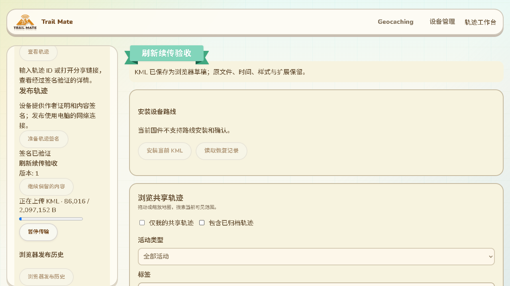

# 浏览器网络会话保留与刷新续传

2026-10-14，接107。补齐实际轨迹页面刷新后沿用原上传所有权的缺口。本批没有固件、SDK编译、刷入或设备RAM改动；用户暂时无法操作设备，候选a29669a2仍未刷入。

## 实现与边界

`TrackIPConnection`不再每次传null生成新传输身份，而从本网站IndexedDB读取按完整规范化端点保存的匿名网络会话。设备仍提供作者证明与内容签名，网页网络会话只用于连接与临时上传所有权，不成为作者账号，也不要求网页登录。

独立库`trailmate-track-transport`版本1，最多32个端点。仅允许WSS及本机WS，拒绝凭据、片段及过长端点；不同路径或端点独立。新增身份使用同一readwrite事务先读取、核对容量再添加，两个标签页竞争时保留先提交的身份。持久化失败、记录损坏或容量满明确提示，不静默更换身份。三种错误有11语言文案。

浏览器依赖的身份导出包含128字节布局，导入需要64字节私有种子；实现提取两段种子并核对恢复公钥。临时导出、记录副本和交给连接的种子在使用后清零。这里只保存浏览器匿名传输密钥，不读取设备作者私钥，不加入设备配置或轨迹草稿备份。记录验证检查格式、版本及公钥绑定；不是任意私有字节的独立校验和。X25519低位会被clamp，篡改测试使用不被clamp的位置。

轨迹发布区增加文件阶段、实际字节进度与暂停操作，暂停保留原任务和签名，不将AbortError的数字code显示给用户。IDB QuotaExceededError的数字code也统一转为可理解的存储错误。进度与暂停文案覆盖11语言。

## 已完成验证

- 实际IndexedDB及生产连接组件：规范化端点重连、真实页面刷新、同BrowserContext两个标签页竞争、不同端点隔离、连接后调用方密钥清零、配额失败后重试、损坏拒绝、32端点容量和11语言窄屏／RTL通过。网络边界受控，未使用实机。
- 实际构建的轨迹整页、浏览器RNS／LXMF、raw桥与Python生产目录：2MiB KML上传后暂停，真实刷新网页并重新连接，原生目录报告从106496字节继续，保持同一传输所有者、请求ID、清单及签名，只签一次。发布确认后再次真实刷新仍恢复确认。整轮37501ms，终端退出0。
- USB作者使用独立合成设备，以实际HostLink字节帧和真实签名响应；结果physicalUsb=false、publicNetwork=false，RF请求、配置写入、密钥导出均为0。不能推广为Wio实机验收。
- 本批6项相关Node测试、共享轨迹IP浏览组件和发布组件回归退出0。常规CI加入新检查，未远端运行。

结果位于`.codex-build/hostlink-codec/track-refresh-network/result.json`及`track-transport-browser/result.json`。截图来自实际现有轨迹页面，发布操作仍位于左侧工作台；模拟设备未声明安装及回执同步能力，因此截图相关按钮禁用，不代表当前Wio能力缺失。

## 新发现及仍未完成

109已修正下述工作区摘要矛盾，并重新完成实际整页／真实网络刷新续传和确认摘要断言；上方确认截图更新为109复测。下段保留本批最初发现，不再作为当前未修复项。

确认截图左侧已经显示“目录已确认”，但工作区顶部仍显示“尚未发布到网络”。状态摘要没有跟随恢复后的发布记录，需要修正；本批网络确认测试通过不能掩盖这个UI一致性缺口。

同端点两个标签页生成同一会话身份已验证，不代表不同设备作者的并发上传互锁、长期关闭后恢复或所有存储故障已通过。107的最大单目录文件与本批2MiB实际页面刷新分别验证，不能合并为最大包整页刷新压力已通过。

当前交付仍缺：候选Wio刷入后的真实作者创建／发布／更新／归档及回执同步；公网NAS容器、轨迹服务发现、生产行政区数据与GitHub Pages发布；部分配置运行消费；PhotoOverlay、完整列表行为及气泡富文本等KML范围；最大点数地图交互、设备导航图片内存峰值、多peer长期故障与物理掉电。等待设备只影响实机项目，其他项目仍可推进。

GitNexus修改前分析连接、上传组件及测试服务包装器返回UNKNOWN；人工范围为网络会话、发布进度／暂停与测试审计，不将索引缺失当作零影响。没有ESP符号改动。
