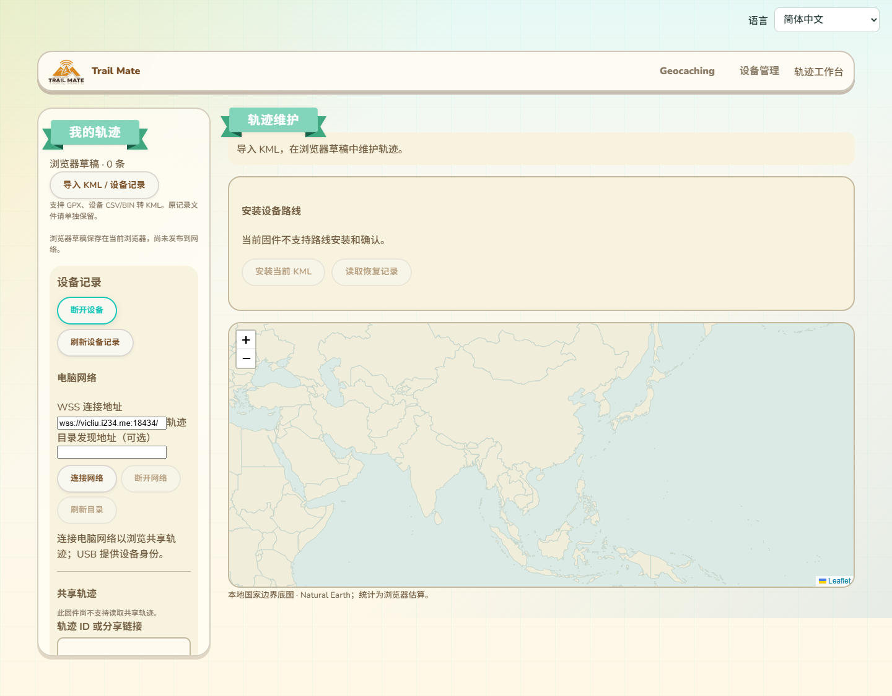
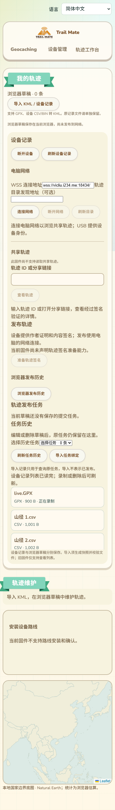

# 轨迹目录查询的当前实施

本文记录 2026-10-11 的接口实现状态，不替代完整轨迹共享方案。当前目录查询与能力请求调度已接入 ESP-IDF 和 Wio L2 Arduino HostLink，网页目录刷新与选择已加入现有轨迹页面的设备连接卡片；网络发布任务仍待连接。Wio L2 构建、资源报告和目录测试步骤见 [12-Wio-L2首轮实机测试](12-Wio-L2首轮实机测试.md)。Wio L2 已接入设备记录导入、KML/清单上传、签名准备和资源释放；网络提交及发布确认仍待实现。

## HostLink 操作 89：TRACK_DIRECTORY_LIST

操作 84 保持轨迹历史，85 保持路线安装。新增 89 用于轨迹目录查询，只有声明该操作的固件才可调用。Arduino 能力表未加入该操作。

请求体为 `[cursor_u8]`，首次为 `[0]`。响应体为 `[next_cursor_or_nil, rows]`，每次最多一条，最后一页的 next 为 nil；空目录为 `[nil, []]`。目录会话最多接纳 8 个节点，不循环覆盖已有节点。

每条记录为 `[delivery16, public_key64, epoch16, name_utf8, capabilities_verified_0_or_1, file_limit_u32, chunk_limit_u16, query_limit_u8]`。未完成能力协商时标志为 0，三个限制值均为 0；它不是可选发布目标。浏览器重新从公钥派生 lxmf.delivery 地址，拒绝地址不一致、重复条目、不合法游标和矛盾的能力字段。

目录信息来自经过现有 Reticulum 签名、身份和服务目标验证的 `trailmate.track.directory` 公告。应用元数据为 `[1, "trailmate.track.v1", delivery16, epoch16, name_utf8]`。名称最长 40 字节时编码为 99 字节，接收视图上限为 128 字节，不创建额外公告缓冲。

## 生命周期和资源

### HostLink 操作 90：TRACK_DIRECTORY_DISCOVER

请求体为 `[discovery_destination16]`，必须为非零 16 字节；成功响应为 `[]`，仅表示路径查询已经发送，不表示目录存在、可信或支持发布。复用操作 89 的目录会话和共享 Reticulum 后端，先注册公告消费者再请求路径。随后必须收到经过正常签名与服务目标验证的公告，再完成 GET_CAPABILITIES，操作 89 才能返回就绪目录。

网页目录卡片提供折叠的“按地址查找目录”，接受目录运营者提供的 32 个十六进制字符，兼容 Reticulum 的 `<hex>` 显示格式。它是目录发现地址，不是轨迹对象 ID，也不是 LXMF 通信地址。目录服务启动日志的 ready JSON 中 `discovery` 字段可供运营者分享。浏览器不会仅凭输入地址创建可信记录。

路径请求由持锁路由解析当前后端，并复用既有路径请求包 scratch、冷却记录和发送接口，不新增任务、队列或目录缓存。通话、游牧及省电阶段暂停请求，后端未就绪或已有冷却时返回 Busy。浏览器重试间隔为 1 秒，默认总预算 30 秒，可取消。

首次查询才分配目录 Owner，限定为 PSRAM，编译断言不超过 1792 字节；分配失败返回 Busy，不回退到内部 RAM。Owner 包含最多 8 条目录元数据、会话 ID、回调绑定、单个在途能力请求和退避计时，不存储 KML、网络消息或私钥。能力请求编码借用原 PendingCommand 的 payload；当前作者公钥借用同一缓冲区尾部 64 字节，不放入 Owner。

公告回调与列表读取使用非阻塞标志保护元数据；竞争时返回拒绝或 Busy。注册和解绑通过适配器路由锁进行。解绑完成后才销毁回调上下文。目录会话在匹配的 SessionClose、USB 断线、HostLink 停止或 30 秒未查询后释放。运行时生命周期入口由现有应用调度线程调用。

目录查询复用现有网页 Reticulum 网络租约，使用 require_storage=false，避免单纯发现目录时要求本地 Geocaching 存储初始化。可能启动已有共享网络后端；这不代表网络后端没有资源成本。尚未新增第二个轨迹专用 Reticulum 实例。

能力请求使用随机请求 ID，同时只有一个在途请求。发送失败退避 3 秒；15 秒未确认则退避 30 秒。收到响应时核对已验证的通信来源、设备本地目标、请求 ID、公钥、epoch、协议操作及资源上限。目录 epoch 变化使旧请求和能力失效；过期响应不会使目录就绪。能力交换是同步完成的临时控制操作，不产生待发布数据；业务上传/发布回调仍须持久化成功才接受。

## 已有验证与仍缺少的连接

2026-10-11 本轮 P4 ESP-IDF 构建在 10:42:36 明确完成，进程退出码 0。完整原生构建成功；CTest 的 68 项中 67 项通过，`track_router_dispatch` 被启动器以 permission denied 拒绝启动，同一可执行文件在 PowerShell 直接运行退出码 0，不能把它记作 CTest 通过。浏览器既有串口与管理协议 13 项测试通过，新增目录读取 3 项通过。ESP 栈检查和 diff 空白检查通过。上述结果均不替代真机验收。

能力调度接入后的 P4 构建在 11:03:23 完成，退出码 0；完整原生构建成功，CTest 仍为 67 项通过、同一项启动权限失败。新增实际运行时测试覆盖请求封包、单请求在途、发送退避、来源/目标约束、能力就绪回传、epoch 重新协商、旧响应和过期响应拒绝、超时退避，以及原有释放流程。

发现过滤接入后的 P4 构建在 11:21:46 完成，退出码 0。轨迹与 Geocaching 共用既有每 10 秒 4 次的应用公告额度，不新增计数器；轨迹公告仅在对应消费者已注册时进入应用发现例外，并在后续正常摄入中验证完整签名和服务目标。通话、游牧及省电阶段保持暂停。路径响应去重和 Wi-Fi 公告延后规则使用同一应用准入结果。两个固定服务的名称哈希改为只读常量，避免运行时初始化缓存和逐包计算；原生测试使用实际 Reticulum 名称哈希函数构造测试包，验证两类服务、99/128 字节合法轨迹公告、129 字节拒绝、错误名称、未监听和受限阶段，并保留原 Geocaching 与计数窗口回绕测试。栈检查通过。

主动路径请求接入后的 P4 构建在 11:37:02 完成，退出码 0。实际目录运行时原生测试验证请求转发、无提前信任记录、未就绪、会话冲突和全零地址拒绝；浏览器新增 3 项 Node 测试验证地址输入、请求语义、输入字节固定、有界重试和取消。构建后的 Edge 页面使用模拟串口验证非法输入不发送、括号格式地址经操作 90 发送、等待验证状态及原有目录/快照流程。仍无实体目录路径请求的网络证据。

原生测试直接包含实际目录运行时头文件，替换硬件分配器、计时器和适配器，验证资源不足、接口不支持、实际公告回调、空列表和条目编码、会话冲突、竞争、闲置到期、断线和显式关闭，并检查 PSRAM 分配归零。

浏览器读取模块通过 3 项 Node 测试，验证操作号和未就绪状态、公钥与通信地址绑定、重复记录、分页错误、空目录、有界 Busy 重试和取消。构建后的真实页面通过 Edge 测试，使用模拟 USB 串口验证目录查询、未就绪禁选、就绪选择、身份不匹配后清除列表、epoch 变化后清除选择、旧固件能力门控和 390px 无水平溢出；原有记录读取、快照导入、取消和回收流程也通过。仍不是实体 USB 验收。

目录区域位于现有左侧“设备记录”卡片的 USB 连接按钮下方，继续复用 Animal Island 风格。以下截图使用模拟串口数据展示状态，图中的就绪目录不是当前固件能力调度已经完成的证明。

Owner 已发送 GET_CAPABILITIES 并通过控制回调校验结果；只有真实网络响应满足绑定和限制后，目录查询才返回就绪。原生测试中的模拟适配器证明状态转换与封包行为，尚不能证明实体设备与目录节点已完成网络协商。发布任务注册、HostLink 83 和任务状态接口仍待接通；尚无实体 USB、SD、LoRa 或峰值 RAM 验收。

## 发布准入的可信目录快照

新增内部 `directory_runtime::pin` 入口，为后续发布任务复制固定的目录地址、公钥、epoch 与文件、分块、查询上限。输出上限 104 字节，由调用者提供存储；函数不分配缓冲、不保留目录表指针。任务仍须另行持久化绑定、取得网络生命周期和注册接收器，这个入口不等于已经实现操作 83。

准入要求适配器和 USB 会话与目录所有者一致，时间不倒退且没有超过 30 秒闲置期限，目录地址与 epoch 精确匹配，并已完成能力验证。竞争返回 Busy；未经验证、错误会话、过期或 epoch 不匹配时拒绝。输出不能与请求字段或所有者内存重叠；失败不修改输出，成功才更新会话使用时间。

原生目录测试验证上述拒绝条件、能力限制复制以及所有者销毁后已复制绑定仍可使用。未来回执必须用固定的目录身份与 epoch 校验，不能把后来改变的目录表项当作原提交目录。

## 发布目录绑定持久化与任务准入

目录快照现复用核心 `PublicationDirectory` 元数据类型，大小上限仍为 104 字节。新增 `TMTD` v1 固定 110 字节记录，包含目录通信地址、公钥、epoch、文件/分块/查询上限及损坏检测 CRC。路径由设备推导为 `/trailmate/tracks/<object32小写hex>/<operation16小写hex>.dir`，网页不能指定文件路径。公钥来源仍须是已验证的公告与能力响应；CRC 只检测损坏，不替代身份认证。

`PublicationDirectoryStore` 使用调用方提供的记录和缓冲，借用现有 SD I/O，不创建常驻缓存或额外文件句柄。首次写入要求同步、关闭和读回一致；已有相同记录可复用，公钥、epoch 或能力限制不同则冲突。损坏记录、短写残留及存储错误不能被重试覆盖；损坏任务应停止并明确报告，不能自行换目录继续。

`admitPublicationIntent` 串起目录绑定与既有双槽发布日志：先确认目录绑定持久化成功且满足任务文件大小、目录地址、epoch，再持久化任务。写完绑定但尚未写任务时中断，可以用相同操作与绑定恢复；已经进入上传阶段的任务重复准入保持进度。只有本地准入成功不能标记为远端发布成功，最终仍要求校验并持久化目录签名回执。

新增原生测试覆盖完整编解码、每个字节的损坏检测、有正确 CRC 的非法资源上限、短写、同步失败、读/关闭失败、不可用存储、绑定冲突、写完绑定后任务写入失败及恢复、重复准入不重置上传进度和缓冲重叠拒绝。实际目录运行时测试还验证销毁 USB 目录所有者后，复制的可信快照可以编码与恢复。`publication_directory`、`object_paths`、`track_directories_runtime` 三项 CTest 通过。这些是软件与故障注入证据；HostLink 83、实际网络任务调度与设备断电验收仍未完成。

本轮共享代码在 Wio L2 与 P4 的构建均退出码 0。Wio L2 14:41:31 构建的静态 RAM 仍为 98,652 字节，HostLink ELF 入口及 ESP 栈检查通过。上述新增核心持久化逻辑尚需由实际发布运行时调用；链接通过不证明其已经在 USB 操作 83 或实机网络中执行。

## 提交时的设备复核与请求生命周期（内部实现，尚未开放操作 83）

新增 `TrackPublicationAdmission`，串起实际 SDK 的 SD I/O、清单签名校验、保留 KML 哈希检查、目录绑定、发布日志和对象头提交。状态机完整复制提交绑定，每次调度重新核对当前作者公钥、身份 generation、SD 媒体会话及外部存储占用；清单与 KML 每次读取最多 320 字节，读取结束即关闭句柄。签名清单、工作区和所有协议记录在按需分配的 PSRAM 对象中，大小限制为 14 KiB，SD 文件实现也要求 PSRAM，不回退到内部 RAM。

最后准入前重新读取版本头和签名预约，核对操作、对象、版本哈希、作者和 KML 证据。Signed 对象头只有在目录绑定和任务日志持久化成功后才能变成 Committed；Committed 仍只表示本地准入。如果头已经 Committed，必须存在匹配的原任务与目录绑定，不能凭对象头重新制造一个缺失任务或换目录。重复准入保留原日志的阶段、序号和上传偏移。

新增 `TrackPublicationRequestWork` 与内部 `processPublicationRequest` / `advancePublicationRequest`。请求绑定 USB 会话与 30 秒闲置窗口；处理期间返回 Busy，不返回提前成功。准入完成后复制小型任务元数据并立即销毁大工作区，残留请求对象上限 384 字节。成功回执为网页 `device-commit.js` 已约定的 8 字段数组：操作 ID、对象 ID、版本哈希、身份 generation、修订号、目录地址、目录 epoch 和本地准入标记 1。网页仍须保持 `published=false`，直到另行确认目录签名回执。

断线、到期或销毁会释放全部请求对象；已持久化的文件保留，重新连接可重复提交同一操作。暂时无法读取身份时不暴露就绪结果；身份变化、换卡、KML 损坏、目录公钥冲突和已提交头缺少任务均拒绝。调用方仍须提供可信目录快照、串行调度和对象存储租约，并连接实际网络任务；目前没有在 HostLink 能力或主命令分发中开放 83，没有新增常驻调度槽、任务或队列。

`track_snapshot_owner` 原生测试直接包含这两个实际 SDK 头文件，用模拟 SD 与真实 SHA-256/Ed25519 验证完整复核、任务写入和 Committed 转换；覆盖请求输入复制、资源不足、内部文件存储不足、保留文件损坏、目录公钥冲突、换卡、同步失败不提前提交、重试不重置已有上传偏移、请求回执封包、会话冲突、身份不可用/变化、处理中断线、完成后断线、重连复用与到期回收，并核查分配计数恢复。网页提交模块的 3 项 Node 测试通过。新增内部请求路径尚未在 Wio L2 固件或实机中执行，本节不能作为固件能力和实网发布证据。

## 发布发送顺序与有界重试（核心实现）

新增 `sendTrackPublicationStep`，串起清单发布封包、Publishing 日志、回执等待和现有受身份约束的 `sendTrackData`。调用方提供互不重叠的记录、发送缓冲与日志缓冲；函数不分配工作区，不保留文件句柄。先验证并预编码发布包，避免缓冲不足时提前修改日志；再持久化 Publishing，注册回执等待，最后发送。日志失败不发送；发送队列拒绝时撤销临时等待，但保留 Publishing 记录和原操作 ID。发送成功仅表示入队，最终仍由现有回执接收器完成签名校验、回执保存与 Confirmed 日志。

新增 `RequestRetryWindow`，大小上限 56 字节，仅保存固定请求 ID、期限与尝试次数，不保存网络包。调用方配置响应期限、退避和次数上限，并保证请求内容、目录/作者/媒体租约及接收器所有权在交换期间稳定。超时撤销本次临时等待并退避，然后重发同一个请求 ID 和相同内容；达到次数上限暂停交换，保留该请求 ID，可显式恢复。暂停/耗尽不等于远端失败，不修改发布日志，也不能新建操作代替未决操作。暂停、发送拒绝或时钟倒退不会被当成收到确认。

原生 `prepared_signature` 测试使用真实 Ed25519 清单与目录回执，以及实际双槽发布日志和回执接收器，验证 FileStored 到 Publishing 后才调用发送器、日志失败不进入发送器、发送拒绝后的重试保持原包、在途不重复发送、超时退避与重发、回执保存失败保持未确认，以及签名回执持久化后才完成交换。测试的模拟 SD 替换文件容器后必须重新建立借用的清单视图；首轮测试发现了该测试夹具的视图生命周期问题，已修正并重新通过。独立 `request_retry_window` 测试覆盖 ID 复制、时间倒退、超时、尝试耗尽、发送退避、暂停和恢复。

这些核心步骤尚未挂到实际设备的网络任务所有者、绑定调度和 HostLink 主分发，因此仍未开放 83，也没有新的实机或 Wio L2 固件运行证据。发布任务所有者还须提供串行回调/调度、断线后独立生命周期、重启恢复、目录 epoch 校验、状态查询与取消。

## 重启后的签名回执复核

回执使用设备推导的独立路径 `/trailmate/tracks/<object32小写hex>/<operation16小写hex>.rct`（临时）及 `.rcp`（已保存），与清单、KML、目录绑定和任务日志分开。旧路径枚举值和后缀保持一致；新增回执路径只接受 16 字节操作 ID，不接受网页指定路径。

新增 `PublicationReceiptLoader`，借用调用方提供的最多 1100 字节回执缓冲、签名验证工作区和 proof，不自行分配缓冲。每次最多读取 320 字节，读完立即关闭 SD 句柄；读取期间文件长度变化、存储错误、取消、损坏签名或目录公钥/epoch/任务绑定不匹配都不能形成就绪证据。回执证明还核对操作 ID、对象、修订哈希、修订号、归档状态、KML 哈希和大小；不能仅凭任务日志中的 Confirmed 报告发布成功。

实际 SDK `TrackPublicationAdmission` 已接入该复核：恢复 Confirmed 任务时，在当前身份、签名清单、对象头、预约、KML 和目录绑定检查之后，必须读取并验证专用回执才能返回就绪结果。回执缓冲复用原有 4200 字节工作区的前 1100 字节，验证使用余下空间，不新增大字节缓冲；整个临时 PSRAM 对象仍保持 14 KiB 上限。该内部状态机尚未挂到 HostLink 主分发。

核心读取器也支持 Publishing 任务的已有回执：如果回执保存成功而最终 Confirmed 日志写入中断，恢复流程可验证已有回执后调用 `confirmPublication` 补完日志，不需要伪造新回执或新操作。实际任务调度的自动恢复扫描仍待接通，此处实现并验证的是读取、验证及补写组合。

原生测试使用真实目录 Ed25519 密钥与签名，验证已确认回执读回、缺失/损坏回执、错误目录公钥、读取时长度变化、取消清除借用缓冲，以及回执已保存但日志尚未确认时的补写。实际 SDK 状态机测试使用真实 SD 适配层接口的模拟实现，验证有效 Confirmed 任务恢复成功、回执缺失或损坏时拒绝且不改写任务。`prepared_signature`、`track_snapshot_owner`、`object_paths` 三项 CTest 通过；没有新固件或实机执行证据。

## 上传到发布确认的统一网络执行器（核心模拟链路已验证）

新增 `PublicationNetworkSession`，将上传开始、分块发送、封存、签名清单发布、签名回执保存和 Confirmed 日志串成一个执行器。执行器借用调用方已准入的清单、不可变 KML、身份/目录/媒体租约、三份任务记录和工作区；拥有上传与发布接收器、重试窗口和回调绑定，元数据上限在原生实例中检查为 768 字节。它不分配任务、队列或网络帧，也没有 USB 会话参数。

每次只维持一个在途交换。上传阶段每个新交换使用新请求 ID，超时与发送拒绝继续原 ID；发布阶段始终使用持久化操作 ID。成功发送不推进上传偏移，偏移和阶段只由匹配且持久化成功的响应推进。借用工作区要求发送缓冲至少 4300 字节、回执/日志工作区至少 1100 字节、文件片段缓冲至少 256 字节，互不重叠，并与记录、密钥、公钥、清单和执行器元数据分离。调用方须准入到 PSRAM并串行化调度与回调；绑定必须在注册期间有效，销毁前先解除注册并等待回调结束。

暂停测试发现一个边界：确认已经持久化但调度器尚未取走完成事件时暂停，重试窗口必须先结束原交换，不能在恢复后让下一块复用原请求 ID。窗口和执行器现已修正该行为；显式暂停期间不发送，恢复后只有未决交换重用 ID，已确认交换后的新块使用新 ID。

`prepared_signature` 原生测试以真实 Ed25519 清单和目录回执、实际双槽日志和实际接收器，配合模拟网络响应，跑通从 Accepted 到 KML 上传、FileStored、Publishing、回执保存及 Confirmed。故意丢弃首次上传响应后，验证同一包与请求 ID 的退避重发；在确认后立即暂停/恢复，验证后续块使用新 ID；未经验证来源和错误本地目标不能推进日志。测试最终确认回执文件与目录签名数据一致，磁盘日志为 Confirmed，发送时不存在打开的 SD 句柄。

这证明核心执行组合的模拟链路，不是实际 Reticulum、USB 或无线验收。新增执行器仍仅由原生测试调用，尚未接入 SDK 网络任务所有者、设备主调度或 HostLink 83。当前身份守卫已随后接入实际 LXMF 入站；目录绑定交接、独立于 USB 的任务所有权、状态查询和启动恢复扫描仍待完成，主分发接通前不得声明 83 可用。

## 回调前的当前设备身份守卫

`TrackDeliveryBinding` 新增可选的当前设备作者公钥引用与期望 generation。网络执行器的绑定固定为原任务作者及 generation；公钥内存必须与绑定一样存活到解除注册。LXMF 实际入站分发现在在调用轨迹控制/业务回调之前，用后台自身的 `LxmfIdentity` 核对就绪状态、存储错误、generation，以及加密和签名公钥的两个 32 字节部分。任一条件不符则拒绝回调并沿用原有重试处理。

守卫直接读取现有身份字段，不分配或复制密钥缓冲，不调用路由器。这样避免了入站已持有路由锁时重新读取作者身份的锁冲突，也避免只信赖上一轮调度缓存的身份状态。未设置作者约束的目录发现绑定保留既有行为；只设置公钥或只设置 generation 的不完整约束拒绝。绑定新增的是按需上下文元数据，身份对象与后台持有的绑定指针未增加成员。

原生绑定测试验证相同身份允许回调，未就绪、存储错误、generation 变化、加密/签名公钥变化及不完整约束均拒绝且不进入业务处理。完整模拟发布链路改为通过相同守卫分发，每个阶段都验证 generation 变化的响应不能推进持久化日志，再用原身份继续完成发布。这些测试不替代实机身份轮换、并发回调和无线验收。

Wio L2 与 P4 构建均退出码 0。Wio L2 15:41:37 固件通过 HostLink ELF 入口检查，静态 RAM 保持 98,652 字节；没有新增密钥缓冲或身份对象字段。绑定上下文增加的作者引用/generation 元数据在 ESP 为 8 字节，后台的常驻绑定指针不变。身份恢复/切换仍须与后台回调处于同一同步边界；此次测试没有证明并发身份轮换的完整流程。

## 目录与任务的绑定所有权交接

路由器新增 `replaceTrackDelivery(expected, replacement)`，在现有回调串行化锁内核对当前绑定指针，再执行替换；不新增锁、队列或常驻成员。返回 Applied、Conflict、Busy 或 Unsupported。Busy 不改变绑定；Conflict 表示在同一串行化边界下确认原上下文已经不再注册。旧 `bindTrackDelivery` 在路由器中改为只允许占用空槽，替换或移除必须明确提供所有者，不能无条件覆盖或清除其他上下文。

目录列表使用空槽条件注册，发布任务占槽时返回 Busy，且回收未注册的候选目录对象。目录释放仅尝试移除自己的绑定；成功移除或已观察到不再注册时回收自身内存，不能清除新任务。停止流程在回调暂时占锁时重试释放，避免断线后失去清理调度而留下目录上下文。

新增内部 `directory_runtime::handover`：调用方须先完成任务构造与作者约束，然后在调度器中将目录绑定条件替换为任务绑定，成功后才销毁目录对象。交接后旧 USB 会话关闭不会移除任务绑定；有任务占槽时再次请求目录不会抢占。交接函数不是任务执行器工厂，实际任务所有者与主调度仍待连接。

原生目录运行时测试验证锁忙时保留所有者与注册、交接后内存回收、旧会话关闭不清新绑定、任务占槽时目录返回 Busy、以及陈旧所有者释放不移除新上下文。路由器测试提取并编译实际生产注册函数，验证空槽注册、错误所有者、锁忙、替换、移除和旧接口不能清除其他绑定。目录测试通过 CTest；路由器程序在 PowerShell 直接运行退出码 0，但 Windows CTest 启动它仍报 permission denied，不能记为 CTest 通过。

Wio L2 16:06:09 与 P4 构建均退出码 0；Wio L2 的 HostLink ELF 入口检查通过，静态 RAM 仍为 98,652 字节。实际接口已可用于目录/任务交接；SDK 工厂随后实现了交接调用，但主调度尚未创建任务，不得将构建通过当作完整任务接入或实机并发释放验收。

## SDK 网络任务所有者与锁外发送（工厂已实现，主调度尚未接入）

新增 `TrackPublicationExecution` 工厂，接受已就绪的 `TrackPublicationAdmission`，构造实际 SDK SD I/O、发布日志、回执存储和核心网络执行器，再条件交接目录绑定。只有交接成功才取得输入对象所有权；资源不足或交接冲突/忙时，输入仍归原调用方。释放时先条件解除自己的绑定，确认回调已退役后才销毁执行器和输入；锁忙时保留全部对象，供后续调度重试。

执行器对象上限 6 KiB、输入上限 14 KiB，均按需分配 PSRAM，文件驱动也要求 PSRAM，不回退内部 RAM。工厂检查总可用量与最大连续块，保留至少 8 KiB PSRAM 余量。执行器持有发送缓冲和文件片段缓冲，复用输入已有回执/日志工作区；没有新增常驻任务、队列或 USB 会话依赖。

实际路由器新增 `visitTrackDelivery`：在现有回调串行化锁下核对注册所有者，并直接读取后台作者公钥/generation，核对固定作者约束后执行有界任务步骤。公钥输出使用调用方存储，不能覆盖原作者约束。步骤不能重新进入路由器或发送；SDK 执行器先在步骤中编码并建立等待，再在锁外使用独立的发送内容、目标地址和作者快照调用原受身份约束的发送接口。实际发送被拒绝时，在后续串行化访问中撤销临时等待、退避并保留原请求 ID；若期间已有确认持久化，不能把该确认当作失败撤销。

原生测试直接实例化实际 SDK 工厂，验证分配失败与交接忙不夺取输入、交接成功后独立持有对象、编码时处于串行化访问而实际发送在访问外、发送拒绝后同一包/ID 的退避重试、接收已封存文件响应后进入清单发布、身份 generation 变化不继续发送，以及锁忙保留对象、解除注册后分配计数归零。路由器测试提取实际访问函数，验证身份匹配才执行步骤，错误所有者/身份/输出别名拒绝，后台暂不可用和锁忙不执行步骤。

这仍是模拟后台与 SD 的软件证据。工厂目前只在原生测试中创建，设备主调度尚未调用；操作 83、任务状态查询、USB 断开后实际持续执行和启动恢复扫描仍待接通。不得将工厂存在或路由访问接口构建通过当作完整设备发布验收。

路由访问接口已通过 Wio L2 16:36:36 与 P4 构建，退出码均为 0；Wio L2 HostLink ELF 入口检查通过，静态 RAM 保持 98,652 字节。SDK 工厂仍只有原生执行证据，尚无固件运行、实机发送或并发回收证据。

## 主分发、独立调度与 USB 会话生命周期

操作 83 的内部处理分支现已调用实际发布任务工厂。先在 USB 请求生命周期内分片核对文件、作者和目录，再把已准入输入交给任务，成功注册才返回准入响应。响应中的标记 1 表示设备接收任务，不表示上传或发布完成。重复提交核对操作、对象、版本、目录及 epoch，身份变化拒绝；不同任务不覆盖现有单槽任务。

Wio 应用 tick 在 USB 处理与屏保门限之前调度网络任务，P4 在核心服务更新之后、显示锁之外调度。USB 断开释放请求元数据，保留网络执行器和其拥有的输入。主动 SessionClose 只释放匹配会话的请求，旧会话关闭不能释放另一会话的请求；已接收任务仍由独立调度推进。没有新增 FreeRTOS 任务、队列或发送缓冲，控制记录分配于 PSRAM；静态 RAM 必须按固件链接结果核算，不能只按指针大小推算。

原生 `track_snapshot_owner` 测试通过，直接走目录准入、真实工厂、重复/冲突提交、旧会话关闭、当前会话关闭和断开后的发送步骤；ESP 栈检查通过。这些测试使用模拟 SD 和网络后台，不能证明实机 USB、无线、并发或动态内存峰值。

能力列表仍不声明操作 83，网页提交按钮保持关闭。任务状态查询、历史/取消、启动恢复扫描及实网确认验收尚未完成，因此当前内部接通不能视为完整发布功能可交付。此前“主调度尚未创建任务”的记录描述的是历史版本，以本节为准。

包含会话关闭修正的 Wio L2 17:15:59 与 P4 构建均退出码 0。Wio L2 HostLink ELF 入口检查通过，静态 RAM 98,660 字节，比接通前增加 8 字节，Flash 4,638,605 字节。链接值包括编译器产生的存储，不能将唯一显式常驻指针的 4 字节作为整体 RAM 增量。

## 轨迹任务状态查询（当前运行时记录）

JobGet（48）保留 Geocaching 的两字段请求；轨迹使用 `[operation_id, generation, 1]`，第三字段 1 为轨迹类型标记。响应为 14 字段：`[operation_id, object_id, revision_hash, generation, revision, directory, directory_epoch, file_hash, file_bytes, offset, phase, sequence, author_hash, active]`。phase 使用发布日志的 0..6：接收、上传、文件封存、发布中、已确认、失败、取消；active 为 0/1，表示当前是否仍由执行器推进。停止或退避耗尽可以留下非终态日志且 active=0，不能把它展示为已发布。

读取活动执行器时，在原路由串行化访问内重新核对当前身份并复制元数据；任务释放后保留的短期结果重新读取当前作者与 generation。未保留记录返回 Expired，不自动重发、不推断成功。网页读取器核对原操作、对象、版本、目录和 epoch，并拒绝越界进度；只有 Confirmed 返回 published=true，FileStored 和 Publishing 均为 false。

这是当前控制对象中的任务读取，不是 SD 历史查询。控制对象到期或设备重启后仍需后续持久化历史/恢复接口。轨迹 JobCancel 暂返回 Unsupported，不能误用 Geocaching 的取消处理。网页协议测试与实际 SDK 运行时原生测试通过；网页维护界面尚未接入此读取器，操作 83 仍未宣告。

2026-10-11 17:23:40 Wio L2 构建 SUCCESS（187.33 秒），静态 RAM 仍为 98,660 字节，Flash 4,639,393 字节；HostLink ELF 检查通过。P4 构建退出码 0。提交与查询六项网页协议测试、实际 SDK 原生测试和 ESP 栈检查通过。以上为软件证据，实机测试尚未执行。

## 恢复扫描候选路径

新增 `parsePublicationSlotPath`，从精确的 `/trailmate/tracks/<object64>/<operation32>.pua/.pub` 路径解出对象、操作和双槽标记。只接受非零 ID、小写十六进制和精确长度，拒绝路径/输出重叠；失败不改写输出。候选路径解析不等于任务认证，扫描后仍必须加载双槽日志、核对当前作者及签名清单、目录绑定，并对 Confirmed 验证签名回执。

原生 `object_paths` 测试验证双槽往返、大小写、零操作、额外后缀和非日志文件拒绝。解析器尚未接入启动扫描，不新增静态对象、分配或文件句柄；本轮未改变固件，测试固件仍为 17:23:40 版本。

## 只读历史准入核心

新增 `loadPublicationHistory`，读取目录绑定和双槽日志，以调用方从当前作者、签名清单及文件验证重新构造的发布意图核对所有不可变绑定。保留日志序号、上传偏移和阶段；缺失、损坏、作者或目录不匹配均返回相应失败并清空结果，不初始化新日志、不覆盖原文件。输入、输出和借用工作区必须互不重叠，不分配额外缓冲。

原生 `publication_directory` 测试重新构造存储对象模拟读取重启后的同一 SD 内容，验证序号 3、偏移 320 的上传进度保留，作者/目录变化拒绝，缺失不创建文件，损坏双槽不回退；所有恢复读取均无写入且关闭句柄。测试通过。此核心尚未接入设备历史查询或启动扫描，Ready 仅表示日志与意图匹配；Confirmed/Publishing 仍必须经签名回执加载器验证，不能直接显示已发布。固件未改变。

后续接入：实际 SDK `TrackPublicationAdmission::step` 的 Committed 分支现使用 `loadPublicationHistory`，在清单签名、KML 哈希、当前作者和头/保留记录再次核对后读取已存在的目录与日志，替代分散的重复读取逻辑。Confirmed 继续进入原签名回执加载器。实际准入原生测试通过；Wio L2 17:51:12 和 P4 构建退出码均为 0，HostLink ELF 检查及 ESP 栈检查通过，静态 RAM 保持 98,660 字节。启动扫描、重启后的历史查询与目录迭代器 PSRAM 约束尚待完成。

目录迭代器新增显式 `SdRuntimeMemoryPolicy::PsramOnly` 构造与 backing-storage 检查，Arduino 和 P4 均仅尝试 PSRAM，无内部 RAM 回退。默认构造行为保持原样，不增加对象成员；销毁沿用各平台原资源释放方式。提取实际 P4 实现的原生测试验证严格分配失败不可打开和成功分配后释放。Wio L2 18:06:33 与 P4 构建退出码 0，Wio 静态 RAM 保持 98,660 字节，HostLink ELF 检查通过。恢复扫描尚未实例化该入口。

新增 `HistoryScan` 分步目录遍历器，借用一个严格 PSRAM 目录对象，控制记录不超过 320 字节，不保存文件列表。每步最多读取一个目录项，保存根目录和对象目录的原生游标，并关闭目录句柄；锁忙不推进游标，介质会话变化或 USB 取得存储所有权则拒绝继续。仅遍历规范对象目录，候选日志由严格路径解析器识别；双槽候选仍需上层按操作去重和认证。

提取实际 P4 目录实现的原生测试通过，覆盖锁忙后继续、对象目录进入、日志候选解码、对象及根目录结束、每步句柄关闭和介质更换拒绝。测试发现并修正根路径字符数错误，路径位置和缓冲大小现由字符串常量推导。遍历器尚未接入启动调度，没有新增固件常驻对象，本轮未改变固件。

新增 `PublicationCandidateReader`，把扫描得到的对象/操作转换为设备规范路径，读取对应目录绑定和双槽日志，并核对日志对象、操作、目录与 epoch。任一槽损坏拒绝，读取失败撤销此前候选结果，无写入和进度重置；元数据由调用方准入到 PSRAM，借用已有工作区。读取接口明确命名为 unverified：Ready 仅提供后续认证所需绑定，不能显示已发布或启动网络发送。

原生 `publication_directory` 测试构造实际规范路径，验证从 A/B 任一候选定位同一个序号 3、偏移 320 的双槽任务，损坏槽拒绝、无效工作区撤销旧结果、无写入且句柄关闭。测试通过。候选读取器尚未连接启动调度及身份/签名验证；本轮未改变固件。

实际 SDK 准入对象新增只读认证模式，复用当前作者/generation、清单签名、KML 哈希和头/保留记录验证，只读取已有目录与日志，不初始化日志、不提交头记录。Confirmed 仍须验证签名回执。网络执行工厂显式拒绝只读对象，防止查询上下文被当作发布输入。

实际 SDK 原生测试验证只读模式保留上传偏移，文件不变，身份变化拒绝，网络工厂拒绝且不夺取对象。Wio L2 18:21:52、P4 构建均退出码 0，HostLink ELF 及 ESP 栈检查通过，静态 RAM 保持 98,660 字节。扫描调度尚未实例化只读模式，历史查询完整入口仍待接通。

新增实际 SDK `beginHistoryAuthentication`，以候选日志/目录启动只读分片认证，先核对当前设备作者哈希与 generation、介质会话和 SD 所有权。候选绑定在创建对象时复制；返回 Busy 仅表示仍待处理，非认证成功。PSRAM 分配失败保留空输出，已有输出不覆盖。随后调用准入 step，重新验证清单签名、文件完整性和持久化记录。

原生测试通过实际候选读取器读取规范路径下的日志，再走上述入口和实际只读准入：身份变化在创建前拒绝；正确身份完成验证并保留偏移，文件不变，网络工厂拒绝只读对象。ESP 栈检查通过。该连接链已有原生执行证据，但设备启动扫描/历史查询主入口尚未调用，本轮未改固件。

新增 `HistoryQuery` 调度对象，按原操作 ID/generation 串起分步扫描、候选读取和只读认证，借用扫描/读取对象，拥有并在结束时释放认证对象。锁忙及 PSRAM 暂不足保留查询状态，缺失返回 Expired，身份变化撤销结果；查询过程中不生成新操作或重置文件。原生测试使用模拟扫描输出、实际候选 SD 读取和实际 SDK 认证，覆盖等待、成功保留偏移、身份变化撤销以及结束后分配计数回到基线；测试和 ESP 栈检查通过。HostLink 主入口及启动调度尚未创建该对象，本轮未改固件。

后续主入口接通：JobGet 轨迹请求在当前内存任务不匹配时按需创建 `HistoryOwner`，所有控制、目录/文件 backing storage 与认证对象仅用 PSRAM，复用唯一常驻控制指针。每个原请求推进一片扫描/认证；匹配会话关闭、USB 断开和 30 秒空闲超时释放。历史占槽期间拒绝轨迹提交、上传和准备交错。返回仍使用 14 字段状态格式，active=0，不自动重发。当前验证依赖匹配的头/保留记录，旧版本头被新版本替换后的历史认证仍需完善，扫描吞吐和自动启动恢复未完成。

Wio L2 18:33:20 与 P4 构建退出码 0，HostLink ELF 检查通过，静态 RAM 98,660 字节。原生核心链路与 ESP 栈检查通过；新的主入口及会话生命周期集成只有构建证据，尚无实机或完整端到端执行证据。操作 83 仍未宣告，网页完整发布入口保持关闭。

网页新增 `waitTrackJob`，复制固定任务绑定，以 JobGet 查询原任务，Busy 时继续等待；回执序号/偏移回退、文件或作者绑定变化拒绝。只在目录确认时返回 published=true；active=0 的保留任务结束网页等待，保持未发布状态。断开、超时或暂停保留原操作 ID 与最后已验证状态，暂停仅停止等待，不发送取消或重新提交。进度回调接收副本，不能修改后续校验使用的记录。

提交、状态读取与等待共 11 项 Node 测试通过，覆盖 Busy、阶段推进、回调/调用方修改、非活动任务、回退/绑定变化、断开、暂停和超时。等待模块尚未接入维护页面，本轮未改固件或发布网页。

检查发现现有草稿只保存签名准备计划，未保存提交目录/epoch。新增 `job-binding` 编码，固定操作、对象、版本、generation、目录/epoch、作者哈希和文件哈希/大小，作为提交前需持久化的描述。记录不代表已发布，不保存密钥或重复 KML。解码验证字段、版本、长度及规范编码并复制数组。两项 Node 测试通过，覆盖完整往返、截断和非法身份/目录/文件绑定。编码尚未接到 IndexedDB 事务和页面，本轮未改变固件。

后续存储接通：新增 `saveTrackDraftJobBinding`，从已保存准备计划重新计算作者、对象和版本哈希，核对操作/generation、版本、文件，再在 IndexedDB 写事务中重新核对草稿版本、文件哈希及准备计划。完全相同的任务重复保存可接受，已有不同目录/epoch 等绑定不能覆盖。Edge 实际 IndexedDB 测试通过，验证保存/读取、重复保存、目录改绑与作者不匹配拒绝，原准备计划与草稿版本测试继续通过。提交入口和状态页面尚未调用该保存函数，草稿编辑/删除后的任务历史保留仍待完成，本轮未改固件。

新增 `commitSavedTrackDraft` 提交封装，先复制准备结果、当前作者和已验证目录，再读取草稿、构造完整任务绑定并等待 IndexedDB 保存完成，最后才调用操作 83。暂停检查覆盖保存前后；丢失提交响应继续保留相同操作和目录，不把本地准入当作已发布。Edge 测试在模拟串口回调中读取实际 IndexedDB，验证发包前任务绑定已保存、丢失响应保留操作、重复提交返回 localAdmitted 而非 published。测试通过；维护页面尚未调用该封装，网页发布入口仍关闭。

新增 `querySavedTrackDraft`，从实际 IndexedDB 读取原任务绑定，核对已验证设备作者哈希/generation 后进入等待查询。状态读取器对保存的文件哈希/大小及作者哈希在第一条响应即核对，不仅比较后续响应。九项状态/等待 Node 测试通过，Edge 实际存储与模拟串口测试验证保存后查询原操作、目录确认和身份变化时无查询流量。页面交互尚未调用这些封装，固件未改变。

页面查询接通：现有“我的轨迹”侧栏 DeviceRecords 在签名准备区域之后新增轨迹发布任务区，沿用现有组件样式。展示保存的操作 ID、复制、查询原任务、暂停等待和已确认字节进度；查询前验证设备作者，断开/错误展示状态并释放页面操作租约。没有保存任务时说明原因，不增加发布按钮。网页构建通过，Edge 组件测试验证空任务提示、禁用状态、操作 ID 和作者读取断开后的错误反馈/租约释放；测试没有覆盖真实身份证明后的完整进度 UI、窄屏视觉及实机查询。固件未改变，操作 83 仍不宣告。

后续页面测试：Edge 组件测试扩展为生成实际身份、签署作者挑战并走实际验签，读取实际 IndexedDB 保存的任务绑定，再用模拟 JobGet 响应推进上传和目录确认。验证等待中暂停不会接受稍后返回的确认，保留原上传进度；再次查询能完成目录确认。375 像素视口验证无水平溢出，使用现有页面 CSS。测试通过；无线、固件响应、实机与完整页面视觉仍未验证，本轮未改固件。

历史查询推进优化：现有 `advancePending` 在连接有效时用已有命令 scratch，每轮推进历史对象一步，避免扫描/KML 校验只能由网页轮询推进。完成或失败后后台停止推进，网页读取仍调用身份核对；没有新增任务、队列或字节缓冲。Wio L2 18:52:49、P4 构建退出码 0，HostLink ELF、原生核心和 ESP 栈检查通过，静态 RAM 保持 98,660 字节。命令循环的新增运行路径只有构建证据，吞吐及动态峰值未实测。

浏览器任务历史独立保留：草稿数据库升到 v2，新增 jobs 仓库。提交前保存绑定与历史在同一事务内完成，以作者哈希/generation/操作组成键，不允许不同绑定覆盖。历史最多 256 条，只保存元数据，不复制 KML；编辑或删除草稿不删除任务历史。升级时迁移 v1 中格式有效的已存绑定，损坏源记录保留供检查。Edge 实际 IndexedDB 测试验证重复保存只有一条历史、编辑/删除后保留，以及构造 v1 数据库后迁移保留同一绑定；网页构建通过。历史列表/查询及导出清理 UI 尚未接入，固件未改变。

历史列表/查询页面接通：设备侧栏新增任务历史选择和刷新，选择后复用任务状态区。`queryTrackHistory` 独立读取历史仓库，校验历史键与绑定及当前已验证作者，再查询原操作，不依赖草稿文件。Edge 测试实际删除草稿后从历史选择该任务，经过实际身份证明和 IndexedDB 读取，用模拟设备响应查询至目录确认；375 像素无水平溢出。原存储/迁移浏览器测试和网页构建通过。历史导出清理、完整页面视觉和实机链路仍待完成，固件未改变。

历史导出/本地清理接通：选择任务后可导出规范 `.tmjob` 绑定文件（不包含 KML 或密钥），或者确认删除本地历史；删除事务重新比较已选绑定，记录不一致拒绝。Edge 测试实际下载并解码文件，核对操作 ID 与文件名，再删除并验证历史列表减少、未增加设备请求；存储测试验证不同绑定不能删除原记录。网页构建与测试通过。导出文件导入、完整页面视觉和实机链路仍待完成，删除历史不取消设备任务、不删除草稿。

导出文件导入接通：页面按 512 字节上限读取 `.tmjob` 并校验规范绑定，保存到独立历史。相同记录幂等，不同绑定不能覆盖同一个作者/generation/操作；导入不发送串口命令、不设发布状态。Edge 测试下载、删除再导入同一记录，验证历史恢复、重复导入不重复、目录 epoch 冲突及超限文件拒绝，且设备请求数不变；网页构建通过。文件只是查询描述，后续仍由设备认证状态。完整页面视觉、实机链路和设备取消/自动恢复仍待完成，固件未改变。

旧版本历史认证修正：只读准入使用该操作的保留记录与已验签清单构造临时校验头，不要求最新全局头仍指向旧操作。临时头不写回，仍核对当前作者/generation、对象/版本/父版本、KML、目录/日志和 Confirmed 回执。正常提交继续要求最新头匹配。原生测试把头推进到后续版本，验证旧任务正常提交拒绝，而只读查询完成且保留上传偏移、文件不变。Wio L2 19:08:49、P4 构建退出码 0，HostLink ELF、原生测试与 ESP 栈检查通过，静态 RAM 保持 98,660 字节。历史认证依赖保留证据仍存在，实机与自动恢复/取消仍待完成。

历史查询生命周期修正：主入口返回成功后复制已认证元数据并释放目录/读取/认证对象，释放存储占用槽；非 Busy 失败也释放。切换查询绑定时释放旧查询再创建新查询。短期缓存只保留状态记录，每次读取核对当前作者/generation，断开及空闲超时沿用控制对象释放。Wio L2 19:19:55 和 P4 构建退出码 0，静态 RAM 保持 98,660 字节，HostLink ELF、原生核心与 ESP 栈检查通过；新增集成分支的释放/缓存行为只有构建证据，实机与自动恢复/取消仍待完成。

取消持久化核心：新增 `cancelPublicationBeforePublish`，调用方须持有当前身份、介质及回调/路径串行化租约。仅 Accepted/Uploading/FileStored 可推进到 Cancelled；Publishing、Confirmed、Failed 拒绝。写入验证成功才更新当前内存日志，保留原操作和偏移；重复 Cancelled 只校验已有日志，不重写。原生测试验证身份 generation 不匹配拒绝、同步失败保留当前状态、上传中持久化取消、重复不写及 Publishing 拒绝。测试通过，尚未接入网络执行器、JobCancel 主入口或页面，固件未改变。

网络会话取消接通：`PublicationNetworkSession::cancel` 在调用方的回调串行化边界核对清单/租约，再调用持久化取消。成功后暂停并退役待接收响应；存储失败也暂停，保留原状态且不能报告已取消。终态不允许 resume。实际签名/网络核心原生测试验证上传请求在途时取消，迟到回执不能推进日志、不再发送，Confirmed 取消拒绝；实际 SDK 原生测试及 ESP 栈检查通过。SDK 路由守卫、JobCancel 主入口和 UI 尚未接通，本轮未重建固件，测试固件仍为 19:19:55 版本。

实际 SDK 执行器新增 cancel，通过原 `visitTrackDelivery` 串行化访问核对当前身份、绑定所有者和请求操作/generation，在锁内持久化并暂停网络会话、复制取消日志。锁忙返回 Busy，身份变化拒绝，错误操作不改文件；成功或存储失败清除暂存发送/拒绝标记。原生测试直接实例化实际 SDK 工厂及取消方法，验证上述拒绝条件、上传在途时持久化取消、取消后不再发送，以及解除绑定后分配计数回到基线；测试和 ESP 栈检查通过。主入口和页面仍未接通，本轮未重建固件。

JobCancel（50）主入口接通活动轨迹任务：轨迹三字段请求沿用 `[operation,generation,1]`。调用真实 SDK 取消后标记退役，返回持久化 Cancelled 的 14 字段任务状态，active=0；后续调度条件解除绑定并回收。重复取消可读取已保留 Cancelled 结果。原生运行时测试覆盖 generation/锁忙拒绝、取消状态返回、停止发送、解除绑定与重复读取。Wio L2 19:46:55、P4 构建退出码 0，HostLink ELF 和 ESP 栈检查通过，静态 RAM 保持 98,660 字节。未运行历史任务取消暂不支持，Publishing/Confirmed 拒绝；页面按钮和实机验证未完成，操作 83 仍不宣告。

网页取消协议新增 `cancelTrackJob`，固定完整保存绑定，仅发送 JobCancel 原操作；复用状态解码及文件/作者校验。只有 Cancelled 且 active=0 才报告成功，Busy 重试，丢失/错误响应保留原操作为未确认，发包前暂停无流量。查询/取消/等待 12 项 Node 测试和原 Edge 状态界面测试通过。页面取消按钮及已验证身份的保存记录封装仍待接通，固件未改变。

页面取消接通：`cancelSavedTrackJob` 从草稿或独立历史重新读取固定绑定，核对已验证作者/generation 后进入取消协议。状态区增加“取消设备任务”，仅最近查询显示活动且处于 Accepted/Uploading/FileStored、固件声明 JobCancel 时可用；操作前再次验证作者，持久化取消响应确认后才展示成功。Edge 测试走实际身份挑战验签、IndexedDB 历史读取及模拟取消响应，验证原操作取消、成功状态与按钮禁用；Confirmed 取消按钮禁用。网页构建通过，固件未改变；真实无线、SDK 主入口与页面端到端实机取消仍未验证。

### 共享轨迹直接 ID 读取客户端

新增 `site/tracks/src/shared-track-read.js`，接受完整 tmtrk1_ ID 或带固定 rev 的分享链接。调用目录协议操作 2 获取签名清单，验证真实作者签名及对象 ID/版本哈希，按签名清单中的文件哈希和大小调用目录操作 8 分片读取 KML；完整 SHA-256 一致后才返回文件字节。单次分片不超过 1024 字节，浏览器文件预算不超过 8 MiB，可限制更低；设备侧没有新增缓冲区。也支持仅读取已验签元数据。

取消在请求前、返回后、异步验签/哈希之后及进度回调后检查，不继续下载或把取消结果当作已验证。4 项 Node 测试使用真实 Reticulum 身份和签名，覆盖直接 ID/固定版本、错误对象/版本/签名、大小/偏移/分片哈希/完整文件哈希及取消。这里的 request 回调必须由已认证的目录适配器提供，并先核对目录、操作和请求关联；这些测试的运输层是模拟回调。

该客户端尚未接入网页共享查询界面及串口目录读取适配器，不能据此验收直接 ID 的实机查询。地图视口和行政区查询也仍需接入完整链路。本阶段没有网页或固件构建。

目录读取适配层新增 `directory-read-session.js`：从目录公钥推导 LXMF 投递地址并核对，先读取并验证能力；读取请求使用独立、递增的 16 字节关联 ID。交换回调返回完整 LXMF wire bytes，适配层独立解析并验证目录签名、来源、接收地址、APP_TYPE、操作及关联 ID，严格限制载荷和响应大小。仅允许目录读取操作 0/1/2/8；发表仍走设备签名发布链路，不由此会话提供。

超时、取消和关闭即使底层回调没有及时返回也会结束等待；发包前关闭不会再调用交换回调，迟到返回不改变已结束请求。真实 LXMF 签名与共享读取合计 8 项 Node 测试通过，覆盖能力、公钥地址绑定、来源/目的/应用/操作/关联 ID 和签名拒绝、远端诊断、取消与超时。运输交换仍由测试回调提供，尚无串口交换实现或实际目录网络测试。本阶段没有网页或固件构建，也没有设备 RAM 变化。

直接 ID 读取新增 Python 互操作验收：`read_interop_fixture.py` 使用实际 BlobStore、DirectoryIndex、TrackApplication 保存签名清单与 KML，并由 Python LXMF 生成目录签名报文；Node 中串联 directory-read-session 与 shared-track-read，核对能力、公钥地址、报文验签、固定 ID/版本及 KML 文件哈希。直接 ID 和固定版本分享链接均读取一致字节，缺失对象返回实际 422 远端错误。测试通过，Python 子进程退出码 0，临时数据库关闭并清理；只输出公开身份及测试内容，没有导出私钥。

这个验收通过 stdin/stdout 传递请求和真实 LXMF wire bytes，使用同一套目录应用与加密编码，但没有启动 RNS 网络或连接 USB。不能替代实际串口及无线测试。测试复用已有 Python 环境，没有网页或固件编译。

### 共享轨迹视口查询客户端

新增 shared-track-query：Leaflet south/west/north/east 转为目录 west/south/east/north 的整数 E7 范围，覆盖跨日期变更线、世界范围与 +180° 边界。查询按类型、作者、状态过滤，并绑定范围/筛选 SHA-256 游标；保留 uint63 快照精度，拒绝变化快照、回退游标、乱序或不匹配筛选的摘要。摘要只表示目录索引结果，authorVerified=false，后续详情仍须经过签名清单读取。

4 项针对性测试与 Python 组合互操作检查通过：真实目录返回命中范围的共享轨迹，范围外返回空列表；直接 ID 和固定版本 KML 读取继续通过。只有读取客户端层完成，地图移动触发、行政区选择、共享列表/详情界面及串口交换仍未接入。没有网页或固件编译，也未新增设备 RAM。

### 设备侧只读目录请求编码

现有 HostLink 业务桥接不等价于浏览器原始 RNS 接口。新增 core_track_sharing/network_read.h，为现有设备轨迹传输提供目录查询（1）、清单读取（2）及文件分片读取（8）的 CMP1 编码；不能通过这些编码器表达上传或发布。使用调用方提供的输出空间，无分配或常驻缓冲区，ReadQuery 仅保留不超过 128 字节元数据。验证响应预算、查询范围/筛选/游标结构、uint63 快照、文件偏移及 1024 字节分片上限，并拒绝输入输出重叠。

原生 track_network_read 目标已加入现有 CMake 测试，单独编译和运行成功、退出码 0，覆盖跨日期变更线查询、超过 JS 精确整数范围的快照、固定版本/当前版本读取、末字节读取、长度/容量/游标/别名拒绝。首次编译修正了测试对 CMP 读取器 API 的调用；只重编该目标，没有整机固件编译。编码器尚未接入 SDK 请求执行、响应存储或 USB 主入口，现有测试固件没有变化。

设备侧新增 network_read_response.h 与 ReadReplyReceiver：响应匹配只读操作、请求 ID、状态及外层字段数量；清单与文件分片解码验证长度、哈希、偏移、总大小及尾随数据。清单解码只证明报文形状，后续仍须作者验签与对象/版本绑定。接收器复用已有 TrackDeliveryBinding.control，只有 SDK 已验证来源/目的且当前账户和租约有效时进入处理。Sink 必须同步校验完整操作正文并存储后返回 true，不允许仅排入易失队列；未存储时保留待处理状态。成功后相同消息哈希可确认重复响应，但不重复写入。

接收器无分配、无完整载荷缓冲区；原生实例大小断言不超过 256 字节，实际接入时仍由临时 PSRAM owner 提供，不新增常驻对象。track_read_reply 单独编译并运行成功、退出码 0，覆盖未验证来源、群组、错误目的地址、尾随数据、租约失效、存储失败、重复处理、取消和清单响应形状。仅原生测试，尚无 SD Sink、SDK 主入口或 USB 分片入口；没有整机固件编译，现有 Wio 测试构建不包含这些模块。

响应字节存储新增 ReadResponseStore，复用现有 RecordFileIo/SdBorrowedRecordFileIo 的 open/write/read/sync/publish 接口。上层先校验整个响应，借用其字节以最多 320 字节写片写入临时文件，再使用调用方的 128 字节 scratch 回读比较、同步并发布；模块无分配、无载荷缓冲区。相同已发布内容幂等成功，不同内容拒绝覆盖；未发布临时文件允许重写，完整临时文件在重试时仍重新 sync，不能把先前同步失败当作持久化成功。每次分片读取最多 320 字节，句柄在返回前关闭。原始响应 SHA-256 由上层保留，用于 USB 完整响应校验，不能把仅文件长度一致当作字节完整性证明。

track_read_store 单独编译、运行成功，覆盖短写、持续同步失败、发布失败后重试、幂等和冲突、完整 8192 字节分片回读、短读、尺寸变化与 scratch 别名拒绝。测试使用带故障注入的 RecordFileIo 替身，不证明真实 SD 后端或断电结果。SDK owner、完整正文校验 Sink、路径清理、USB 主入口仍待接入；没有整机固件编译。

ReadResponseSink 接通接收器的完整校验端口、响应存储及借用流式哈希端口；仅校验通过、持久化成功并生成原始响应摘要后标记 ready。摘要放在可信 owner 的元数据中，不依赖 SD 文件自报哈希。StoredReadResponse 不超过 40 字节，Sink 无载荷缓冲区、无分配，原生大小不超过 64 字节；scratch 和哈希上下文由 caller 计入临时资源预算。

track_read_sink 原生编译和运行通过，串联实际 ReadReplyReceiver、实际文件分片解码与 Sink，故障注入覆盖校验拒绝、存储失败、哈希端口失败、成功与重复接收。这个测试的 Store 和 Hash 是替身，只证明调用顺序与失败状态，不证明 SHA-256 算法或真实 SD 写入。实际 SDK 各操作的正文/验签 Validator、SHA-256 端口、媒体/账户 owner 和 USB 入口尚未接入；没有整机固件编译。

查询正文新增 read_query_response.h，逐条解析最多 32 条摘要，不创建整页数组。Owner 提供单条元数据 scratch（不超过 64 字节）和响应视图（不超过 56 字节），返回视图只在回调中有效。检查 canonical CMP1、条目字段/文本/范围/统计、作者非零、首版状态、当前范围与筛选、严格 ID 顺序、uint63 快照及游标前进和绑定；完整解析且没有尾随数据才成功。预期游标绑定摘要由 caller 从当前查询参数计算并提供，实际 SDK 计算端口尚待接入。

track_query_response 原生目标编译、运行成功，覆盖跨日期变更线、精确大快照、顺序/游标/筛选/快照/范围拒绝和尾随数据。浏览器摘要校验也对齐“首版必须活动”规则，5 项浏览器客户端 Node 测试与 Python 组合互操作共 6 项通过。没有网页或整机固件编译。查询正文校验已可供 Sink 使用，但 SDK owner 和实际查询执行仍未接入。

设备游标绑定摘要新增 deriveReadQueryBinding，严格编码当前范围/类型/作者/状态的 CMP1 四字段，再借用已准入的流式哈希上下文生成 SHA-256；不使用自动哈希上下文或自有工作区。拒绝工作区与查询、作者、游标及摘要输出重叠，避免覆盖旧游标后错误地把新筛选当作同一查询。

track_query_binding 单独原生编译与运行成功，使用实际 ESP-IDF mbedTLS SHA-256 和 SnapshotStreamSha256；跨日期变更线固定向量与 JavaScript Identity.fullHash 一致。覆盖快照变化不影响绑定、筛选变化改变绑定、容量/别名/无效范围拒绝。没有网页或整机固件编译。摘要实现已可供 SDK owner 使用，但 owner 与 USB 查询仍待接入。

清单正文新增 verifyReadManifest，借用响应内 canonical 签名清单元素，复用实际 verifyManifest 的 Ed25519 验签及对象/版本 SHA-256，随后核对查询对象 ID 和可选固定版本。没有额外清单复制，输出和签名域工作区均由 owner 提供；解析形状、验签或引用不匹配时不能作为已验证结果。验签只证明作者完整性，目录当前状态和文件可用性仍依赖各自验证。

track_read_manifest 单独原生编译完成。2 项 Node 驱动的原生互操作测试通过：真实浏览器 Reticulum 身份签名由原生 Ed25519 与 mbedTLS SHA-256 接受，当前/固定版本匹配；错误请求、对象、版本、修改签名及尾随数据均拒绝，退出码符合预期。没有整机固件编译。实际 SDK owner 和 USB 入口仍未接入。

四类正文校验由 ReadResponseValidator 统一接入：能力响应核对固定目录公钥/epoch 和只读能力；查询核对固定 ReadQuery 与绑定摘要；清单调用真实验签/引用校验；文件核对固定哈希/大小/偏移/长度。上下文和 scratch 由 owner 借用且必须在操作内不可变。外层响应会再次与原始字节核对，不能把不同正文配上伪造的错误状态绕过校验。

track_read_validator 原生目标编译和运行通过，覆盖目录公钥/epoch 错配、文件范围错配和伪造 envelope 状态。该组合测试的 Crypto/Hash 端口是不可用替身；真实清单验签、查询和绑定摘要分别由前述测试证明。四类分发已可供 Sink 使用，但 SDK owner、发送调度与 USB 入口仍待接入；没有整机固件编译。

读取网络交换新增 ReadNetworkExchange，使用现有 IMeshAdapter 的 replaceTrackDelivery、visitTrackDelivery 和 sendTrackData 接口契约。单操作复制最多 320 字节请求和身份/目录元数据，不保存响应页、不创建线程或队列；最终设备 owner 必须将整个对象准入 PSRAM。回调沿用 ReadReplyReceiver 的同步校验与持久化契约。发送仅在离开路由锁后执行，刷新作者公钥/代次与外部媒体/USB 租约后才发送；身份变化、租约失效、45 秒到期或发送拒绝终止等待。发送成功只表示入队，必须收到匹配且成功持久化的响应才进入 Ready，Ready 可以包含经验证的目录错误响应。

撤销注册返回 Busy/Unsupported 时保留对象；Applied 或 Conflict 才证明回调已退休并允许 owner 释放。接入方必须在析构前成功撤销注册，且在同一调度上下文调用 attach/advance/detach。接口复制请求前核对只读操作、请求 ID 和响应预算；正文必须来自对应的只读请求编码器。后续 owner 还需负责固定目录公钥/epoch、实际 SD 独占路径与清理、USB 会话检查及分片读取。

track_read_exchange 单独原生目标编译与运行成功（退出码 0），覆盖注册 Busy 后重试、锁外发送、单次发送、匹配响应完成与重复接收、身份代次改变、租约失效、发送拒绝、超时、撤销 Busy 保留和取消。测试使用符合 SDK 接口契约的替身 adapter/sink/lease；不证明真实路由器、SD、无线网络或 USB 行为。未运行整机固件编译；PSRAM owner、设备调度调用和 USB 入口仍待接入。

设备读取任务新增 TrackReadOwner，组合生产版 SdRuntimeFile（PsramOnly）、SdBorrowedRecordFileIo、SnapshotStreamSha256、TrackManifestCrypto、Validator、Sink、Store 和网络交换。Owner 整体仅从 PSRAM 准入，保留 8192 字节传输余量，编译期限制对象不超过 8192 字节；没有全响应缓冲区、额外任务或静态 owner 指针。目录、USB 会话、请求、作者和各操作参数在注册前复制，能力/查询/清单/文件请求均由只读编码器生成。独占缓存路径由会话和请求 ID 的设备端十六进制编码产生，已存在文件会拒绝准入，不覆盖旧证据。响应摘要保存在 owner 元数据中，SD 分片读取及元数据快照在 SDK 回调锁内进行并再次检查作者和媒体。

测试复用 track_snapshot_owner 目标和现有 SDK 接口替身，直接包含生产版 TrackReadOwner。增量原生编译、运行通过（退出码 0）：实际文件正文校验、实际流式 SHA-256、实际响应持久化算法及 SD 适配器组合，校验响应摘要与读回原字节；复制后修改原目录/文件哈希不能改变操作；回调撤销 Busy 不释放对象，成功撤销后删除缓存并释放所有准入内存。SD 底层文件实现和网络路由器仍为替身，不代表物理 SD 或无线验证。该任务对象尚未由 HostLink 调度器调用；目录 binding 交接、USB 操作码与断线清理接入、缓存启动清扫/容量上限仍待完成。没有整机固件编译。

读取任务已接入现有 publication_runtime 的 Controller 和 tick；未增加新的常驻指针，Controller 中仅增加 PSRAM 元数据字段，原有不超过 512 字节的编译期约束仍通过。holdsStorage 包含读取任务，轨迹提交及历史读取在读取期间返回 Busy。目录发现 binding 通过原子 replacement 交给读取任务，只有 Applied 后才释放发现 owner。新增内部 typed beginRead/readResult：beginRead 从会话发现池重新 pin 目录，不能接受网页自报的目录公钥；读取结果核对会话/请求/adapter，读取成功刷新结果租约。尚无外部 USB 操作码调用这些入口。

tick 调度发送与超时处理，Ready 缓存闲置 30 秒后回收。现有 USB disconnect/SessionClose 清理调用可释放读取任务；撤销 Busy 时保留 Controller/owner，由 tick 重试。开始释放时先原子撤销任务租约，Busy 期间后来的有效响应也不能再被接受或写入 SD。Owner 准入时从 SDK 重新核对当前作者公钥及代次。

track_snapshot_owner 增量编译、运行通过（退出码 0），新增生产目录交接、Controller 存储互斥、提交/历史 Busy、SessionClose 撤销 Busy 保留、关闭后拒绝有效响应及 tick 后续释放测试。SDK 路由/SD 底层仍为替身。没有整机固件编译；USB 操作码、浏览器设备读取适配器、缓存清扫/容量控制仍待完成。

USB 读取入口新增 91 TrackReadBegin、92 TrackReadStatus、93 TrackReadChunk、94 TrackReadRelease，C++/浏览器常量对齐。当前仅设备源码接线，能力清单尚不公布这四个操作，也没有新固件产物。Begin 正文为 `[networkRequest16,directory16,epoch16,generation,readOperation,parameters]`，ACK 为 `[networkRequest16,readOperation]`；只允许目录操作 0/1/2/8。查询正文沿用目录协议七字段，清单为 `[object32,revision32或nil]`，文件为 `[hash32,signedFileBytes,offset,length]`（网络请求不发送 signedFileBytes）。查询支持跨日期变更线、uint63 快照和绑定游标。解码工作对象仅 PSRAM，作者公钥取自 SDK，任务准入后才覆盖借用的请求帧。

Status/Release 输入 `[networkRequest16]`；Status 成功为 `[networkRequest16,readOperation,directoryStatus,responseBytes,responseSha256]`，响应未就绪返回管理 Busy。Chunk 输入 `[networkRequest16,offset,length]`，长度 1..320；输出 `[responseSha256,responseBytes,offset,binaryChunk]`。先编码二进制长度前缀，再直接从 SD 写入 USB 响应缓冲区，避免重叠 memcpy 或栈上分片数组。Release 成功为空数组；回调仍在使用时 Busy，并立即撤销响应接收租约，由后续调度清理。目录 List/Discover 在发布或读取持有存储期间返回 Busy，避免抢走已注册的读取回调。

track_read_usb 小型原生目标编译、运行通过，覆盖四类正文、跨日期范围、大快照、游标、文件范围、尾随/截断和禁止写操作；track_snapshot_owner 增量编译、运行通过，直接调用生产 USB 结果处理函数，覆盖请求与响应复用同一 arena、摘要/总长/偏移/内容读回、Release Busy 后重试及文件/内存释放。没有整机固件编译。execute_management 新分支尚未由整机编译验证；Begin 丢 ACK 的幂等重试、网页设备读取适配器、能力公布、缓存清扫和配额仍待完成。

网页新增 createDeviceTrackReadSession。入口要求固件公布全部四个读取操作、设备作者证明已成功、目录能力已验证，并持续调用连接/身份时效检查。通过 USB 设备认证目录的 LXMF 来源，不声称网页获得或独立验签了完整 LXMF wire。网页仍独立校验响应 SHA-256、请求/操作/状态关联和作者签名；GET_FILE 的大小只取自网页已验签且对象/版本匹配的清单，限制在选定目录能力范围内。整个适配器只保留一条已验证文件绑定。支持 Busy 等待、同 ID 的 Status 恢复丢失 Begin ACK、超时/取消、迟到响应拒绝和 bounded Release 重试；清理无法确认时阻止继续操作，要求重新建立会话。没有重发已接受的 Begin 来冒充幂等性，设备端相同 Begin 完整参数的幂等重试仍待实现。

连续下载暴露了发现 owner 交接后无法重新 pin 目录的问题。Release 现在释放请求 owner 和响应文件，短暂保留现有 PSRAM Controller 中的已验证目录，绑定原 USB 会话并复用已有 local[16] 存会话 ID。下一请求只能在同会话、同 adapter、同目录/epoch 且 30 秒租约内复用；SDK 会再次验证当前作者。SessionClose/断线删除目录缓存，闲置调度也会回收 Controller。没有新增常驻指针、响应队列或身份私钥缓存。

新增适配器与现有共享读取/查询共 14 项 Node 测试通过：真实作者签名、完整 KML、丢 ACK 的同 ID Status 恢复、响应损坏、固件/身份能力门槛、未验签文件绑定拒绝、取消正在等待的 ACK、迟到结果、远端错误和释放。USB session 是替身，没有物理串口或网络。为验证连续请求修正，仅增量编译一次既有 track_snapshot_owner 目标，运行退出码 0；测试覆盖发现 owner 已销毁后的下一请求目录复用及会话关闭释放。未编译整机固件、未构建网页。UI 接线、能力公布、缓存清扫/配额和实机验证仍待完成。

按 ID 的网页读取入口已接入现有 DeviceRecords：目录选择下方的共享轨迹表单接受完整 ID 或分享链接，打开 `tracks/?id=...&rev=...` 时填入链接，不自动连接 USB 或发送查询。开始读取前验证当前 USB 作者身份；跨连接或目录变化会中止旧任务并清除详情。主内容区展示独立共享详情：作者、对象 ID、版本、活动/归档状态及地图。尚未下载时地图表示签名清单范围，下载并完成全文件哈希验证后绘制 KML 几何/样式；保持本地草稿编辑地图独立。支持复制 ID、固定版本分享链接、剪贴板失败时可选文本、下载原 KML 和保存本地可编辑副本。编辑副本不修改共享原对象。行政区/地图范围搜索和共享列表仍待接入，未把按 ID 查看视为完整共享浏览功能。

新增 11 种语言的共享读取文案，随既有语言选择切换；输入、详情和已下载文件不会因语言变化重置，也不重发 USB 请求。网页构建成功，实际 Edge 页面测试通过：真实设备作者证明替身、真实清单签名、URL 引用、元数据/完整 KML 下载、11 语言状态保留、390px 无横向溢出以及本地草稿保存。SDK/串口网络为测试替身。既有设备目录浏览器回归测试也通过。截图为现有样式下的实际构建页面，位于本地测试缓存 shared-track-detail.png。没有固件编译或实机测试；固件四个新操作仍未在能力清单公布。

共享地图浏览已接入主内容区：用户拖动/缩放地图后可搜索当前范围，也可启用移动结束后自动搜索。自动搜索等待 800ms，进行中的请求完成或取消后再处理新的范围，语言切换不触发搜索。地图显示每条目录摘要的范围和可点击标记，列表可打开对应对象的固定版本详情，再独立验证作者签名和 KML。摘要本身不标记为作者验签通过。后台依旧使用 USB 设备作者证明及目录读取适配器，没有新增设备 RAM 或协议操作。

querySharedTrackViewport 拆分跨日期变更线视窗，以一个精确快照和每个范围独立的绑定游标进行分页，完整检查后合并去重。重复对象的全部摘要字段必须一致；快照变化或重复冲突拒绝合并，不返回混杂结果。默认最多 8 页、256 条（可见截断状态提示缩小地图），避免浏览器和无线链路无界查询。地图底图与轨迹分层，防止后加载的国家边界遮住标记；跨世界移动时标记经度重新对齐。

网页构建与实际 Edge 测试通过，新增当前范围搜索、拖动地图后自动发起新查询、列表打开详情、11 语言保留地图结果且不重发请求；既有完整 KML/草稿流程仍通过。8 项查询/视窗 Node 测试通过，包括大快照、跨日期去重、分页限制、重复冲突、快照变化及取消。所有串口网络仍为替身，未编译固件；行政区层级选择、搜索筛选/分页体验、缓存配额和实机验证仍待完成。地图浏览实际截图保存于本地测试缓存 shared-track-map-browse.png。

行政区实现先核对现有数据：Geocaching 仅有国家/地区与海域，没有省/市/区县层级，不能将国家外接矩形搜索冒充 09 要求的行政区精确查询。新增目录端 RegionCatalog，加载运营者提供的 GeoJSON Polygon/MultiPolygon 层级包；设备不装载行政区数据库。ID 为 `namespace:source_id`，同名不同区域可以共存；parent 使用稳定 ID，最大深度 8。数据版本为排序后的 ID/父节点/名称/翻译/整数 E7 几何规范内容 SHA-256，源 feature 顺序变化不改变版本，内容变化则改变版本。节点和分页必须指定完整版本，父节点不匹配的游标拒绝。输入有文件、节点、几何和层级容量限制；复制内部几何，不借用调用方数据。

目录几何辅助接口按 E7 真实边界检查 Point/LineString/Polygon，包含边界接触、孔洞、跨日期变更线和 KML 多边形完全包围行政区的情况，不能只看 bbox。区域源中覆盖半球以上或经度边模糊的环明确拒绝，需由数据包预先分割，而非猜测边界。MultiGeometry 后续由 KML 提取器拆成基本几何；当前没有接入 XML/KML 提取、目录 QUERY、Reticulum 版本能力或浏览器选择器，因此不宣称已经支持行政区搜索。真实多级区域数据包、几何完整性/运行预算、网络分发和边界版本兼容仍待完成。

6 项目录层级/几何 Python 单元测试通过，涵盖国家→省→市→区、分页、同名 ID、版本绑定/排序稳定性、输入修改不影响准入数据、循环/缺失父节点/重复 ID/未闭合环拒绝、凹边界 bbox 假阳性、孔洞/边界/穿越线/包围多边形和跨日期线。没有网页构建、固件编译、USB 或无线实机验证。

目录端新增流式 KML 空间提取器，BlobStore.read_geometries 读取真实内容寻址文件；输入限定 8 MiB，按块解析并同时计算 SHA-256，完整 XML、长度和签名清单引用的文件摘要全部匹配后才返回几何。仅识别有效容器/Placemark 路径中的 KML 2.2 Point/LineString/LinearRing/Polygon/MultiGeometry 及 gx:Track/MultiTrack；Polygon 外环/孔洞保持同一填充几何，不能拆成独立线后误算区域。坐标 token、元素、深度、要素和点数均有界；DTD/实体、非 UTF-8 声明、错误命名空间和需要外部资源的 NetworkLink/Model/GroundOverlay 明确拒绝，不访问网络。该接口是空间提取器，不替代全部 KML profile/时间/样式验证，外部几何支持仍需另行处理。

E7 量化对齐现有网页/原生签名规则：半数向正无穷舍入；范围和点数采用常量内存 anchor arc。目录新增 typed query_region，先按作者/类型/状态筛选，再读取哈希校验后的真实 KML；签名 bbox/点数必须与文件一致，不能用未经验证的作者 bbox 提前漏掉匹配轨迹。随后以区域 bbox 预筛选并进行真实边界相交。每页最多扫描/解析 16 个候选，空匹配页可以带游标；游标 SHA-256 绑定区域 ID、完整边界版本、相交关系和所有筛选，索引快照变化拒绝继续分页。现有普通地图 query 和发布行为保持原接口，不代表本次已经加强了所有发布时的文件 profile 校验。

24 项相关 Python 测试通过，包括单字节到 64 KiB XML 分块、UTF-8 名称、真实 BlobStore 读取与存储损坏拒绝、DTD/命名空间/重复坐标/环闭合/极端数值、负半数 E7 和日期线 anchor、凹区域排除 bbox 假匹配、作者虚假范围拒绝、区域/筛选/快照分页绑定及归档筛选。没有网页构建或固件编译。Reticulum 区域能力与请求编码、设备只读解析扩展、区域包分发/完整性与 CPU 预算、网页层级选择和真实数据包仍待完成；内部 query_region 不等于已开放网络行政区查询。

目录服务的区域扩展已接入 TrackApplication CMP1 分发及可选启动配置，基础 GET_CAPABILITIES 0 的八字段/0..8 列表保持原格式。区域能力单独探测：9 `[]` 返回 `[1,"trailmate.track.regions.v1",namespace,version32,maxDepth,childLimit32,chunkLimit1024,[9,10,11,12,13]]`。未加载区域包时明确返回 422 `region capability unsupported`，不能降级成 bbox 却宣称精确区域查询。

10 列下级行政区：请求 `[version32,parentId|null,afterId|null,limit]`，响应 `[version32,nextId|null,nodes]`，每节点 `[id,parentId|null,level,name,translations,bboxE7,childCount]`。11 读取区域描述：请求 `[id,version32]`，响应 `[version32,node,["region-e7-json-v1",sha256,size]]`。12 读取区域边界分片：请求 `[id,version32,offset,length]`，响应 `[sha256,total,offset,binaryChunk]`，长度 1..1024，严格区间而非短片。边界文件是整数 JSON `[1,versionHex,id,polygonsE7]`，经度环在连续窗口中表示；它是单独校验/分片的文件，不放进控制帧的大数组。目录端只缓存一条编码边界（不超过 8 MiB），避免每片重做整区域编码。网页仍需在完整摘要一致后解析和验证几何。

13 精确区域查询：请求 `[id,version32,"intersects",kind|null,author64|null,state|null,limit,snapshot|null,cursor|null]`，响应保持 `[snapshot,nextCursor|null,trackSummaries]`。相交关系必须明确为 intersects；bbox 等其他关系拒绝。原始查询、上传、发布入口未改成该扩展。目录启动可使用成对的 `--regions-file` 和 `--regions-namespace`；数据包在网络服务创建前载入和验证，缺少配对参数不会创建状态目录。

区域协议测试覆盖原能力兼容、四级层级及版本/父节点游标、完整边界 SHA-256 与严格分片、真实签名 KML 的区域命中/假阳性排除、不支持关系和缺包状态。响应同时检查字节及 CMP1 元素预算；多语言节点即使不足 8192 字节但超过 2048 元素也返回小型 413，不发送客户端无法解析的控制帧。相关测试通过；原服务无外部接口的启动/身份重启，以及带区域包的无外部接口原生启动测试通过。未建立设备或外部无线连接、未编译固件。C++ 只读扩展、浏览器区域客户端/选择器、真实层级数据包、几何有效性和总 CPU 工作预算仍待完成，现有设备读取适配器仍只允许操作 0/1/2/8。

网页协议客户端新增 createTrackRegionClient，固定区域 namespace/version，校验根/父节点/深度、翻译名称、稳定 ID 顺序与分页游标。区域描述和分片严格绑定 ID/version/hash/总长/偏移，完整 SHA-256 一致后才解析整数 JSON；随后检查 polygon/ring/point 数量、连续经度、闭合、非零面积及几何实际范围与节点 bbox 一致。大环面积使用 BigInt，避免 E7 乘积超出安全整数精度。区域查询核对精确 uint63 快照、摘要类型/状态/作者/范围和严格排序；游标绑定完整区域 ID/version/intersects 与筛选，不能在相同 bbox 的不同区域间复用。

已验证完整 LXMF wire 的只读浏览器适配器允许扩展 9..13，继续禁止 3..7 上传/发布等操作。节点几何验证只证明传输完整性与约定形状，不证明运营者区域数据的地理真实性、完整拓扑或作者签名；目录摘要仍标为作者未验签，打开轨迹后再验证作者。现有 USB 设备适配器及 C++ owner 仍仅支持 0/1/2/8，区域 UI 不能借此宣布已支持实机。

10 项相关 Node 测试通过，其中区域互操作使用实际 Python TrackApplication/RegionCatalog/DirectoryIndex/BlobStore 和真实 LXMF 签名，逐级读国家→省→市→区、完整边界和真实文件精确查询，验证原共享 KML 读取未回归；没有外部网络或 USB。替身响应故障测试覆盖版本/父节点/顺序/翻译重复、描述对象错配、分片范围/哈希损坏、大快照、筛选游标错配和取消。Windows UTF-8 stdin 设置已修正，中文区域名不再被本地代码页损坏。未构建网页或编译固件；设备扩展、行政区选择器、真实数据包和总计算预算继续待完成。

设备区域请求编码器新增 region_read_request.h，覆盖 9 能力探测、10 层级分页、11 区域描述、12 边界分片和 13 精确查询。编码器仅借用调用方缓冲区，没有动态分配、区域几何缓存、身份私钥或新增常驻指针。区域 ID 严格按 namespace 1..24 字符和 source_id 1..64 字符验证，拒绝路径字符/多冒号/无效起始字符；请求 ID、32 字节区域版本、只读操作范围和 512..8192 响应预算独立核对。游标要求快照，偏移/长度、容量和输入输出别名失败时不能生成有效请求。

deriveRegionQueryBinding 借用既有流式 SHA-256 上下文，以 `[regionId,version32,"intersects",kind,author,state]` 生成与目录/网页相同的摘要；快照/游标推进不改变筛选绑定。track_region_request 单独小型原生目标编译、运行成功，使用实际 ESP-IDF mbedTLS SHA-256。固定向量 `304c871d43740c796e3c47f83a6f22a61b0ba35c984fcffa9144834f779d7a55` 与网页一致；覆盖五种正文/头完整解析、大于 JS 安全整数的快照、最大 89 字节 ID/作者/游标组合仍不超过现有 320 字节请求缓冲，以及无效 ID、别名、容量、分页/文件范围和无快照游标拒绝。

本次没有整机固件编译。编码器尚未被 TrackReadOwner/USB 入参调用，原 envelope/接收/正文校验器仍未放行区域操作；必须先完成区域响应校验和 owner 上下文复制再开放，不能只扩大操作白名单。浏览器选择器和实际固件能力仍待接入。

区域响应新增 region_read_response.h，能力 9、层级分页 10、边界描述 11 完整校验。能力匹配请求/操作/状态、namespace、完整 32 字节版本、深度和限额以及无重复的五个区域操作。节点逐条检查稳定 ID/namespace、父子层级、名称/翻译 UTF-8、翻译标签及重复、合法 E7 bbox、子节点数量；分页固定版本/父节点/层级/严格 ID 顺序，游标只能等于最后一行，允许叶节点合法空页。边界描述核对指定对象与版本、文件格式、摘要长度和文件大小，拒绝尾随数据及危险输入输出别名。

单节点/能力/分页/描述输出均为借用元数据视图，无整页/翻译/边界数组。重复翻译通过重扫最大 32 项的已验证前缀检查；分页累计 CMP1 元素预算，不仅依赖 8192 字节限制。校验器需要 SDK 验证来源后使用，返回视图不能跨回调存活，完整正文验证后才允许持久化/确认。

track_region_response 单独小型原生目标编译、运行成功（退出码 0），覆盖能力操作重复、尾随数据、日期线节点、翻译重复、父节点/游标错配、叶节点空页、完整描述/对象/版本匹配及元素预算。预算测试使用相同合法的 32 个有序节点：少量翻译成功，多翻译虽不足 8192 字节但超过 2048 元素则拒绝，避免用无效节点误证预算逻辑。没有整机固件编译；12 分片/13 区域查询的完整绑定校验、通用接收入口、owner/USB 复制和浏览器选择器仍待接入。

12 边界分片与 13 区域查询复用已有文件/查询解析器：可选操作参数仅允许 8/12 或 1/13，默认值保持原操作，不接受任意操作号。区域分片匹配摘要、总长、偏移、长度与完整正文；区域查询匹配精确快照、筛选、范围、排序/游标，并使用 deriveRegionQueryBinding 的区域 ID/version/intersects 筛选摘要。节点/几何没有复制到整页数组；真正边界相交仍由认证目录承担，不把摘要预筛选称作作者验签或设备 GIS。

通用 ReadResponseValidator 已分发五类区域正文；9 需要 caller 提供 RegionReplyWorkspace，10/11/12/13 需要对应不可变上下文。RegionReadScope 不超过 96 字节、RegionReplyWorkspace 不超过 256 字节，必须由 owner 在短期 PSRAM 准入，不是自动栈对象。成功响应缺少工作区/上下文不会通过。通用 envelope 和接收操作判断可识别 9..13，但 USB 解码与 TrackReadOwner.create 显式保留 0/1/2/8，尚未复制区域参数/接入区域编码前不开放实机入口。

区域分片/查询及旧解析器 3 个针对性 CTest 通过；随后组合 validator、接收器、USB 解析、实际任务对象 4 个相关 CTest 通过（共享目标有重叠，不计作 7 个独立测试）。新增校验覆盖操作混用、错摘要/范围、超安全整数快照、筛选变化、尾随数据和通用分发缺上下文拒绝。仅增量编译相关原生目标，没有整机固件编译。owner/USB 区域参数复制、网页设备适配器/选择器、固件能力开放和硬件验证继续待完成。

TrackReadOwner 现已接入全部五类区域编码器和响应工作区。初始化将 namespace、ID、parent、after 复制进 291 字节短期 PSRAM 成员；版本复用单操作 reference 后 32 字节，边界摘要用前 32 字节，不创建新的常驻字段或区域数据库。query 的作者/游标继续复制到原有成员，区域筛选摘要从复制后的 ID/version/filters 计算；有游标时必须在本地与新摘要匹配再发请求。边界分片限额按区域协议 8 MiB/1024，不错误继承目录可能更低的 KML 上传限额。区域工作区和 scope 均为 owner 成员，不在 ESP 栈上建立大对象；原有 owner 不超过 8192 字节编译期约束通过。

track_snapshot_owner 相关原生目标增量编译、运行成功（退出码 0）。新增组合测试直接构造生产 TrackReadOwner，五类区域请求均检查实际 SDK sender 提交的 CMP1，之后通过实际 Receiver/Validator/Sink/SD 适配器/流式 SHA-256 完成响应、元数据读取和文件/内存释放。创建后故意修改输入 namespace/ID/parent/version/hash/query 数据，发送与接收仍绑定复制的原值；10..13 缺 scope 的创建失败且不泄露准入内存。SDK 适配器和底层 SD 仍是替身，不证明物理串口/无线或实际 RAM 峰值。

本次没有整机固件编译。内部 typed beginRead 可承载区域 owner，但 USB 参数解码仍显式限制到旧读取操作，网页 USB 适配器和区域选择器尚未接入；新操作不在固件能力清单公布。待参数解码/网页接线完成后再统一编译与安排硬件验证。

USB TrackReadBegin 解码现已支持区域参数，外层六字段保持不变，单请求正文仍不超过 471 字节。内层 9 为 `[]`；10 为 `[namespace,version32,parentId|null,parentLevel,afterId|null,maxDepth,limit]`（根 parentLevel=-1）；11 为 `[namespace,id,version32,maxDepth]`；12 为 `[namespace,id,version32,boundaryHash32,total,offset,length]`；13 为 `[namespace,id,version32,bboxE7,kind|null,author64|null,state|null,limit,snapshot|null,cursor|null]`。namespace/ID/版本/父层级/范围及相应限额全部核对，13 复用原有查询尾部解析，不允许无快照游标。

新增 RegionReadScope 为解码工作对象的借用成员，解码结果 expected.region/query 指向同一短期 PSRAM 工作对象；生产 processReadBegin 在回写响应前将其交给已实现的 owner 完整复制。USB 元数据不是直接透传：parentLevel/depth/bbox/完整边界摘要等仅供 device 校验，网络编码器生成对应 9..13 的标准正文。384 字节解码工作对象和 512 字节服务工作对象的既有编译期约束仍通过，没有扩大帧或增加常驻 scratch。

track_read_usb 和 track_snapshot_owner 相关原生 CTest 通过（2/2，退出码 0），覆盖五类区域正文、scope/query 内部绑定、文件范围、大快照及尾随数据拒绝，原设备任务生命周期测试仍通过。没有整机固件编译或实机验证。网页 USB 适配器还未生成新参数；行政区选择器、能力公布、真实数据包/总计算预算及实机验证仍待完成。

网页 USB 适配器现已生成 9..13 的设备参数。RegionUsbContext 保存从认证目录响应取得并校验的 namespace/version、节点层级/范围和当前边界描述；父节点分页、边界分片和区域查询必须引用已验证元数据。节点缓存最多 256 项，仅在浏览器内；重新探测相同版本保留上下文，版本变化清空，目录公钥/目标/epoch 不同不能复用。设备读取适配器关闭后可显式复用该上下文，便于网页逐次建立授权读取会话。该改动没有增加设备常驻 RAM。

13 项针对性 Node 测试通过（退出码 0），包括 USB 管理读取→区域客户端的组合、完整边界摘要与分片、父子层级分页、精确 uint63 快照、跨读取适配器复用和目录 epoch 错配拒绝；底层 USB/SDK 为替身，不能证明实机链路。此次未构建网页或编译固件。行政区选择器尚未接入实际页面，能力公布、真实区域数据包/总计算预算和实机验证仍待完成。

行政区选择器已接入轨迹工作台右侧「浏览共享轨迹」区，与左侧设备/目录选择和 ID 直达入口共存。用户明确点击「加载行政区」才探测区域能力和根节点；选择节点读取完整边界并校验摘要，地图显示区域边界，面包屑支持返回任意上级，下级列表支持「更多行政区」分页。节点名称优先当前语言、基础语言，最后使用目录原名。新增交互文案覆盖现有 11 种语言，切换语言保留区域层级/结果，不发送 USB 请求。

「搜索所选行政区」通过操作 13 精确相交查询，不将区域 bbox 作为地图查询替代；一次操作最多读取 8 页，固定同一快照并校验游标，达到上限明确显示结果受限。行政区模式禁用地图自动搜索，地图拖动不会更换选区；「改用地图范围」清除区域约束并恢复地图搜索。地图模式移动时取消旧请求并使旧结果失效；设备会话或目录对象更换时重建浏览状态，不复用旧层级上下文。

实际 Edge 页面测试通过：原地图拖动/共享详情/完整 KML/可编辑副本路径，合成四级国家→省→市→区、区域查询参数与精确大快照、11 种语言保留四级选择且无额外串口请求、390px 宽度无横向溢出。针对性 13 项 Node 测试继续通过，网页构建成功。截图保存在 `.codex-build/hostlink-codec/shared-track-region-search.png`，区域为合成矩形测试数据，不能据此宣称真实行政区包或实机已可用。本次未编译固件；91..94 能力清单开放、真实数据包、区域拓扑/总计算预算以及 USB/无线实机验证仍待完成。

目录区域查询增加整页共享的 RegionQueryBudget：最多 32 MiB KML 文件读取及 2,000,000 个几何工作单位，原单文件 8 MiB/100,000 点与每页最多 16 个候选约束保留。工作单位覆盖路径转换、环经度范围扫描、点在环内测试和线段对相交测试；同一请求的多个文件/几何对象不重置预算。读取文件前预扣文件字节，超限不继续打开下一文件；环经度中心每个几何计算一次，不再随每条轨迹线段反复重扫。范围来自完整摘要校验后的 KML，仍核对作者签名中的 bbox/点数，不能通过跳过完整性检查来节约工作。

预算耗尽返回操作 13 的小型 413 错误及 `region geometry work budget` 或 `region file work budget` 诊断，没有部分成功摘要或伪装空结果。该预算约束确定性循环/读取总量，不是硬性墙钟超时，也没有解决区域数据完整拓扑、目录并发/频率限制或真实数据包部署。26 项相关 Python 测试通过，含预算精确边界、跨几何累计、顶点测试后的线段对计数、第二文件读取前拒绝、真实目录事务失败后的恢复与 CMP1 413。没有网页构建或固件编译；设备 RAM 未改动。

2026-10-12 集中 Wio L2 构建通过，177.12 秒、退出码 0。91–94 读取能力已公布于支持平台的管理清单；实际固件二进制核对 32 项能力响应，ELF 核对 BEGIN/结果读取/运行时准入、USB 解码及区域 owner 复制入口，HostLink 与 ESP 栈检查通过。静态 RAM 98,660 字节，与此前基线一致；Flash 4,668,761 字节。固件 SHA-256 `b15da8e76bc5624057ed9e6a9dbc451bbab9b624fdf57ccecd93fff158abe870`，文件 4,669,184 字节。新增区域工作区仍是短期 PSRAM，运行峰值和断开回收尚无硬件证据。实机测试步骤见 12；本轮没有 P4 构建、刷写、外部无线验收或公布操作 83。

网页任务暂停链路修正：TrackTaskStatus 的作者证明、JobGet 和 JobCancel 现在传递同一 AbortSignal 到实际管理请求；已取消请求的迟到响应在解析状态前拒绝。暂停 JobGet 返回 JOB_WAIT_PAUSED，只保留原操作 ID，不发送设备取消；取消命令已经发出后暂停，返回 JOB_CANCEL_PENDING，不能宣称设备已取消或自动提交新任务。4 项新增中断测试与原等待/取消/状态测试共 16 项通过，实际 Edge 任务状态界面测试通过，轨迹网页构建成功。没有固件修改或编译，固件测试版本仍为上段哈希。

提交前绑定检查补齐：commitSavedTrackDraft 在保存任务绑定或发送串口命令前，验证持久计划的作者公钥/generation、当前草稿文件 hash/bytes、operation ID、revision，并用既定域分隔重新计算 object ID/revision hash，拒绝另一清单或另一设备的准备结果。TrackCommit 传递 AbortSignal；命令已经发出后暂停返回 COMMIT_PENDING 并保留原操作 ID，不能把停止网页等待视为设备未准入。6 项准备绑定/提交测试通过，Edge IndexedDB 发布计划测试通过，网页构建成功。发布界面、操作 83 公布、完整更新/归档仍待完成；没有固件修改或编译。

发布界面已接在签名准备结果下，使用设备记录区当前已验证目录。TrackPublish 复用真实作者证明、commitSavedTrackDraft 与 querySavedTrackDraft；发布前持久化原任务绑定，随后通过 JobGet 等待目录确认。设备准入不能显示已发布。提交开始后禁用重复发布，暂停/未确认时提供「继续查询原任务」，查询不再次提交；显示保留的目标目录名称，之后改变目录选择不会改写原任务目标。准备阶段「尚未发布」提示在提交开始后撤下，避免与最终目录确认状态矛盾。

新增发布文案覆盖现有 11 种语言。Edge 组合测试使用真实身份签名、真实 IndexedDB 计划/任务存储和生产网页组件，替身串口核对先保存任务绑定再发操作 83，之后用操作 48 返回确认状态；发布仅提交一次，语言切换保留结果且无额外串口请求。原准备能力门控、暂停/恢复及草稿切换拒绝旧响应仍通过，网页构建成功。当前 Wio 固件尚未公布操作 83，实际页面提交按钮受能力限制；真实无线任务、更新/归档和固件开放仍待完成。没有固件修改或编译。

新增 createTrackSuccessorPlan，为网页更新/归档生成可复用的持久计划。必须先验证父版本作者签名且属于当前已验证设备公钥，保留 nonce/kind/创建时间，递增 revision，绑定父 revision hash；拒绝已归档父版本、uint32 版本耗尽和更新时间回退。更新重新解析 KML 并计算实际范围/点数/统计/文件摘要；归档要求原 KML 字节 hash/size 完全一致并保留文件/范围/统计。每个后续操作生成独立 operation/upload ID，并通过原计划编码校验。父版本签名不证明目录当前 head，实际准备/发布仍须核对父摘要，不能绕过并发版本保护。

6 项后续计划/原计划 Node 测试通过，含真实签名版本链、对象 ID 保持、错误文件/作者/签名拒绝、已归档/耗尽/时间回退及取消。实际 Edge 中解析修改后的 KML，生成首版→更新→归档，三版真实签名及 verifyTrackSuccessor 全部通过，同一对象 ID 保持、更新范围重新计算、归档文件不变。该步骤是计划生成核心，尚未接入所属轨迹的更新/归档按钮和持久草稿流程，没有执行 USB/目录写入或固件编译。

prepareSavedTrackSuccessor 已将更新/归档计划接入真实 IndexedDB 草稿及既有文件/清单上传、操作 82 准备链路。首次持久化精确计划后才发送串口命令；恢复时重新验证签名父版本、设备身份/generation、草稿 hash/bytes、nonce/kind/创建时间、父摘要/下一版本及更新/归档类型，归档还核对原文件、范围和统计。父版本变化或将更新重试改为归档均在串口流量前拒绝。GitNexus 对新符号返回 UNKNOWN，不能给出可靠调用图。

Edge 组合测试通过，使用真实签名和 IndexedDB，模拟操作 82 回执丢失，重新打开持久计划后复用相同 operation ID 并得到第二版准备结果；随后改成归档被拒绝且没有额外设备流量。准备设备及上传存储仍为替身；所属轨迹界面、原目录最新头验证、完整提交/无线回执仍待接入。本轮没有网页产物构建或固件编译。

createOwnedTrackMaintenancePlan 增加所属轨迹的目录前置读取：不论输入是 ID 还是固定版本链接，先向当前认证目录读取不带 revision 的最新头，核对 current 标记、作者公钥和活动状态。固定链接版本与最新头不同返回 TRACK_HEAD_CHANGED；其他作者或未确认头在文件读取前拒绝。归档再按最新摘要固定版本下载并校验完整文件，第二次读取头已变化则拒绝计划。更新使用用户提供的新 KML，生成同一对象的后续计划。返回计划与签名父版本供后续持久化；读时 current 不能代替设备准备/目录发布时的 CAS 检查。

8 项所属维护/后续计划 Node 测试通过，含最新读取与固定文件分片、旧链接、其他设备作者、未确认头以及两次读取间头变化。Edge 更新/归档/持久重试组合测试继续通过，新增更新前最新头读取检查。尚未接入维护按钮或所有者轨迹列表，本轮没有 USB/目录写入、网页产物构建或固件编译。

共享轨迹浏览界面加入「仅我的共享轨迹」和「包含已归档轨迹」筛选，覆盖现有 11 种语言。作者参数来自当次设备证明的公钥，不接受用户自行填写身份；默认只查活动轨迹，包含归档时 state=null。筛选同时传递给地图查询 1 和行政区查询 13，并参与原有快照/游标绑定；改变筛选取消旧查询、清空旧结果，防止跨作者或状态复用结果。此入口可浏览设备作者在所选区域内的共享轨迹，尚不是全量所属轨迹管理或维护按钮。

网页构建成功，实际 Edge 页面测试通过：核对地图及行政区 USB 参数带设备作者与 state=null，11 种语言切换保留两项筛选且无额外串口请求，原 ID/详情/KML/移动地图和手机宽度检查继续通过。GitNexus 新组件影响分析为 UNKNOWN；未编译固件、未执行实机查询。

新增「查看我的全部共享轨迹」入口，对所选认证目录以全世界范围及当次设备作者公钥查询，保留归档筛选，退出行政区范围并关闭地图自动查询，避免随后被当前视窗结果覆盖。结果标明「我在此目录中的共享轨迹」；仍采用有界分页，超过上限明确要求按地图/行政区缩小范围，不能声称已完整枚举任意大目录。文案覆盖 11 种语言。

网页构建成功，Edge 测试核对实际 USB 全世界 E7 范围、设备作者筛选、自动地图搜索关闭，以及 11 种语言切换保留所属列表且无新请求，原共享读取流程继续通过。没有固件编译或实机验收。所属列表已有入口，完整分页浏览和维护按钮仍需继续接入。

所属列表改为单页查询并提供「下一页」，不再受一次聚合 8 页的限制；点击入口重新从首张目录快照开始。网页仅保留当前页，下一页保留 snapshot/cursor/author/state；当次设备证明公钥或状态筛选不匹配时拒绝旧游标，目录快照变化由原协议校验拒绝。空页仍有 cursor 时允许继续，不能因此宣称列表结束。地图/行政区/筛选切换清除所属分页状态。

网页构建与 Edge 页面测试通过，替身目录返回两页，核对第二页实际 USB 携带原 snapshot/绑定游标，当前页替换而非累积、末页移除下一页入口；11 种语言保留首分页状态且没有额外请求，其他共享读取验证继续通过。GitNexus 新符号为 UNKNOWN，无法量化调用图。未编译固件、未实机验收；维护操作按钮仍待完成。

所属轨迹详情页已提供「使用修订 KML 更新」文件入口与「创建归档草稿」，只在当次设备证明作者匹配、目录标记当前版本且活动时显示。点击后再次证明身份并通过所属维护模块重新读取目录最新头；新 KML 更新和原文件归档均创建独立本地草稿及下一版计划。saveTrackDraft 支持预校验 publicationPlan 的文件 hash/bytes，并在同一 metadata/files 事务保存文件与计划，避免先存普通草稿再存计划失败时误当作首版。详情中显示后续草稿的设备签名准备和发布组件；创建草稿本身不写目录、不等于更新/归档已发布。

网页构建成功，实际 Edge 页面测试完成选择修订 KML、生成更新草稿及归档草稿，读取真实 IndexedDB 核对两计划均为第二版、保留 nonce/父摘要、归档原文件不变；维护按钮 11 种语言切换不增加串口流量。原地图、行政区、所属分页、详情下载、手机宽度和可编辑副本验证继续通过，IndexedDB 原发布计划/任务绑定回归测试通过。USB/目录响应仍为替身，操作 83 尚未公布，编辑器直接关联后续草稿、真实签名/无线提交及实机验收仍待完善。本轮没有固件修改或编译。

后续草稿保存签名父版本 predecessor 与 archive 标记；普通编辑保存会保留该来源，同时撤下与旧字节绑定的准备计划。prepareSavedTrackDraft 在没有现成计划但存在父版本时生成后续计划，不能退回首版创建。首次来源保存验证父签名及活动状态，编辑不能替换已有父版本；归档草稿不能修改 KML 文件字节。详情维护草稿已保存该来源，复用原浏览器草稿存储和编辑保存链路，没有复制额外设备缓冲区。

网页构建、共享详情页面和 Edge 后续计划组合测试通过；组合测试执行后续草稿编辑保存再用生产 prepareSavedTrackDraft 上传/准备，核对仍为第二版、对象 ID/父摘要保留且几何按编辑更新，归档文件替换被拒绝且原版本不变。设备接口仍为替身。编辑器直接打开按钮、发布能力开放和实机完整版本链仍待完成；本轮没有固件编译。

详情后续草稿新增「打开后续版本草稿」并透传到现有 App.choose，复用文件摘要检查、KML 解析和未保存修改确认，随后刷新草稿列表；新增入口覆盖 11 种语言。编辑器保存改为显式传入 id/name/filename/expectedVersion，避免把读取元数据中的 ArrayBuffer 发布计划/父版本误当成新参数。父版本保留与旧计划撤下由存储事务负责。

网页构建与实际 Edge 页面测试通过：从详情打开草稿、切换到更新草稿、编辑标题并保存，核对版本增为 2、签名父版本保留、旧准备计划清除且仍为更新类型；原副本导入等待改为实际列表完成条件，其他共享读取/维护/多语言流程继续通过。本轮无固件修改、编译或实机验收。发布能力开放及完整无线版本链仍待完成。

编辑器当前草稿元数据透传到详情维护区；同一维护草稿保存为新版本时，详情的签名准备组件同步使用新版本，触发原有旧准备结果撤销，避免保留创建时的版本号。不同草稿不能覆盖详情维护对象。网页构建及共享读取/维护页面回归通过；尚未对同步后的详情准备按钮执行完整设备准备/提交组合验证，不据此宣称无线发布已完成。本轮未编译固件。

目录发布生命周期新增组合验证，实际 TrackApplication CMP1、RNS 身份签名、BlobStore 分片上传及 DirectoryIndex 持久版本参与。首版→修改文件更新→保留文件归档分别验证目录签名回执与相同 object ID；旧父版本并发更新、其他身份提交、归档替换文件均返回 422。当前/固定旧版本读取、作者/归档筛选与新旧文件读取核对；关闭并重开目录索引后，epoch、归档 head 和原请求幂等回执仍一致。与原应用/索引测试共 4 项通过。

该验证没有启动外部无线接口，没有设备/浏览器 USB，也没有模拟完整操作系统断电；不能代替设备日志恢复、无线回执时序或实机内存验收。本轮没有固件或网页构建，操作 83 源码能力声明继续等待集中固件构建。

目录发布准入增加 KML 几何校验：在版本/头入库前，从真实 BlobStore 读取并完整核对文件 SHA/大小，按既有有界 XML 几何解析器计算 bbox/pointCount，与作者签名清单一致才接受。此前仅区域查询时检查不够，普通地图摘要也需要避免虚假范围入库。空几何、损坏 XML、DTD/实体及错误范围/点数均返回 422，不产生版本或头记录。原空 `<kml/>` 发布测试样本改为有效点 KML；Blob 上传本身仍可独立测试任意字节，不能将封存文件等同于可发布 KML。

19 项目录生命周期/应用/索引/区域/预算回归通过，新增几何拒绝组合测试通过（5 类非法输入）；2 项真实 Python/LXMF 与网页区域/共享读取互操作测试通过。该解析器验证支持的空间几何，不是所有 KML 样式、时间和扩展的完整语义验证。设备 RAM 未改动；本轮没有固件或网页构建，没有实机或外部无线验证。

明确拒绝的发布请求不再占用回执额度：仅当本次新建占位且 DirectoryIndex 在入库前返回校验错误时，删除匹配 source/request/fingerprint/空 body 的占位。已有占位可能绑定「版本已提交、签名回执生成中断」的请求，后续文件校验失败不能删除；签名回执失败亦不清理绑定。5 项几何/生命周期/应用/索引测试通过，核对非法几何不留占位，以及已提交版本的未完成回执在文件损坏拒绝后仍保留、文件恢复后原请求可生成幂等回执。GitNexus 影响分析 UNKNOWN；本轮没有固件编译或外部网络。
