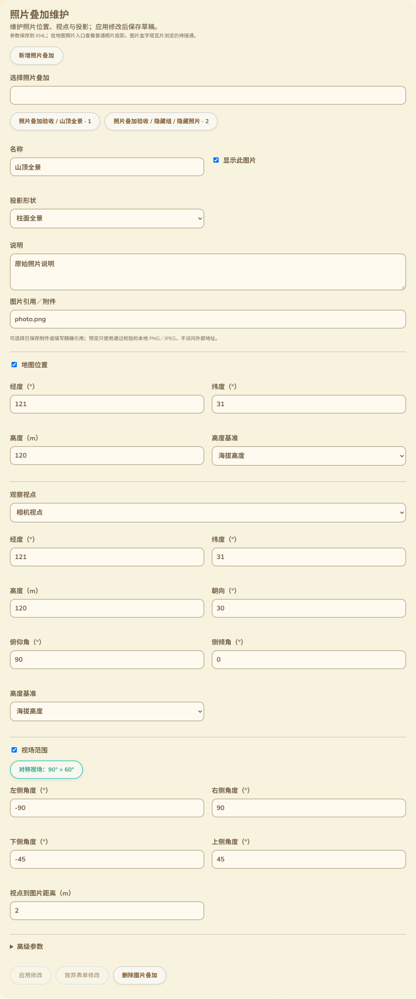

# 照片叠加声明维护

日期：2026-10-14。原三功能目标保持；本记录补齐 PhotoOverlay 的作者维护入口，不代表完整照片投影浏览或全部 KML 能力交付。

## 已实现的维护入口

沿用现有 GitHub Pages 轨迹工作台和卡片样式，在地理图片叠加、屏幕叠加之后加入“照片叠加维护”。原轨迹列表、地图、附件、样式、时间与 Region 编辑入口保留。

照片列表按原 Document／Folder 路径、名称与 DOM 顺序呈现，可搜索名称、路径和 ID，每页最多 50 项。隐藏容器中的照片仍能维护，单独提示继承的隐藏状态；扩展命名空间中的同名节点不会冒充 KML 照片。

表单分组维护：

- 名称、说明、显示、附件引用和矩形／柱面／球面投影形状。
- Point 地图位置：经纬度、可选高度以及地表／相对地表／海拔／海底／相对海底五种高度模式。
- Camera 或 LookAt 视点：位置、高度、朝向、俯仰以及相机侧倾或目标观察距离。可明确不声明视点。
- ViewVolume：左右／上下角度和视点到照片距离，带角度／米单位，提供 90° × 60° 对称预设。
- 高级 ImagePyramid：瓦片尺寸、原图宽高和左下／左上网格原点；另维护旋转、图层顺序、颜色和透明度。

参考 [Google KML 照片叠加说明](https://developers.google.com/kml/documentation/photos)及 [KML 元素参考](https://developers.google.com/kml/documentation/kmlreference)。维护声明与实际图片投影分别验收。

## 保存与保护

照片的未应用输入加入原工作台互锁：保存、附件和其他编辑区等待应用或放弃；草稿切换及离开使用原未保存保护。应用使用原 KML 变更历史，支持撤销、保存后重开及新增／删除。

只修改指定字段，未编辑的源节点、CDATA、样式、时间、Region、未知扩展和 ID 保留。数值语义未变的操作不改原工作字节；真实修改仍采用 DOM 序列化，不声称逐字保持全部排版。独立原始 KML 和 PNG 附件字节保持。

视点类型转换或声明移除遇到 ID-bearing 子树时拒绝，避免破坏 KML Update；删除整张照片时检查外部 targetId 引用。高度模式转换使用正确 KML／gx 命名空间并删除冲突的旧声明。输入非有限值、越界坐标／角度、不成立的视场、非二次幂瓦片尺寸等会保留原输入并提示失败，草稿不变。

## 当前验证

`tests/site/kml-photo.browser.mjs` 使用实际构建页面、生产编辑模块和真实浏览器 IndexedDB／PNG，退出 0。覆盖 11 类无效操作、作用域／继承隐藏、ID 引用、语义无操作、原文／PNG 字节、Camera 和 LookAt、金字塔参数、跨语言小数录入、保存重开、精确撤销、放弃、新增删除及 11 语言／390px／RTL，无 USB、RF 或外部资源请求。

原 ScreenOverlay 实际地图／共享预览回归，以及轨迹工作台实际 IndexedDB／下载／编辑／未保存保护／并发冲突／移动布局回归均退出 0。网页构建、差异检查通过；专项已加入已有 CI，但尚未远端执行。

实际页面截图已检查：

## 仍需交付

矩形／柱面／球面照片投影查看器、地图位置入口、ViewVolume 交互预览和 ImagePyramid 瓦片读取仍未实现。二维地图继续明确保留 PhotoOverlay 而不虚构投影；页面提示当前限制。后续必须使用核验后的本地／目录附件、时间／Region 和资源预算完成浏览，不自动获取外部图片或用普通平铺图片替代投影。

本批未改固件、未编译 SDK、未刷机，未增加设备 RAM。Wio 仍为 COM69，已核验候选 93926b41 待手动 BOOT 后恢复原确认任务。公网 NAS／行政区、配置实际消费、其余 KML／导航峰值、掉电和多 peer 交付范围继续保持。

GitNexus 修改前对现工作台 App、新照片模块／编辑器和验收入口返回 UNKNOWN，已报告并人工追查互锁、KML 保存和原页面调用范围；未提交或推送。
