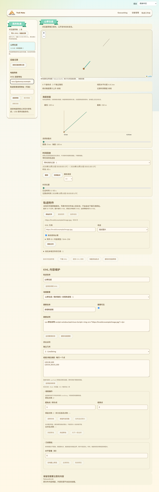
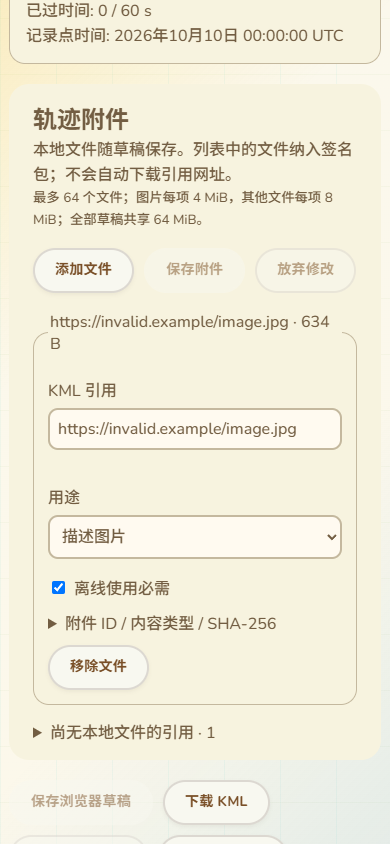

# 网页轨迹附件维护与持久签名接入

更新：2026-10-13。接续27—36的附件协议与设备作业，把本地附件维护放入实际轨迹工作台，接入既有设备身份签名和浏览器IP发布；保持与RF协议无关的网页作者身份。

## 页面位置与操作

位置为“我的轨迹 → 打开浏览器草稿 → 地图、海拔剖面和时间回放下方 → 轨迹附件”。沿用当前Pages的纸色卡片、按钮、左侧设备/电脑网络栏和语言选择，没有另建独立页面。

用户选择本地文件后，系统生成附件ID、推断内容类型，并尝试按文件名匹配KML内已有资源引用。可修改引用、用途和离线必需标记；ID、内容类型和SHA-256放在展开项中。用途包括描述图片、路标图标、叠加图片和其他文件。未有本地文件的引用另列，不自动下载任何引用网址。界面说明只有列出的文件纳入签名包，不把其余外部链接误称为离线资源。

附件有未保存修改或读写正在进行时，暂停KML编辑及发布入口，防止两个编辑流程混用版本。切换草稿/导入、关闭页面保留未保存保护；可以放弃本次修改。改变界面语言保留输入，引用/ID使用LTR，Arabic布局使用RTL。覆盖现有11种语言，手机宽度390px无横向溢出。

以下是实际页面渲染，使用示例KML和本地JPEG，没有真实设备连接或网络发布：

## 草稿与重试

浏览器草稿数据库从2升到3，增加附件存储，原KML、元数据和作业证据保留。附件存储精确字节、用途、必需标记、引用和内容摘要；读取时检查数量、字节数、类型和SHA，缺失/损坏返回DRAFT_CORRUPT，不继续签名。所有草稿的KML及附件共同受64MiB逻辑预算，单草稿64个附件，图片4MiB、其他文件8MiB；签名包还检查索引计入后的总预算。

保存附件采用原草稿锁和版本比较，成功后增加版本，清除旧发布计划/附件上传绑定，保留签名父版本与既有历史作业证据。KML编辑保留附件字节，重新构建索引时绑定新KML摘要。删除草稿一并删除本地附件；尚未解决的IP发布检查点仍阻止编辑。归档附件不允许随意改动，原始资源缺失不能当成空包继续。

附件索引及资源上传ID独立保存在同版本元数据，绑定完整清单摘要，实际USB流量之前落盘。重开、重新签名请求及断线重试使用同一组ID；不把随机重生成ID当作恢复。大小、唯一ID、大小写冲突、引用穿越和资源哈希先检查，失败不进入USB上传。

## 签名与发布接入

普通无附件首版保留原v1。带附件首版生成v2，签名保护索引摘要，索引再保护精确资源字节。后续计划支持v1升v2和v2更新；归档必须保留原索引绑定，不降级或删除附件。当前自动元数据保留未知活动/标签/时间/高度语义，不把它们当作经过设备推导的事实；线段及路标计数取自KML。

网页签名能力根据清单选择96或99；完整包仍由设备验证并签名，私钥不进入普通网页流程。IP发布将KML、索引及附件一并交给既有网络发布器。所选目录未公告附件能力14时，复核即给出本地化提示，不先上传大文件再失败。发布复核显示附件数量/字节，确认后保留原请求ID和签名；回执丢失可以继续同一操作。

## 联调发现的固件收尾

网页在同一会话重试已签名操作时，命中准备结果缓存的路径原本留下一个已封存上传所有者直到会话关闭。共享准备运行时现在只在结果已完成、无持有中的工作区、会话/媒体/身份/代际/上传ID均匹配时释放该所有者。不删除封存文件或签名结果，不处理只读查询，不释放仍接收中或其它ID的上传。

原生分配计数验证：匹配重试回到单个完成结果缓存，未相关/仍接收中的上传继续保留；关闭会话全部释放。签名计数始终1，没有重新签名。此项只代表模拟堆的分配计数，不能换算成新的Wio运行堆读数。

## 验证证据与剩余范围

真实Edge组件及整页通过：旧数据库迁移、文件/索引精确字节、固定上传ID、刷新恢复、11语言保留输入、手机/RTL、版本冲突、失效旧计划、坏摘要拒绝、删除清理；既有KML编辑/导出/撤销和共享浏览/地图/地区/ID/自有维护/路线安装回归通过。截图已检查整体位置和手机布局。

浏览器生成的真实v2包通过实际C++上传/准备/保留/签名，JS验签及重开复用通过。进一步在浏览器通过同一C++串口模拟桥执行IP签名，验证附件传给模拟目录发布器、真实目录身份签出的回执验签、回执丢失后固定请求/签名恢复及未确认期间禁止修改。底层SD/堆/串口和目录传输模拟，不等于真实USB或RNS公网。

14项相关Node回归及原生track_snapshot_owner通过，网页构建、ESP栈/流式/差异检查通过。浏览器测试加入CI；旧测试读取数据库改为当前版本，旧导入输入选择器限定侧栏，保留原断言。

Wio缓存修正增量构建PID35812明确退出0、SUCCESS181.34秒，stderr为空。静态RAM仍95,556字节；Flash4,785,717字节，bin4,786,128字节，SHA256 `a3815617bb6f18dd6e6492f426b789d66a414f37abae3c0da9745846d23f6aba`。实际53项能力含98/99/100/101及应用分区预算核验通过。尚未刷写，已刷仍b733480e…，最近运行读数仍87K/297K，没有新的实机峰值或显示结果。

仍需完成他人共享包的附件下载/校验/图片与图标及叠加显示、完整安装面板与跨刷新安装任务、原作者资源恢复（包括v2归档所需原资源）、完整包/ZIP导出和精细字段错误提示。活动分类/标签/派生来源的完整交互也没有由本批替代。真实USB/SD/峰值/掉电、导航进度/到达、公网多目录和身份恢复实测继续保留；三功能总体尚未验收。
