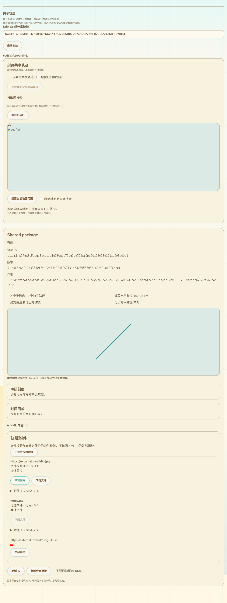
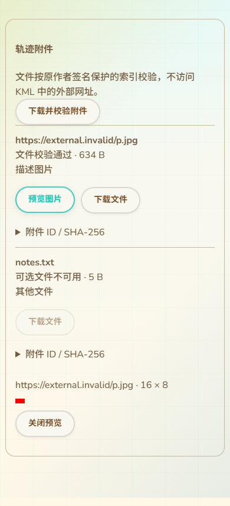

# 共享轨迹附件读取与验证呈现

更新：2026-10-13。接续37的本地附件维护，补共享详情的索引/资源读取、校验、单文件下载和图片预览；本批只有网页变更，没有固件编译或刷写。

## 读取协议

先验证目录返回的原作者清单签名、所选对象与版本，目录未明确公告能力14时，在文件传输前停止附件读取。IP只读会话新增允许14，保留目录公钥/目标/epoch/连接代际的绑定；仍不能发送发布7等写操作。无需插USB或切换RF协议才能公开浏览和下载。

按签名清单的KML摘要下载精确字节，随后以原签名请求目录package_status。索引可用时，按其签名描述符下载索引并核对SHA、大小、条目数和KML绑定；各提供资源按索引摘要、长度、每块偏移和精确字节核对。不是访问KML的URL或把引用当作磁盘路径。

相同摘要及大小的多个资源只传输和保存一份内容，分别保留各条目的用途/必需属性。全部读取完毕后，重新查询固定版本签名和当前性，不在过程中切到新的头版本；当前性只表示该目录在最后查询时的断言。取消、摘要错误、偏移/大小/响应错误和版本绑定错误不会返回部分成功包。

目录声明不可用的必需文件使本地包ready=false，可选文件不可用时允许已校验的必需集合ready=true，同时allComplete=false。目录的可用性布尔值不能区分未存储与已损坏，因此界面称“不可用”。若目录实际返回了错误资源字节，即使资源可选，也必须使本次读取失败，不能改称可选缺失。索引不可用不生成虚假条目列表。

ready是已取得、校验的本地必需文件集合，不是设备已安装，也不等于所有可选文件齐全或目录永久在线。所有文件仍受签名索引64条/64MiB等原协议预算；逐文件传输，没有新增并发下载队列。

## 详情界面

附件区在共享详情的地图、海拔/时间回放及KML内容说明后，原ID/分享复制和KML下载按钮前。列出引用、用途、大小与校验/不可用状态，ID和SHA置于展开项。单文件下载保存精确字节，使用摘要生成安全文件名，不使用引用路径写文件。

图片按需预览，每次只打开一张。先读取PNG/JPEG头中尺寸，限制每边8192及3200万像素，再建立本地Blob；关闭、换包及卸载释放URL。浏览器解码失败显示失败，不将内容摘要正确等同于图片格式可解码。SVG/GIF及其它类型暂不预览，可下载原字节；其它KML呈现需求没有删掉。

下图由生产共享详情组件和示例签名包实际渲染，没有真实USB/RNS公网连接：

## 验证

14项相关Node组合通过，包括读取器、IP只读能力和实际Python应用/SQLite/不可变文件存储。覆盖原签名/索引/精确资源、重复摘要去重、可选/必需不可用、目录未公告能力零文件传输、坏索引/可选坏字节/错误响应、取消、图片尺寸及结束后的当前性检查。实际Python目录重开后仍读取到同一完整包，目录标记不可用的损坏可选资源不会伪装成本地已验证资源。

真实Edge组件及集成共享详情通过：不连接USB的包读取、有效本地JPEG显示、精确下载字节及安全文件名、11语言保留预览、手机/RTL、必需不可用不显示旧图片、坏字节不显示部分列表、缺索引提示，且没有请求外部KML网址。现有整页共享地图/行政区/ID/作者维护/归档/复制及旧KML路线安装回归也通过。新增脚本加入CI，网页构建和git diff --check通过。

Python存储是真实实现，目录传输为本地stdio适配器；浏览器集成使用模拟网络请求，不是RNS公网验证。最后固件候选仍a3815617…、静态RAM95,556字节，已刷仍b733480e…、最近实机读数87K/297K；本批无设备RAM影响。

## 继续保留的交付范围

完整包安装面板、安装前持久ID/精确字节及跨刷新任务恢复、100/101实际页面接入还须完成；旧85/95面板只安装KML，不代表保留原作者签名和附件的完整包安装。共享原资源保存为可维护副本/v2归档恢复、完整包/ZIP导出、图片关联地图位置及实际路标图标/叠加呈现、更多资源类型和元数据交互也未由本批替代。真实USB/SD/峰值/掉电/公网多目录、导航完整交互与身份恢复实测继续保留在16。
