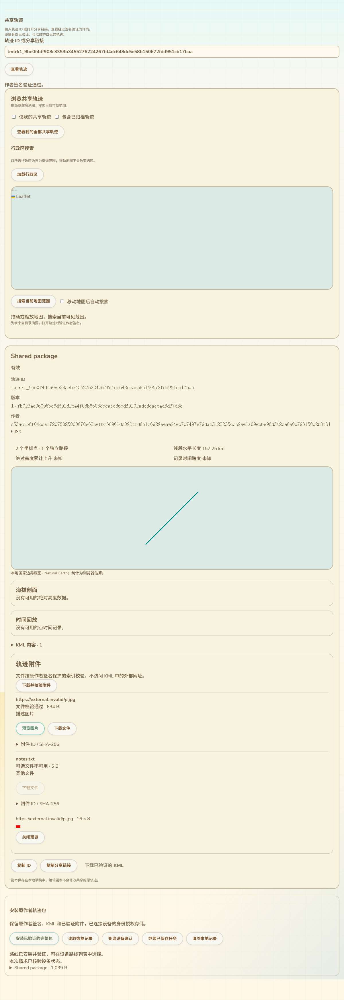
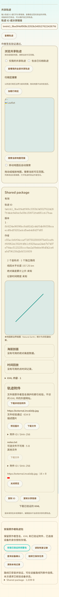

# 完整轨迹包安装与网页任务恢复

更新：2026-10-13。接续38，实际共享详情接入100/101完整包安装、浏览器持久任务和恢复交互。本批仅修改网页与测试，没有固件编译或刷写。

## 现有页面中的入口

共享详情下方新增“安装原作者轨迹包”区域。先公开读取并校验KML、签名索引和必需附件，再连接设备并安装；连接USB保留已选公共详情与已下载附件。设备身份授权写入，包内原作者签名保持原样，不调用本地内容签名。公开读取与下载不依赖USB或RF协议。

安装区提供安装、读取恢复记录、查询设备确认、继续已保存任务、确认缺失后的重新上传已保存包、清除本地记录及传输中取消。标题、对象/版本摘要和总字节在恢复记录中可查看。读取浏览器保存的状态时明确提示它是旧记录，只有本次设备安装或查询成功后才显示本次已核验。清除记录只删除浏览器数据，不删除设备路线或终止设备已接收的任务。

新固件能力要求1/2/32/33/35/100/101。没有完整包能力的v2详情不退回仅安装KML；旧v1详情在旧固件上仍保留85/95入口。必需资源未取得时不允许安装；缺失可选资源明确省略且在确认中提示。

截图是现有生产共享详情与安装面板实际渲染，使用本地签名示例及模拟网络/USB，不是实机或公网截图：

## 写入之前保存完整证据

独立IndexedDB `trailmate-package-installs` v1在一个事务内保存任务和精确内容：原签名清单、KML、索引及已提供附件，以及操作ID、查询ID、KML/清单/索引/映射/资源上传ID、设备公钥和代际。第一笔USB文件上传发生之前必须保存完成，不能只保存文件名或先上传再记录ID。

每个本地设备公钥保留一笔安装任务，最多8个身份，逻辑KML/索引/资源预算合计128MiB，单包64MiB；遵循原KML8MiB、索引及64项资源限制。浏览器实际配额不足会拒绝保存，不开始USB上传。正常恢复读取元数据即可；需要传输时才读取并重新验签、核对内容长度/SHA和资源集合。生产代码不保存设备私钥。

Web Locks按本地设备公钥排他；任务更新和删除核对版本及操作ID，拒绝旧检查点覆盖。一个未确认的任务不能被新的安装悄悄替换。断线、取消或丢回复后保留可恢复状态和原字节，不伪装成安装成功。

## 恢复规则

1. 重新证明当前设备公钥与代际，再按公钥读取本浏览器记录。只读旧记录不会声称当前设备已经安装。
2. 继续任务先调用101，在设备上重新核对原签名、资源及实际路线，不依赖暂存上传或旧success缓存。已经安装时更新网页记录，不再上传文件或调用100。
3. 当前设备未安装且仍为原代际时，继续原操作及所有上传ID，保持原签名和精确内容。
4. 当前设备未安装且代际变化时，旧上传ID不能继续。界面允许从已保存包重新上传：再次查询，若已经安装则直接结束；仍缺失才生成整组新ID，并在第一笔上传前持久保存，包和原签名不变。不要求重新搜索或下载原包。
5. 浏览器保存资源损坏时，在上传前拒绝；设备持久资源损坏时，查询失败，不把旧安装成功状态当作本次核验结果。

面板处理会话切换、卸载、取消和过期回调，释放页面操作租约；11种语言沿用现有文案与风格，手机布局无横向溢出，阿拉伯语支持RTL。

## 验证与证据边界

`tests/site/package-install.browser.mjs`使用实际Edge、生产面板/IndexedDB/工作流，以及生成测试身份的真实挑战签名。覆盖第一笔上传前完整持久记录、真正page.reload恢复、成功回复丢失后查询且零重复写入、同代际安装前中断后原ID恢复、代际变化后原包/新ID重传、过期CAS拒绝、存储资源损坏零写入、11语言和手机/RTL。

同一浏览器工作流还通过stdio桥调用实际C++100/101作业：安装其他作者的包，实际成功响应后故意丢回复，清理上传暂存后仍由持久查询恢复；恢复及随后损坏查询不新增32/33/35/100请求，本地内容签名计数为0。这个桥的作者证明由测试注入公钥；真实1/2挑战验签由前述浏览器USB模拟验证，不能合称真实硬件身份联调。C++文件系统、堆和平台接口仍模拟。

`tests/site/track-shared-package.browser.mjs`使用生产共享详情，验证公开附件下载后接USB安装、原清单/KML/JPEG精确保持、缺失可选文件省略、无额外公共目录读取、安装区位置与桌面/手机截图。现有整页共享地图/行政区/ID/作者维护/旧路线安装回归通过。

10项相关Node测试通过，包括实际C++包准备/安装/持久查询互操作、共享包读取和IP只读会话。网页构建与git diff --check通过。安装浏览器脚本已加入CI；此处报告的是本地运行结果，没有声称远程CI已运行。

## 保留的完整交付范围

本批覆盖38列出的完整包安装面板、持久精确字节/ID、100/101页面接入与任务恢复。共享原资源恢复为可维护副本及v2归档、完整包/ZIP导出、地图关联图片/路标图标/叠加、更多资源类型和活动/标签交互仍需完成。真实Web Serial、SD、运行峰值、掉电、公网多目录、身份恢复以及完整配置和导航验收仍保留在16。

最后SDK候选仍 `a3815617bb6f18dd6e6492f426b789d66a414f37abae3c0da9745846d23f6aba`，静态RAM95,556字节；已刷仍 `b733480eca1a559b5d6fa23634cc452e8c3f899e778da612c398baa3d2bd84d5`。最近实机运行读数仍87K/297K，没有本批新运行堆证据。
