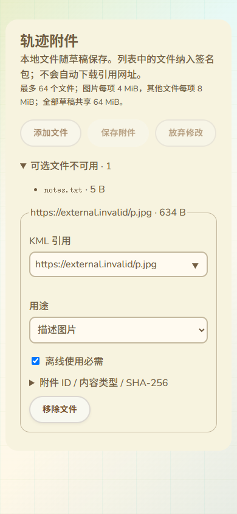

# 共享资源副本与原包归档

更新：2026-10-13。接续39，补齐共享详情保存副本、本人更新/归档的原资源传递，以及本地草稿的来源证明。仅修改网页与测试，没有固件编译、上传或设备RAM变化。

## 保存为可维护副本

共享详情的“保存副本”不再只传KML。v2有附件时，先取得签名索引与必需资源，按钮才可用；调用既有工作台导入逻辑，同时传递原签名、精确KML、索引和已取得资源。草稿元数据、KML和资源在同一IndexedDB事务中保存，任一验签/摘要/配额失败不会留下半个新草稿。

草稿保存原签名证明sourceProof和原索引attachmentTemplate，提供资源保存ID、引用、MIME、用途、必需属性及精确字节。原作者与新副本发布作者分开：新副本没有原对象的predecessor，新设备身份创建新的对象；v2发布元数据中的来源字段记录原对象ID及原版本哈希，保留可验证的来源参考。来源证明留在浏览器，当前网络协议携带的是签名覆盖的来源ID/哈希，不自动嵌入全部原历史或证明来源目录永久在线。

没有取得的可选资源保留在原索引中，不伪造本地字节，也不偷偷删除其声明。发布/安装映射只包含实际取得的资源，签名索引仍可包含未取得的可选项。必需资源缺失或已提供字节损坏则拒绝保存。原索引与文件仍受64项/64MiB等已有预算；浏览器草稿保存实际字节沿用全体64MiB预算，完整包索引容量继续由既有协议校验。

## KML和附件编辑

普通KML编辑保留原来源证明及索引模板。未改文件时使用原索引精确字节；文件改变时为新KML摘要/长度重新编码索引，保留原资源条目，包括暂不可用的可选项。新清单绑定新文件与新索引，不沿用旧哈希。

附件面板显示“可选文件不可用”及引用/声明大小。编辑附件时仍使用既有录入方式；若原索引含不可用条目，保存前明确确认：新附件集合将移除这些没有本地字节的条目。取消保留原记录；确认才清除原索引模板并生成新集合，来源证明继续保留。11语言文案覆盖这个确认，避免普通附件编辑默默改变原包。

截图使用生产附件面板和本地签名示例副本，没有真实USB/公网：

## 本人更新和归档

本人维护入口执行前重新证明设备作者，再查询目录当前签名头。v2有附件时，通过目录已公告的14能力读取并验证固定版本完整包，结束后的当前性必须仍匹配；其它作者、头改变、必需资源不足或提供字节损坏不会创建维护草稿。

更新时保留提供资源与原模板，为替换KML重新绑定索引；后续工作台附件编辑可以显式建立新的集合。发布准备保持原活动/标签等元数据，并重新计算段/路标数量。

归档保存原KML和原索引精确字节，包括不可用可选项声明；提供的资源同时原子保存。归档草稿的附件编辑继续禁用，准备流程要求原附件描述符保持，不能将有附件的轨迹伪装成nil资源归档。缺失可选资源只表示当前草稿没有那些字节，不等于原目录或其它节点必然没有资源。

## 验证与边界

实际Edge共享详情测试覆盖公开读取后保存副本、来源对象/版本与新作者、原图片精确字节、2条签名索引/1个实际文件、原索引归档、KML编辑后重新绑定仍保留可选声明、坏资源零新增草稿，以及附件编辑取消/确认的状态变化。测试使用生产SharedRead、存储、发布计划、附件面板；其导入回调直接调用生产存储，工作台真实App导入参数接入已修改并通过现有整页工作台回归，但此专项不是完整App实机操作。

同一共享详情原有读取/预览/安装、11语言/手机回归继续通过。原附件测试（实际IndexedDB迁移/重载/固定ID/CAS/损坏/清理，以及浏览器→C++签名/IP任务恢复）通过；安装恢复专项和实际工作台原字节/编辑/冲突/手机回归通过。来源确认11语言均有文案，手机实际截图已检查。

7项相关Node通过（实际C++包准备/保留/安装/持久查询互操作及本人维护），其中包准备加入真实签名来源对象/版本引用并验证实际C++签名结果保留这些字段；另5项设备包签名预检回归通过。C++平台/堆/SD仍模拟；新副本/归档专项的网络与USB为测试模拟，不能当作真实多目录公网、实机身份或掉电验收。网页构建及git diff --check通过；已有共享包浏览器脚本已在CI配置中，不声称远程CI已运行。

本批不覆盖完整包/ZIP导出、来源链接的详情跳转UI、活动/标签完整录入与检索、地图关联图片/图标/叠加及完整原范围。最新SDK候选仍a3815617…/静态RAM95,556，已刷b733480e…，最近实机87K/297K不变。真实Web Serial/SD/峰值/掉电/公网、身份恢复、全部配置和导航验收继续保留在16。
