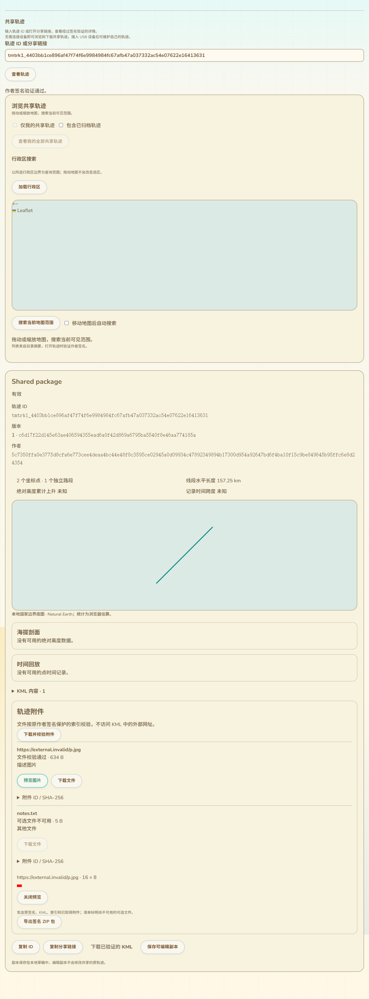
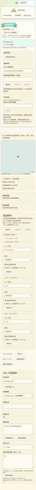

# 签名轨迹ZIP导出与导入

更新：2026-10-13。接续40，加入原作者签名包的ZIP下载和实际工作台验签导入。只有网页、依赖与测试变更，没有固件编译、刷写或设备RAM变化。

## 页面入口

共享详情的附件区增加“导出签名ZIP包”。v1及v2无附件详情在取得KML后也提供同一入口。导出之前重新验证原签名、KML、索引及资源摘要，必需资源不足不可导出。可选资源尚不可用时允许保存已取得集合，界面提示和包内清单明确说明缺失；原签名索引保持原样。

“我的轨迹”既有导入文件入口接受此ZIP包；在验签、内容摘要和KML解析通过后，按40的原子保存逻辑建立本地副本，不要求连接设备。副本保留来源证明、原索引及资源，不借用原作者身份创建后续版本。未来发布仍需要自己的设备身份。

11语言补齐导出说明、导入说明、容量提示、验证中与失败提示。包最多65MiB，其中KML最多8MiB；包内资源/索引仍遵循原64MiB/64项等协议限制。未通过验证的ZIP不建立草稿。容量错误和包格式/验证错误不继续显示仅针对普通KML的错误提示。

图片使用本地签名测试数据及生产组件。导入截图来自实际page.jsx页面；未连接真实设备或公网。

## 包格式 v1

ZIP使用store模式，不压缩；资源命名不使用原引用作为磁盘路径。内容为：

- `track.kml`：原始精确字节。
- `signed-manifest.cmp`：CMP编码的原清单字节与原签名二元组。
- `attachment-index.cmp`：有附件时保留原索引精确字节。
- `resources/<SHA256>.bin`：已取得资源的原始字节，同摘要仅存一份。
- `package.json`：格式/版本、对象ID、版本哈希、原作者公钥、是否取得全部资源，以及原索引各条目与本地ZIP文件的对应关系。它是说明性清单，不替代签名证明。

下载名使用固定前缀与对象/版本摘要，不使用任意用户标题或引用路径。KML及引用不重写，不重新签名，也不访问外部URL。相同摘要及长度的别名可由同一实际ZIP资源恢复为各签名资源ID；若这些字节已在包中，包的本地齐全状态可以为true，与目录此前的可用性声明分开。

导入仅接受此版本的store格式签名包；在提取前限制入口名称、重复名称、数量、单项及合计声明大小和压缩方法，提取后根据真实原签名索引选择资源，核对全部提供字节与清单绑定。目录当前性不是离线包可以证明的信息。

ZIP处理使用固定网页依赖fflate 0.8.3，参考 [fflate官方API说明](https://github.com/101arrowz/fflate#usage)。依赖打包进网页，不加入固件，不使用CDN运行时脚本。当前浏览器在内存中处理有界包，未实现磁盘流式导出。

## 验证

5项Node测试验证v1、v2无附件、v2部分可选资源的往返原字节/签名/索引保持、同摘要别名去重、签名/内容错误、必需缺失、取消、路径/无关资源/说明清单/压缩方法/截断拒绝。独立Python zipfile读取导出包并通过testzip CRC，核对原KML、签名及索引。测试不使用fflate自身解包作为唯一格式互操作证据。

实际Edge共享详情点击导出按钮并取得下载文件，重新验签读取，与原JPEG字节一致，部分资源状态正确，导出不增加目录请求。原读图、保存副本、本人归档、设备安装、附件编辑确认等集成回归继续通过。

新增实际page.jsx测试导入超过8MiB的签名ZIP（两份各5MiB资源、一张JPEG和一条缺失可选资源），核对KML/原证明/索引、实际资源长度/字节及无predecessor；实际page.reload后仍读取三份资源和原索引。11语言、390px无横向溢出、错误ZIP专门提示且零新增草稿、零外部网络请求通过。原整页共享浏览/地图/行政区/ID/维护/旧安装回归及实际工作台编辑/存储/原字节下载/手机回归通过，网页构建和git diff --check通过。

新增Node与实际网页脚本加入CI配置；这里只报告本地执行，没有远程CI结果。没有真实Web Serial、公网目录、SD、掉电或最新固件运行堆测试。

## 保留的交付范围

本批覆盖“原作者签名完整包的ZIP导出和导入”。普通压缩ZIP/KMZ、为通用GIS改写引用的派生KMZ、未签名编辑草稿的全部资源备份/恢复仍需实现，不能把此格式称作通用KMZ或所有草稿备份。来源详情跳转、活动/标签完整交互、地图关联图片/图标/叠加、更多KML能力，以及原配置/导航/身份恢复/真实USB/SD/峰值/掉电/公网验收继续保留。

最后SDK候选仍a3815617…/静态RAM95,556；已刷b733480e…，最近实机87K/297K保持。网页ZIP依赖不改变这些设备指标。
