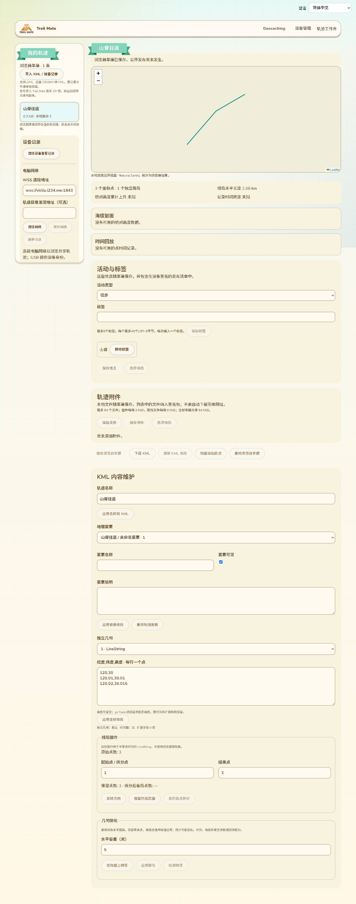
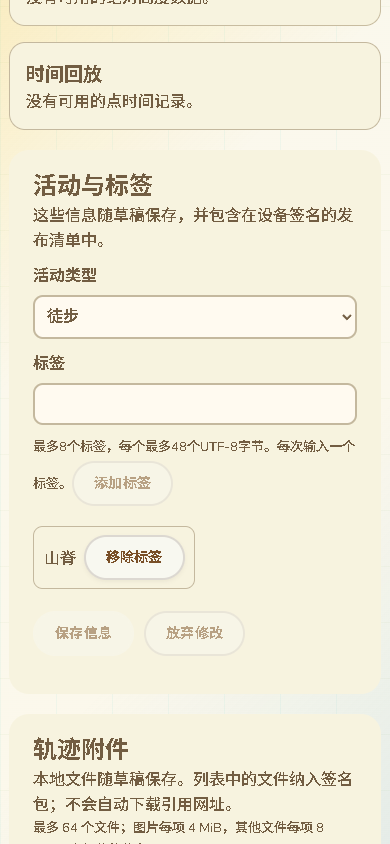

# 轨迹活动与标签维护

2026-10-13。等待50中的Wio清理修正版刷入期间，完成独立网页缺口；没有增加固件编译、协议命令或设备RAM。工作分支保持feature/web-device-outdoor-management。

## 现有页面中的位置

在现有“轨迹工作台”主区域，地图／统计／海拔剖面／时间回放之后、附件与KML内容编辑之前加入“活动与标签”。沿用现有Card、Button、米色输入框和主题变量；左右布局、顶栏和“我的轨迹”侧栏保持现有结构。共享详情显示已验证签名清单中的活动和标签。

以下为当前实际page.jsx生成页面的截图，不是独立原型：

分类下拉与逐项标签录入支持11种网页语言及RTL。按Enter或“添加标签”加入一项，逐项移除；“保存信息”也会包含尚未点击添加的输入。最多8项，每项48个UTF-8字节；拒绝空白、控制字符、无效Unicode、精确重复和超限。标签可包含逗号，不按逗号偷偷拆分；已有签名标签保留原文本。

## 已有v2字段的语义

复用27中metadata的activity:u8和tags:[str]，没有改变清单长度、签名域、对象ID或设备存储格式。此次固定界面映射：

| 值 | 活动 |
|---|---|
| 0 | 未指定 |
| 1 | 徒步 |
| 2 | 跑步 |
| 3 | 骑行 |
| 4 | 登山 |
| 5 | 划船 |
| 6 | 滑雪 |
| 7 | 驾车 |
| 8 | 其他 |
| 9–255 | 保留为未知活动，显示原值，用户未选择新类别时不改写 |

这些类别是作者标注，不从几何推断。其余几何能力、时间覆盖、高度语义和来源证明保持原有字段；段数与路标数仍由当前KML推导。旧v1草稿未设置这些信息时继续使用v1；显式保存信息后生成v2，附件索引可以为nil，因此单独标注活动／标签不强迫添加附件。

## 保存与发布一致性

saveTrackDraftMetadata在现有Web Lock和IndexedDB版本CAS内保存，递增本地草稿版本，作废旧publicationPlan／attachmentBindings／旧行jobBinding。KML字节、文件SHA、附件、原签名来源／父版本保留；已有历史任务存储不删除。之后修改KML或保存附件都保留活动与标签。

创建发布计划时读取冻结草稿元数据，更新版本保留父对象／版本链；来源副本继承原类别和标签，作者可明确修改。归档草稿拒绝修改，归档计划保留原签名父版本的元数据。reviewed／signing／signed／publishing／unconfirmed等已有发布锁继续阻止元数据覆盖。

页面将元数据与附件的未保存／忙状态统一传回原工作台：阻止切换时丢失修改、阻止发布未保存内容、阻止两处同时编辑产生版本冲突。元数据面板读取已载入草稿字段，不为展示再次读取和哈希整份KML／附件。

## 验证证据与边界

- 15项相关Node测试通过，覆盖UTF-8限制／非法值／未知类别保留／来源继承／11语言，以及既有发布恢复、更新／归档和真实C++完整包互操作。
- 新Edge专项使用实际IndexedDB、生产草稿／发布计划与编辑组件：重复标签拒绝、保存／刷新、旧计划作废、KML及附件保持、更新、归档保护、旧版本写入拒绝、已审阅发布锁通过。
- 网页生成“只有活动／标签、无附件”的v2清单，经实际C++99上传／准备／Ed25519签名实现返回，浏览器验签后分类、标签完全相同；附件索引确认为nil。USB／SD／heap为原生替身，此处不是实机签名证据。
- 实际page.jsx集成录入／保存和截图、11语言／手机／RTL通过；原整页轨迹工作台、附件与原生／IP流程、共享整页回归通过，轨迹网页构建和差异检查通过。新测试加入CI，未提交／推送／部署。
- 首轮单测用全零身份与nonce被生产清单校验拒绝，修正测试数据后通过；首轮等待引用尚未建立的全局busy已修正。原工作台回归曾因新增整份草稿读取拉长占用而错过下一次导入，已移除元数据展示的重复文件读取，随后完整回归通过。

GitNexus对相关新网页符号返回UNKNOWN，手工核对直接草稿读写、附件保存、发布准备、版本更新／归档和页面入口；不将未索引当作低风险。

尚未完成：活动／标签在真实目录上的索引与筛选、跨目录完整查询／发布验收、母语术语审阅，以及16中全部配置、Geocaching、原始KML特殊元素、导航／SD显示、峰值RAM和掉电等原范围。当前地图滑动、行政层级与ID直达搜索不因本批减少；本批不宣称目录已支持分类／标签搜索。
