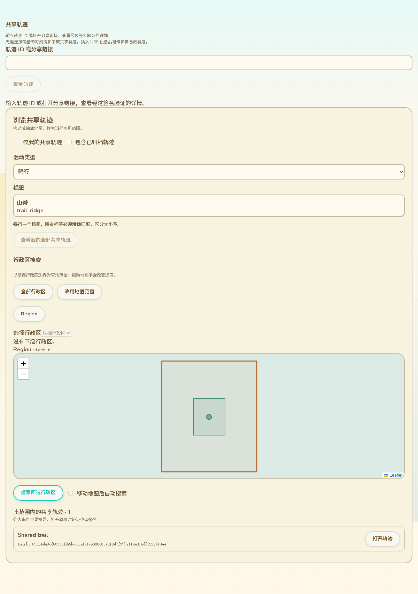
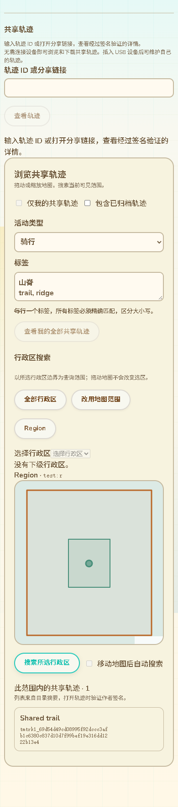

# 活动与标签的目录查询协议及交互

2026-10-13，接51。实现范围为电脑端Reticulum轨迹目录与网页，不增加设备串口命令、RF接口或固件RAM。本批没有新增SDK编译。

## 能力与兼容边界

普通0[]仍返回旧0–8操作列表，保留已部署固件的能力解码契约。网页显式0[2]协商得到14（附件状态）、15（地图元数据筛选）、16（行政区元数据筛选）。旧目录返回422时保留旧浏览／ID直达／普通范围查询；新筛选控件明确提示目录不支持，不把筛选静默改为当前页本地过滤。

应用名与CMP1信封继续为trailmate.track.v1／[1,0,operation,request,budget,body]；扩展使用独立操作编号，旧1／13的请求和10项摘要均不变。电脑查询适配器核对所选目录公钥／delivery／epoch和能力，冻结请求字节；切换网络／目录或关闭后拒绝过期结果。

## 新查询契约

15地图请求体：

```text
[bbox_E7, kind|nil, author_key|nil, state|nil,
 activity:u8|nil, tags:[str], limit, snapshot|nil, cursor|nil]
```

16行政区请求体：

```text
[region_id, boundary_version:bin32, "intersects",
 kind|nil, author_key|nil, state|nil,
 activity:u8|nil, tags:[str], limit, snapshot|nil, cursor|nil]
```

activity沿用51的值；nil不限制，0表示未指定，包括旧v1轨迹。tags最多8项／48 UTF-8字节，要求全部精确匹配，区分大小写，无隐式Unicode规范化或逗号拆分；禁止重复、空白、控制字符和无效文本。旧v1视为activity=0、tags=[]。

返回仍为[snapshot,cursor|nil,items]。新操作的每项摘要为原10项后追加activity和tags，共12项；网页逐项核对筛选条件、对象排序、范围、快照和游标，不接受缺少元数据的旧摘要。摘要由目录提供，打开详情才独立验证作者签名，页面继续显示这项区别。

游标仍[after_object_id:bin32,filter_hash:bin32]，但新操作使用独立绑定域：

```text
SHA256(CMP(["trailmate.track.query.metadata.v1",
 bbox,kind,author,state,activity,tags]))
SHA256(CMP(["trailmate.track.region.query.metadata.v1",
 region_id,boundary_version,"intersects",kind,author,state,activity,tags]))
```

筛选、区域／边界版本或目录快照变化时拒绝复用旧游标。个人全部共享轨迹的下一页同时核对作者、状态、活动和标签。

## 目录处理与资源边界

DirectoryIndex从当前版本头查询，而不是客户端当前页过滤；每个候选先验证保存的作者签名与对象／版本绑定，再判断元数据。更新和归档后的当前头决定筛选结果，旧历史版本不会继续充当活动结果。

复用现有有界扫描和对象排序索引：地图每页最多扫描256候选，行政区每页最多16候选；不增加常驻轨迹全文缓存，也没有新增SQLite元数据二级索引。行政区标签／活动不匹配时跳过KML文件与几何解析，匹配候选仍通过原文件哈希／几何交集校验。空页可以带游标，不能当作全目录为空。

网页仍保留每批最多8页／256项的预算与明确截断提示。后续53已补齐公共地图／行政区“下一批结果”，保持筛选／快照与未消费页条目，详见 [53-公共轨迹查询继续分页](53-公共轨迹查询继续分页.md)。个人全部共享轨迹沿用已有下一页入口。

## 现有页面交互

在“浏览共享轨迹”的作者／归档条件下加入活动下拉与标签多行输入，每行一项；与地图滑动自动搜索和行政区选择组合。切换条件撤销旧请求、清空旧结果和分页；无效输入在网络请求前提示。未连接设备时仍可公开浏览和筛选；设备证明仅用于本人筛选／维护。





截图使用生产TrackSharedRead／SharedTrackBrowse组件和实际Python目录／签名LXMF回复；网络桥为本机测试，不是公网部署截图。11语言、RTL、手机尺寸沿用当前主题。

## 验证

- 19项Python回归通过，包含4项新增实际签名／文件／SQLite查询：活动与全部标签匹配、旧v1、未知250、条件游标绑定、重开索引、更新／归档当前头及35条轨迹跨空页查询。区域元数据筛选后只读取1个匹配KML文件。
- 23项Node回归通过，包含新扩展参数／冻结／摘要验证／能力拒绝，实际Python应用和真实LXMF签名互操作，以及既有范围／行政区／日期线／直接读取／取消／超时／目录绑定。
- Edge专项经生产TrackSharedRead的IP适配与查询入口调用实际Python目录，Node桥独立验签所有LXMF回复：地图条件、错误类别无结果、拖动自动查询保留标签、行政区条件、11语言／RTL／手机、重复标签零网络请求、旧目录禁用与提示均通过。既有整页共享回归与网页构建／差异检查通过，测试加入CI。
- 布尔activity在CMP1层拒绝，索引API也拒绝；没有放宽协议子集。旧区域测试仍把14当非法信封，已按当前新增能力修正边界为17；旧能力0[]保持原列表。
- GitNexus对本批相关新符号返回UNKNOWN，已手工核对应用分发、目录查询、网络适配、页面和测试入口；不将缺失图数据视为低风险。

公网多目录部署／完整发布归档仍待验收，通用KML／KMZ、全部配置、Geocaching、软件重启USB稳定性、设备SD显示／导航与峰值内存等按16保留。公共搜索继续分页的后续实现与验证见53。
