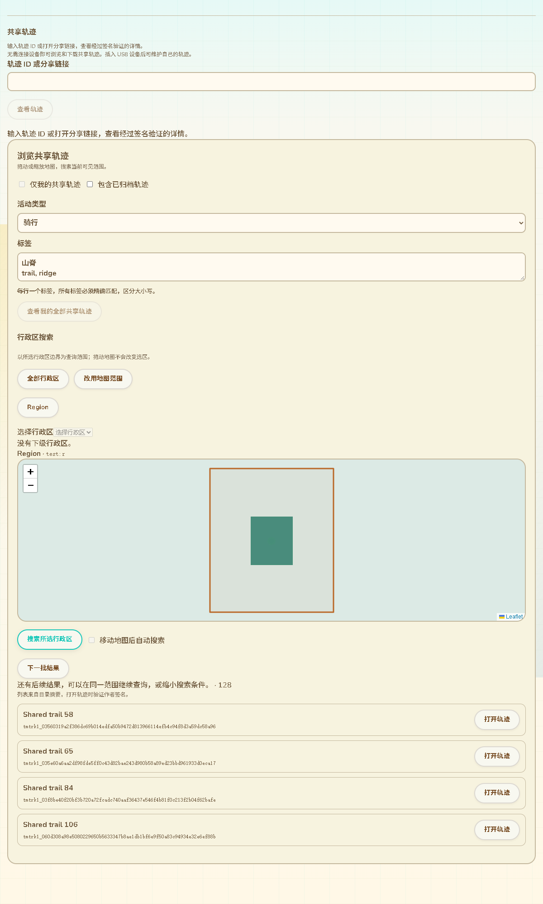
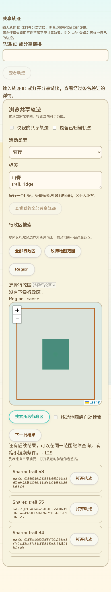

# 公共轨迹地图与行政区查询继续分页

2026-10-13，接52。补齐公共查询超过单批预算后的继续操作；只修改网页查询、交互和测试，不新增固件命令或设备内存。

## 现有页面中的交互

在“浏览共享轨迹”地图下方、结果列表上方增加“下一批结果”。活动、全部精确标签、作者、归档状态及地图范围／所选行政区均沿用当前查询。每次只展示这一批结果，不把整个目录逐批累积到页面内存。

单批预算仍为最多8次目录请求／256条结果；实际目录每页可以返回少于32项，不能用结果不足256判断已经结束。存在后续游标时明确提示“还有后续结果”；扫描到空批仍可以继续。最后一批结束明确提示查询完成；最后一次扫描为空时保留上一批可见结果。

移动地图会撤销旧地图查询和继续标记；已选择行政区时移动地图只改变视图，不改变选区查询。修改筛选条件或行政区撤销旧分页。“我的全部共享轨迹”沿用既有个人下一页；拖动地图不清空其列表或分页，不把全球个人查询改成局部范围查询。

截图由实际TrackSharedRead／SharedTrackBrowse和Python目录生成，当前显示128条首批摘要；后续2条在同一测试中验证。回复由独立桥核对LXMF签名；本机桥不是公网部署。

## 查询一致性

继续标记是当前网页内存中的不透明对象，不能手工伪造、跨页面刷新保存或拿到另一目录使用。内部绑定目录公钥与epoch、全部筛选、精确范围／行政区ID及边界版本，并保持目录快照。

达到结果预算时保留已下载页中尚未展示的条目，下一批先消费它们，不跳过或重新下载这一页。重试和取消不改写先前标记的状态。跨日期线的两部分范围共享同一快照，跨批去重，摘要冲突拒绝；普通单范围和行政区查询不保存整个历史结果集合。

继续对象只持有游标、未消费页和必要的日期线去重摘要；未被界面持有的对象可由WeakMap自动释放。没有增加设备缓存、任务或串口传输。

## 验证及边界

- 17项Node回归通过：页内剩余条目无遗漏／重复下载，重试，取消，条件／目录／区域版本变化和伪造标记拒绝，空区域批继续，跨日期线去重／冲突与快照，11语言文案。
- Edge生产组件调用实际Python目录并验证签名LXMF回复：130条已签名记录，地图128＋2和行政区128＋2，无遗漏／重复；拖动自动搜索仍保持筛选，11语言／RTL／手机、无效条件零请求及旧目录提示通过。
- 既有整页共享轨迹Edge回归通过，补测个人全球结果在地图拖动后保持，下一页仍可读取；公开浏览、身份连接／断开、ID、详情、维护和安装恢复保持。
- 网页构建、差异检查通过；新增继续查询Node测试加入CI，已有浏览器专项现在覆盖130条记录。

这关闭52中“公共查询后续分页交互”的源码与本机验证缺口。公网多目录、完整联网发布／更新／归档、全部配置、Geocaching、设备SD显示／导航、USB稳定性与峰值内存仍按16保留；未提交／推送或部署。
