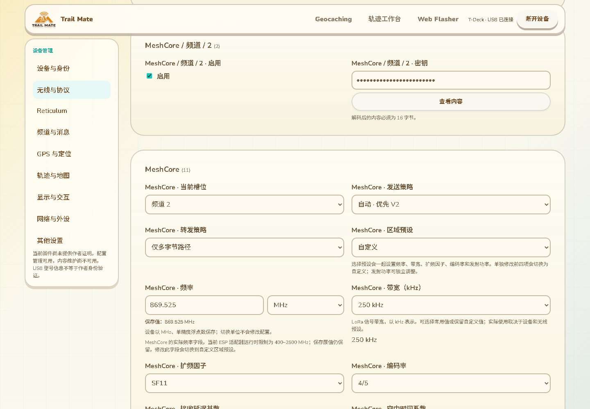
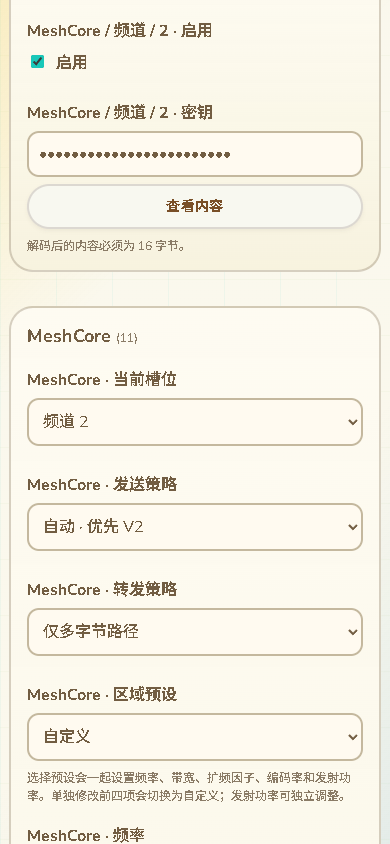

# 核心配置逐字段互操作与MeshCore频道镜像修复

2026-10-13，接47的保存投影对账。本批补网页值进入实际核心模型的验证，并修复发现的网页派生字段问题；没有修改、编译或刷写设备固件。

## 逐项验证范围

新电脑原生桥直接编译实际AppConfig、TMSET7 Decoder／writer和mesh_protocol_utils，不替换字段解码或模型。生成的核心文档为214项：210个当前可编辑字段，schema.version／document.kind两项格式元数据，以及mc.channel.0.enabled／mc.base.secondary_psk两项固定或派生状态。

浏览器测试使用生产TmsDocument／配置校验／值编辑入口，对210项分别写入不同于默认值的合成值：布尔反转，具名枚举选择另一项，数值／浮点改变，UTF-8与百分号等文本，二进制密钥／哈希／映射。每份完整候选先用实际Decoder校验，再应用到新的AppConfig，最后由实际writer重新导出。比较修改字段及完整文档的所有类型化值，避免仅解码成功但值未进入模型，或误写其他字段。

额外核对当前槽位0／7与8／255拒绝、兼容密钥固定32字节、APRS节点映射0／255与256字节拒绝，以及缺必需字段／重复／错误类型的准入。所有输入为测试合成配置，不连接设备、不保留用户配置或私钥。

这比47的保存→导出源码对账更强，证明当前核心writer所列字段经过网页编辑后能由实际Decoder装入模型并重新导出。它仍不证明所有独立存储、硬件运行时消费、生效策略、掉电恢复或当前实机309项完整写入；TMS扩展和板型行为继续按16核对。

## 找到并修复的实际问题

首轮逐字段测试失败于mc.base.secondary_psk。它是MeshCore兼容缓冲，Decoder::finish调用syncMeshCoreLegacyChannelMirror，从mc.active_slot对应频道复制16字节密钥并清零其余缓冲；网页原来将它当作独立密钥允许编辑，修改会被覆盖。

现在显示为只读并用11语言解释来源；实际八个mc.channel.<slot>.key仍可维护。编辑当前频道密钥、切换当前槽位时同步兼容值；非当前频道的修改不会替换当前镜像。保留原输出长度0／16／32及后半零填充，未知／不完整格式不新增或删除字段。原生测试对三种长度核对真实模型，并用16字节旧镜像复现不同步的差异、证明同步后完整一致。

备份导入跳过作为独立输入的旧镜像，按实际频道／槽位重新计算；错误导入保留原候选。保存前同步并冻结实际上传内容，所以摘要、提交回执和重连读回预期引用同一内容。只读输入改为随候选值刷新，避免实际页面仍显示旧镜像；可编辑字段仍保留原有未完成输入和错误状态。

mc.active_slot使用八项具名下拉，显示1–8，持久值0–7。当前TMSET7解码器对8／255直接拒绝；底层模型另有兼容归零逻辑，不能将它误说成当前配置提交的行为。网页提前阻止非法槽位。

另外补齐legacy.secondary_psk固定32字节和aprs.node_map最多255字节的网页容量检查，错误提示覆盖11语言。兼容字段仍按其当前格式保留，不扩大到未知二进制字段。

截图来自实际device页面、模拟串口和合成配置，沿用现有Pages主题。密钥保持遮盖；不是Wio画面或实机用户密钥。

## 验证与资源

- 配置Node回归共128项全部通过，包含4项新实际核心互操作及5项镜像／导入／保存／语言测试；210字段是单项测试内的逐字段案例数，不与128项相加。
- 实际Edge整页回归通过：11语言槽位／帮助、只读、当前密钥编辑、槽位切换与恢复、镜像及时刷新；原配置分类、错误录入、搜索、备份、作者证明、提交和窄屏流程保持。新增手机截图无横向溢出。
- 网页构建、clang-format14、ESP栈检查及差异检查通过。CI现有config-*.test.mjs入口包含新测试，原生构建新增小型CLI；尚未远程运行CI。
- GitNexus对新增网页符号返回UNKNOWN；手工核对Field、编辑、导入、上传、回执与读回入口，不将未收录视作无影响。没有提交／推送或部署。

本批只编译电脑CLI，不增加设备库、任务、队列或RAM。候选仍5848e0dd…／静态95,556字节，已刷仍8bcf6607…；两个镜像哈希已复核。设备87K／297K及正常菜单／触摸为用户对已刷版本的验收，不是本批或候选的新运行测量。全部配置、Geocaching、联网轨迹维护、设备SD导航、峰值、掉电与USB重连继续保留原范围。
