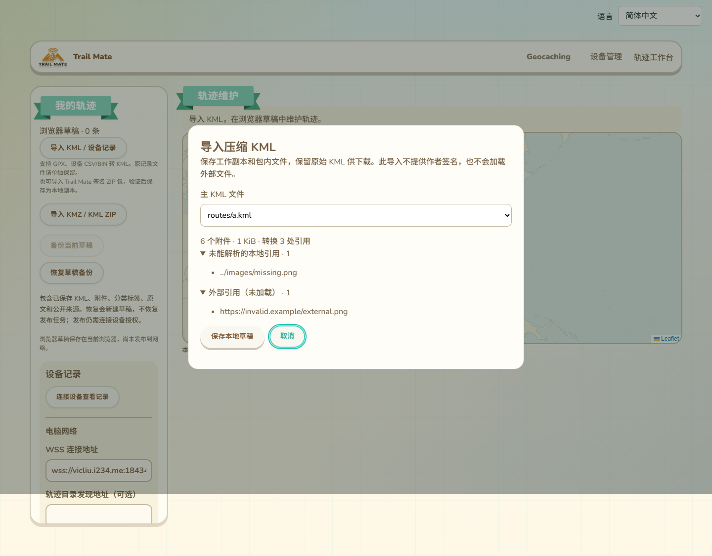
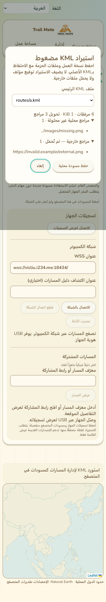
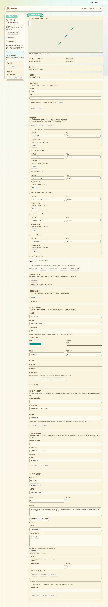

# KMZ页面导入与原文持久保存

2026-10-13，接61。KMZ／普通KML ZIP已接入现有我的轨迹页面；本批为网页实现和浏览器验收，没有固件编译／刷写。此记录覆盖61的“未接入界面和保存”状态，不代表整个三功能目标完成。

## 页面位置与操作

现有我的轨迹侧栏保留原KML／设备记录／签名ZIP入口，新增“导入KMZ／KML ZIP”。原入口继续核验签名包，不增加核验失败后自动降级为无签名草稿的路径。新入口检测签名包标记并提示改用签名ZIP入口。

新入口沿用现有按钮／颜色／圆角，原页面上的原生modal dialog负责焦点与背景交互隔离。读取后列出全部主KML候选；根doc.kml或唯一候选可预选，多候选由用户明确选择。显示附件数、大小、转换引用数、未解析本地引用和外部引用。取消不保存；读取中支持取消，提交中显示保存状态并暂时禁用取消，避免误报已取消而实际已写入。

全部文案接入现有11语言；路径以独立文本展示，RTL和手机布局已验证。导入结果是浏览器本地无签名草稿，发布仍走连接设备作者身份及既有签名／网络流程。

## 工作副本、资源与原文

按所选KML在包内的目录解析相对URI。标准KML href／styleUrl和description中的src／href可转为kmz前缀下的路径；查询／片段引用另有精确映射，同文件样式片段可转回本文件引用。处理实体及HTML采用既有XML／HTML DOM边界；原始KML字节另行保留，不用加工副本替代原文。

包内全部文件保持原始内容与目录关系，包括所选原始KML、其它KML和未被当前主文件直接引用的资源；这样其它保留文件的相对关系仍存在。查询／片段别名分别进入附件索引，资源角色区分图片／图标／叠加／其他。文件名保持大小写和Unicode差异。所选KML产生工作副本并重新计算摘要，不沿用原作者签名。

外部／缺失／无法安全定位的引用列在审阅中，不自动加载或编造文件。缺失引用可随草稿保留，继续在现有说明／附件界面维护。动态／3D／外部样式和其它尚未渲染能力仍按兼容报告与08保留，导入不等同于完整渲染。

原始所选KML提供独立“下载原始KML”按钮，编辑、附件修改及重新打开后保持精确字节。其它原成员保存在附件中；本批没有添加重新导出原始压缩容器的功能。原文保留空间与查询别名的副本计入现有64MiB草稿总预算；图片4MiB、其它单资源8MiB、64附件和KML8MiB约束继续生效，超限拒绝而不静默删资源。

## 原子保存与一致性

saveTrackDraft新增仅新建可用的archiveImport参数，不能与签名包／父版本／准备计划／归档操作混用。KML、附件、原文及摘要在同一IndexedDB事务提交；任一失败回滚。原文摘要及长度在readTrackDraft核对，损坏返回DRAFT_CORRUPT。后续普通编辑保留原文文件与元数据，附件保存也保留；新原文不能覆盖已有草稿的原文。

旧草稿、签名包来源证明、版本CAS、发布锁及任务失效机制沿用原行为。新增原文空间计入新建／编辑／附件修改的总预算，没有新增数据库store或升级版本。

## 验收证据

- 实际生产page.jsx、导入组件及IndexedDB在Edge通过：11语言、主文件选择、取消零草稿、嵌套相对引用／查询别名／图标／未知扩展／未引用文件保留、外部引用不加载、原文精确下载。
- 编辑KML、修改附件、刷新页面后原文字节相同，无签名来源证明被伪造。
- 注入文件put配额失败，metadata／files／attachments全事务回滚；原文逐字节损坏检测及恢复验证通过。参数错误和试图替换已有原文不创建新草稿。
- 所有KML触发请求保持本地／blob，description脚本未执行；已识别签名包拒绝进入无签名入口。
- 现有工作台、附件、活动／标签和签名ZIP四条实际页面回归通过，包括原有11语言／手机／RTL、版本与发布锁、原签名和附件保持。
- 13压缩读取测试、5签名包测试、1草稿锁测试，共19Node通过；网页构建与git diff --check通过。新页面测试加入CI，未远程执行CI。

截图为实际集成页面，已视觉检查。此处未执行公网发布、设备安装或GPS／图片显示验收。

设备仍仅COM67，60的手动复位请求尚待完成；当前已刷7c317f32…的应用／配置／身份／内存验收没有新结果，87K297K仍只是此前已刷版本反馈。配置全部生效、Geocaching完整维护、公网多目录共享、KML剩余增强、设备导航、峰值／掉电与跨身份／板型等原范围继续按16保留。
