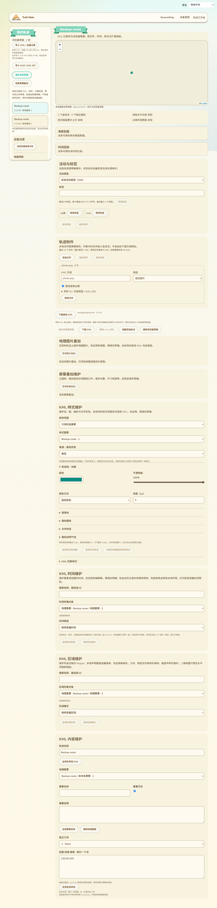
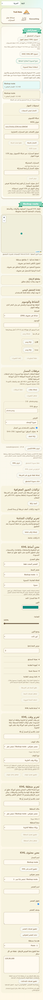

# 轨迹草稿 ZIP 备份与恢复

2026-10-13，接62。现有“我的轨迹”侧栏在 KMZ 导入下新增“备份当前草稿”和“恢复草稿备份”，沿用页面样式与11种语言。当前草稿有未保存的 KML／表单／附件修改或操作预览时，两个入口暂时禁用，先保存再备份。恢复不覆盖已有草稿，而是新建 UUID、本地版本1并打开编辑器。

## 文件与身份边界

ZIP包含 `draft.json`、精确工作 KML、可选原始 KML、附件二进制和公开来源证明／索引／活动父版本。附件按 SHA-256 去重存放，JSON保留每个附件ID、原始引用、类型、用途与必需标志，多个引用可以指向同一份内容。活动类型和标签随草稿保存。原始KML与工作副本分别校验，不用编辑后的文件冒充原文。

格式为 `trailmate.track.draft` 版本1，导出 stored ZIP，可由独立 Python `zipfile` 读取与校验CRC；读取复用61的有界ZIP引擎，支持其压缩／名称规则。ZIP最多65MiB；实际草稿内容（KML、原文、逐附件行）仍受64MiB预算约束；最多64行附件。JSON最多512KiB，严格检查键、文件清单、大小、SHA-256和额外成员，不能把普通KMZ或签名发布ZIP误当草稿备份。

公开来源与父版本签名在读取时重新验证；保留附件索引时核对来源清单和实际附件。归档草稿要求活动父版本，且工作KML必须仍匹配父版本的长度和摘要。已编辑的普通草稿可以保留公开来源证明，但恢复不会声称修改后的文件仍受旧签名认证。

备份不含设备私钥、身份秘密、维护会话、准备nonce、USB上传绑定、发布检查点或旧任务。发布继续使用插入设备的作者证明和既有协议；恢复旧任务不属于本格式。它也不替代设备完整配置／身份备份。

## 保存与失败处理

恢复先检查ZIP与签名，再实际解析KML，最后由 `saveTrackDraft(..., {draftRestore})` 将元数据、工作文件、原文和附件放在同一 IndexedDB 事务。仅允许新草稿，不与发布计划、packageSource或archiveImport混用；已有ID拒绝。恢复时复制输入字节和元数据，再异步哈希，避免处理中修改对象造成混合快照。

读取阶段可以取消；开始存储提交后显示处理状态并禁用取消。损坏文件／容量不足显示本地化错误，事务失败不会留下半份草稿。当前浏览器关闭期间的下载结果仍取决于浏览器行为，取消提交后不冒充撤销已保存数据。

## 验证证据

- `track-draft-backup.test.mjs` 5项通过：精确字节／别名／元数据／原文、独立ZIP校验、不包含任务与秘密、真实Reticulum公开签名／归档父版本、篡改与清单错误、取消、异步输入快照。
- 与13项KMZ和5项签名ZIP一起共23项Node测试通过。
- `track-draft-backup.browser.mjs` 实际 `page.jsx`／IndexedDB：下载ZIP并独立读回、从文件选择器恢复新草稿，精确保留KML／原文／附件／标签／公开签名和父版本，刷新后仍可读取。注入files.put容量错误后三个存储各仍只有原2行；坏ZIP没有新草稿。11语言及阿拉伯语390px布局通过。
- 元数据、KMZ、签名ZIP浏览器回归与网页构建通过；相关脚本加入CI。地图后续修改时一次并行运行未收到download事件而超时，单独复测通过；这条记录不据此断言已查明或修复并行下载原因。

本批仅网页源码、测试和截图，无固件编译／刷写／RAM增量。63不证明公网发布、真实USB授权、设备安装、完整KML预览或整个目标完成，剩余范围保留在16。
