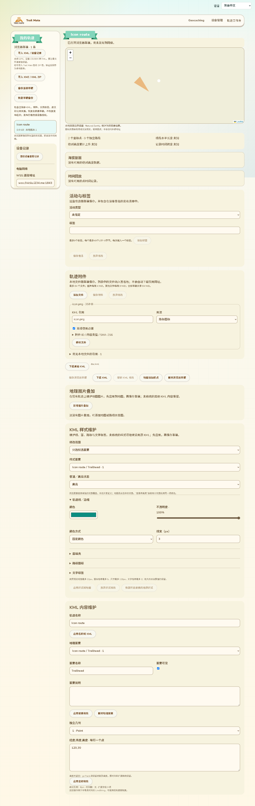

# 草稿与共享地图的附件图标预览

2026-10-13，接62／63。原来虽然保存了IconStyle和附件，地图只显示圆点；现在本地工作区与共享详情接通PNG／JPEG附件图标。共享详情取得经过签名索引／内容摘要校验的包后更新地图，不需要重新下载KML，也不启动额外网络请求。

## 语义与兼容边界

继续复用Style／StyleMap的normal、highlight及行内覆盖；显示scale、heading和颜色的alpha，hotSpot支持fraction、pixels、insetPixels，转换为Leaflet从左上角计算的锚点。KML锚点原点在左下角、insetPixels分别从右／上边缘计算，依据 [Google KML IconStyle参考](https://developers.google.com/kml/documentation/kmlreference#iconstyle)。旋转放在子图片，保持Leaflet地图平移变换。

最长显示边128px；源图片尺寸和锚点超出预览预算时缩小／回退，并显示兼容提示。后续已补RGB混色：图片下挂本地SVG滤镜，以sRGB对角矩阵乘KML的RGB，保留图片原alpha，再应用一次KML alpha；沿用colorMode=random的固定种子。白色不创建滤镜，过滤器ID由UUID产生，数值来自已校验的颜色，无额外网络地址或固件开销。不以此宣称完整Google Earth样式实现。GroundOverlay／ScreenOverlay／PhotoOverlay、图标调色板裁剪与其他动态／3D内容仍须后续处理，原文与资源继续保留。

全部样式兼容提示（包括原先直接显示中文的循环、重复ID、外部样式、错误值等）已有11种语言，工作区与共享详情均显示。无附件、附件未验证、摘要错误、无法解码、格式／尺寸超限时使用圆点。KML内的HTTP引用只有精确匹配已保存附件映射时可使用该本地内容，绝不从URL自动取文件。

## 生命周期与预算

图标hook仅处理当前模型normal／highlight实际引用的附件，不预解码无关照片。读取草稿核对版本；共享只接受verified行，再对实际文件做SHA-256核验。最多64行、单文件4MiB、仅识别PNG／JPEG；先读头和尺寸，再真实createImageBitmap解码，最多累计800万唯一源像素。相同内容摘要共用一个Blob URL，解码位图立即关闭。

草稿版本、图标引用或共享包变化会清理旧URL。异步摘要／解码完成前若上下文已经改变，不把旧结果显示到新详情；位图仍关闭。无新的固件常驻缓冲、任务或RAM使用。

## 已验证与剩余

`track-map-icons.browser.mjs` 通过实际工作台和生产SharedTrackPreview：真实canvas PNG、本地IndexedDB资源、scale／heading／alpha、三类锚点、11语言、外部／缺失／未验证／篡改回退、匹配摘要但无效图像拒绝、替换详情时的延迟解码与URL释放。共享包原有浏览器回归、样式解析回归、草稿备份整页回归和网页构建通过；新测试加入CI，实际截图已检查。

后续图标浏览器测试新增真实渲染像素核对：源RGB(200,128,64)乘颜色(128,64,32)，截图中心RGB约(100,32,8)；再验证KML alpha及源alpha与KML alpha组合的白背景结果。PNG截图以独立解压／反滤波读取RGB，不只检查DOM滤镜属性。RGB／alpha三组与既有图标整页、资源释放、11语言测试通过。

共享测试输入为已校验包形状的合成数据，并不是公网作者／目录到浏览器的完整链路。未进行真实USB、设备图片显示或内存峰值验收；源文件不改写。公开网络、图标调色板、地理叠加和整个原目标均未因此完成。
