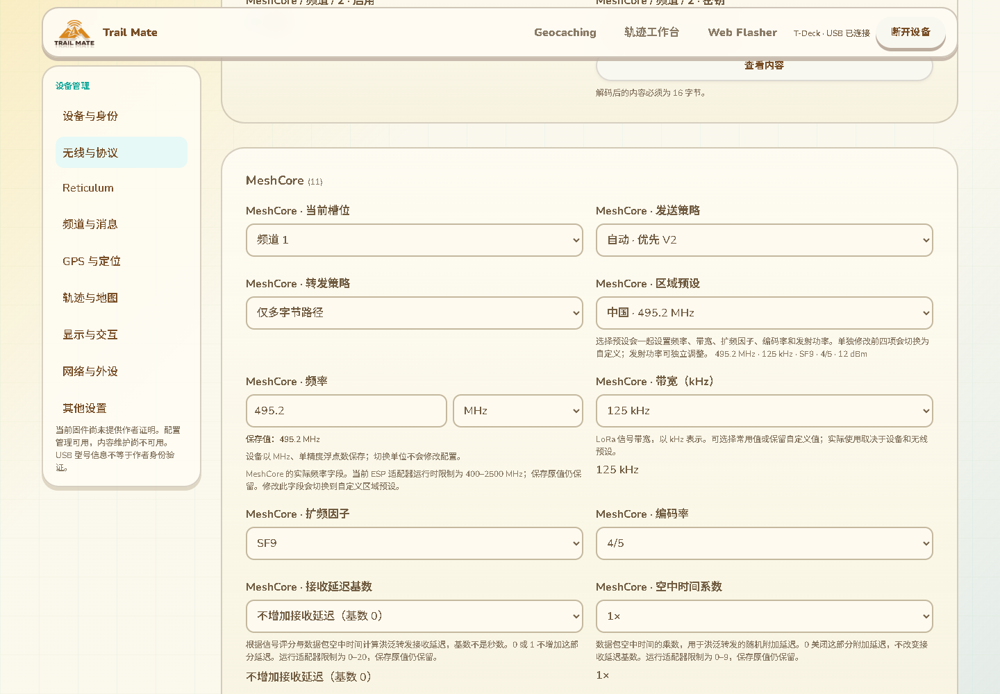

# 配置语义与 MeshCore 区域联动

日期：2026-10-13。分支：`feature/web-device-outdoor-management`。这是实现和验证记录，不代表全部配置交互或三个功能已交付。

## 本批行为

现有设备管理页的“无线与协议”中，`mc.region_preset` 不再显示无解释的数字。0 显示“自定义”，1–17 使用固件实际区域表，地区名通过当前语言的 `Intl.DisplayNames` 显示，窄带／距离／推荐名称及操作说明覆盖全部 11 种语言。选项包含频率，说明区显示完整频率、带宽、SF、4/n 编码率和功率。

选择非零预设会一起设置 `mc.frequency_mhz`、`mc.bandwidth_khz`、`mc.spread_factor`、`mc.coding_rate` 与 `mc.base.tx_power`。单独修改前四项会将预设切换为自定义；修改功率保留预设，符合当前设备界面。选择自定义仅解除预设，不重置现有参数。一次选择先在临时文档验证，再修改编辑文档，缺字段或非法输入失败时原文档不受部分修改影响。

区域数据对照 `modules/core_chat/src/infra/meshcore/mc_region_presets.cpp`，交互对照 `modules/ui_shared/src/ui/presentation_sources/runtime_settings_source.cpp` 的预设应用和单项修改逻辑。没有改动这两份固件源码。

备份导入仍使用原逐字段恢复路径。备份中的区域预设标识和独立参数均按原值恢复，不因字段顺序或预设联动而覆盖用户自定义值。变更预览补充当前／原配置各自的频道名，使前后频道名称来自正确的快照。

## 浮点比较与回读

TMSET7 的 `f32` 在设备中保存为 IEEE-754 单精度。网页输入 `495.2`，固件可能导出 `495.200012`；两者表示相同存储值。变更与回读现在比较 `Math.fround` 后的值，不使用可能掩盖实际变化的宽泛误差容限。测试同时验证相邻可表示浮点值仍被报告为不同。

同精度的频率重新录入不会误切换为自定义。作者身份绑定的完整逐字段回读通过后，将对应传输的公开校验摘要更新为设备实际快照摘要，支持随后刷新时校验；不同身份、未验证身份、字段不一致或其他标签页的较新传输均不会被这一步确认。存储失败继续显示持久校验不可用。刷新发生在首次完整回读之前时，只有原摘要可用，不能从摘要反推出字段语义，因此文本规范化可能仍显示摘要不同，需要重新核对。

实机只读测试报告改为读取页面显式的 `data-author-verified` 状态，而不是在指纹框中搜索中文验证提示。该状态只在页面实际验证成功时为真；失败、验证中、断开及迟到结果不得恢复它。修复尚未重新取得实机浏览器报告，旧报告中的 false 不被改写为通过。

## 验证证据

- 32 项相关配置回归通过：所有 17 个预设经过已有 native CLI 的实际 C++ Settings/BLE/Wi-Fi/存储读写与重新导出；309 条基线、296 项普通可编辑字段、100 项模块单值字段、集合／备份／变更预览回归通过。硬件、NVS 和运行时为桌面替身，不是实机写入验证。
- 11 项区域、回读及检查点专项通过，包括单精度等值／相邻值、原子失败、备份不受联动影响、不同传输保护和秘密不持久化。
- 实际构建的 device 页通过 Edge 整页测试：11 语言预设名称、选取中国预设五参数刷新、手动切换自定义、独立功率调整、验证成功／失败／撤销状态、浮点规范化回读摘要，以及原有导入／保存／重连／恢复／手机布局流程。串口设备为测试替身，作者签名为测试身份实际密码学验证。
- 网页构建、诊断服务语法检查和 `git diff --check` 通过。

实际页面截图使用合成 T-Deck 配置，不代表 Wio L2 实机截图：

## 仍需完成

全量清单仍为 309 条；本批更新后，50 项选择控件、83 项开关、2 项百分比滑块等不等于全部字段语义已经完善。77 项数值控件中包括正常的端口、时间、功率等，必须逐项核对单位、自动／关闭等特殊值、来源关联和合适的输入方式。MeshCore 遥测与广播策略、APRS 符号、GPS 运动传感器及剩余字段说明继续核对实际消费代码，不猜测枚举意义。

本批未重新编译或刷写固件，没有增加设备 RAM。Wio L2 保持用户已验收的 7c 固件和此前约 87K／297K 同页读数。真实浏览器配置写入／重连、全部配置实际生效、Reticulum 网络发布确认／查询／更新／归档与服务重启恢复、Geocaching 完整流程，以及 KML 剩余渲染和设备运行验收仍属原目标，见 16。
