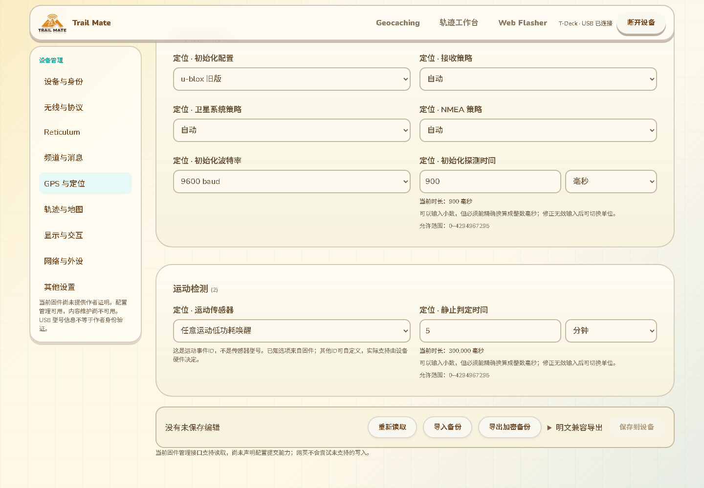
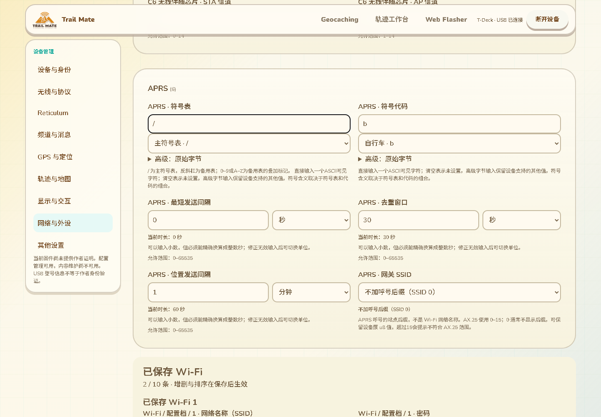

# 运动事件与 APRS 字符配置

日期：2026-10-13。分支：`feature/web-device-outdoor-management`。这是全量配置语义审计的后续实现，不代表所有配置交互或三个功能已经交付。

## 运动事件录入

`gps.motion_sensor` 仍保存原 u8 值，界面增加“运动检测”77、“显著运动”55、“任意运动低功耗唤醒”143。数值对照 `modules/core_gps/include/gps/domain/motion_sensor_ids.h` 的三个 Bosch 事件常量；这是事件 ID，不是传感器型号。硬件是否支持继续取决于设备，网页不假设所有板型具有同样的传感器。

已知选项使用可读名称，普通状态不显示额外裸数字框。选择“自定义”才展开数字输入；未知但合法 ID 自动显示在自定义状态，切换分类后保留。选择已知预设重新收起数字输入。其他现有带自定义入口的波特率、信道利用率同步采用此交互，不限制设备原来的值域。

## APRS 字符录入

固件把 `aprs.symbol_table`、`aprs.symbol_code` 的 char 值以 u8 编码到 TMSET7；这些配置现在直接输入一个可见 ASCII 字符，空输入明确设置为未设置的零字节。符号表提供主表 `/`、备用表反斜杠，以及备用表 0–9／A–Z 叠加标记选择。规则对照 [APRS 官方主符号表](https://www.aprs.org/symbols/symbolsX.txt) 和 [官方叠加扩展说明](https://www.aprs.org/symbols/symbols-new.txt)。

符号代码保留完整 94 个可见 ASCII 字符入口。主表中额外显示步行、自行车、营地、摩托车、汽车、独木舟、骑马、吉普车、动力船、固定住宅站、气象站、中继站等 12 个常用名称。切换备用表时不沿用主表名称，避免同一字符被错误解释。

“高级：原始字节”折叠入口可维护完整 0–255 原值；未识别字节以 `0xFF` 等形式显示，读取和切换分类不会自动改成空值。汉字、emoji、多字符和不可见字符不能通过普通字符入口提交；原始字节入口仍按设备 u8 约束验证。错误输入保留在对应控件中，修正后才解除错误；不会用不合法字符替换设备值。

变更预览显示当前快照对应的字符、可用名称和原字节，备份继续使用原 TMSET7 类型。当前没有实现完整 188 个主／备用符号的名称、全部叠加组合名称或图标预览；这些边界不能被常用名称替代。

两张图来自实际构建的现有页面和合成 T-Deck 配置，不是实机截图。

## 约束、语言和验证

- 新名称、说明、错误提示和高级入口覆盖 11 种语言；不改变配置键、序列化类型或原合法值域。
- 通用范围说明在最终字段约束确定之后生成，避免端口已经要求 1–65535，说明仍沿用类型的 0–65535。
- 25 项相关回归通过，包含已有实际 C++ Settings/BLE/Wi-Fi/存储与重新导出路径：27 组运动 ID／APRS 字节往返、17 MeshCore 区域预设、309 条基线／296 普通可编辑字段／100 模块单值字段及备份／预览。硬件、NVS 和运行时为桌面替身。
- 字符与基础模式／外设相关 13 项验证通过：实际事件常量、94 字符双向转换、完整 u8 值域保留、非法字符、11 语言以及主／备用名称分开。
- 实际 Edge 整页验证保存恢复、身份证明与撤销、区域预设联动、新字符／事件输入通过；补充快速呈现测试核验 11 语言、手机 390 像素、字符错误、未知字节／高级值错误、清空、表切换、自定义事件跨分类保留。首次测试对语言切换立即读取旧渲染产生时序失败，改为等待目标语言呈现后再比较；未削弱名称断言。
- 网页构建、差异检查通过。更新的 309 条合成控件清单为选择 53、普通数值 74 等；普通数值包含端口、时间、功率和位掩码，不能把该数量当作错误数量或完成百分比。

本批没有固件构建／刷入，也没有新增设备 RAM。真实配置在各硬件上的消费与生效、剩余配置语义和分组、MeshCore 遥测策略、完整 APRS 符号解释，以及 USB 作者与公网／网页完整发布、KML 设备验收等原目标继续保留在 16。
