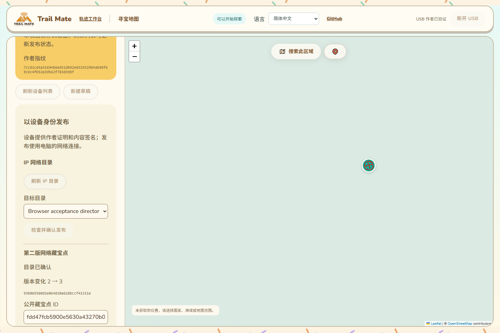

# Geocaching 整页与真实网络维护

日期：2026-10-13。分支：`feature/web-device-outdoor-management`。本批将验证从协议入口推进到现有整页维护操作；仍不代表 Wio L2 真实 USB、公网部署或三个功能整体交付。

## 验证路径

实际构建的 Geocaching 页面与维护面板 → 实际管理会话／HostLink 编解码 → 测试 USB 设备身份；实际页面 Worker → 浏览器 RNS/LXMF → 原始 WebSocket 桥 → TCP/HDLC → 原生 Python Geocaching 生产目录及 SQLite。

只替代 USB 端点，使用独立合成身份执行真实作者挑战证明和内容签名。没有替代 Worker、网络客户端、目录响应或页面维护组件。测试 USB 端点校验上传摘要、草稿代次和签名绑定，接收原生目录的签名证明并验证它；设备侧持久化为测试内存状态，不能作为实机存储证据。地图瓦片使用本机占位图，避免请求公共瓦片服务，不替代业务地图与编辑操作。

独立 Python 只读检查实际目录数据库，对照整页流程签出的原始对象，验证三个版本、原文／签名、父版本链、归档头，以及网络传输身份不同于设备作者身份。

## 本批发现的真实签名请求问题

网页签名准入将草稿代次转换为 BigInt 做范围检查，然后把普通代次 `1n` 直接传给 MsgPack。编码器把它写为 uint64；管理协议的严格 CMP1 解码器要求最短整数形式，因此报 `Noncanonical CMP1`，命令 71 在发出前即失败。实际整页停在“设备正在签名／结果未确认”，没有发生新的设备签名。此前直接调用测试会话的单元测试绕过了管理编码，未覆盖这一问题。

修正只作用于 `beginDeviceGeocacheSignature`：范围检查后，安全整数范围内转回 Number；更大的代次继续以 BigInt 传输。没有放宽规范解码或缩小原完整 uint64 范围。新增测试通过实际 `encodeManagement`／`decodeManagement` 检查 1、127、128、65535、2³²、最大安全整数、其后一值及最大 uint64，确认值不丢失。固件无需变更。

## 整页通过的流程

1. 自动发现和核验原生 IP 目录；连接测试 USB，验证作者身份。
2. 在现有“草稿”页新建藏宝点，输入中文、多行正文、提示和坐标，按原串口协议保存草稿。
3. 检查发布预览，由测试设备签名；浏览器网络提交第一版并验证目录回执。
4. 保存原生目录签名证明，通过管理协议上传内容／证明并取得测试设备确认，更新“我的藏宝点”记录。
5. 修改并保存草稿，发布第二版；改为归档，发布第三版。每次重新核验当前网络版本和父版本。
6. 原文超过单包大小，实际经历 HostLink 分块和网络 RNS Resource 传输。正文内 `<script>` 保持文本，不执行。
7. 实际复制公开 ID 到测试浏览器剪贴板，核对它与签名对象 ID 一致。
8. 切换 11 种语言，已确认／已同步状态保持；390 像素手机布局无横向溢出，语言切换不触发新的设备请求。
9. 刷新整页，重新连接并验证作者，恢复浏览器已保留的第三版及设备同步状态；签名和确认仍各 3 次，没有重签。
10. Python 使用只读 SQLite 连接核对三版原文及签名与预期完全一致，归档头无冲突，并确认传输来源不是设备作者的 LXMF 身份。

流程中没有请求设备 RF 身份／目录／发布命令 7、67、68、70，也没有配置读写或身份导出。这个证据证明当前网页维护路径不依赖设备 RF 查询，不能扩大为全部硬件模式都已实测。

图中使用合成测试作者和本机真实目录，USB 为测试端点；保持现有页面风格与位置。

## 证据与剩余范围

- `geocaching-network-maintenance.browser.mjs` 整页真实 Worker／网络测试退出 0。仅成功完成全部断言后写结果；开始新一轮时移除旧结果，避免失败留有旧通过记录。
- 26 项签名／IP 工作流／版本／证明／检查点／网络注册回归通过。另实际管理编码的相关 20 项检查通过，其中存在重叠，不能相加计算完成率。
- 网页构建、Python 语法检查和 `git diff --check` 通过；截图已检查。
- 新整页测试加入现有 CI 构建页面后的检查，但未运行远端 CI。
- 测试服务正常停止，原始桥退出。保留合成目录状态和日志用于版本链核对；没有真实设备秘密。

本批没有固件构建／刷机或设备 RAM 增量，保持用户验收的最新 Wio L2 固件和约 87K／297K 表现。仍待真实 Wio L2 的浏览器发布、目录证明同步与持久恢复，以及公网故障／重连／多标签页竞争／跨身份的完整验收。全量配置语义、KML 其余功能、设备导航／掉电与峰值、其他硬件和最终交付门禁继续保留在 16。
