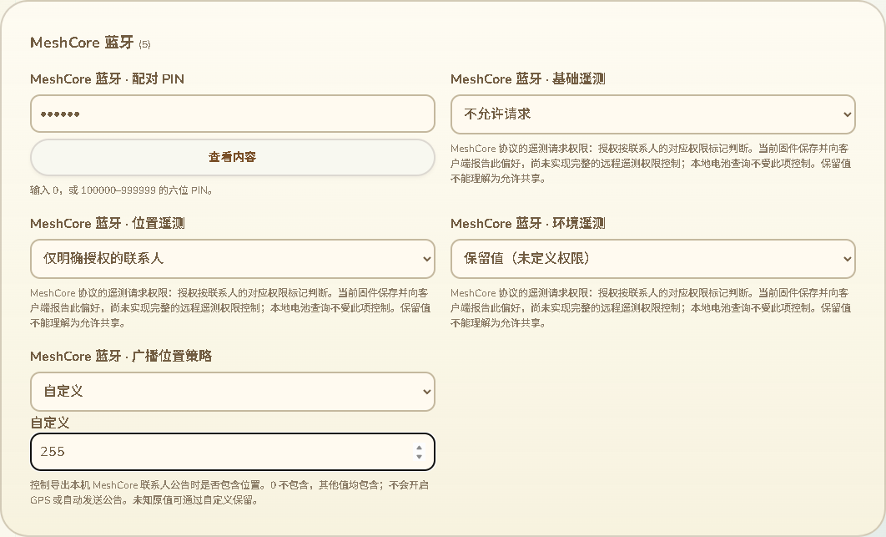

# MeshCore 遥测与公告位置配置

**本页控件已撤掉：用户随后明确要求网页不出现蓝牙配置、不支持 MC／MT App 连接。以下为历史记录，当前行为以 [70](70-时间单位录入与网页配置范围修正.md) 为准。蓝牙遥测偏好不再属于当前网页交付要求。**

日期：2026-10-13。分支：`feature/web-device-outdoor-management`。本批继续处理全量配置中的数字含义和实际生效范围，不代表全部字段交互或三个功能已经交付。

## 现有页面上的录入

`mc_ble.telemetry_base`、`telemetry_location`、`telemetry_environment` 从裸数字输入改为四个可读选项：0 不允许请求、1 仅明确授权的联系人、2 允许所有请求者、3 保留值（未定义权限）。三个字段独立维护，不把保留值转换为允许共享，也不因展示更新而改写原配置。

0／1／2 的协议含义核对 [MeshCore 官方 NodePrefs](https://github.com/meshcore-dev/MeshCore/blob/main/examples/companion_radio/NodePrefs.h) 与 [官方请求处理](https://github.com/meshcore-dev/MeshCore/blob/main/examples/companion_radio/MyMesh.cpp)：模式 1 使用联系人的相应权限标记，并非所有已保存联系人都自动获得权限。当前 Trail Mate 的实际合法范围来自 `app_config_tms_ble_extension.cpp` 中的 u8 上限 3，以及 `getTelemetryModeBits` 的三个两位字段。

界面明确说明当前实现边界：本固件保存这些偏好并报告给 MeshCore 客户端，但没有据此实现完整的远程遥测权限控制；本地电池查询也不受这三项控制。证据为 `MeshCoreBleService::getTelemetryModeBits`／`setOtherParams`／存储路径，以及 `MeshCorePhoneCore` 的本地电池查询分支和现有调用点。不能把官方完整权限行为直接当作本固件已经实现的功能。后续如补齐该行为，应独立核验请求接收、联系人权限和真实 RF 行为。

`mc_ble.advert_location_policy` 提供“不包含位置”“包含位置”两项常用选择，并保留自定义输入。当前本固件在导出本机联系人公告时，以 `advert_loc_policy_ != 0` 判断是否包含位置，所以原 2、3、42、255 等合法字节不丢失，也不按其他固件的模式表擅自解释。说明明确指出它不会开启 GPS 或自动发送公告。

未知原值读取后直接进入自定义状态；切换分类仍保留。选择常用项时收起数字输入，只有选择自定义才展开。非法值保留在输入框并阻止有效提交；修正后解除错误。变更预览显示权限含义，序列化仍保持原键和 u8 类型。

截图来自实际构建页面和合成设备配置，故意包含保留值 3 与未知公告策略 255，用于展示原值保留；不是 Wio 实机画面。

## 验证与限制

- 新选项和帮助说明覆盖 11 种语言，沿用现有页面风格与分类。
- 18 项相关 Node 回归通过，包括三类遥测全部 0–3 值和七种公告位置值共 19 组经过实际 C++ 配置校验、保存、重新导出的往返；NVS、硬件和运行时使用桌面替身。完整 309 条基线、296 个普通字段及 100 个模块单值字段回归仍通过。
- 实际 Edge 页面呈现专项退出 0：11 语言选项、390 像素无横向溢出、自定义 255 保留、256 错误、42 跨分类保留、常用项收起数字框、权限变更预览，以及编辑不触发串口命令。首次截图定位错误地假设 Card 是 section，测试失败；改为按实际 device-section 类定位后通过，生产页面无此故障。
- 实际 Edge 整页完整回归也退出 0，包含保存／备份恢复、作者证明验证与拒绝、断开撤销、模块编辑和窄屏布局；USB 使用测试端点，不宣称本轮 Wio 写入或新实机验收。
- 网页构建和差异检查通过；已有 CI 的 `config-*.test.mjs` 与 `device-page.browser.mjs` 自动覆盖新增验证。
- GitNexus 对新增的网页配置函数返回 UNKNOWN；已核对配置输入、校验、搜索、分组、预览和导入调用范围，不能把无索引结果当作没有影响。

本批不改固件、不构建 ESP SDK、不刷入，不增加设备 RAM。剩余全量字段用途、单位、特殊值、依赖和分组，以及完整 APRS 符号、实际硬件消费、真实 USB 与公网整页维护、KML 和导航等原目标继续保留在 16。
