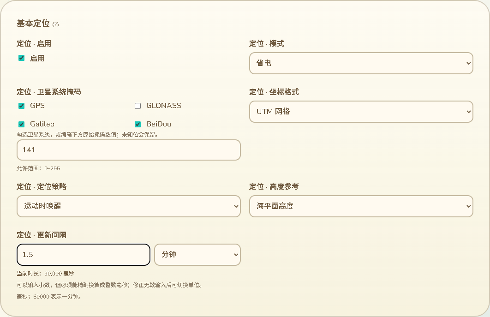

# 时间单位录入与网页配置范围修正

日期：2026-10-13。分支：`feature/web-device-outdoor-management`。本批包含用户新增的明确范围约束，不代表三个功能全部交付。

## 用户确认的范围

用户明确要求网页不出现蓝牙配置，不支持设备连接 Meshtastic／MeshCore App。网页管理继续通过 USB 与设备作者身份工作，不将手机 App 连接作为前置条件。

已从配置录入、搜索和变更预览排除 `device.ble_enabled`、`mt_ble.*`、`mc_ble.*` 及其他明确的 BLE／Bluetooth 字段族。69 的 MeshCore 蓝牙遥测与公告位置控件已撤掉，新增语言目录和专项测试也已移除；69 仅保留历史记录，不代表当前界面。原规划中完善蓝牙 App 兼容配置的条目退出当前目标范围。

备份恢复跳过这些字段，保留当前设备值；类型不同或未知字段也不会被旧备份注入。完整快照与原格式备份保留协议兼容记录，其他配置保存时仍使用完整文档，不损坏当前固件要求的配置块。保留兼容数据不等于开放编辑入口或启用蓝牙。固件既有可选蓝牙模块没有在本批改动，不能以网页隐藏推断编译时已经删除这些模块。

无线频道、调制参数和通过 USB 的 RF 身份维护继续保留，不与手机 App 连接混同。309 条完整测试基线中有 10 条排除记录，网页范围为其余 299 条；这些数量包含只读及模块容器记录，不是可编辑控件数或完成百分比。

## 时间参数录入

七个已核对单位和类型的字段增加单位选择：GPS 初始化探测、更新间隔、静止判定三个 u32 毫秒字段；传播同步间隔 u32 秒字段；APRS 最短发送间隔、去重窗口、位置发送间隔三个 u16 秒字段。毫秒字段用毫秒／秒／分钟／小时录入，秒字段用秒／分钟／小时。

初始显示优先使用可整除的较大单位，如 60000 毫秒显示 1 分钟，300000 毫秒显示 5 分钟；输入 1.5 分钟精确得到 90000 毫秒。主标签去掉固定原单位后缀，另显示精确当前时长；变更预览也附带单位。

单位切换不调用编辑函数、不改变文档、不产生未保存编辑。无法用有限小数表示的换算明确标为近似显示，同时保留精确原值。真的编辑时使用十进制整数运算，不能精确换算到原始整数单位就拒绝，不靠浮点舍入“修正”。支持当前语言的小数分隔符、阿拉伯数字及全角数字，拒绝分组符、指数、负数和超大输入。中间输入 `1.` 与错误输入保留，跨分类保留错误值和单位；修正前禁止切换单位。

传播同步间隔在当前配置准入中要求 60–86400 秒，网页补齐此范围。不能因为 `PropagationClient::syncDue` 接受零，就把零展示为可保存的关闭模式。范围错误带原生单位，避免在分钟输入框出现无单位的 60–86400。

屏幕常亮 300000 和地图记录间隔 99（按距离）保留行为选项，不经过普通时长转换。没有将 GPS／APRS 的零值猜测为自动或关闭，运行时归一化与硬件消费继续独立核验。

截图来自实际构建页面与合成 USB 配置，不是实机写入；新增单位、帮助及错误覆盖 11 语言。

## 验证

- 当前配置范围／时长／导入／搜索／预览组合 22 项通过；最后完整原生／范围／时长组合 17 项通过，两组有重叠，不能相加为独立总数。
- 10 组时长输入经过实际 C++ 配置校验、保存、重新导出并精确保持，包含 u32 最大值、分钟小数、毫秒小数和 u16 小时时长；0、59、86401 秒传播同步间隔被实际准入拒绝。
- 实际原生路径证明：旧备份的蓝牙开关／PIN／偏好变更被导入跳过，正常设备名称仍保存，重新导出保留原兼容字段。NVS 和硬件运行时为桌面替身。
- 完整 309 条测试基线、296 个原生标量字段、100 个模块单值字段回归通过。原生标量含兼容记录，不能称为当前网页可编辑字段数。
- 实际 Edge 整页回归退出 0：11 语言隐藏与搜索排除、时长精确输入／无编辑单位切换／近似提示／错误跨分类／上限／同步范围、保存恢复、作者证明与撤销、窄屏布局。USB 为合成端点；编辑交互核对零额外串口命令。
- 网页构建、差异与实际截图检查通过。既有 CI 配置通配符及整页回归覆盖新增验证；未声称远端 CI 已运行。

没有构建 ESP SDK、刷机或增加设备 RAM。用户准备离开时已明确答复本批无需刷入，现有已验收固件保留。其他全量配置语义、KML 地图叠加、真实 USB／公网完整维护及硬件验收继续保留在 16。
