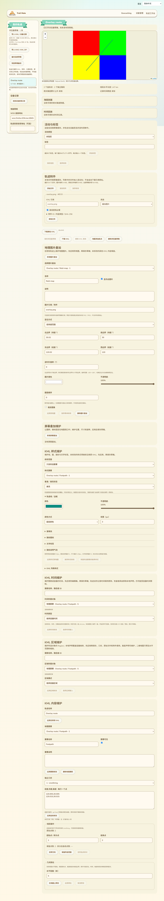
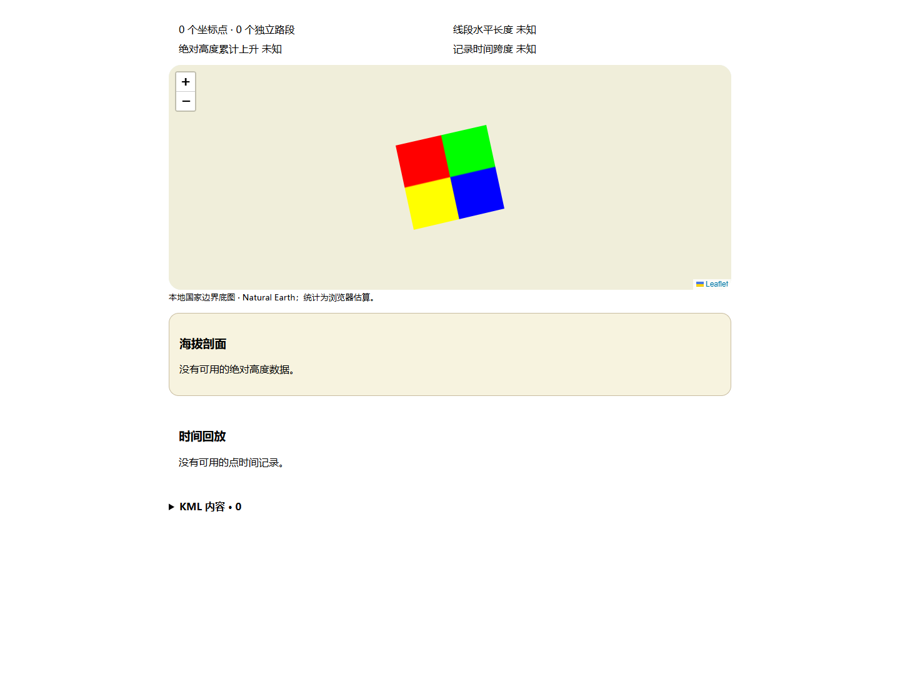

# KML 地理图片叠加预览

日期：2026-10-13。分支：`feature/web-device-outdoor-management`。本批补齐 GroundOverlay 的网页绘制，不代表全部 KML 能力或三个功能已交付。

## 两处地图中的呈现

现有“我的轨迹”工作台和共享轨迹详情使用同一套地理图片叠加实现。`LatLonBox` 的经纬范围与绕中心逆时针旋转、跨日期变更线及扩展经度均可预览；`gx:LatLonQuad` 按四个逆时针顶点、首点对应图片左下角的规则处理，拒绝非凸或退化四边形。规则核对 [Google KML GroundOverlay](https://developers.google.com/kml/documentation/kmlreference#groundoverlay) 和 [gx:LatLonQuad](https://developers.google.com/kml/documentation/kmlreference#gxlatlonquad)。

图片四角经地图投影后，用透视变换定位，避免将任意四边形误画成普通矩形。地图平移、缩放和尺寸变化更新投影；图片范围参与视图定位，即使文件只有 GroundOverlay 而没有 Placemark，也能显示其范围。日期变更线附近保持连续经度，不把两度范围误画成 358 度。

尊重自身及上层 Folder／Document 的 visibility，兼容 0／1／false／true；drawOrder 排序后分配同一图片图层中的绘制顺序。图片在底图上方、轨迹线及路标下方。颜色使用 KML AABBGGRR 的 RGB 乘色与透明度，复用原图标的 sRGB 实现；无图片引用时绘制指定颜色的范围。

第一张来自实际构建的完整页面；第二张来自直接挂载的生产共享组件，未覆盖共享整页网络流程。四种色块是有意生成的方向／像素验证附件，不是实机画面或实际地图内容。

## 资源与原文约束

- 复用草稿和共享包的图片资源加载器。仅匹配本地附件的精确引用，核验真实字节摘要、PNG／JPEG 头与实际解码尺寸；不请求 KML 中的外部网址。
- 最多 64 条附件、图片每文件 4 MiB、合计唯一解码图片 800 万像素的既有预算继续保留，多个引用的相同摘要只创建一份 Blob URL。解码 bitmap 关闭，切换来源／包或卸载后撤销 URL；过时异步解码不能发布新图片。
- **64 条附件不是 64 个叠加位置。** GroundOverlay 数量沿用 KML 5000 要素预算；实际 65 个位置共用一个附件的测试通过。较小的显式调用预算仍有可读限制提示，不改变原文。
- 原始 KML、附件、签名和发布数据没有因为预览而改写。共享详情缺失、未验证或坏摘要的附件明确显示提示；不使用外部网络补齐。
- 其他资源列表文案改为说明有限预览能力，不再错误地把已经可绘制的 GroundOverlay 一律说成未绘制。说明和错误覆盖 11 语言。

## 当前边界

后续72已补齐路标／地理叠加的图集裁剪、裁剪后锚点和预算验证，覆盖下文当时“真裁剪未实现”状态，详见 [72](72-KML图集裁剪与裁剪锚点.md)。其他边界继续保留。

这是二维地图预览：矩形旋转在经纬平面计算，不模拟地球曲面的三维地形贴合或高度。非地面高度模式显示说明，保留原值。时间、区域限制（包括从上层继承）尚未用于过滤图片，显示说明。实际图集裁剪仍不支持并明确提示；x=0、y=0、w=-1、h=-1 的默认未裁剪参数正常绘制。超过 Web Mercator 纬度范围或参数无效时保留原文并提示。

ScreenOverlay、PhotoOverlay、三维场景、完整时间／区域过滤，以及图片叠加参数的专用可视化维护表单仍未完成。不能用静态二维叠加证明全部 KML 功能已完成。

## 验证

- 4 项 Node 几何、凸性／退化、日期变更线、旋转、透视映射及 11 语言测试通过。数学四角映射误差要求小于 1e-7；实际浏览器 CSS 矩阵序列化检查要求小于 0.01 屏幕像素，测得最大约 0.00455 像素。
- 实际 Edge 草稿整页和生产共享组件专项最终退出 0：原始字节持久保留、四象限真实 PNG 截图像素、逆时针旋转、透视四角、平移／缩放、日期变更线、无图片色块／drawOrder、RGB 乘色与 alpha、隐藏父层、无效／裁剪／极区／继承范围提示、11 语言／390px、65 个位置共用 URL、不同引用同摘要去重、解码预算、过时异步关闭与 URL 全部释放。两张 2048×2048 不同图片超过 800 万预算，第二张未解码；实际 decode 调用次数为 1。
- 早期像素检查采样点正好被轨迹线覆盖，改为避开线段的象限内部；CSS 计算样式的系数序列化有正常精度差，按屏幕像素核验；Leaflet 缩放动画会暂时隐藏图片，截图等待可见与动画结束。没有为此修改绘制逻辑或去掉像素断言。
- 既有 KML 解析、样式、图标／RGB-alpha、KMZ 整页导入与共享包组件共五个浏览器脚本均通过，进程退出 0。新数学／浏览器验证加入 CI，未声称远端 CI 已执行。
- 网页构建、差异和实际截图检查通过。GitNexus 未收录新增网页符号，影响结果 UNKNOWN；已核对两地图、解析提示、资源加载和共享图标调用范围。

本批没有固件开发、ESP SDK 编译、刷入或设备 RAM 变化；没有真实 USB、RF、公网或导航硬件实测。原配置语义、网络维护与设备完整验收，以及上述 KML 剩余能力继续保留在 16。
