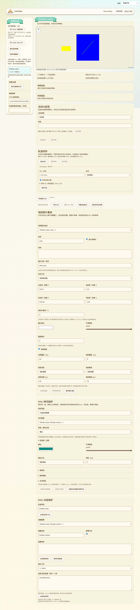

# KML 图集裁剪与裁剪锚点

日期：2026-10-13。分支：`feature/web-device-outdoor-management`。本批补齐静态图集裁剪，不代表全部 KML 能力或三个功能已交付。

## 实际地图中的裁剪

路标 `IconStyle/Icon` 和 `GroundOverlay/Icon` 共用 `gx:x`、`gx:y`、`gx:w`、`gx:h` 解析和范围核验。原点位于图集左下角，转换到网页图片顶部偏移时使用 `图片高度 − y − h`；宽高的默认 -1 对应原图片尺寸。规范来源为 [Google KML Icon](https://developers.google.com/kml/documentation/kmlreference#icon)。

只有符合整数语法、设备预览能精确处理且落在已验证图片范围内的裁剪区域可以显示。负偏移、小数、重复字段、零尺寸、非法负宽高及越界范围明确提示。使用裁剪后的小图尺寸计算缩放、128 像素图标预览上限、fraction／pixels／insetPixels 锚点；旋转作用于裁剪视口，图集不会因旋转露出相邻区域。

样式引用、StyleMap normal／highlight 和部分内联覆盖继续有效。仅覆盖 scale 等项会保留原 Icon 的裁剪；内联替换 Icon 且未声明裁剪时使用整张新图片，不错误地继承原图集区域。

截图来自实际构建页面与合成浏览器草稿。黄色路标和蓝色地理叠加来自同一张四象限 PNG 的不同区域；绿色线段是独立轨迹，不是图集内容。两者使用同一附件 URL，原始图片和 KML 没有被改写。

## 数据与预算

裁剪仅通过网页显示视口完成，不生成新的裁剪附件或重新编码图片。RGB 乘色、原图片 alpha 和 KML alpha 沿用原绘制路径；超出图片边界时不回退成错误的整张图。

摘要与实际 PNG／JPEG 解码核验、每图片文件 4 MiB、合计唯一解码图片 800 万像素等既有约束保持。预算按完整源图计算，不按裁剪区域计算：1×1 小裁剪仍需解码完整图集，不能绕过上限。不同位置、图标和叠加共用已验证附件；切换／卸载继续关闭 bitmap 和撤销 Blob URL。

没有调整签名、清单、目录协议或固件数据格式。共享组件接收已验证包形状并再次核验图片字节；本批没有验证公网或真实 USB 发布流程。

## 验证

- 3 项裁剪单元测试与既有 4 项叠加数学／语言测试通过：默认原图、左下偏移与顶部转换、整数边界／非法输入、重复和其他命名空间、越界以及 11 语言说明。
- 新实际 Edge 草稿整页／生产共享组件专项退出 0：四象限真实截图像素、同图集路标和叠加共 URL、96×48 缩放与96／12锚点、45度旋转、裁剪 RGB／alpha、共享样式／highlight／内联新Icon覆盖、原文及附件摘要不变、越界拒绝、11语言／390px、完整源图解码预算和 URL 全部释放。
- 两张 2048×2048 图集分别选择1×1区域，仍超出800万唯一像素预算；第二张未解码，实际 createImageBitmap 调用为1。
- 原图标、GroundOverlay、样式及KMZ整页导入回归通过。样式专用测试使用固定HTTP模块列表，初次没有服务新增裁剪模块而失败；补齐模块和语言目录后单独重跑退出0。没有改变生产导入或放宽断言。
- 网页构建、语法、差异和实际截图检查通过。新测试加入CI，未声称远端运行。
- GitNexus 对新增网页函数返回 UNKNOWN；已核对两地图、共用图片生成、样式解析及地理叠加调用范围。

覆盖71中“实际图集裁剪未支持”的旧状态。时间／区域过滤、叠加与裁剪参数的专用维护表单、ScreenOverlay、PhotoOverlay、三维场景及完整真实USB／公网／硬件验收仍未完成，继续保留在16。

本批没有 ESP SDK 编译、刷机或设备 RAM 改动，也没有新增蓝牙或MC／MT App配置入口。用户已验收固件继续保留。
