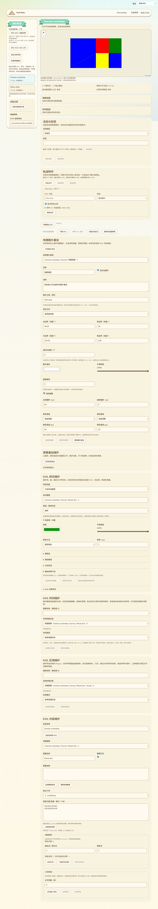
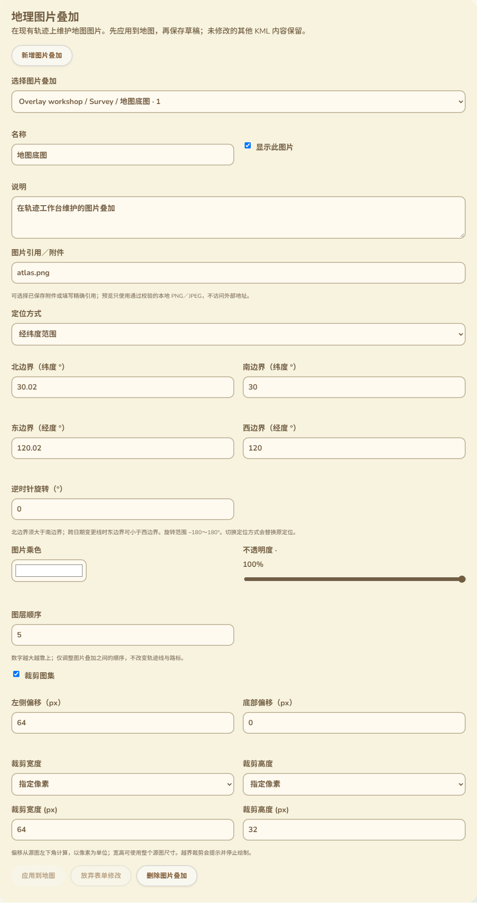

# KML 图片叠加维护表单

日期：2026-10-13。分支：`feature/web-device-outdoor-management`。本批将 71／72 的地理图片预览与图集裁剪接入实际轨迹工作台的维护交互；没有固件编译、刷机或设备 RAM 改动。

## 在现有页面中的位置

沿用现有 Pages 的背景、颜色、卡片、按钮和语言切换。右侧主栏的附件维护与草稿保存按钮之后、原有「KML 内容维护」之前，新增「地理图片叠加」卡片。左侧仍为我的草稿、设备记录与电脑网络入口，顶部地图显示应用后的结果。

截图来自实际构建页面、浏览器 IndexedDB 草稿与合成 KML／PNG，显示现有主题中的真实控件，不是实机或公网截图。

## 录入与操作

- 选择现有叠加时展示文档／文件夹路径、名称和原始序号。列表不按绘制顺序重新编号，隐藏或预览无效的叠加仍可以维护。只列出 KML 根、Document、Folder 下的实际要素，不将 Update 命令里的对象当成普通叠加。
- 可新增、修改、删除叠加，维护名称、说明、显示开关、图片引用、颜色、不透明度、图层顺序和裁剪。上级隐藏会单独提示；不会因为打开本项就覆盖文件夹的设置。
- 图片引用可以选择已保存 PNG／JPEG 附件的精确引用，也可以直接录入。地图仍只绘制经过既有摘要和实际解码校验的本地附件，不访问外部地址。
- 「经纬度范围」分别录入北、南、东、西边界与逆时针旋转，标签标明经纬度及度数；说明北大于南、日期变更线和旋转范围。「四角定位」使用左下、右下、右上、左上四组经纬度输入，避免要求用户手写 KML 坐标串。
- 颜色使用取色器，不透明度使用滑块并显示百分比；转换到 KML 的八位颜色时保留 alpha 字节精度。图层顺序明确说明较大的值在其他图片之上，轨迹与路标的顺序不变。
- 裁剪偏移标明左侧／底部与像素。宽高通过「源图尺寸／指定像素」选择，不把底层 -1 当成需要用户理解的普通数字。实际图片越界仍由既有预览核验拒绝绘制并提示。
- 数值支持当前语言的小数符号、阿拉伯／波斯／全角数字。每个编辑字段保留录入时的语言，切换页面语言后不会把已输入的逗号小数解释错，也不会丢失中间或错误输入。

定位与字段含义按 [Google KML GroundOverlay](https://developers.google.com/kml/documentation/kmlreference#groundoverlay)、[gx:LatLonQuad](https://developers.google.com/kml/documentation/kmlreference#gxlatlonquad) 和 [Icon](https://developers.google.com/kml/documentation/kmlreference#icon) 核对。

## 草稿一致性

操作分为「应用到地图」与「保存浏览器草稿」。有未应用表单时，保存、下载当前编辑文件、撤销及其他 KML／附件维护会锁定，并提示先应用或放弃；切换草稿、导入和离开页面沿用未保存保护。普通要素编辑、附件操作或几何简化预览也会锁定叠加表单，避免同时修改两套状态。

应用通过原有有界撤销历史进入内存草稿；删除有明确确认，保留图片附件，可用原有撤销恢复叠加。保存继续使用 IndexedDB 的版本检查。新增叠加生成唯一 ID；普通修改保留原 ID。可能移除带 ID 的旧定位或破坏 KML Update 目标引用的操作会拒绝，不擅自修复引用。

只修改有变化的字段。不改动未编辑的说明、扩展、图片刷新参数、ExtendedData、样式、时间／区域、原有高度等内容；重复字段与冲突定位无法明确修改时拒绝。**工作 KML 经 XMLSerializer 重新序列化，不承诺空白、实体写法或 XML 前缀逐字相同。** 原始导入 KML 的独立副本与附件字节仍精确保留，空操作直接保留工作文件原字节。

二维预览没有实现高度／地形贴合；原有四角第三列高度保留，编辑二维坐标不主动删掉高度。定位方式切换属于明确替换原定位，未知扩展的保留范围遵循这一操作边界。

## 验证与剩余范围

- 叠加编辑专项在实际 Edge 整页运行：稳定目标序号、无效输入保留与拒绝、应用／保存／重开／下载／撤销、新增／删除、日期变更线四角、草稿切换确认、放弃表单、11 语言／390px／RTL，以及实时语言切换后的输入与 DOM 保留。
- 13 类无效修改在实际浏览器 XML 与生产修改器中拒绝，覆盖文字、显隐类型、颜色、整数顺序、裁剪、范围、四角方向、重复字段、带 ID 定位、Update 引用及不存在的目标。
- 实际下载核对颜色 `80c0a080`、45 度旋转、图层顺序 -4。原 KML 独立副本与 PNG 字节保持精确相同，未编辑子树的样式／扩展／ID／高度保持。
- 2 个新录入／语言单元测试与既有裁剪、叠加数学测试组成 9 项组合通过。原有 KML 修改、图集裁剪、KMZ 导入、工作台与管理页多语言浏览器回归通过。
- GitNexus 对新增网页符号返回 UNKNOWN；手工核对了工作台调用、草稿保存与未保存保护范围。新验证接入 CI，未声称远端 CI 已运行。

本批覆盖 72 中「地理叠加与裁剪参数的专用维护表单」缺口。路标 IconStyle 的专用样式编辑、时间／区域过滤、ScreenOverlay、PhotoOverlay、三维场景、完整配置语义以及真实 USB／公网／硬件完整验收仍未完成，继续保留在 [16](16-交付缺口核对.md)。没有新增蓝牙或 MC／MT 手机 App 配置入口，保留用户已经验收的固件。
