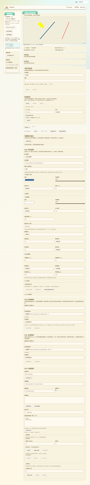
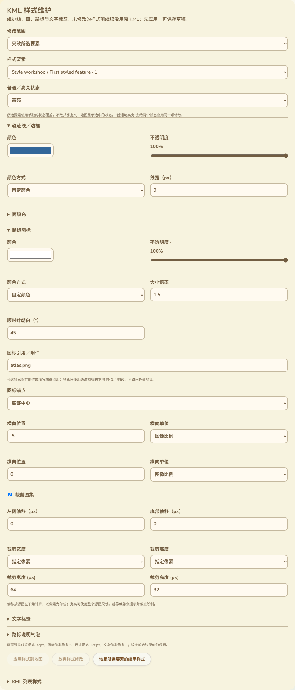

# KML 样式维护与状态隔离

日期：2026-10-13。分支：`feature/web-device-outdoor-management`。本批补齐轨迹线、面、路标及文字标签的样式编辑，继续使用当前固件，没有 ESP SDK 编译、上传或设备 RAM 改动。

## 实际工作台入口

现有工作台右侧的图片叠加之后、原有 KML 内容维护之前增加「KML 样式维护」。沿用现有卡片、字体、颜色和按钮；左侧草稿列表及顶部地图仍是原来的入口。四类样式分为可展开的小组，不把全部参数平铺。

截图来自实际构建页面与合成浏览器草稿，不是实机或公网维护截图。

## 修改范围与状态

默认「只改所选要素」，并可在表单中切换当前地理要素。普通、高亮、普通与高亮三项明确显示作用状态；地图跟随普通／高亮选择，两个状态同时修改时显示高亮。只修改用户改变的字段，不将另一状态的全部属性复制覆盖。

修改所选要素通过内联 StyleMap 的状态覆盖完成，原共享 styleUrl 和定义保留。原内联 StyleMap 只有 normal 时，高亮原本会回退到它；修改前保留这一回退的原内容，避免修改 normal 后连带改变 highlight，或新增 highlight 时丢掉此前回退得到的线宽等属性。原节点带 ID 时追加独立覆盖，避免改动可能被其他内容引用的原样式；已有安全覆盖重复编辑时复用，不持续追加选择器。

也可以明确选择「修改共享样式」，按 Style ID 维护带 ID 的 Style 定义。页面提示该操作影响直接或通过 StyleMap 引用它的其他内容；共享定义保留 ID、扩展和未修改子样式。重复 ID 或重复目标字段无法明确修改时拒绝，保留原草稿。

行为按 [Google KML Style](https://developers.google.com/kml/documentation/kmlreference#style)、[StyleMap](https://developers.google.com/kml/documentation/kmlreference#stylemap) 和 [IconStyle](https://developers.google.com/kml/documentation/kmlreference#iconstyle) 核对。

## 可维护参数

- 轨迹线／面边框：颜色、不透明度、固定／随机颜色方式和像素线宽。随机方式的取色器表示随机 RGB 上限，不把某一次随机预览结果写回原色。
- 面：填充颜色、不透明度、颜色方式、显示填充和显示边框。
- 路标：颜色、不透明度、颜色方式、大小倍率、顺时针朝向、精确附件引用、锚点及图集裁剪。
- 文字标签：颜色、不透明度、颜色方式及大小倍率；倍率零可以关闭标签。
- 锚点有中心、底部中心与自定义，支持图像比例、pixels、insetPixels。选择自定义只展开编辑状态，不擅自改变坐标。横纵位置和单位可以分别维护。
- 裁剪使用 73 相同的左侧／底部像素偏移与源图尺寸／指定像素选择。修改倍率或朝向不会丢失继承的裁剪；修改引用或裁剪时完整声明本次 Icon 引用与裁剪状态。清空引用可明确覆盖继承图标，而不是又显示上级图标。

颜色使用取色器和百分比不透明度，不要求用户手写 AABBGGRR。保留原 alpha 字节精度；每个数值字段记录录入时的语言，实时切换语言不丢失逗号小数、中间输入或 DOM 控件。

网页显示预算保留：线宽最多 32px、图标倍率最多 5、图标尺寸最多 128px、文字倍率最多 3。合法更大原值继续保存并提示预览上限，不静默改写原值。给原本没有子样式的单个要素新增线宽等覆盖时，显式保留原预览的颜色／宽度，避免新建 ColorStyle 的默认值造成无关视觉变化；主题透明度转换到 KML 颜色时按最近的 8 位 alpha 表示。

## 保存、恢复和数据保留

沿用「应用到地图→保存浏览器草稿」及有界撤销历史。未应用的样式与图片叠加、普通要素、附件操作互锁；保存／下载／撤销和切换／离开保护均接入同一未保存状态。没有内联样式时，恢复按钮禁用，避免无效恢复制造一次编辑。

「恢复所选要素的继承样式」需要确认，移除该要素全部内联 Style／StyleMap，保留共享引用与定义，可以撤销。带 ID 的原内联样式暂不允许整体移除，避免破坏外部引用。

工作 KML 使用 DOM 修改和 XMLSerializer，不承诺空白、实体写法或前缀逐字相同；无修改操作直接保留原字节。独立原始导入 KML 与附件字节精确保留。原 BalloonStyle、ListStyle、其他扩展、几何、时间、高度等未编辑内容不因本批样式维护而删除。

## 验证

- 生产修改器在实际浏览器 XML 环境中验证：normal／highlight 隔离、只有 normal 的回退、两状态只改所选字段、共享定义不变／明确共享修改、无样式主题颜色保持、ID 与扩展保留、图标引用／裁剪／锚点、清空引用、恢复继承及重复编辑不积累选择器。
- 12 类无效操作拒绝：状态、目标、负数／非有限数、颜色、显隐类型、朝向、锚点单位、裁剪尺寸、重复字段／ID及带 ID 样式的整体移除。
- 实际 Edge 整页验证包括输入错误保留、编辑互锁、普通与高亮预览、保存与真正重新打开、撤销、共享修改、恢复与放弃、11 语言／390px／RTL，以及德语输入 `7,5` 后切换英语仍准确应用为 7.5。
- 沿用生产 Canvas 地图，记录实际绘制的线宽／颜色，并读取线条中点实际像素，得到 `51,102,153,255`，与 `#336699` 一致。图标实际显示 96×48、45 度、底部中心 48／48 锚点；修改裁剪后仅目标要素改变，另一个要素保留原裁剪。面填充／边框和标签关闭经实际保存数据与生产解析核对。
- 独立原 KML 和 PNG 字节保持精确一致。原样式解析、附件图标、图集裁剪、图片叠加维护、工作台和管理页多语言浏览器回归通过；3 项样式文案／数值与叠加文案 Node 组合通过。
- 首轮集成发现两张兄弟卡片使用同一 React key，已改为不同前缀并复测。测试初版误用 SVG 路径检查 Canvas 地图，已改为核验实际 Canvas 绘制与像素，没有改变生产地图渲染方式。
- 构建、语法、差异与实际截图检查通过。新测试接入 CI，未声称远端运行。GitNexus 对新增网页符号返回 UNKNOWN，已手工核对两地图、资源读取和工作台草稿调用范围。

本批覆盖 73 中路标及基础样式专用编辑缺口，但不代表全 KML 已完成。共享 StyleMap 引用映射的直接维护、BalloonStyle／ListStyle 的专用编辑、时间／区域过滤、ScreenOverlay、PhotoOverlay、三维场景，以及全部配置交互、真实 USB／公网／硬件完整验收仍保留在 [16](16-交付缺口核对.md)。没有新增蓝牙或 MC／MT App 配置入口。
