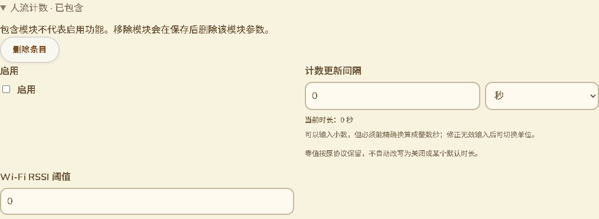

# 模块配置范围与全量录入审计

日期：2026-10-13。分支：`feature/web-device-outdoor-management`。继续用户要求的网页配置范围和全量录入核对；没有 ESP SDK 编译、刷机或设备 RAM 改动。

## 结构化模块的遗漏修正

70 已将普通 TMS 蓝牙字段排除，但结构化 Meshtastic 模块使用另一套表单、搜索与变更预览，`paxcounter.ble_threshold` 原本仍会出现。本批统一使用网页范围规则，排除该模块字段的控件、搜索元数据和变更预览，其他人流计数参数仍保留。

截图来自实际构建设备页与合成 USB 配置。展开的人流计数模块显示启用、更新间隔及 Wi-Fi 阈值，没有 BLE 阈值控件；不表示该模块的硬件功能已经实机验证。

## 备份导入与兼容数据

已知 `pb-v1` 格式的导入会保留当前设备的网页范围外模块参数，其他正常字段继续按备份恢复。保留目标原始 protobuf 字段字节，不把负数或重复字段重新解释成普通无符号输入；其他未知字段按候选备份保留。

当前未包含的范围外字段不能被备份注入。备份移除父模块、但设备仍有需要保留的隐藏兼容字段时，会保留只含这些字段的最小父容器；其他参数按备份处理，不自动设置 enabled=true。这可能使该容器继续显示“已包含”，与模块启用是两回事。网页明确移除整个模块仍遵循原有确认和删除该模块全部参数的语义。

隐藏叶子字段的错误 wire 可在恢复当前设备值后被排除；非法的非隐藏字段、无法解析的父结构或容量超限仍使整个导入回滚，不应用其他标量修改。导入摘要使用模块级兼容保留说明，不重新显示隐藏字段的配置控件。

未来未知格式保持不透明，本批不推断其内部字段，也不宣称可对未知 protobuf 格式逐字段恢复。完整快照与原始数据保留不等于开放蓝牙设置或手机 App 连接。

## 当前全量控件审计

新增 `scripts/audit_web_configuration_presentation.mjs`，只读取现有原生 CLI 输出的固定合成配置，不接收设备转储。报告只记录字段名、类型、控件、约束及帮助，不写配置值或密钥。替换此前包含已排除字段的旧审计，输出位于本地 `.codex-build/hostlink-codec/config-presentation-audit.json`。

当前基线 309 条，网页范围 299 条，包括只读与模块容器，不能称为 299 个可编辑控件：

| 呈现方式 | 记录数 |
|---|---:|
| 开关 | 80 |
| 选择 | 47 |
| 选择＋自定义数值 | 3 |
| 带单位时长 | 7 |
| 位选择 | 1 |
| 字符录入 | 2 |
| 百分比滑块 | 2 |
| 普通数值 | 60 |
| 文字 | 57 |
| 二进制／文字适配 | 27 |
| 只读 | 7 |
| 模块容器 | 6 |

结构化模块有 118 条可呈现描述，排除 1 条 BLE 字段；描述数量包含消息容器和只读字段，不能当作可编辑参数数量。60 条普通数值包含正常端口、功率、频率及计数，不是 60 项错误。频道位置精度、模块更新周期／特殊零值等仍需要进一步核对含义与实际消费，不凭数字类型猜测行为。

## 验证

- 21 项范围、模块搜索、导入、变更预览组合通过，包含 11 语言元数据排除、负值保留／普通值恢复、未知字段、未有字段不注入、父模块缺失、隐藏叶子错误 wire 与非隐藏错误整体回滚。
- 16 项完整原生互操作、模块准入及网页范围组合通过。新增用例实际经过现有 C++ 配置校验／nanopb／Preferences 保存和重新导出，保留 BLE 兼容阈值 -80，恢复普通 Wi-Fi 阈值 -60。NVS 与硬件运行时为桌面替身，不是 Wio 写入。
- 原有 309 条基线、296 项普通标量、100 个模块单值字段及集合互操作回归通过。这些测试仍包含兼容字段，不能称为当前网页编辑数量；两组测试也不能相加为无重叠总数。
- 实际 Edge 设备整页专项与既有保存／恢复／作者证明／断开撤销回归退出 0，11 语言下无隐藏模块控件与搜索结果，普通参数仍可维护；模块操作与语言切换零新增串口命令。串口为合成测试端点。
- 网页构建、差异与截图核对通过。GitNexus 对新增网页符号返回 UNKNOWN，手工核对模块表单、搜索、预览与备份导入范围。新 Node 测试由现有 CI 通配符覆盖，整页回归也已在现有 CI 内；未声称远端运行。

本批修正具体范围遗漏并更新审计，不代表全配置交互或三个功能已经完成。剩余字段语义、实际配置生效、KML 能力及真实 USB／公网／硬件完整验收继续见 [16](16-交付缺口核对.md)。继续使用用户已验收的固件及约 87K／297K 运行内存基线。
