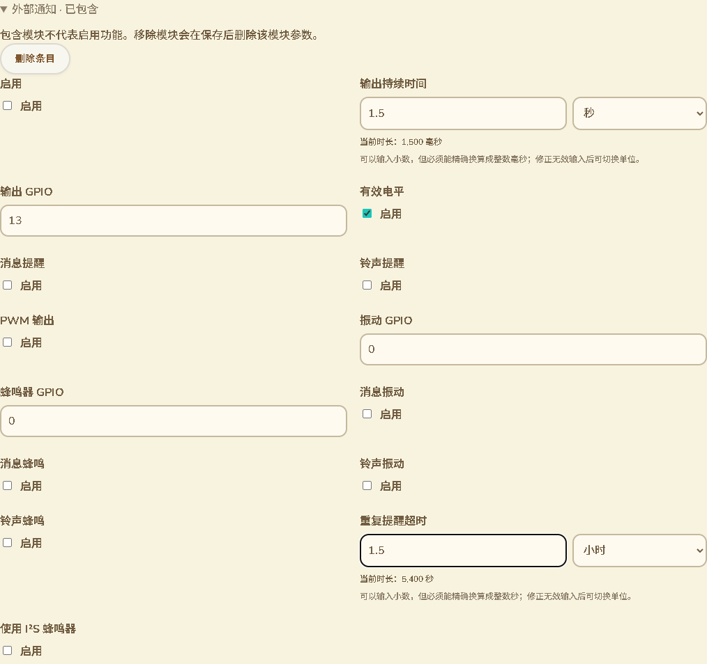

# 模块时间单位与录入约束

日期：2026-10-13。分支：`feature/web-device-outdoor-management`。本批将 15 个结构化模块时间字段接入现有精确时长控件，并完善搜索、变更预览、错误保留和名称。没有固件编译、刷机或设备 RAM 改动。

## 在现有配置页中的录入

沿用「无线与协议→Meshtastic 模块」的现有可展开模块。时间字段由单独数字框改成数值＋录入单位，并显示设备实际保存的整数值。可以输入 1.5 秒而不是计算 1500 毫秒，也可以输入 1.5 小时而不是计算 5400 秒。单位切换只改变显示，不修改配置或产生串口命令。

截图来自实际构建页面与合成 USB 配置，沿用现有主题；不代表 Wio 实机写入。显示的 1.5 秒／1.5 小时分别对应原始 1500 毫秒／5400 秒。

## 已核对的字段

| 字段 | 原始保存单位 | 录入单位 |
|---|---|---|
| MQTT 地图发布间隔 | 秒 | 秒／分钟／小时 |
| 串口超时 | 毫秒 | 毫秒／秒／分钟／小时 |
| 外部通知输出持续时间 | 毫秒 | 毫秒／秒／分钟／小时 |
| 外部通知重复提醒超时 | 秒 | 秒／分钟／小时 |
| 存储转发历史返回窗口 | 分钟 | 分钟／小时 |
| 距离测试消息发送间隔 | 秒 | 秒／分钟／小时 |
| 遥测设备／环境／空气质量／电源／健康更新间隔（5项） | 秒 | 秒／分钟／小时 |
| 邻居信息更新间隔 | 秒 | 秒／分钟／小时 |
| 检测最小广播间隔／状态广播间隔（2项） | 秒 | 秒／分钟／小时 |
| 人流计数更新间隔 | 秒 | 秒／分钟／小时 |

单位先核对仓库固定版本的 `module_config.pb.h`，注释未完整说明的字段再核对官方 [串口配置](https://meshtastic.org/docs/configuration/module/serial/)、[历史返回窗口](https://meshtastic.org/docs/configuration/module/store-and-forward-module/#history-return-window)、[距离测试发送间隔](https://meshtastic.org/docs/configuration/module/range-test/#sender-interval) 和 [人流计数更新间隔](https://meshtastic.org/docs/configuration/module/paxcounter/#update-interval)。当前上游功能与固定生成头文件的容量／枚举保持区分，不把新上游字段直接加入当前设备配置。

此前 `range_test.sender` 被标为「发送端角色」，但实际是发送间隔，已在 11 种语言中修正。GPIO、记录条数、位置精度等不会因为同为整数就被误当时长。

## 原值、零值与错误

复用十进制整数计算，必须能精确换算成原始整数单位，不用浮点舍入。历史窗口原单位是分钟，因此 1.5 小时可保存为 90 分钟，1.5 分钟不能保存为该字段的整数分钟。非有限值、千位分隔、精度损失和越界输入保持原输入并阻止保存。

容量使用当前生成描述的真实上限。重复提醒字段在协议里是 UINT32，但当前 nanopb 存储为 `uint16_t`，网页按 65535 秒校验，20 小时的 72000 秒不能通过。错误提示附原始单位；11语言切换后单位提示也使用当前语言。错误输入与录入单位跨分类保留，修正之前不能切换单位。

只在有明确协议依据时解释零值：重复提醒为不重复、检测状态广播为只在触发时广播、距离测试为不发送测试消息。其他零值按原协议保存，不自动转换成关闭或任意默认时长。当前模块参数可存储／恢复不代表设备新增了模块执行能力，页面有一次统一说明，避免把上游 Meshtastic 功能当成本设备已完成的功能。

原 PWM 联动保留：启用 PWM 时输出 GPIO、普通输出时长和有效电平仍禁用，原值保留，关闭 PWM 后恢复编辑。时长控件在提交失败前不提前更新其已保存值引用，避免模块容量错误丢失原输入。

## 搜索与预览

搜索元数据增加原始时间单位和协议参数说明，不索引字段值。结构化模块变更预览附带单位，不只列出 90、1500 等数字。全量合成审计补齐 7 个普通配置时长与 15 个模块时长的单位，仍不记录配置值或密钥。

## 验证

- 17 项时长、模块文案、搜索与变更预览组合通过，含全部 15 个字段、真实描述容量、精确小数／原生分钟拒绝、非时间字段排除和 11 语言。
- 18 项完整原生、模块时长与范围组合通过（与前一组有重叠）。新增 15 个字段的实际 C++／nanopb／Preferences 保存与重新导出，逐项保持精确整数；309 条基线、296 个普通标量、100 个模块单值及原有集合／兼容值回归通过。NVS 和硬件运行时为桌面替身，不是 Wio 写入。
- 实际 Edge 设备整页退出 0：1500 毫秒、5400 秒、90 分钟、原生分钟非整数拒绝、重复提醒越界保留／修正、11 语言错误单位、390px、错误与单位跨分类恢复、单位切换不产生变更、PWM保留／禁用，以及此前配置上传恢复／作者证明／断开撤销回归。USB为合成端点；编辑／语言切换无额外串口命令。
- 网页构建、语法、差异、文案和实际截图检查通过。新验证由现有配置测试通配符和设备整页 CI 覆盖，未声称远端运行。
- GitNexus 对新增网页符号返回 UNKNOWN；手工核对时长组件、结构化 Scalar、搜索、预览和模块名称调用范围。没有修改固件协议或生成的 protobuf 文件。

本批补齐具体模块时间录入，不能视为全部配置语义或三个功能已交付。频道位置精度、其他参数语义及实际消费、剩余 KML 能力、真实 USB／公网／硬件完整验收继续保留在 [16](16-交付缺口核对.md)。蓝牙／MC、MT 手机 App 配置排除仍保持。
