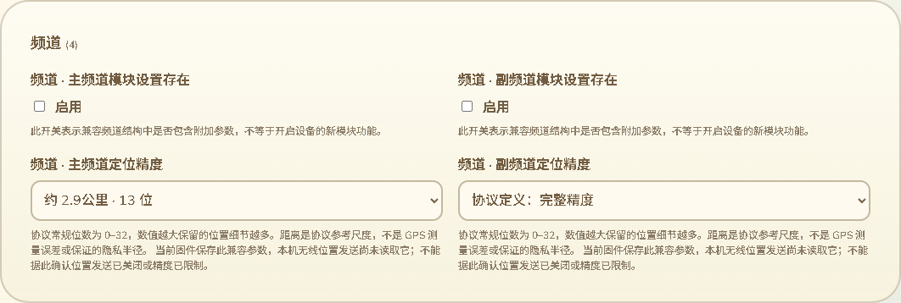

# 位置精度的可读选项与实际作用

2026-10-13，接76。本批完成两个频道位置精度与MQTT地图上报位置精度的网页交互，保持完整原值维护能力。没有修改固件、SDK构建或刷机，设备RAM基准继续以用户验收的87K／297K为准。

## 表单与预览

频道主／副精度提供常用下拉选项：0、10–19、32。13显示“约2.9公里 · 13位”，19显示“约45米 · 19位”；0与32分别明确标为协议定义的不发送频道位置／完整精度。距离采用官方频道参考表，不作为GPS误差、实际定位误差或保证的隐私半径。

MQTT字段属于独立的地图上报参数。其0显示“协议原始零值 · 保留”，不套用频道“不发送”的含义，也不猜测为完整精度或某个默认位数；是否报告位置是另一个字段。本仓库的规范化代码初始化此值为0，并把should_report_location初始化为false。固定生成协议注释与当前上游文档的默认描述不同，因此未把当前上游默认值写成设备的0值含义。

两类控件均可选择“原始／自定义位数”：1–9、20–31显示实际位数，33以上显示非标准兼容值说明。设备原生存储为uint32，保留0–4294967295；网页没有把允许存储范围擅自收窄到0–32，没有截断、钳制或自动替换未知原值。负数、非整数和超过4294967295的输入拒绝，原错误输入在分类切换后保留。切换常用选项可直接修正错误。

变更预览也使用相同含义，包括自定义位数；搜索元数据增加MQTT参数作用说明，不把设备配置值加入可搜索说明。修改精度不自动打开频道附加参数标志、MQTT地图上报或should_report_location，也不会在普通录入阶段发送额外串口命令。

实际页面截图沿用现有主题和“频道与消息”位置：

## 已核对的固件边界

2026-10-14 收尾口径修正：MQTT 地图上报参数可维护和保存，但本仓库没有本机生成地图上报的功能。为这些兼容字段新增发送功能属于额外固件开发，不再作为本次配置管理交付前提。普通设备 MQTT 设置与模块兼容参数现已有分组作用说明及跳转入口，均覆盖 11 语言；参数仍保留可读写能力。该结论不改变已实现的频道位置精度，也不改变网页网络独立于 RF 的设计。

2026-10-14更新：109已在ESP最终发送及回复边界消费主／副频道精度，并以生产代码片段和真实protobuf验证；此时未SDK构建／刷入，a296候选不包含改动。下述“不消费”记录仍适用于已刷旧固件及本批77的原始基线，不能当作最新源码状态。MQTT地图上报未实现的边界仍保持。详见 [109](109-频道位置精度生效与工作区状态修正.md)。

频道精度在AppConfig、TMS编码／应用、Preferences存取与兼容频道快照／导出中存在。目前本机无线位置发送没有消费它：MeshtasticPositionCore::buildPositionPayload直接以经纬度乘1e7生成整数坐标，其输入没有频道精度，发送路径也未根据该参数量化或关闭位置。

MQTT map_report_settings目前找到的是协议生成定义、默认规范化和存储／导出，未找到本机根据此精度生成地图上报的运行路径。

所以表单明确显示当前实际作用：保存兼容协议参数，不声称无线位置关闭／精度限制已经生效；MQTT参数也不改变网页KML轨迹地图精度。频道“附加模块设置存在”标志另有结构含义说明，不能把它当作新功能启用。此核对不改变USB设备身份与浏览器网络维护独立于RF协议的设计。

参考来源：[Meshtastic频道位置精度](https://meshtastic.org/docs/configuration/radio/channels/#position-precision)、[MQTT地图上报精度](https://meshtastic.org/docs/configuration/module/mqtt/#map-reporting-position-precision)。这里引用其协议含义，不把当前上游固件的公共密钥精度策略或模块实现当作Trail Mate的功能证据。

## 验证结果

- 18项精度／schema／预览／模块文案／模块时长组合测试通过，覆盖11语言、常用尺度、原值、类型约束与搜索说明。
- 另21项原有模块搜索、备份导入、模块准入与配置语义回归通过，确认新增作用说明没有改变搜索目标、秘密排除、恢复回滚和原生约束。
- 16项完整原生互操作／精度组合通过，与上面的精度测试有重叠。新增21组值覆盖两个频道与MQTT的0、1、13、22、32、33、uint32最大值；通过已有实际C++／nanopb／Preferences保存读取工具核验。309条合成基线、296项普通字段及100项模块字段回归保持通过。NVS与硬件为电脑替身，不是新实机写入。
- 实际Edge整页测试退出0。主／副与MQTT选项覆盖11语言、390px窄屏；自定义位数预览、溢出拒绝、分类切换保留错误、修正恢复、标志不自动开启、录入零额外USB命令通过。既有保存／恢复、作者证明验证／拒绝、断开撤销与刷新恢复回归通过。USB为合成端点。
- 首轮整页比较遇到Node与Edge阿拉伯语ICU数字制不同；测试仅归一化两种数字／小数符号后比较翻译和单位，保留选项原值、作用说明、完整语言及窄屏断言。重新执行完整整页测试通过，未改变产品数字呈现。
- 网页构建、差异检查与实际截图检查通过。现有CI的config测试通配及device-page浏览器入口包含本批，未声称远端CI已运行。

当前合成审计仍为309条基线、299条网页范围记录（含只读／容器），普通裸数值由60降为58，自定义选择由3增为5；118条模块描述新增明确位置精度标记。这些数量不作为完成百分比或错误数量。

## 仍保留的范围

其他配置语义与实际消费继续核对。KML共享StyleMap映射、Balloon／ListStyle、时间与区域过滤、Screen／PhotoOverlay及3D等尚未完成；真实USB作者与公网整页、软件重启USB稳定性、存储失败／掉电、跨板型、导航与长文件内存峰值仍按16保留。网页排除蓝牙／MC-MT App配置保持，本批不新增相关入口。
