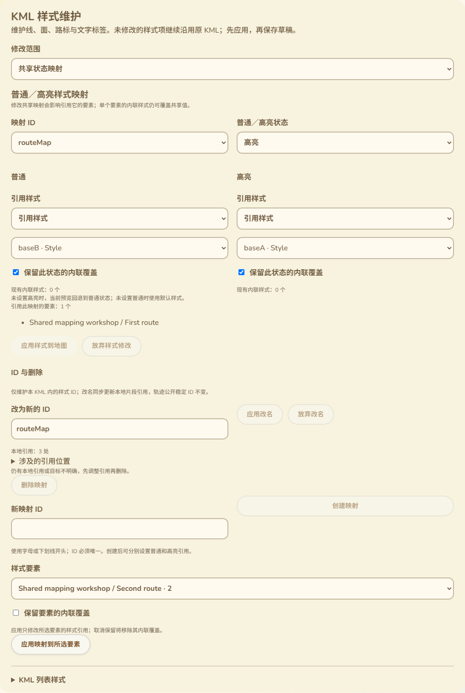

# 共享StyleMap映射维护

2026-10-13，接74与77。本批补齐共享StyleMap的状态引用维护，接入现有轨迹工作台的“KML样式维护”面板。没有固件、SDK构建或刷机，不增加设备RAM。

## 交互位置与范围

“修改范围”新增“共享状态映射”，与“所选要素覆盖”“共享样式定义”并列。StyleMap在本KML文件内把普通／高亮状态连接到Style或其他StyleMap；映射ID是文件内的XML引用ID，不是Reticulum共享轨迹的稳定对象ID。

用户选择一个映射，分别维护普通和高亮引用。下拉提供本文件可唯一定位的Style／StyleMap，并显示类型；也可保留或输入原始／外部引用。只切换到原始输入方式不修改KML。外部引用保存在文件中，网页不联网加载它，仍遵循原有外部样式预览提示。

每个状态显示现有内联样式数量，可以选择保留内联覆盖，或明确取消保留。更换共享引用并不隐式删除内联覆盖；取消保留只移除该状态的内联选择器，Pair自身的ID、扩展与另一个状态继续保留。选择“不设置此状态”移除对应Pair，但ID-bearing节点不会被隐式移除。当前预览中缺少高亮映射时回退普通，缺少普通时使用默认；这是现有预览规则，不扩张为所有外部KML客户端行为。

面板列出直接／跨层引用此映射的轨迹要素，最多展示前20个名称，计数使用全部结果。该列表表示潜在受影响的引用要素；要素本身的内联覆盖可能使某些视觉属性保持不变。例：routeMap被一个要素直接引用、被proxy间接用于另一个要素时，计数为2。

实际界面截图：

截图中第二条轨迹已绑定新映射，因此routeMap剩余1个要素引用；这与测试初始跨层计数2不冲突。

## 创建、绑定与删除

- 创建使用本文件未占用的XML ID，支持Unicode字母。已有唯一Style时以第一个Style设置普通引用；没有可用Style时创建空映射，后续可维护状态引用。高亮不自动复制普通Pair。原文件根部直接放置要素且没有Document时，添加Document并移动原有Feature进入其中，保留原要素内容及顺序。
- “应用映射到所选要素”仅修改该要素的styleUrl。默认保留其内联覆盖；用户取消保留后才移除无ID的内联选择器。引用片段对Unicode ID进行URI编码，读取时解码，避免名称编码导致引用丢失。
- 创建失败保留输入的ID和错误，不切换到不存在的对象。未应用的引用修改或新ID输入接入现有草稿互锁；保存／下载、其他编辑、修改范围和对象切换受未应用状态保护。支持放弃表单、应用到地图后撤销、保存和重新打开。
- 已知有轨迹要素引用时禁用删除并提示引用关系。实际删除还扫描所有剩余styleUrl及targetId，覆盖其他共享映射与Update引用；被引用时拒绝，无引用才在确认后删除。删除不会重写其他要素去掩盖引用关系。

## 数据与校验

新的本地引用必须定位到唯一且活动的Style／StyleMap。空引用、损坏的片段编码、缺失对象、控制字符／未编码空格、重复ID／被编辑状态重复均拒绝。新引入的直接／间接循环和超过现有16层解析预算的链拒绝，UI错误保留待修正值，不提交部分修改。Update内的选择器不作为活动编辑目标。

DOM修改仅作用于显式变化的状态，不重建整个映射，不改变ID或未编辑的扩展。移除包含ID的内联覆盖或Pair拒绝，防止隐式破坏其他引用。未变化修改精确保留源字节；有变化的工作文件经XMLSerializer重新序列化并重新解析。独立原KML副本仍逐字保留，不能把工作文件DOM序列化称作字节原样保存。

共享引用要素统计使用反向关系和队列去重，避免反复扫描每一层；文件、元素、坐标等继续采用既有解析和草稿容量约束。

协议参考：[KML StyleMap与Pair](https://developers.google.com/kml/documentation/kmlreference#stylemap)。上游KML元素定义用于核对结构，不替代本页实际渲染与编辑验证。

## 验证结果

- 新映射文案与原样式文案2项Node测试通过，11语言均有独立翻译、完整字段和错误提示。
- 新实际Edge测试退出0：18类无效修改；状态隔离／高亮回退／跨层引用计数／内联保留与移除／原Pair-ID及扩展保留／Unicode引用／根要素包入Document／新建与无引用删除／仍被引用删除拒绝通过。
- 实际工作台完成应用、错误修正、创建失败原输入保留、新建／要素绑定、显式移除要素内联覆盖、保存、真正刷新重新打开、放弃、撤销、其他编辑与保存互锁。保存后独立读取草稿与重新解析确认普通／高亮值，原始KML精确保留。
- 生产地图Canvas已捕捉普通状态绿色宽5、移除内联后绿色宽7，以及高亮红色宽3的实际绘制。原始／外部引用在页面完成跨语言输入／DOM保留和应用，所有网络请求仍仅本地服务或Blob，没有访问外部样式地址。
- 11语言390px、阿拉伯语RTL及真实截图检查通过。首轮测试在新映射的未设置高亮状态上直接寻找引用控件，已改为先显式选择“引用样式”，重新执行通过；没有以放宽禁用／等待校验代替真实操作。
- 原74样式整页回归退出0：普通／高亮隔离、共享Style、图标裁剪／锚点／方向、清空引用、主题默认保持、原附件与ID、保存重开、恢复继承、11语言与跨语言数值保持继续通过。
- 网页构建、脚本语法与差异检查通过，新增两个入口加入现有CI，未声称远端运行。

## 剩余范围

本批关闭74记录的共享StyleMap映射维护缺口。Pair内联Style的字段仍由原文件保留或明确整体移除，本面板未新增其逐属性专用编辑；共享Style新建、Balloon／ListStyle维护、时间／区域过滤、Screen／PhotoOverlay与3D等完整KML范围仍保留。配置语义核对、真实USB作者与公网完整整页、软件重启USB稳定性、存储失败／掉电、跨板型和导航／长文件内存峰值继续按16推进。网页不新增蓝牙／MC-MT App入口。
