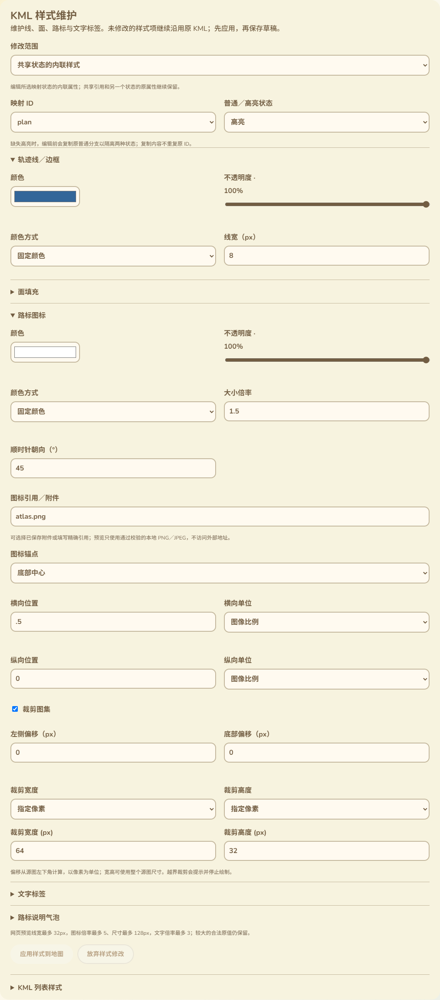

# 共享Style创建与状态内联维护

2026-10-13，接78。本批补齐共享Style新建与StyleMap的Pair内联属性编辑，复用现有工作台样式控件。没有修改固件、SDK构建或刷机，设备RAM基准仍以用户验收的87K／297K为准。

## 新增交互

“修改范围”新增“共享状态的内联样式”：选择本文件的映射ID，再选择普通、高亮或两种状态。颜色／透明度、颜色方式、线宽、面填充／边框、图标引用／倍率／方向／裁剪／锚点和文字属性沿用原有表单。显示的是该状态解析后的当前属性，包含共享引用与嵌套映射继承；仅修改用户实际改过的字段，不把整份显示值写回。

选择“两种状态”时，只同步变化字段，未修改属性各自保留。例如普通线宽7.5、高亮线宽8，给两者修改同一颜色后仍保持不同线宽。单状态编辑不直接写另一状态的节点；如果另一状态显式引用同一个带ID对象，修改该对象仍遵循共享引用关系。此情况有实际引用提示及专项验证，不把显式共享引用默默改成独立副本。

共享Style模式新增ID输入与创建按钮。ID支持Unicode字母，必须符合XML名称格式且在整个文件中未占用。新Style先为空定义，随后维护属性，再在映射里选择使用它；创建本身不替换任何要素的引用。ID仅用于本KML内部，不是Reticulum轨迹稳定ID。创建失败保留原输入与错误，创建成功选中新定义。

没有Style／StyleMap的普通KML可从零操作：创建Style、设置属性、创建映射、绑定到轨迹并保存。原根部直接放Placemark的文件，新增共享定义时包入Document，原要素和原始源副本保留。没有映射时，内联模式明确提示先创建映射。

创建ID或属性尚未应用时接入原有草稿保护：范围／对象／状态切换、其他编辑、保存与下载均受保护；用户可应用或放弃。语言切换保留原ID或数值文本及其输入语言，支持逗号小数修正，不把切换语言当成改值。

实际内联维护截图：

## 状态隔离与ID

高亮分支缺失时，现有预览回退普通分支。编辑前先复制原普通分支，才能保留未选择状态的原效果；空映射也先建立独立的另一状态默认分支。

复制带ID内容不能直接复制原ID，也不能只删除ID：后者会让副本内的styleUrl仍指向原对象，普通状态新增颜色等属性后仍可能影响高亮。当前实现给副本的ID分配唯一新值，并调整副本内部的本地styleUrl和KML targetId关系；原对象ID、原外部引用及原始文件不改。重复原ID导致无法可靠复制时拒绝。

已有带ID内联Style仍保留ID，并允许维护属性，因此可能影响文件中其他引用它的内容。网页只在确实发现分支外部styleUrl／targetId引用时列出对应ID，不把全部内部ID或新副本ID作为假设性提示展示。实际测试的第三个要素直接引用normalInline，普通内联线宽修改也反映到该要素，提示与实际行为一致。

Pair里已有嵌套StyleMap时，沿对应状态进入内联定义，并在各层保留未选择状态，不在同一个Pair里追加第二个StyleSelector。重复状态或同时有多个内联选择器时拒绝；沿用16层预算。未编辑的引用、ID、Balloon内容及未知扩展保留。

## 结构与存储

新增共享Style／StyleMap位于Document的Region／Metadata／ExtendedData／Schema和子要素之前。新增Pair内联Style位于key／styleUrl之后、扩展内容之前。此处根据[OGC KML 2.2 XML Schema](https://schemas.opengis.net/kml/2.2.0/ogckml22.xsd)核对结构；Pair的内联选择器至多一个，StyleMap可包含零个Pair。

修改在独立解析的DOM上完成，成功后重新序列化与解析；错误不提交部分变更。空属性修改精确保留原字节。工作文件经过DOM序列化，不承诺格式逐字相同；独立原始KML及原PNG附件精确保留。

内联状态的合成预览只在该模式启用时生成，避免在普通要素／共享Style模式额外复制整个XML。没有新增设备端常驻对象或缓存。

## 验证结果

- 3项内联／映射／原样式文案Node测试通过，11语言完整，包含两状态行为、空映射提示、新ID、范围与错误。
- 新实际Edge脚本退出0，15类无效操作覆盖缺失／重复对象、选择器冲突、坏复制ID、非法状态、数值／颜色／面开关／裁剪／字段和新ID格式。正向覆盖嵌套映射、解析后继承、只同步变化字段、自引用ID复制后的高亮隔离、新ID及内部引用对应、空属性无变化、主题默认、新节点顺序与Unicode Style创建。
- 实际页面完成普通7.5／高亮8不同宽度、两状态蓝色、嵌套高亮图标96×48／45度／底部锚点／裁剪x0；Canvas绘制红色7.5、蓝色8与新Style橙色9通过。无效输入原值与互锁、逗号数值跨语言及DOM保留、已有外部引用ID提示通过。
- 共享Style创建失败保留输入，Unicode新Style在全部11语言390px输入保留；创建、属性修改、选入新映射、绑定要素、保存与真正重开完成。普通无样式KML也在整页完成首次创建／失败修正／放弃／首次映射绑定与保存，实际Canvas显示目标颜色与线宽。
- 保存后独立读取草稿，原KML、PNG字节、普通／高亮字段、图标字段、原ID／扩展及全部ID唯一性核验通过；放弃与撤销恢复通过。11语言窄屏与RTL、截图、全部请求仅本地服务或Blob通过，没有外部样式／图片请求。
- 原74样式整页和78共享映射整页均退出0，含12／18无效操作及原状态／附件／创建绑定／保存重开／多语言回归。
- 网页构建、脚本语法、差异检查通过；新文案和浏览器脚本接入CI，未声称远端CI运行。

## 继续保留的范围

本批覆盖78中“Pair内联逐属性／共享Style新建”的缺口。共享Style删除／ID改名、Balloon／ListStyle专用维护、时间／区域过滤、Screen／PhotoOverlay和3D等完整KML范围继续核对和实现，不把未编辑内容保留当成专用维护已完成。配置语义核对、真实USB作者与公网完整整页、软件重启USB、存储失败／掉电、跨板型、导航与长文件峰值仍按16保留。网页不新增蓝牙／MC-MT App入口。
