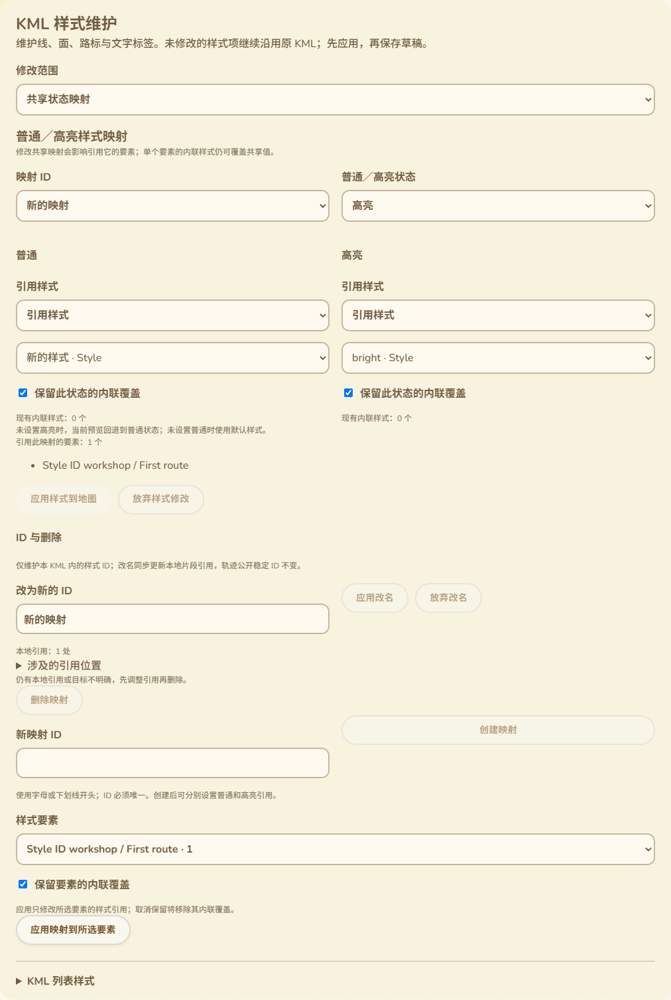

# 共享样式ID改名与引用保护删除

2026-10-13，接79。本批补齐共享Style／StyleMap的ID改名、共享Style删除，并把原映射删除接入统一引用检查。改动仅在网页，不需要固件构建或刷机，不增加设备RAM。

## 现有面板中的操作

“修改共享样式”和“共享状态映射”中新增“ID与删除”小组。可直接修改所选定义的ID并应用，或放弃改名。应用后仍选中新ID，属性、映射与地图呈现继续保持；普通名称、说明或其他文本中出现的同名字串不会被替换。

输入未应用的新ID时，保存／下载、样式属性、其他编辑、对象与范围切换互锁，改名输入本身仍可修正。创建定义和改名有各自按钮，不把改名误做成创建新对象。失败保留原输入、原文件与错误；支持撤销、保存与重新打开。

ID属于本KML内的样式对象。改名只修改该定义的id及已确定的本地引用，不改草稿ID、轨迹公开稳定ID或作者身份。文件内容变化需要后续正常保存／发布，不能视为目录上已经更新。

实际界面：

## 引用范围

普通styleUrl的纯片段引用按URI解码定位对象，改名后写入新ID的编码片段，保留其前后空白；要素、共享映射、内联选择器的本地引用均核对。定义内部的自引用也同步更新，保持原引用图，不用改名掩盖原循环。普通文本、说明、外部文件URL和其他ID不改。

Update的目标必须区分：

- Tour／gx:AnimatedUpdate中的唯一空targetHref表示同文件更新，对应styleUrl与targetId随改名更新。
- 唯一非空targetHref具有明确绝对URI形式时，属于外部更新，保留其ID与片段，不因本地同名ID改变而改写。
- 缺失／重复targetHref、无法确定来源的相对目标、动画之外的空目标、无明确Update范围的targetId，以及未知扩展的同名targetId视为目标不明确。会阻止涉及该引用的改名／删除，并说明原因，不自动猜测。

本文件并不运行这些Update。这里只维护已有引用关系。标准依据：[OGC UpdateValidator](https://cite.opengeospatial.org/te2/about/kml2/2.x/site/apidocs/org/opengis/cite/kml2/validation/UpdateValidator.html)，其中说明动画Tour内空targetHref的同文件含义；这不是整个KML文件的XSD或运行时执行验证。

Update负载中的Style不再作为当前文件的活动共享Style显示，防止把外部／未执行更新当成本文件定义；原数据仍保留。新ID仍检查整个文件的既有id属性，不能与隐藏或其他对象的ID冲突。

## 删除规则

删除核对所选定义及全部后代ID的分支外部引用。因此不仅检查顶层Style名称，也检查其内部LineStyle／属性等带ID内容。还有本地或目标不明确的引用时禁用删除，并显示引用数量及前20个位置。

没有本地引用时，确认后删除整个定义及内部内容；确认文案明确范围，可用撤销恢复。外部文件的同名更新目标不属于本文件定义，不会误阻止无本地引用的删除，也不会随删除改写。原映射删除接口仍保留既有错误前缀，页面使用统一的明确提示。

面板数字是引用出现次数，不是受影响要素数；一个要素可有多处引用。改名核对所选ID，删除另核对后代ID，所以同一Style的两种操作涉及数量可能不同。示例中4处本地引用需要跟随顶层Style改名，另有1处引用其后代widthNode；删除显示5处本地引用并禁用。

## 验证结果

- 4项身份／内联／映射／原样式文案Node测试通过，覆盖11语言。
- 新实际Edge脚本退出0，17类无效改动覆盖ID格式／冲突／对象或类型错误／重复对象、本地引用删除、未明确／相对／重复Update目标和未知扩展引用。
- 正向核对Unicode Style／StyleMap改名、URI片段解码与新编码、原空白、内部自引用、同文件动画更新、外部Update不改、普通文本不改、无变化字节精确保留；只受外部同名更新涉及的未引用Style／Map可删除且外部数据保留。
- 实际页面完成错误修正、两类改名、选择保持、引用计数与禁删、新Style删除确认取消／确认／撤销、保存与真正重开、放弃改名与撤销改名。新ID在11语言390px、RTL与DOM保持；输入时属性、范围、映射与保存互锁通过。
- 独立读取保存结果确认草稿ID、原KML字节、引用、普通4／高亮8呈现及元数据保持。外部Update内带ID的Style在表单里不可选，但原数据保存保留。全部请求仅本地服务或Blob，没有加载外部目标。
- 原74样式、78映射、79内联整页均退出0，含原12／18／15无效操作、创建绑定／嵌套／图标／PNG原文／保存重开及多语言回归。
- 网页构建、脚本语法、差异与实际截图检查通过；新文案和浏览器脚本已加入CI，未声称远端运行。

## 后续范围

### Wio L2只读复核

本批网页验证结束后确认COM69仍可用，实际只读probe退出0。握手v1／512字节与56操作能力、真实设备作者挑战签名、原作者指纹与代次2通过；309条／9356字节完整配置摘要仍为此前基准`f5b2ca87c5cbbfc9fe7ab96c4d31d83ad8c2176cfa3594270f07e73511023dda`。没有配置／身份写入、私钥导出或刷机；串口关闭完成。此检查证明设备身份和配置基线可用于下一阶段联调，不是完整浏览器WebSerial／公网维护或新的RAM测量。

本批覆盖79记录的共享Style删除／ID改名缺口。接下来优先推进原三功能的完整联调和配置语义交付核对；Balloon／ListStyle、时间区域、Screen／PhotoOverlay、3D等KML维护范围仍保留。真实USB作者与公网整页、软件重启USB稳定性、存储失败／掉电、跨板型和导航／长文件峰值继续按16保留，不将本地网页测试替代为实机或公网验收。网页继续排除蓝牙／MC-MT App配置。
