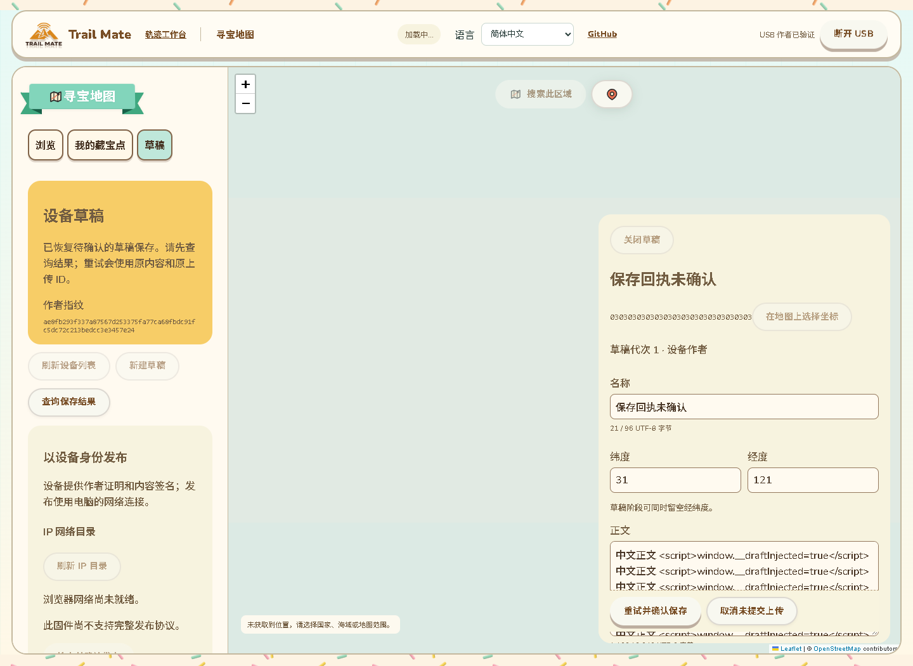

# 网页草稿保存恢复与只读核对

2026-10-14，接81。本批补齐浏览器刷新／关闭后恢复原草稿保存操作的交互。仅网页改动，无新增固件源码、SDK构建或刷机。81候选a29669a2…保持，当前设备仍在COM69应用端口；修正版实机发布链仍待刷入验收。

## 现有页面中的恢复操作

在原Geocaching“草稿”页面，保存未确认时保留原名称、正文、提示、坐标、状态、难度、地形、容器尺寸及保存绑定。重新连接并验证设备作者后，页面显示这份原内容和恢复说明，新增左侧“查询保存结果”。原编辑表单继续提供“重试并确认保存”与“取消未提交上传”。

实际构建页面截图，测试USB为合成设备，地图／网络加载状态由测试替身控制：

用户可以先查询：读取设备当前草稿，只接受原草稿ID、同一已验证作者、预期代次加一及全部用户字段精确匹配的快照。已保存时清理浏览器待确认记录并显示确认结果，不再次上传；未匹配或读不到时保留原内容和操作，不把不同／更新后的草稿当作成功回执。

选择重试时使用原内容、原上传ID、原预期代次和原USB会话。浏览器默认会话后来变化时仍恢复原会话并重新完成设备挑战证明，不新建替代上传。取消仅在设备确认取消未提交上传后清理记录，原网页编辑保留；设备拒绝、取消回执错误或存储清理失败均不丢弃操作。

身份代次发生变化时禁用原保存重试和上传取消，保留只读结果查询。同一作者身份恢复后的设备如果确实已有完全相同的保存内容，可以通过查询结束本地待确认状态；不会因此重发旧代次的写命令。连接其他作者不会把原操作迁移给新身份。

## 浏览器持久化与多个页面

上传之前先保留一条按64字节公开作者键隔离的待确认保存记录。记录包含原用户字段、草稿ID、上传ID、预期代次、作者代次和原会话；没有设备私钥或完整配置。每个作者最多一条未解决保存，文本最多8192字符，用户字段仍遵循设备现有UTF-8与选项范围。当前网页来源下的浏览器存储被清除或换到不同来源时不会凭空恢复记录，这一限制明确保留。

写入后重新读取并检查规范结构；损坏／超长／未知字段／非法代次及无效字段阻止恢复写入，保留原记录。保存配额不足时不开始USB上传。设备已保存但浏览器清理失败时仍保留待确认状态，存储恢复后可再查询，不把清理失败误作一次新保存。

保存、重试、查询和取消使用同一作者的Web Lock。另一个页面持有锁时立即说明并停止，既不上传，也不覆盖原记录。重试／取消／查询要求当前记录与原绑定全部一致；其他页面已经清理或替换的记录不会由旧页面重新插回。重新连接发现本作者的旧待确认记录已被处理时，保留当前页面编辑内容、解除本地待确认锁并提示核对，不静默保存原编辑。

待确认期间禁止新建草稿、刷新／切换记录、地图选点以及发布／同步操作，避免共用串口维护所有者被另一项操作打断。普通／高亮KML编辑、配置页面与蓝牙App排除范围没有变化。

## 验证

- 32项相关Node测试通过，含8项新保存恢复测试：字段冻结、公开作者隔离、完整uint64、最短实际管理编码、记录损坏／超长／非法字段、存储写入／清理失败、CAS防覆盖、精确快照确认、锁和11语言文案。
- 新实际Edge整页退出0：设备保存但回执未确认→真正刷新→连接恢复原记录，确认连接不自动写入；所有字段精确恢复。只读查询仅65与3，设备保存次数不增加，正文中的script不执行。
- 清理记录失败后仍保留原内容和待确认状态，恢复存储后再次只读查询可完成；配额失败在任何上传命令前停止。
- 同作者代次7→8后重试／取消禁用，查询仍只读并可确认原精确内容；当前设备仍须挑战验签。
- 实际同来源另一页面取得Web Lock时本页保存拒绝且USB命令数不变；另一页面清理记录后旧页重试拒绝、不重新插入记录，重新连接保留编辑。
- 已提交操作在刷新后恢复原会话／原上传ID重试，设备保存次数与草稿代次不增加。测试默认会话特意改成其他值，验证恢复不会仅依赖当前默认值。
- 分块回复不可用后的未提交上传可确认取消，只发送原ID的36；清理记录、解锁编辑并保留原输入，设备保存次数不变。
- 新页面在11语言、390px与RTL下查询／恢复说明和原输入保持，切换语言不增加串口命令；实际截图已检查，符合现有页面风格。
- 原Geocaching维护整页加入真正刷新后的未匹配只读查询与原传输恢复，退出0；原实际网页／Worker／本机原生Reticulum目录的发布／更新／归档3版本、证明／设备确认／刷新恢复也退出0，USB仍为合成。
- 网页构建、脚本语法与差异检查通过；新浏览器脚本加入CI，Node入口由已有Geocaching通配覆盖，未声称远端CI已运行。

首轮恢复代次统一为BigInt后造成小整数管理编码非规范，已改为安全范围内Number、超出范围保留BigInt；新增实际管理编码测试并重新构建／整页重跑通过。没有改变固件CMP1约束。

## 固件与未完成范围

本批未接入物理USB，因此不代替81的实机验收。设备仍COM69，没有刷入；已上传备份哈希仍7c317f32…，修正候选哈希仍a29669a2…。运行RAM继续以此前用户约87K／297K反馈为准，无新测量。81候选静态RAM＋808来自已存在联系人状态的事实保持，不把网页浏览器存储计入设备RAM。

修正版手动下载模式操作请求已发出，等待设备具备刷入条件；没有尝试向COM69应用端口刷写。之后继续同一孤立测试记录的真实设备发布／更新／归档，另验原生WebSerial、公网、软件重启、SD失败／掉电、峰值以及16列出的完整配置／高级KML范围。
