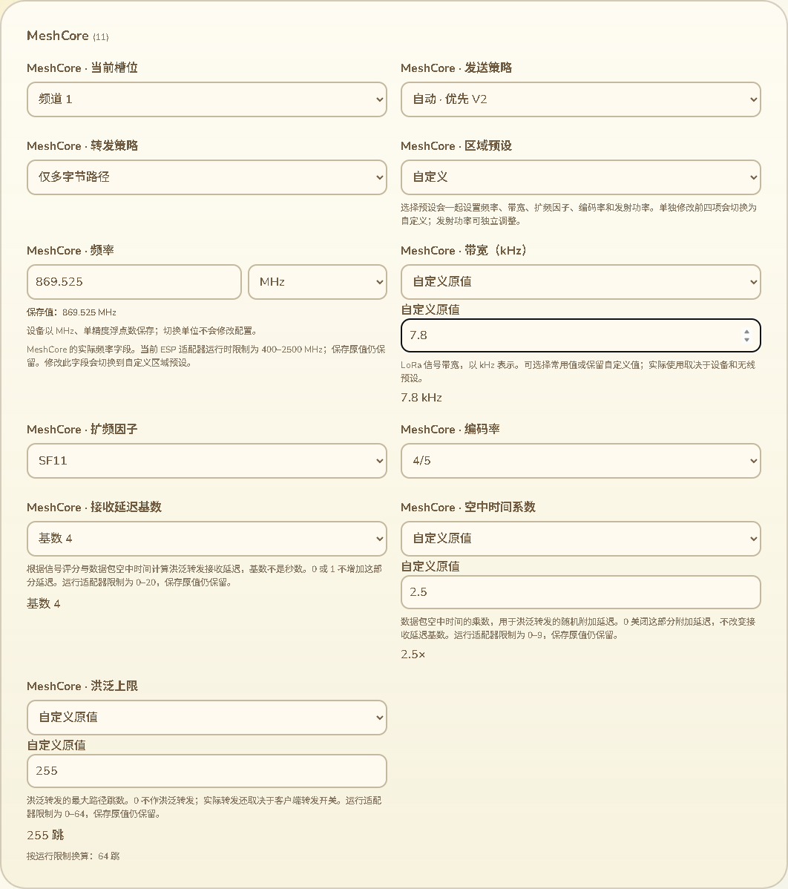

# 无线调参含义与小数输入

2026-10-14，接82。本批继续处理配置魔数，补齐四个LoRa带宽和三个MeshCore调参的可读选项／自定义录入／预览，并改善float32显示。只改网页和诊断测试工具，没有固件源码改动、SDK编译、刷机或新的设备运行RAM测量。

## 七个字段的交互

四个带宽字段`mt.bandwidth_khz`、`mc.base.bandwidth_khz`、`mc.bandwidth_khz`、`rt.bandwidth_khz`提供125／250／500 kHz常用选项和“自定义原值”。保留原有无线预设互锁与MeshCore原子预设更新；自定义支持7.8等小数。展示控件不改变当前预设、启用状态或文档内容。

MeshCore调参按实际算法解释：

- 接收延迟基数：不是秒数。提供0／1的无附加接收延迟选项及2／4／8／20基数，允许自定义。算法结合信号评分和数据包空中时间。
- 空中时间系数：显示为倍率，如2.5×。0仅关闭洪泛转发中的随机空中时间附加量，不关闭另一部分接收延迟。
- 洪泛上限：按路径跳数显示，0表示不作洪泛转发；是否转发还取决于客户端转发开关。提供8／16／32／64跳及自定义。

实际页面截图：

## 保存范围与运行范围

目前实际MeshCore适配器在应用时限制接收延迟基数0–20、空中时间系数0–9、洪泛上限0–64、原生MeshCore带宽7.8–500 kHz。这些不是存储类型的完整范围。本批没有将float32存储校验收窄为运行限制，也没有把u8洪泛原值255强制改为64。

页面同时保留原值与按已核对适配器限制换算的提示。例如原值255仍显示255跳，另显示“按运行限制换算：64跳”；修改预览记录实际将保存的原值。提示不表示未保存编辑已应用，也不表示当前启用了MeshCore／转发。其他协议带宽不借用MeshCore限制。

源码依据：

- [computeRxDelayMs](../../../../modules/core_chat/src/infra/meshcore/meshcore_protocol_helpers.cpp)：`(pow(base, 0.85 - score) - 1) * air_ms`，非有限／非正延迟取0，上限32000ms。基数本身不是时间。
- [MeshCoreAdapter](../../../../platform/esp/arduino_common/src/chat/infra/meshcore/meshcore_adapter.cpp)：applyConfig实际范围，以及洪泛路径判断、接收延迟与随机空中时间延迟的组合。
- [TMS配置编解码](../../../../modules/core_sys/src/app/tms_config_codec.cpp)：上述字段实际存储／导出与float32、u8类型。

旧设备设置元数据中“RX Delay”的秒后缀与算法不符，发现已记录；本批仅纠正网页解释，未改变设备设置页面代码，不以网页修正代替该旧界面的修复或实机应用验证。

## 浮点录入与展示

普通float32输入和自定义浮点输入使用能精确还原相同float32的最短十进制文本。常见0.1、7.8、869.525保持可读，不展示多余二进制转换尾数。包含负零、极小／极大值与1000组确定性位模式的检查证明转换仍保留原float32值；不修改TMS原文字节或字段值。

自定义浮点控件使用任意小数步长，整数控件仍只允许整数。float32溢出、空值及u8范围错误保留用户原输入、错误与自定义状态，切换分类／11语言后仍可修正。修改预览提高float32显示精度，并在很小值时使用科学记数法，不把微小频率偏移显示成0。

## 验证与审计

- 21项控件／Schema／语义Node测试通过，含7项新调参测试，覆盖11语言、原存储范围、运行换算不改值、最短浮点精确性、预览和元数据搜索不索引值。
- 13项完整原生互操作测试通过，维持309记录／296标量／100模块单值基线。新增35组七字段的常用／小数／超运行范围原值经实际C++校验、Preferences保存及读回；按float32位值比较，其他字段不变。NVS／硬件是桌面替身，不是实机射频生效。
- 首轮新测试把原生九位十进制与JavaScript完整双精度展开直接比较，出现7.80000019与7.800000190734863的测试失败；改为按实际float32值比较后整组重跑通过，存储约束未放宽。最终运行换算展示后35组再次通过。
- 实际Edge完整设备页面退出0：七字段选项／含义、125／250／500kHz、2.5×与7.8小数、255跳保存值／64跳运行限制提示、溢出3.5e38与256原输入跨分类／11语言保留、修正和恢复无未保存编辑通过。
- 原配置保存／断线恢复／读回、实际合成作者签名验证／拒绝／断开撤销、模块／位置精度／时间／区域预设／窄屏回归继续通过。录入与换语言不新增USB命令，未知原值不因显示被重写；网页仍排除蓝牙与MC／MT App配置。
- 构建、语法、差异和实际截图检查通过。新增Node测试由既有config通配覆盖，新页面断言在既有device-page浏览器CI入口中；未声称远端CI已运行。

修正可重现配置审计工具：只使用原生合成配置，按当前网页范围排除10条记录；识别时长、位选择、字符、自定义选项和模块容器，模块描述继续按实际schema遍历。输出不包含硬件数据或配置值。

当前309条原生记录，网页299条（含只读和容器）；普通数值控件58→51、自定义选项5→12，其他控件数量保持；模块描述118、排除paxcounter蓝牙阈值。控件数量不是完成百分比，剩余数值字段及所有字段实际消费／生效仍须逐项核对。

## 后续范围

设备端口仍COM69，81修正候选a29669a2…与已刷7c317f32…保持；没有新SDK或刷入，之前约87K／297K运行反馈继续作为既有基准。手动下载模式请求仍待回应，不向应用端口刷机。

本批没有关闭真实设备Geocaching整页、原生WebSerial、公网目录、SD掉电／失败、导航／峰值、跨板型、高级KML和其余完整配置语义缺口。仍按16交付清单继续完成，不把七字段改善替代为全部配置完成。
