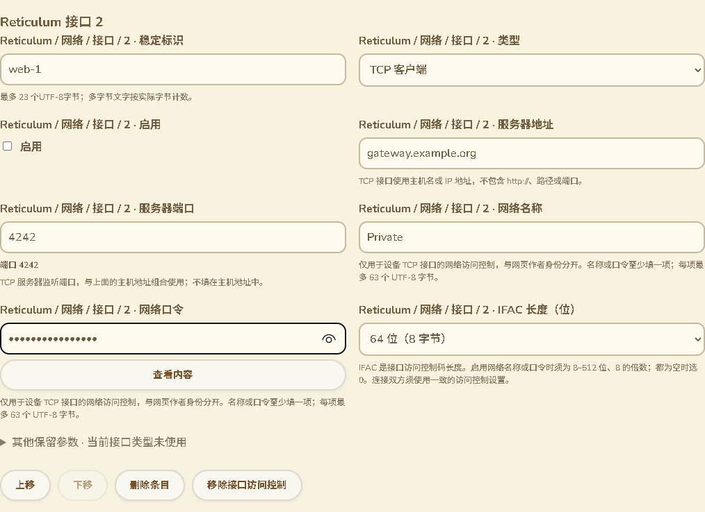
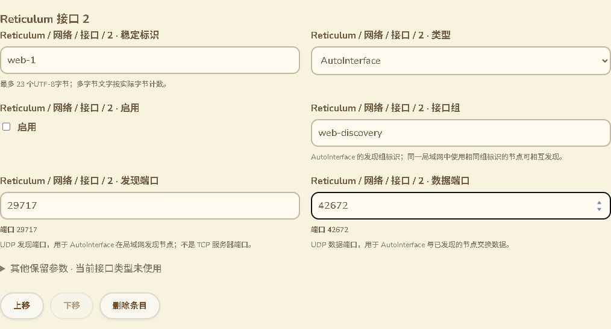
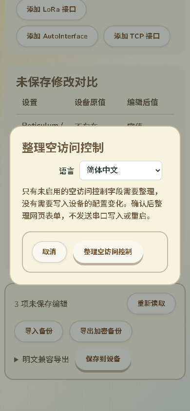
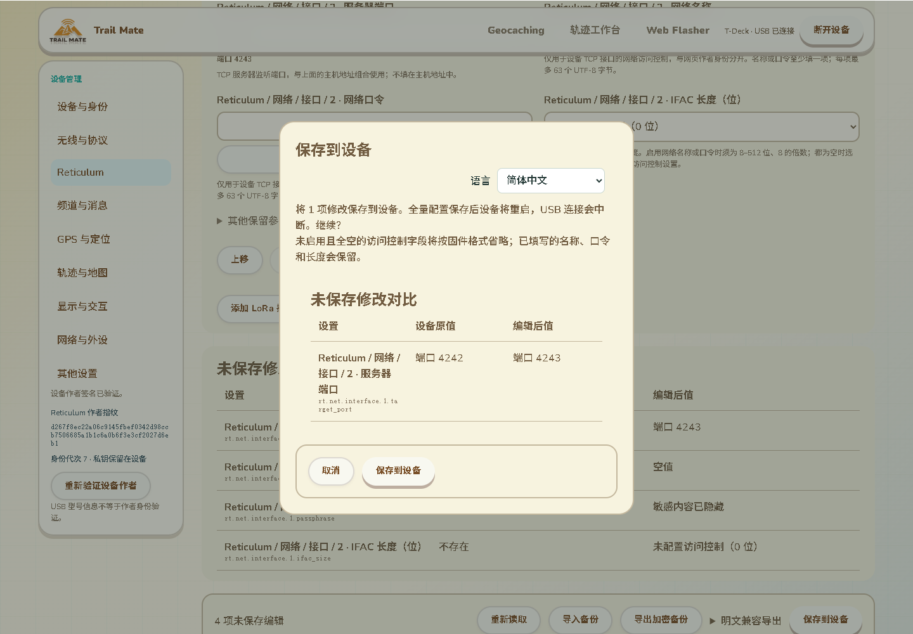

# Reticulum 接口交互与配置规范化

2026-10-14，接83。继续落实完整配置维护的输入含义、修改预览和保存读回一致性。本批只改网页、测试和审计文档，没有固件源码修改、SDK构建、刷入或新的设备运行RAM测量。

## 接口类型与录入

沿用现有设备管理页的布局、颜色与分类。TCP接口显示服务器主机和监听端口；AutoInterface显示发现组、UDP发现端口和UDP数据端口。当前类型暂不使用的参数继续放在“其他保留参数”中，可展开维护，切换类型不丢失原值。网页配置这些设备接口不改变网页作者的身份，也不把网页联网能力绑定到设备当前RF协议。

访问控制长度提供0、8、16、32、64、128、256、512位及自定义，非零选项同时显示字节数。例如64位为8字节，24位的自定义值为3字节。输入范围按真实固件约束：0或8–512位中的8的倍数；有网络名称或口令时必须使用非零长度，没有名称和口令时必须为0。0不是自动选择长度。

源码依据：[网络配置类型与访问控制校验](../../../../modules/core_chat/include/chat/domain/reticulum_network_config.h)、[TMS扩展实际校验与条件输出](../../../../platform/esp/arduino_common/src/app_config_tms_settings_extension.cpp)、[AutoInterface实际端口与发现处理](../../../../platform/esp/arduino_common/src/chat/infra/reticulum/reticulum_interfaces.cpp)。

网络名称／口令说明明确这是设备TCP接口的网络访问控制，和网页作者身份分开；至少填写其中一项，每项最多63个UTF-8字节。口令继续默认隐藏；修改预览不输出口令内容。不对位数作未经验证的密码学强度推荐。

实际页面截图（合成设备与参数，非实机配置）：

## 空访问控制的保存行为

生产TMS writer只在`InterfaceAccessConfig::enabled()`为真时输出`network_name`、`passphrase`、`ifac_size`三条记录。网页新建空访问控制表单会暂时具有完整空三元组，但固件保存读回会省略它。

新增纯准备流程，在克隆文档上同步派生频道镜像、验证集合／模块／C6约束，然后只省略活动接口中完整、类型正确且名称为空／口令为空／长度为0的三元组。部分字段、错误类型、范围外或未启用槽位、非零无材料长度仍被校验拒绝，不用清理掩盖损坏。实际材料、其他配置和未知扩展保留。源表单不被保存API就地修改。

修改预览、审批绑定、上传、重试和读回预期使用相同的准备结果。用户取消确认时保留空表单。确认保存后以实际提交的文档更新表单和基线，避免已省略字段又立即成为未保存编辑。上传API在提交前回调及结果中返回冻结的实际源字节；页面再次检查其与已确认内容一致。

如果只有新增空访问控制字段而没有设备配置值变化，页面使用“整理空访问控制”确认，不提示设备将重启；确认后仅整理网页表单，测试要求没有任何串口传输、提交或重启。

如果还修改了服务器端口等实际配置，确认页只列出实际上传的变化，并说明空访问控制字段将按固件格式省略。

## 刷新后的读回核对

新增生产C++互操作首先证明：集合编辑可能改变字段顺序，float32也可用不同十进制文本输出。整个TMS文件的SHA不同并不代表类型化配置不同。原有未刷新的逐字段读回检查保留，新增持久检查点版本2记录类型化内容SHA-256。

类型化摘要按键排序，包含字段键、类型和值；float32使用实际单精度位值，正负零按既有字段比较的等价规则处理；字符串按解码后的文本、二进制按完整字节、未知类型按精确原文。摘要有固定域标识。实际值变化、类型变化、增删字段或未知原文变化不能被排序／浮点规范化忽略。

仍先验证完整串口快照SHA和作者证明，再计算内容摘要。相同公开作者即使身份代次更新也可以只读核对；缺少有效作者或不同设备不能确认。存储仅包含版本、公开作者指纹、传输ID、文件SHA和内容SHA，不存字段值／口令／完整配置。旧版本1检查点继续兼容原文件摘要规则，不凭空推断其缺失的内容摘要。当前页面逐字段核对成功后仍只更新同一传输ID的检查点，不覆盖其他页面的新操作。

## 验证记录

- 全配置Node测试192项通过，包括14项完整原生互操作。新原生用例通过实际C++校验／应用／Preferences保存／重新导出，证明空三元组省略与网页准备结果相同，名称单独／口令单独、8／24／64／512位材料保持。文件顺序不同情况下类型化摘要一致。NVS／硬件仍为桌面替身，不是设备网络生效验证。
- 新纯测试覆盖所有8–512位的8的倍数、部分／错误类型／未启用槽拒绝、未知原文和CRLF保持、幂等／源表单不变、上传／审批／读回源一致、11语言文案与自定义位数预览／口令掩码。
- 内容摘要测试覆盖顺序、等价UTF-8转义、单精度小数／负零、最小单精度值变化、字符串／二进制／未知原文／类型／字段增删、检查点无秘密、作者隔离及损坏格式拒绝。
- 最终实际Edge完整设备页面退出0。覆盖11语言、390px与RTL、9位错误原输入跨语言／分类保留、24位自定义／64位选项、TCP和Auto字段折叠保留、取消／不写入整理、实际修改规范化上传与读回、保存回执丢失后真正刷新及字段重排／单精度原生文本变化核对、原配置／作者证明／备份恢复回归。真正刷新测试明确检查文件SHA不同后仍能按类型化摘要核对，实际字段变化仍显示差异。串口为合成适配器，不作为实机完整WebSerial验收。
- 全配置回归首次出现两项失败：旧镜像测试依赖API就地修改表单，改为检查实际返回源并增加源表单不变断言；NVS清单源文件1608→1609过期，重新生成只改变文件计数，106调用／18键别名不变。复测192项全部通过。
- 最后增加仅整理空字段的专用确认文案后，13项相关Node及上述完整Edge再次退出0。此前192项包含这些相关测试，不能将两次数量直接相加。网页构建、语法与差异检查通过；四张实际截图均已打开检查。已有config通配与device-page浏览器CI入口覆盖新增检查，未远端运行。

合成配置审计仍为309条原生／299条网页记录，普通数值51条、12条带自定义选择，模块描述118条，普通蓝牙记录10条及paxcounter蓝牙阈值继续排除。基线未包含可选IFAC三元组，因此控件总数不变化；数量不是完成百分比。

## 固件与剩余范围

最终只读端口枚举仍COM69；两份镜像重新核对SHA，候选a29669a2574f83f59ca1b2ab356dd12786bffa24f6fa295d90703a0834ad113b，最近已刷备份7c317f327a277af6f4cc14bcd2ed7b8245a9801ae7e6bfa1c35589946e85a9b7，均保持。此前用户验收约87K／297K。本批没有设备RAM改动，候选运行RAM及真实草稿恢复仍需实机验证；原下载模式请求仍待设备操作。

本批关闭IFAC录入含义和空三元组保存规范化缺口，不等于全部配置交互／消费完成。其他配置实际生效、真实Wio Geocaching发布更新归档、完整原生WebSerial／公网／轨迹／SD故障掉电／导航峰值／跨板型及其余KML要求继续按16完成。
