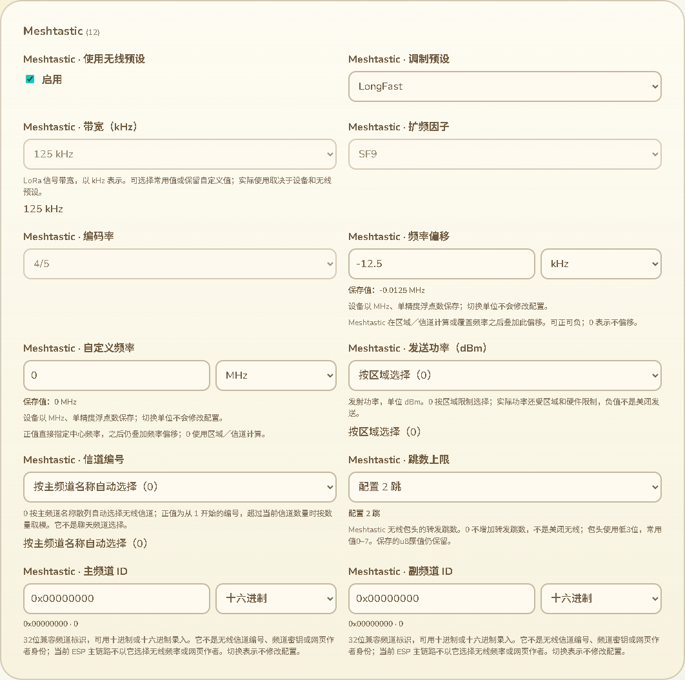
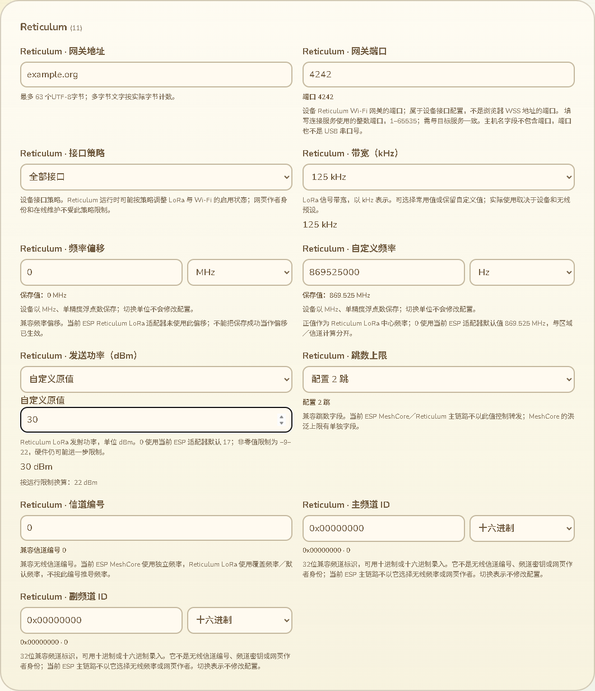

# 频率单位与功率、信道录入

2026-10-14，接84。本批继续完善全部配置中的普通数字输入，处理7个频率字段、3个发射功率字段和1个Meshtastic无线信道编号。只改网页、测试和配置审计，不改固件、不新增SDK构建或刷入，不增加设备RAM。

## 频率录入与精度

七个实际float32字段接入MHz／kHz／Hz单位选择：Meshtastic偏移和覆盖频率、MeshCore兼容偏移和覆盖频率、MeshCore独立频率、Reticulum偏移和覆盖频率。单位选择仅改变录入表示，不修改配置值、修改预览或发送串口命令。字段标签移除固定MHz后缀，控件下方继续显示以设备存储单位MHz换算的当前编辑值。

例如偏移−12.5 kHz对应−0.0125 MHz；869525000 Hz对应869.525 MHz。输入支持符号、小数、科学记数法、当地小数分隔符、阿拉伯／波斯数字和全角数字，拒绝空值、错误格式、千位分组和float32溢出。错误原输入与所选单位跨分类／语言切换保留，错误时禁止单位切换，修正后可以继续。

表示使用能恢复相同float32的最短MHz十进制，按十进制移位显示其他单位，不通过反复乘除产生尾数误差。单位选择记忆只存在网页会话中，不写设备；区域预设或备份／读回改变字段值时，控件用所选单位显示新的实际字段值。

## 各协议的实际含义

不能把同名兼容字段都当成相同的有效调参：

- Meshtastic：区域／带宽／信道编号或主频道名称散列得到基础中心频率；正覆盖频率替代它，再加频率偏移。没有正覆盖频率时，结果还按区域范围限制。页面解释计算顺序，不另写一套未验证的浏览器射频计算器。
- MeshCore：当前ESP适配器使用独立的`mc.frequency_mhz`，运行时限制为400–2500 MHz；兼容`mc.base.frequency_offset_mhz`、`mc.base.override_frequency_mhz`不参与该适配器频率计算，仍可维护保存。直接改MeshCore频率沿用原子编辑逻辑，区域预设转为自定义；选择区域预设仍同步频率／带宽／SF／CR／功率。
- Reticulum LoRa：当前ESP接口调用RNode适配器，使用正覆盖频率；0使用当前代码默认869.525 MHz，不执行Meshtastic的区域／信道频率计算。该适配器未使用兼容偏移，页面明确说明保存不代表偏移已应用。

这些是当前生产源码的实际行为，不是所有硬件已验证的射频能力、真实发射测量或地区频率建议。网页作者身份和电脑联网维护仍与当前RF协议分开。

源码依据：[Meshtastic频率推导](../../../../modules/core_chat/src/infra/meshtastic/mt_radio_config.cpp)、[MeshCore配置应用](../../../../platform/esp/arduino_common/src/chat/infra/meshcore/meshcore_adapter.cpp)、[Reticulum LoRa到RNode的应用](../../../../platform/esp/arduino_common/src/chat/infra/reticulum/reticulum_interfaces.cpp)、[RNode默认与限制](../../../../platform/esp/arduino_common/src/chat/infra/rnode/rnode_adapter.cpp)。

## 功率与信道编号

三种功率字段提供常用dBm选项与自定义原值，原i8范围−128–127保持，不用运行范围悄悄改存储值：

- Meshtastic的0表示按区域限制选择，实际功率还受区域和硬件限制；负值不是停止发送。
- MeshCore的0仍显示原值0 dBm；当前ESP适配器运行时限制1–30，另提示按限制换算为1 dBm。其他超运行范围原值同样保留并提示。
- Reticulum的0显示使用当前ESP适配器默认17 dBm；非零按−9–22限制，硬件还可能进一步限制。原值30仍可以保存，旁边明确提示按适配器限制换算为22 dBm。

功率输入不自动改变发送开关，切换功率也沿用原区域预设策略：单独改MeshCore功率不强制清除区域预设。自定义溢出保留原输入供修正。修改预览为非选项值补齐dBm，而不是裸数。

Meshtastic无线信道编号0显示“按主频道名称自动选择”，1–8为方便选择的编号，其余合法u16数值仍可自定义到65535。说明正值从1开始，超过当前信道数量时按数量取模；它与聊天主／副频道选择分开。页面不将1–8当作设备总信道容量或存储上限。

## 验证与当前状态

- 197项配置Node回归通过，含15项完整生产C++互操作。新增60组：7频率字段各5种MHz／kHz／Hz、负值／0／微小科学记数法；3功率字段各7个边界／零／常用／超运行范围值；信道编号0／1／8／65535。实际校验／应用／Preferences保存／重新导出的类型化值与其他字段一致。NVS和硬件仍为桌面替身，不能替代实机无线生效。
- 1000组确定性抽样float32位模式和代表性最大／最小、负零值，经三个单位显示／解析往返恢复相同float32。11语言当地小数／单位含义、完整存储范围、未知字段／类型不借用语义、自定义预览及零功率区别通过。
- 最终俄语默认值表述修正后20项相关Node通过；这些是197项的子集，不能相加作为独立测试数。
- 最终实际Edge完整设备页面退出0：7单位控件切换零配置变化／零额外USB；−12.5kHz输入、错误／溢出／分类和11语言单位保留、390px／RTL布局、功率0与溢出128原输入保留、自定义30显示22运行提示、信道65535、MeshCore预设在Hz录入时仍原子同步、编辑恢复无未保存项，以及原保存／备份／身份证明／断线恢复／刷新读回回归。USB为合成串口，不是本批Wio原生WebSerial验证。
- 首轮浏览器测试等待未修改时不存在的修改预览节点，改为同时比较空列表／已有预览，保持“单位切换不修改配置”的验证。旧小数预览测试新增MHz后缀，不放宽精度；全部Node复测通过。截图初次固定导航遮挡标题，调整实际滚动和视口后最终整页再测退出0，两张截图均打开检查；没有修改页面样式来隐藏问题。
- 网页构建、语法和差异检查通过。Node由既有config通配、浏览器由既有device-page入口覆盖，未远端运行CI。

配置审计同步识别频率单位控件和功率单位：309条原生记录／299条网页记录、普通数值51→40、7个频率单位控件、带自定义选择12→16，模块描述118保持。审计仅合成配置及元数据、不输出硬件配置值；数量不是完成百分比。

最终端口只读枚举仍COM69。候选镜像仍a29669a2…，已刷备份仍7c317f32…，哈希重新核对未变。没有新的设备运行RAM测量，之前约87K／297K仍只代表已刷版本。真实草稿恢复／Geocaching发布更新归档／原生WebSerial／公网／KML完整范围、其他配置实际消费、SD故障掉电与导航峰值继续按16推进。
