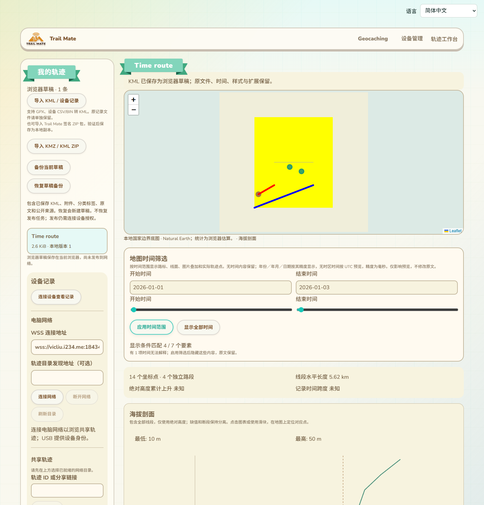
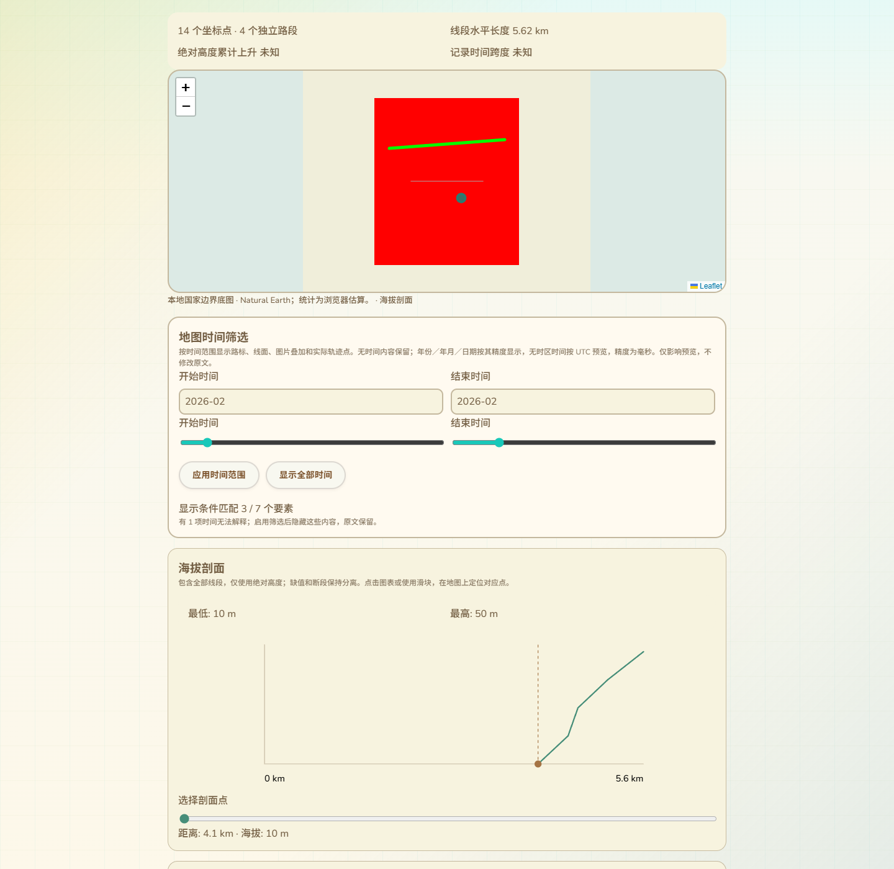

# KML 时间范围与地图可见性

2026-10-14，接85。原时间轴只选择gx:Track记录点，未按TimeStamp／TimeSpan控制地图内容。本批在现有本地轨迹工作台和共享轨迹预览接入同一时间筛选，保持原KML／附件／草稿版本和发布内容不变。只改网页、测试与CI入口，没有固件源码、SDK构建、刷入或设备RAM改动。

## 交互与实际位置

时间面板放在本地与共享地图下方，沿用现有浅色卡片、字体和按钮。具有开始／结束录入、两个范围滑条、“应用时间范围”和“显示全部时间”，支持11语言及390px／RTL。无时间数据时不显示空面板；没有可解释范围或存在无法解析内容时有明确说明。

输入可以是年份、年月、日期或完整XML时间。完整时间无时区时按UTC预览，页面明确告知；显示精度为毫秒，更高精度和原始时区文本不被写回。输入错误或开始晚于结束时保留原输入、禁止应用，地图保持上一有效筛选。换语言保留原输入和已应用范围；换KML源后恢复全部时间并释放旧源引用。

时间筛选不会重新缩放地图，当前视野保持。高程图、原文件统计和旧记录点回放仍表示完整原文；地图仅显示匹配的实际内容，落在时间范围外的回放／高程定位标记不显示。原编辑操作预览仍有独立提示，不能把预览筛选当作裁剪原文件。

实际本地页截图，使用合成KML及纯色图片叠加验证时间切换，未连接设备／公网：

共享预览使用生产SharedTrackPreview组件和实际Leaflet图层；截图是组件测试场景，不代表完整公网目录验收：

## 时间解释与继承

采用KML要素时间原语的最近声明继承：Document／Folder声明供未自行声明的子要素使用；子要素的本地时间声明覆盖继承值，后代再继承新值。没有把所有祖先与子要素时间范围相交，否则二月子声明会被一月父声明错误隐藏。原visibility条件仍独立生效，修正解析器把文字false误当可见的问题。

TimeStamp的年／月／日精度按对应日历区间预览，完整dateTime作为毫秒时刻。TimeSpan缺少一端时保持开放，至少有一端且完整范围开始早于结束。预览筛选按闭区间相交；TimeSpan的开始／结束值取对应日历值的起始时刻，UI结束日期则表示选择完整一天／月／年。重复原语、缺少when、无效日期／时区／顺序或超出浏览器时间能力的内容不猜测：默认全部时间保留，启用筛选时不绘制并显示无法解释计数，源文本保留。

依据：[OGC KML继承规则，9.8](https://docs.ogc.org/is/12-007r2/12-007r2.html)、[KML 2.2时间原语测试约束](https://docs.ogc.org/ts/07-134r2/07-134r2.html)、[KML时间分辨率与开放时间段](https://developers.google.com/kml/documentation/kmlreference#timestamp)。UTC浮动时间解释、闭区间与毫秒显示是本浏览器预览策略，不把它们宣称为原文的时区或精度。

gx:Track时间改为使用明确日历校验和同一UTC预览解释，拒绝Date.parse可能自动滚动的非法日期；保留空when为未知时间。完整日期、时区、24:00:00、闰日、XML负年和扩展年份有检查，时间源和坐标源仍原样保存。

## 地图绘制与文件保留

路标、线面按要素有效时间绘制，GroundOverlay按自己或最近容器的时间绘制。时间已处理后，图片叠加不再显示“时间尚未应用”提示；Region仍未实现，单独保留区域限制提示。Camera／LookAt中的gx时间、Tour、三维场景等没有冒称实现。

gx:Track范围内只保留真实记录点，遇到未知时间或范围外点断开，不跨缺口连线，不推算移动或时间。单点作为标记显示，多点保留原顺序；MultiTrack段保持独立。统计使用可绘制要素的匹配数，不用滤后的地图结果改写原坐标或签名摘要。

筛选生成临时预览几何，不替换model.source／XML、不保存草稿、不请求设备操作、不重签名、不发布网络。原附件解码预算和资源校验沿用既有实现；不访问外部NetworkLink或图片地址。此项不代表全部KML维护和实机安装导航完成。

## 验证记录

- 18项相关Node／原生日期互操作通过，包含4项新时间筛选测试：日历精度、闰年／时区／24时边界、无时区UTC策略、XML负年往返、非法日期／Unicode非XML空白、原点引用／时间缺口／单点、可见计数与高程／回放标记、11语言；既有日期C++、高程、轨迹回放、图片投影测试通过。
- 新实际Edge本地整页与共享生产组件退出0：一月Canvas蓝线保留／绿线消失、二月相反，图片叠加按容器继承与本地覆盖交换，日期／月份／年份精度，上海浏览器无时区时间仍按已声明UTC策略，隐藏要素与非法时间、滑条与错误录入、11语言390px／RTL、视野不跳变、源切换重置范围与原文件／IndexedDB版本保持。
- 实际共享Leaflet图层检查证明未知时间缺点两边未连线，范围内孤立点作为标记，记录的经纬度与原点精确一致；二月窗口隐藏一月高程定位标记。图片和地图范围筛选不构成修改／归档／签名操作。
- 新用例复现既有延迟地图事件错误：resize安排200ms后的moveend，关闭预览后背景重绘调用已销毁地图getCenter，报_leaflet_pos。两预览清理时取消自己的moveend监听，回调也检查关闭状态；用同一resize→立即关闭→等待事件的过程验证不再报错，无依赖库修改。
- KML读取／安全描述、原文编辑／扩展／时间／10万点、GPX转换／持久导入下载、完整工作台编辑／回放／未保存保护／冲突，以及原图片像素／旋转／四角／日期线／资源预算与Blob释放浏览器回归均退出0。
- 旧两个测试用删除export后动态求值，不能执行新增真实模块依赖，改成真实模块打包或导入；另修正GPX测试固定语言与多个文件入口定位。工作台一次因复用了上一导入提示过早检查段数，补等待新段数而保留原2段断言后整页通过。没有放宽文件精确保留或几何检查。
- 网页构建、语法、差异及两张最终截图检查通过，CI新增单元／浏览器入口；未远端运行CI。所有启动测试均达到终态。

最终设备仍COM69，候选a29669a2…／已刷备份7c317f32…重新核对SHA保持。没有新运行RAM测量，既有约87K／297K基准不代替候选实机测量。真实Geocaching整页／WebSerial／公网链、Region／时间原语编辑表单／其余高级KML、完整配置实际消费及SD故障掉电／导航峰值／跨板型继续按16推进。
