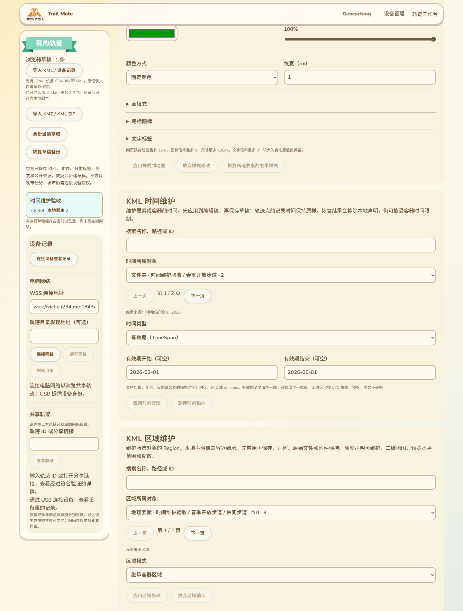
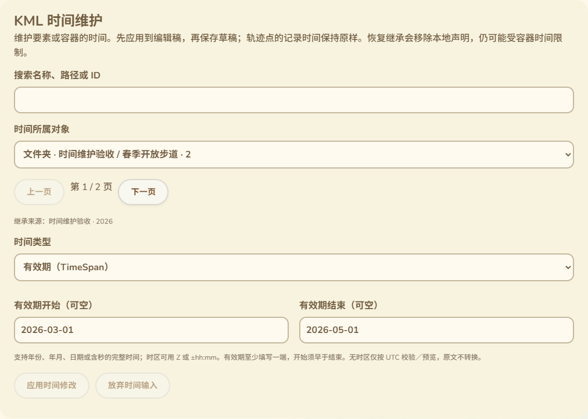

# KML 时间信息维护

2026-10-14，接86。上一批实现本地／共享地图时间筛选；本批让作者在现有轨迹工作台维护 KML 要素的 TimeStamp／TimeSpan。只改网页、测试和CI入口，不改固件，不增加设备RAM，没有SDK构建或刷入。完整交付范围继续以16为准。

## 页面位置与流程

时间维护卡片放在样式维护下方、KML内容维护上方，沿用现有页面配色、字体和控件。先选择时间所属对象，再选择“继承容器时间”“时刻／日期”或“有效期”。输入先应用到当前编辑稿，再用工作台保存；未应用输入会锁住保存、下载、撤销、地理要素、样式、图片叠加和附件编辑，退出保护沿用工作台现有流程。可以放弃输入，应用后的修改可以撤销。

所属对象支持Document、Folder、Placemark、GroundOverlay、NetworkLink、ScreenOverlay、PhotoOverlay和gx:Tour。这里只维护它们的时间声明，不代表网络链接访问、屏幕图片、照片叠加或Tour播放已经实现。对象按原XML要素顺序编号，显示类型、路径、名称；可搜索名称／路径／ID，每页50项，当前对象即使不在当前搜索页中也保留在选择器中。选择地理要素时与内容维护的选中对象同步；选择文件夹／文档后应用或保存不会强制跳回地理要素。

页面显示最近容器的继承来源和原值。移除本地声明恢复继承，因此不等同于“始终显示”。恢复继承要明确确认；若还会删除属性、注释或扩展内容，另列出删除内容供确认。取消任一确认都保持输入和原稿。

## 录入、比较与原文保留

支持年份、年月、日期和含秒完整时间，时区为Z或±hh:mm；有效期至少有一端，完整范围开始严格早于结束。无时区仅采用已声明的UTC校验／预览策略，不把存储原文转换成UTC。日期比较使用整数日历计算和完整小数秒，避免JavaScript Date的年份范围与毫秒截断使两个有效日期被误判相等；支持XML无零年与负年，实际地图预览仍受86中的浏览器时间范围／毫秒策略限制。

同类型编辑保留时间原语ID／属性、日期节点属性／CDATA／注释、未知扩展；其他样式、几何、记录点when、附件与原始导入稿不改。转换类型保留原语属性和共同基类扩展；旧类型专用子内容需要明确同意才能移除。完全相同的有效修改返回原始字节，不触发XML重写。

原语或被删除日期子树的ID若被其他XML节点targetId引用，禁止删除或转换；仍可修改原类型的日期值。重复时间原语、重复日期字段或日期包含元素子结构时拒绝猜测，保留原文供其他工具修复。新声明按Feature时间原语顺序插入，位于样式／容器子要素／叠加专用字段等之前；实际浏览器测试覆盖八种对象和命名空间前缀。

编辑产生新源后，时间预览恢复“全部时间”，避免旧筛选继续隐藏新日期；原记录点时间和回放仍保留。此编辑不连接设备、不签名、不发布；保存后的草稿仍须走既有设备作者授权和发布流程。

## 验证与边界

- 21项相关Node／原生日期测试退出0，包含3项新时间维护测试：小数秒／时区／超Date范围年份、负年、开放边界与严格次序、11语言文案；其余覆盖时间筛选、回放、高程和图片叠加。未进行SDK编译。
- 新实际Edge整页退出0：真实XML序列化与不变子树、精确原始字节无操作／撤销、CDATA／注释／属性、基类扩展、命名空间与八类对象顺序、七种拒绝操作、父容器继承和时间筛选重置。
- 实际表单覆盖11语言／390px／RTL、错误原输入保留、其他面板和保存／下载／退出互锁、删除范围确认取消与接受、开放有效期、对象搜索／分页与内容选择同步、被引用ID的界面错误。
- 实际IndexedDB保存并刷新重开，版本仅递增一次；原导入KML和图片附件字节保持，记录点when与其他内容保持。截图两张已打开检查。无设备或外部网络请求，不把此批等同实机／公网发布成功。
- 既有完整工作台、图片叠加编辑、样式编辑及本地／共享时间筛选浏览器回归均退出0。新增时间测试接入CI，尚未远端运行。
- 新测试先确定复现Document时间被追加到子要素之后，补齐具体Feature内容顺序后八种对象通过；整页首轮的等待误用了分页按钮，改为等待明确的应用按钮状态，未放宽保存／源保留断言。

Region、Balloon／ListStyle等其他高级KML交互，以及完整配置消费核对、真实设备Geocaching／轨迹发布链、公网目录、存储掉电／导航／峰值／跨板型验收仍保留。候选固件a29669a2…未刷入，已刷备份7c317f32…；约87K／297K仍是用户对已刷版本的反馈，不代表候选的运行测量。
