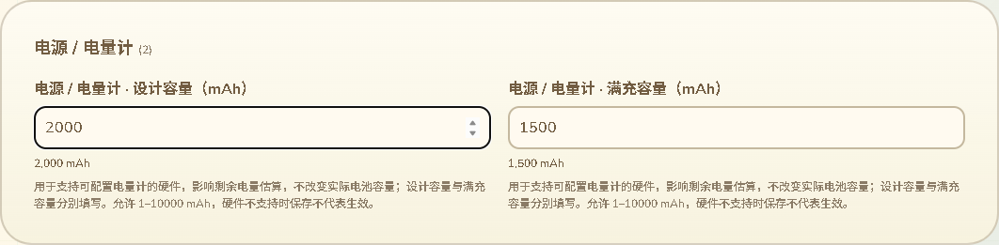
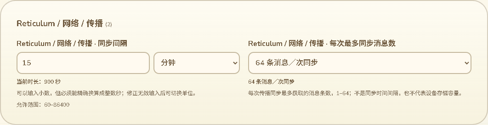

# 端口、容量与数量配置

2026-10-14，接85及87。继续解决普通数字字段的含义和录入问题，本批覆盖21个网络端口、两种电池容量、APRS呼号SSID后缀与传播同步消息数量，共25个字段。只改网页、测试和审计，没有固件源码、SDK构建或刷入，不增加设备RAM。不是全配置实际运行生效或整个三功能交付完成。

## 端口与网页联网的区别

端口维持整数输入，不设一套可能不符合目标服务的固定枚举；范围沿用已有1–65535校验。21个字段包括MT／MC MQTT端口、Reticulum兼容Wi-Fi网关端口及六个接口的TCP目标／Auto发现／Auto数据端口。字段和修改预览补充本地化“端口”表示；端口不加千位分组，便于直接辨认。

MQTT字段解释应与服务器监听端口一致，修改端口不会自动设置TLS或改变电脑网页的Reticulum连接。设备Wi-Fi网关端口与浏览器WSS地址区分；通用说明强调主机名不含端口、这里不是USB COM编号。六个接口继续保留84中的TCP／UDP发现与数据端口用途、接口类型显示和集合同步逻辑，不以通用TCP说明覆盖AutoInterface的含义。

## 容量与同步数量

两种容量分别表示设计容量与满充容量，维持精确整数输入1–10000 mAh；控件和修改预览显示mAh。解释用于支持可配置电量计的硬件，影响剩余电量估算，不改变电池的物理容量。保存成功不等于没有此功能的板型会应用该设置，不据此声称Wio L2电量计已生效。

生产依据：Arduino的[T-LoRa Pager容量应用](../../../../boards/tlora_pager/src/tlora_pager_board.cpp)、[IDF的P4容量应用](../../../../platform/esp/idf_common/src/platform_ui_device_runtime.cpp)、[完整设置扩展中的存储校验](../../../../platform/esp/arduino_common/src/app_config_tms_settings_extension.cpp)。它们证明这些设置有实际容量消费路径，不代表所有板型一致。

传播同步数量提供1／8／16／32／64条常用选项及自定义1–64；选项、当前值和修改预览都显示“消息／次同步”。说明与旁边的时间间隔不同，也不是设备存储容量。运行配置验证及LXMF同步结果消费使用此值，见[网络配置验证](../../../../platform/esp/arduino_common/src/platform_ui_reticulum_network_config_runtime.cpp)和[LXMF同步](../../../../platform/esp/arduino_common/src/chat/infra/lxmf/lxmf_adapter.cpp)。

## APRS呼号后缀

SSID显示为呼号后缀，区别于Wi-Fi的网络名称；0显示不加后缀，1–15为“-数字”选项。[AX.25官方规范3.12](https://tapr.org/pdf/AX25.2.2.pdf)定义SSID为四位整数。这里不添加传统SSID数字的用途推荐，也不把SSID当作网页作者身份。

设备完整编解码存储为u8，现有代码未在此处收紧到15。为了维护原配置，自定义仍保留0–255；大于15提示不符合AX.25范围，不悄悄截断。原生存储证明255可保留，不等于已经证明设备会正确发送该SSID；本批没有实机APRS发射验证。

## 验证状态

- 201项配置Node测试最终退出0，其中完整配置生产互操作16项。新75组值覆盖所有21端口的1／4242／65535、两容量的1／1500／10000、同步条数1／32／64和SSID0／15／255，经过实际C++校验、应用、Preferences保存与重新导出；类型、数值与其他字段一致。NVS和硬件使用桌面替身，没有重新编译SDK。
- 三项新单元测试覆盖精确字段／类型识别、未知字段不借用语义、全范围校验、可读修改预览、11语言和占位符。首轮测试样本缺少必需的schema／document头导致拒绝，补齐合法文档后通过。
- 广泛回归发现容量标题替换破坏已有本地化字段名称，改为保留现有名称，仅在没有字段翻译时使用专用后备标签；最终201项全部通过。
- 实际Edge完整整页退出0，新增容量错误输入跨语言保留、390px／RTL、SSID原值／超范围警告、同步自定义／边界、端口范围与可读预览，以及操作后恢复原值时零额外串口命令／零提交计数；原配置审批保存／备份恢复／作者验证／断线重连／真正刷新读回回归保持。此测试USB为合成串口，不当作Wio原生WebSerial或无线生效。
- 容量标题保留修正后重新构建，最终Edge展示范围回归退出0，覆盖新增25字段交互、11语言、390px／RTL和旧展示用例；没有重复执行未改变的整套保存测试。两张最终截图已重新生成并打开检查。
- 11语言SSID预期采用浏览器自身Intl格式核验；Node与Edge的阿拉伯数字默认表示不同，不用Node的格式假定浏览器必须显示同样数字。保留选项含义和实际值检查。
- 网页构建与语法检查通过；新Node由既有config通配入口、浏览器由既有device-page入口覆盖。CI未远端运行。

合成审计保持309设备记录／299网页记录，蓝牙字段排除与118模块描述保持；普通数字40→15，23个数字字段增加用途／单位表示，带自定义选择16→18。23包含21端口和两容量，另两项新增选择为SSID和同步数量。这些数量用于定位后续缺口，不是完成百分比；剩余15项涉及跳数、策略数量、兼容频道ID／编号和时区偏移，继续核对实际消费。

候选固件a29669a2…未刷入，已刷备份7c317f32…；此前约87K／297K运行内存反馈保持。本批没有真实设备写入，完整配置生效、实机发布恢复、公网目录、其他KML、存储掉电／导航／峰值／跨板型按16继续推进。
