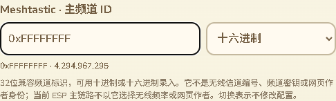
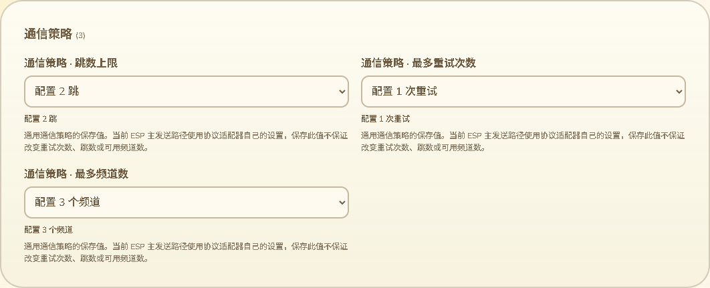

# 频道标识与路由配置录入

2026-10-14，接88。处理上一批审计剩余的15个普通数字字段：六个兼容频道ID、六个跳数／策略数量、两个兼容无线信道编号和时区分钟偏移。只改网页、测试与审计，不改固件，不构建SDK或刷入，不增加设备RAM。审计清单清空不代表全部配置实际消费和整个三功能交付已经完成。

## 频道ID的两种表示

MT、MC兼容配置和Reticulum兼容配置的主／副频道ID仍使用原u32，输入提供十进制／十六进制选择，同时显示两种表示。例如0xFFFFFFFF对应4294967295，最高位不是负数。十六进制最多八位，可有0x前缀；十进制不接受小数、科学记数法或千位分组。接受全角与阿拉伯／波斯数字的整数录入，错误输入保留供修正。

切换表示只改变输入形式，零配置修改／零USB命令；选择保存在浏览器会话按字段记忆。错误输入携带当前进制，切换分类／语言后保留；错误未修正时不能切进制。真实读回或备份使字段数值变化时按所选进制更新输入，不保留过期数值。

说明明确它是兼容频道标识，不是无线信道编号、频道密钥或网页作者身份。当前ESP主链路不以这个兼容ID选择无线频率或网页作者，不把维护该字段当作开通外部App连接。网页依旧排除所有约定蓝牙配置，作者仍使用设备Reticulum身份。

源码核对涵盖编解码、存储与直接成员使用。整数ID有完整保存／导出路径；实际ESP MQTT配置的同名string字段从频道名称取得，不是此u32；相关依据：[完整配置编解码](../../../../modules/core_sys/src/app/tms_config_codec.cpp)、[ESP持久化](../../../../platform/esp/arduino_common/src/app_config_store.cpp)、[MQTT频道名称绑定](../../../../platform/esp/arduino_common/src/chat/infra/mesh_mqtt_client_runtime.cpp)。保留兼容ID不代表证明所有板型都使用它。

## 跳数、重试和频道数量

六个u8字段增加可读常用选项与自定义原值，原0–255存储范围保持，不以常用选项缩窄备份兼容范围：

- 通用策略的跳数、最多重试与最多频道数分别显示单位。当前ESP主发送路径使用协议适配器自己的设置；保存通用字段不保证增加频道容量或改变实际重试／转发。这一轮没有给未消费字段增加固件行为。
- Meshtastic跳数常用0–7；0表示不增加转发跳数，不是停用无线。生产包头用低三位编码，原值大于7时显示编码结果。例如存储255而包头编码7，不把它表述成运行时钳制到7。
- MC兼容跳数和Reticulum兼容跳数继续保存，明确当前ESP主链路不以它们控制转发；MC实际洪泛上限是已在83维护的独立字段。

包头依据：[Meshtastic flags掩码](../../../../modules/core_chat/include/chat/infra/meshtastic/mt_packet_wire.h)、[生产包头编码](../../../../modules/core_chat/src/infra/meshtastic/mt_packet_wire.cpp)；实际发送使用[ESP Meshtastic适配器](../../../../platform/esp/arduino_common/src/chat/infra/meshtastic/mt_adapter.cpp)的config_.hop_limit。通用策略默认值和设备选项是[ChatPolicy](../../../../modules/core_chat/include/chat/domain/chat_policy.h)与设置界面的约定，不当作原生存储或无线能力上限。

## 兼容信道编号与时区

MC和Reticulum的兼容信道编号仍为u16整数，附用途及修改预览。当前ESP MC使用独立频率，Reticulum LoRa使用覆盖／默认频率，不按这些编号计算频率；MT编号的名称散列和正编号逻辑已经在85单独处理，不能套用给其他协议。

时区分钟输入沿用-720至840及现有城市／固定时区交互，新增UTC±hh:mm换算和保存分钟值。345显示UTC+05:45；负一分钟显示UTC-00:01。此表示是该保存值的换算，不声称城市时区会采用它。原说明继续强调分钟偏移仅用于固定UTC模式，城市时区由设备规则按日期计算，依据[设备时区实现](../../../../modules/core_sys/src/platform/ui/timezone_profile.cpp)。

## 验证状态与后续范围

- 205项配置Node最终退出0，其中完整生产配置互操作17项。本批新增77组：六ID四个边界值乘两种表示48组、六u8各三个边界18组、两个u16编号各三组6组、五种时区偏移。实际C++校验、应用、Preferences保存和重新导出的原类型／数值一致，其他字段不变；硬件与NVS仍是桌面替身，不等同实机RF生效。
- 三项新Node覆盖完整u32／最高位、1000组两进制往返、Unicode整数、非法输入／未知类型与字段不借用语义、原存储范围、UTC负值和可读修改预览、17项文案键的11语言完整性。
- 实际Edge完整整页退出0：两进制零编辑、错误进制与原输入跨分类／11语言、六ID最高位值、u8／u16边界、Meshtastic包头提示、时区换算、390px／RTL、回到原值后的零额外USB／零提交计数，以及原保存审批／备份恢复／作者验证／断线重连／真正刷新读回回归。USB为合成串口，不是本批Wio原生WebSerial验证。
- 首轮旧带宽语言测试在React完成切换前读到旧选项，新增等待当前语言自定义选项后保留原完整选项／说明断言；未放宽实际配置或保存断言。
- 网页构建、语法与差异检查通过，两张实际截图已经打开检查；新Node由既有config通配入口、浏览器由既有device-page入口覆盖，尚未远端运行CI。

合成审计：309设备记录／299网页记录，118模块描述及蓝牙排除保持；原普通数字15→0，六ID进制控件、26用途数值、24带自定义选择。这里证明清单中的数字有展示策略，不证明每个兼容字段在当前固件生效，更不能代表全配置或整项目100%。

最终端口枚举仍COM69；候选a29669a2…及已刷备份7c317f32…的SHA重新核对保持。此前87K／297K是已刷版本的用户反馈，本批无新的运行测量。真实Wio发布恢复及WebSerial、公网目录、其余KML、完整配置消费与存储掉电／导航／峰值／跨板型继续以16为准。
