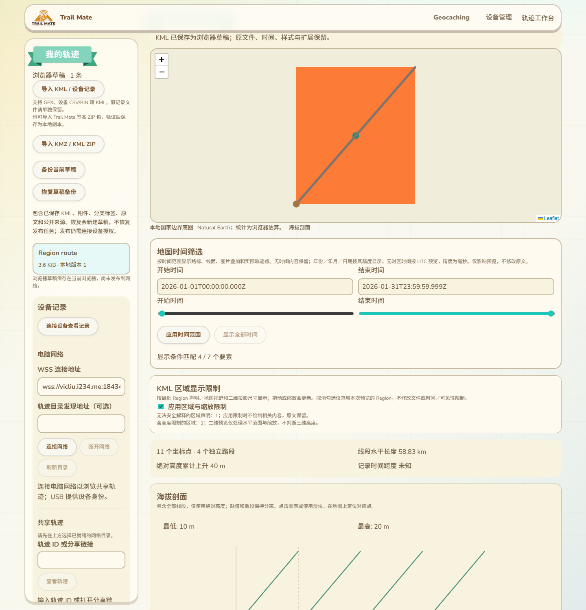
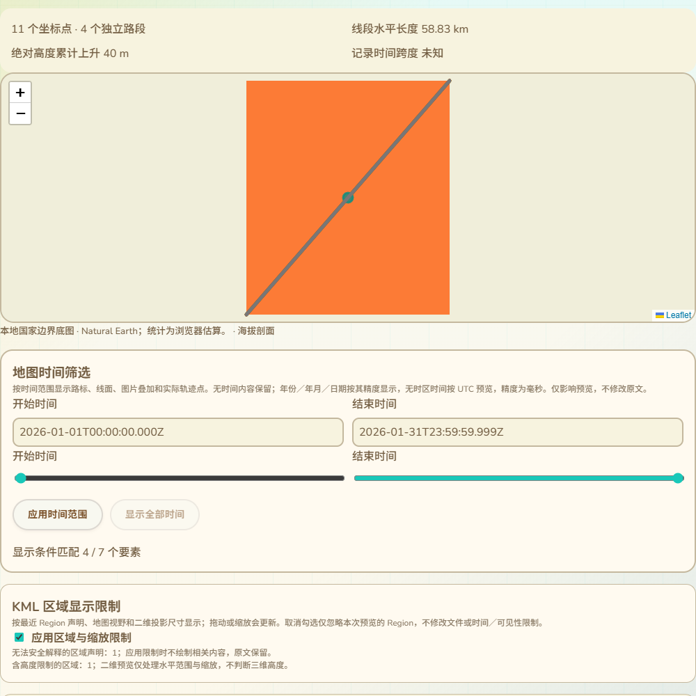

# KML 区域与缩放预览

2026-10-14，接87及89。现有本地工作台和共享轨迹预览加入Region的水平区域／LOD／淡入淡出计算，解决之前图片叠加“区域限制未处理”的缺口。本批只做显示行为；作者维护Region的编辑表单仍须实现，不能把本批称为全部Region维护或全部KML完成。网页、测试及CI改动，没有固件源码、SDK构建、刷入或设备RAM增加。

## 现有页面中的交互

区域限制面板放在地图和时间筛选下方，沿用现有浅色主题。默认应用文件中的区域及缩放限制；拖动、缩放和窗口尺寸变化会更新显示。取消勾选可检查被Region隐藏的原内容，仅影响本次预览，时间筛选和visibility仍生效，原文件、草稿版本和签名内容不变。

共享预览使用同一生产组件，图片是本机合成文件的组件场景，不代表公网目录或真实设备签名发布验收：

不支持解释的声明显示计数；默认启用限制时不绘制相关内容，取消可检查原内容。含三维高度、超墨卡托纬度或淡入淡出区间重叠时说明二维预览策略。没有Region的文件不显示空面板，也不注册区域变化重绘监听，避免给大文件每次拖图增加全量重绘。

## 继承、LOD与淡入淡出

使用最近Feature声明：文档／文件夹的Region供未声明的子要素使用，本地声明覆盖继承值；不把所有祖先范围相交。Region水平盒与视野相交、投影尺寸满足LOD时显示，尺寸采用二维墨卡托投影面积的平方根，以CSS像素计，不混用Canvas的高DPI内部像素。

maxLodPixels=-1表示没有最大尺寸限制；最小尺寸包含端点，最大尺寸不包含端点。淡入淡出叠乘原线／面／图片透明度，不覆盖原KML颜色alpha。原生路标图标采用大于0.5的阈值显示，统计数也按实际可绘制几何判断，避免图标未显示却计入显示数。完整原文统计、高程和回放仍保留；定位标记在所属要素被区域限制隐藏时不绘制。

规则依据：[Google Region范围和继承](https://developers.google.com/kml/documentation/regions)、[Region／Lod参考与淡入淡出](https://developers.google.com/kml/documentation/kmlreference#region)、[OGC参考中的投影面积平方根](https://docs.ogc.org/bp/07-039r1/07-039r1.pdf)、[OGC KML规范](https://portal.ogc.org/files/12-007r2)。地图使用二维投影，不提供三维视锥／地形高度判断；高度原文保留并提示，不能把二维结果当作Google Earth三维结果一致。

## 日期线、首屏与资源

跨日期线区域用短范围展开，依据当前地图世界副本计算相交，轨迹和图片跟随相同副本。179到-179的线在-180附近仍显示为两度，而不是跨地图连接358度。无区域的原地图行为保持。

首次打开含Region的文件先以原内容定位，避免初始视野的限制将全部内容隐藏后无法定位；随后应用当前视野／LOD，不因筛选、语言、预览开关或拖动重新自动缩放。时间面板的显示数结合区域和时间条件；忽略Region仍保留时间与可见性限制。

图片使用既有本地附件、颜色叠加和解码预算；没有访问外部NetworkLink或图片地址，也没有以Region激活触发远程加载。资源、坐标及XML不会写回，所用模块没有增加设备存储或RAM缓冲。

## 验证记录

- 25项相关Node／原生日期测试退出0，含4项新区域测试：有限值／范围／LOD、视野／世界副本／日期线、精确边界及淡入淡出、原样式alpha保留、图标阈值／高程段归属、11语言。原时间维护／筛选、回放、高程和叠加测试保持。
- 新实际Edge本地整页与共享生产组件退出0：父区域在视野外而子区域覆盖有效、地图移动／缩放／resize、线和图片的淡入淡出、路标阈值、非法／高度声明提示、时间与区域组合计数、预览开关不改变视野、11语言390px／RTL、原XML及实际IndexedDB版本保持。
- 实际Leaflet图层检查验证红线透明度和两点保留、图片原alpha叠乘；高程定位点先实际出现，拖出Region后实际隐藏；跨日期线负世界副本绘制两度线，拖到0度视野后隐藏。resize安排延迟moveend后立即关闭共享组件，等待事件仍无错误。
- 原完整工作台、时间筛选、图片叠加、样式编辑和时间维护浏览器回归均退出0。相关页面构建、语法、差异和两张实际截图已检查；CI增加区域测试，尚未远端运行。
- 最终截图发现Leaflet图层越过地图范围盖住顶部导航，地图增加独立层叠范围；实际elementFromPoint验证顶部设备管理链接不再被地图截获，区域与图片浏览器回归通过。显示数文案在11语言中改为“显示条件匹配”，避免组合区域／时间后仍写成纯时间匹配；最终8项相关Node及区域／时间整页复测退出0，属于上述25项的子集，不相加。
- 测试首先把观测脚本放在根路径，导致生产语言运行时相对路径不匹配；改为正式tracks/dist目录，并在App启动前注册同一Leaflet实例观察器。修正setView返回整个地图对象导致序列化失败，保持实际地图／图层断言。投影独立计算的浮点微差使用1e-12容差，仅用于透明度比较，LOD端点／几何／源保留检查仍保留。最终没有改变生产缩放步长来制造测试结果。

Region编辑表单、Balloon／ListStyle等其他KML维护、真实Wio发布恢复／WebSerial、公网目录、完整配置消费与SD故障掉电／导航／峰值／跨板型仍按16推进。最终COM69，候选a29669a2…／已刷备份7c317f32…的SHA保持；87K／297K仍是已刷版本此前用户反馈，本批没有新设备运行测量。
